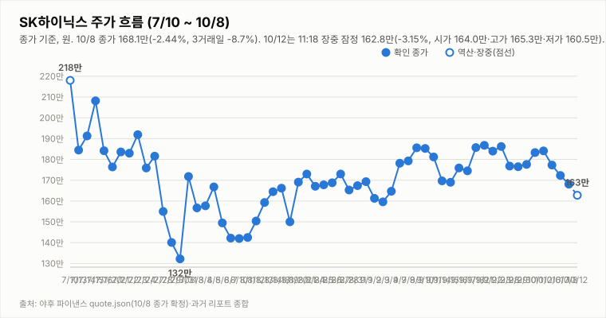
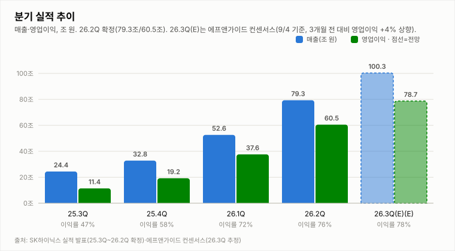

# SK하이닉스 투자 리포트 — 2026-10-12 (월) 아침 (연휴 후 첫 거래일, 장 초반 지연 시세)

> **작성** 2026-10-12 09:30 KST · **판정: 중립 유지** (10/8 종가 기준) · 현재가·시가는 트레이딩뷰 KRX 피드 09:21 갱신 표기의 20분 지연 시세이며 개장 직후라 장중 갱신에서 바뀝니다. 10/8 종가 168.1만은 `quote.json`(marketTime 15:30 KST)으로 확정했습니다. 판정은 종가 기준으로만 변경합니다.

> **종목** SK하이닉스 (KRX 000660 · NASDAQ 상장 7/10)
> 본 자료는 정보 제공 목적이며 투자 권유가 아닙니다.

## 핵심 요약

- **투자의견: 중립 유지** — 10/8 종가 기준 판정(매수→중립)을 그대로 유지합니다. 방향성 4요소는 긍정 2(②④)·중립 1(③)·부정 1(①)이며, 오늘 장중에는 판정을 바꾸지 않고 15:30 확정 종가에서 유지 규칙 표로만 점검합니다.
- **개장 직후(09:21 지연 시세) 164.8만(-1.99%)** — 시가 164.0만·고가 164.9만·저가 164.0만으로 10/8 종가(168.1만) 대비 -2.44% 갭하락 출발 후 소폭 회복했습니다. 거래량 15.8만주의 개장 직후 값이라 추세 판단은 이릅니다. 삼성전자 25.95만(-0.95%), 코스피200 12월물 주간 선물 1,039.80(-0.81%, 09:00)입니다.
- **외부 변수**: 10/9 미국장은 나스닥 +0.64%·S&P500 +0.59%로 강했으나 SOX -0.41%·마이크론 -0.66%·엔비디아 -0.52%·SK하이닉스 ADR 169.03달러(-0.86%)로 반도체는 약했고, EWY +0.54%·원/달러 1,338원대(-0.11%)입니다. 연휴 중 반도체 약세가 갭하락에 반영됐을 가능성이 있으나 원인은 단정하지 않습니다. 야간선물(KRX:K2I1!)은 연휴로 신규 야간 세션이 없어 확인 불가입니다.
- **뉴스**: 헤드라인 기준 메리츠증권이 3Q 영업이익 80조원 서프라이즈를 전망하며 목표주가를 320만원으로 상향했다는 보도(조선비즈·연합인포맥스·매일경제, 10/12)가 나왔습니다.
- **지표(10/8 종가 확정, 야후)**: DMI 격차 -7.9, KDJ K 17.3·D 32.4(격차 -15.1, 과매도 구간), MACD 히스토그램 -1.31만(시그널 하회). 3Q26 실적 발표(10/27)까지 **D-15**입니다.

## 시세

**전일 확정 — 10/8 (목) 15:30 마감** (출처: 야후 quote.json, marketTime 15:30 KST)

| 시가 | 고가 | 저가 | 종가 | 등락 | 거래량 |
|---|---|---|---|---|---|
| ₩1,722,000 | ₩1,759,000 | ₩1,681,000 | **₩1,681,000** | **-2.44%** | 3,203,231주 |

전일(10/7) 확정 종가 1,723,000원 대비 -42,000원입니다. 마감 리포트의 트레이딩뷰 거래량(301.9만주)은 `quote.json` 확정치(320.3만주)로 교체합니다.

**오늘 진행 중 — 10/12 (월) 09:21 지연 시세 (확정 아님)** (출처: 트레이딩뷰 KRX 피드, 20분 지연)

| 시가 | 고가 | 저가 | 현재가 | 등락 | 거래량 |
|---|---|---|---|---|---|
| ₩1,640,000 | ₩1,649,000 | ₩1,640,000 | ₩1,647,500 | -1.99% | 157,962주 |

## 기술적 지표 (10/8 종가 확정 기준, 야후)

| 지표 | 값 | 해석 |
|---|---|---|
| MACD (12,26,9) | +0.71만 / 시그널 +2.01만 / 히스토그램 -1.31만 | 하락 모멘텀 확대 |
| ATR (14) | 8.47만 (5.0%) | 변동성 매우 큼 |
| ADX / DMI | ADX 9.6 · +DI 24.1 · -DI 32.0 | 추세 강도 매우 약함, 격차 -7.9(-DI 우위) |
| KDJ (9,3,3) | K 17.3 · D 32.4 · J -13.1 | 과매도 구간, K<D 하락 우위(-15.1) |
| 거래량 / 20일 이평 | 320.3만 / 318.0만 | 평균의 1.01배 |

종가 기준 격차 흐름: DMI 9/29 +1.6 → 9/30 +4.3 → 10/1 +2.2 → 10/2 +3.9 → 10/6 -0.8 → 10/7 -4.7 → 10/8 -7.9, KDJ 9/29 -8.4 → 9/30 -8.9 → 10/1 -5.2 → 10/2 -2.2 → 10/6 -8.2 → 10/7 -14.1 → 10/8 -15.1 (10/8은 마감 리포트의 15:14 집계 -7.1·-14.4에서 종가 확정으로 갱신).

## 최신 뉴스 Top 5 (구글 뉴스 헤드라인 기준)

1. 🟢 **메리츠證 "SK하이닉스, 3분기 영업이익 80조원 서프라이즈 전망…목표가 320만원↑"** (조선비즈, 10/12) · "하이닉스 목표가 320만원 등장"(매일경제), "3분기 영업익만 80조… 출하량·판가 복원 본격화"(연합인포맥스) — 자동 분류는 ⚪이나 내용상 호재성
2. 🟢 **SK하이닉스도 최대 실적 예고…AI 메모리 호황 지속** (뉴스토마토, 10/11)
3. ⚪ **'아픈손가락' 솔리다임, SK하이닉스 美전략 핵심될까** (머니투데이, 10/12)
4. ⚪ **삼성·SK하이닉스, LTA로 깬다…'2년 주기' 메모리 덫** (리드경제, 10/11)
5. 🟢 **2030년엔 로봇용 D램 20배 증가 전망…삼성전자 SK하이닉스 '호재'** (국제신문, 10/11)

※ 뉴스는 헤드라인 기준이며 본문 수치는 별도 검증하지 않았습니다.

## 실적 · 밸류에이션

2Q26 확정 매출 79.3조·영업이익 60.5조(영업이익률 76%), 3Q26 컨센서스는 매출 100.3조·영업이익 78.7조(에프앤가이드, 9/4 기준)입니다. 헤드라인 기준 메리츠증권은 10/12 3Q 영업이익 80조원을 전망했습니다. 3Q26 실적 발표는 10/27입니다.

컨센서스 목표주가 322만원은 10/8 종가(168.1만) 대비 **+91.5%** 괴리입니다(개장 직후 164.75만 기준 +95.4%). 메리츠 320만원(10/12 상향), 유진 370만원(10/8), IBK 400만원 유지가 거론됐고 DS투자증권은 264만원(9/29 하향)입니다.

## 투자 판단

**의견: 중립 (유지) — 10/8 종가 기준 판정을 유지하며 오늘 장중에는 변경하지 않습니다 (판정은 종가 기준으로만 변경합니다)**

| 요소 | 방향 | 근거 |
|---|---|---|
| ① 추세/모멘텀 | 부정(약화) | 종가 기준 3거래일 연속 하락, 오늘 갭하락 출발. MACD 시그널 하회(-1.31만)·DMI -DI 우위(-7.9)·KDJ 격차 -15.1(과매도 구간) |
| ② 밸류에이션 갭 | 긍정 | 컨센서스 322만 대비 10/8 종가 168.1만 — +91.5% |
| ③ 촉매 | 중립 | 우호(메리츠 3Q 영업익 80조 전망·목표가 320만, 최대 실적 예고, 로봇용 D램 전망)와 경계(ADR 락업 해제·38% 프리미엄 매물 우려, 솔리다임 주주가치 논란, 외국인 매도)가 상쇄. 호재에도 갭하락 출발 |
| ④ 산업 사이클 | 긍정 | HBM4 공급가 급등, 메모리 공급부족 구조, 3Q 이익 전망 상향 |

**종합: 긍정 2·중립 1·부정 1 → 중립 유지.** 판정 규칙의 표는 종가마다 한 번만 적용하므로 오늘 아침에는 현재 판정만 언급하고, 변경 여부는 15:30 확정 종가에서 점검합니다. 매수 복귀는 긍정 3개 이상·부정 0개(①이 중립 이상으로 개선되고 ③이 긍정 복귀)가 필요하고, 매도 전환은 부정 3개 이상·긍정 0개입니다.

## 오늘(10/12) 전망 — 한글날 연휴 후 첫 거래일

| 항목 | 내용 |
|---|---|
| 지지선 | 164.0만(오늘 시가·장중 저가, 09:21 지연 시세) — 하회 시 뚜렷한 지지 레벨 확인 불가(참고: 10/8 종가-ATR 159.6만) |
| 저항선 | 168.1만(10/8 종가·갭 메우기) · 172.2만(10/8 시가)·172.3만(10/7 종가) · 175.9만(10/8 고가) · 177.6만(9/30 종가) |
| 예상 등락 레인지(참고용) | 10/8 종가 ± ATR(8.47만) 기준 159.6만 ~ 176.6만 |
| 예정 이벤트 | 3Q26 실적 발표 10/27(D-15) · 메리츠 3Q 영업익 80조 전망 이후 실적 눈높이 · ADR 락업 해제·솔리다임 IPO 보도 · 외국인 수급 · 원/달러 · 연휴 중 미국 반도체(SOX -0.41%·ADR -0.86%) |
| 관찰 포인트 | 갭하락(164.0만) 회복 여부와 168.1만 종가 회복, 종가 기준 DMI·MACD·KDJ(과매도 반등) 방향, 외국인·기관 수급, SOX 흐름 |
| 상방 시나리오 | KDJ 과매도 구간이라 기술적 반등 가능. 168만대 회복과 함께 종가 기준 DMI 재역전·③ 긍정 복귀가 확인돼야 매수 복귀 논의 가능 |
| 하방 시나리오 | 164.0만 이탈 시 추가 약세·변동성 확대 가능. 부정이 3개 이상·긍정 0개가 되면 매도 전환 조건 점검 |
| 야간선물 | 확인 불가 — 10/9 휴장으로 신규 야간 세션이 없어 인용하지 않음. 참고: 주간 선물(코스피200 12월물) 09:00 1,039.80(-0.81%, 10/8 종가 1,048.25 대비) |

확률적 관점일 뿐 가격 예측이 아닙니다.

---

*본 자료는 공개 보도·자료를 종합해 작성한 정보 제공 목적의 리포트이며 투자 판단과 책임은 투자자 본인에게 있습니다.*
