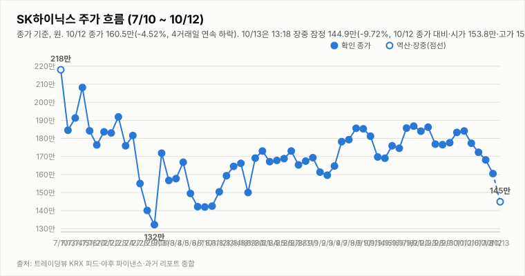
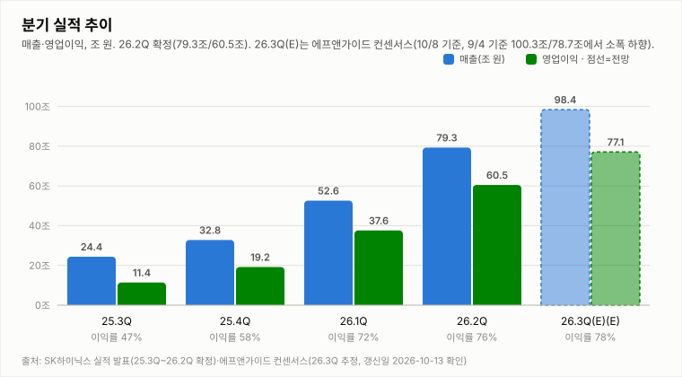
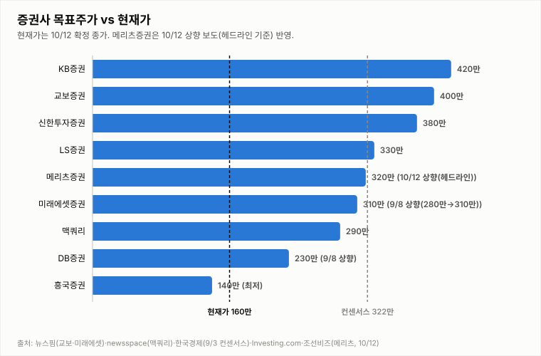
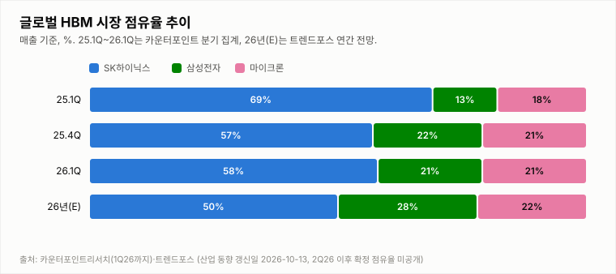

# SK하이닉스 투자 리포트 — 2026-10-13 (화) 장중 업데이트 (10:38, 10:19 지연 시세)

> **작성** 2026-10-13 10:38 KST · **판정: 중립 유지** (10/12 종가 기준) · 전일 종가 160.5만(-4.52%)은 `quote.json`(marketTime 10/12 15:30 KST)으로 확정. 오늘 값은 야후 `quote.json` 20분 지연 시세(10:19)이며, 수집 로직 보강(누락된 10/12 봉 복원·트레이딩뷰 전일 종가 교차검증)으로 등락률이 10/12 확정 종가 기준으로 정상 산출됩니다(오전에는 전일 종가가 10/8 값으로 잡혀 -10.29%로 표시됐음). 판정은 종가 기준으로만 변경합니다.

> **종목** SK하이닉스 (KRX 000660 · NASDAQ 상장 7/10)
> 본 자료는 정보 제공 목적이며 투자 권유가 아닙니다.

## 핵심 요약

- **투자의견: 중립 유지** — 10/12 종가 기준 판정(중립)을 그대로 유지합니다. 4요소는 긍정 2(②④)·중립 1(③)·부정 1(①)이며, 오늘 장중에는 판정을 바꾸지 않고 15:30 확정 종가에서 유지 규칙 표로만 점검합니다.
- **전일(10/12) 확정 종가 160.5만(-4.52%)** — 시가 164.0만·고가 165.3만·저가 160.5만, 거래량 303.9만주(트레이딩뷰 최종, 20일 평균의 0.96배). 종가가 일중 저가와 같았고 4거래일 연속 하락(10/2 종가 184.1만 대비 -12.8%)입니다.
- **오늘 장중(야후 지연 시세, 10:19)**: 시가 153.8만(10/12 종가 대비 -4.17% 갭다운)·고가 155.4만·저가 147.0만, 현재 147.2만(**-8.29%**, -13.3만원), 거래량 159.7만주(20일 평균의 0.52배). 10/2 종가(184.1만) 대비 -20.0%이며 지난 지지 참고선(종가-ATR 151.7만)을 하회했습니다. 헤드라인 기준 주간동아 "‘중국발 반도체 쇼크’로 SK하이닉스 8%대, 삼성전자 6%대 급락… 매도 사이드카 발동", 뉴스1 "‘CXMT의 추격’ 반도체 투심 위축", 뉴데일리 "2182조 사라진 코스피, 69%는 ‘반도체 투톱’"이 나왔으나 인과관계는 단정하지 않습니다.
- **외부 변수**: 10/12 미국장은 SOX -2.67%·마이크론 -3.88%·엔비디아 -1.29%로 반도체가 약했고 나스닥 -0.44%·S&P500 -0.06%였습니다. SK하이닉스 ADR 162.23달러(-4.02%)·EWY -4.02%에는 10/12 한국장 낙폭이 이미 반영된 부분이 있을 수 있어 추가 하락 신호로 단정하지 않습니다. 원/달러는 1,334.93원(+0.06%)입니다. 야간선물(KRX:K2I1!)은 987.6으로 주간 종가(1,008.25) 대비 -2.05%이며 updateTimeKST 10-13 06:00(08:07 수집분, 20분 지연)입니다.
- **지표(10/13 10:19 잠정, 복원한 10/12 봉 포함·종가 미확정)**: DMI 격차 -23.4(+DI 20.0 < -DI 43.4), KDJ K 7.8·D 19.6(격차 -11.8, 과매도 구간), MACD 히스토그램 -3.40만(시그널 하회). 10/12 15:14 집계는 DMI -13.9·KDJ -13.3·히스토그램 -2.09만이었습니다. 3Q26 실적 발표(10/27)까지 **D-14**, 10/14(수) 반도체대전 개막입니다.

## 시세

**전일 확정 — 10/12 (월) 15:30 마감** (출처: 트레이딩뷰 KRX 피드, quote.json marketTime 15:30 KST 확정)

| 시가 | 고가 | 저가 | 종가 | 등락 | 거래량 |
|---|---|---|---|---|---|
| ₩1,640,000 | ₩1,653,000 | ₩1,605,000 | **₩1,605,000** | **-4.52%** | 3,038,563주 |

10/8 확정 종가 1,681,000원 대비 -76,000원입니다. 마감 리포트의 15:52 시점 거래량(2,935,230주)은 트레이딩뷰 최종값으로 갱신했습니다.

**오늘 10/13 (화) — 장중 (10:19 지연 시세, 확정 아님)** (출처: 야후 파이낸스 quote.json, 20분 지연)

| 시가 | 고가 | 저가 | 현재가 | 등락(10/12 종가 대비) | 거래량 |
|---|---|---|---|---|---|
| ₩1,538,000 | ₩1,554,000 | ₩1,470,000 | ₩1,472,000 | -8.29% | 1,596,914주 |

## 기술적 지표 (10/13 10:19 야후 지연 시세 기준, 복원한 10/12 봉 포함·종가 미확정)

| 지표 | 값 | 해석 |
|---|---|---|
| MACD (12,26,9) | -2.77만 / 시그널 +0.63만 / 히스토그램 -3.40만 | 하락 모멘텀 확대 |
| ATR (14) | 8.77만 (6.0%) | 변동성 매우 큼 |
| ADX / DMI | ADX 12.5 · +DI 20.0 · -DI 43.4 | 추세 강도 약함, 격차 -23.4(-DI 우위) |
| KDJ (9,3,3) | K 7.8 · D 19.6 · J -15.6 | 과매도 구간, K<D 하락 우위(-11.8) |
| 거래량 / 20일 이평 | 159.7만 / 307.0만 | 평균의 0.52배(장중 누적, 장 마감까지 증가) |

## 최신 뉴스 Top 5 (구글 뉴스 헤드라인 기준)

1. 🔴 **‘중국발 반도체 쇼크’로 SK하이닉스 8%대, 삼성전자 6%대 급락… 매도 사이드카 발동** (주간동아, 10/13) · "‘CXMT의 추격’ 반도체 투심 위축…삼성전자 4%, SK하이닉스 5% 급락[핫종목]"(뉴스1) · "[특징주] 삼성전자·SK하이닉스, 중국발 기술 추격 우려.. ‘약세’"(글로벌이코노믹) · "2182조 사라진 코스피, 69%는 ‘반도체 투톱’"(뉴데일리)
2. 🟢 **"SK하이닉스 올해 실적 전망치 상향조정"** — 하나증권 (머니투데이, 10/13) · "내년 영업익 405조"(조세일보) 등 보도는 올해·내년 표기가 엇갈려 수치는 인용하지 않음 · [리포트 브리핑] 목표가 360만원 "컨센서스에 부합"(뉴스핌)
3. ⚪ **삼성·SK하이닉스, 美 50억달러 연구동맹…차세대 반도체 공동 개발** (뉴스핌, 10/13)
4. 🟢 **환율 부담에도 버틴 D램…"SK하이닉스, 3분기 실적 기대치 부합할 것"** (매일경제, 10/13)
5. ⚪ **SK하이닉스는 잡음 끊이지 않는 '솔리다임 상장' 왜 밀어붙일까** (인베스트조선, 10/13) · 이익률 80% 넘보는 K-메모리(비즈워치)

※ 뉴스는 헤드라인 기준이며 본문 수치는 별도 검증하지 않았습니다.

## 실적 · 밸류에이션

2Q26 확정 매출 79.3조·영업이익 60.5조(영업이익률 76%), 3Q26 컨센서스는 매출 100.3조·영업이익 78.7조(에프앤가이드, 9/4 기준)입니다. 3Q26 실적 발표는 10/27입니다.

컨센서스 목표주가 322만원은 10/12 종가(160.5만) 대비 **+100.6%** 괴리입니다(10:19 지연 시세 147.2만 기준 +118.8%). 하나증권 360만원 "컨센서스 부합"(10/13), 메리츠 320만원(10/12 상향), SK증권 400만원(10/12), 유진 370만원(10/8), IBK 400만원 유지가 거론됐고 DS투자증권은 264만원(9/29 하향)입니다.

## 산업 동향 — HBM·DRAM·NAND (갱신일 2026-10-13)

> 직전 갱신: 2026-07 조사분. 수치는 TrendForce 9/30 발표·산업통상부 10/1 발표·국내 언론 헤드라인 기준이며 차트의 점유율은 카운터포인트 1Q26(매출 기준)·트렌드포스 연간 전망입니다. 2Q26 이후 확정 점유율은 확인 불가.

**HBM / DRAM**

- **4Q26 범용 D램 계약가 +10~15%(QoQ)** — TrendForce 전망. 3Q26 전망(+13~18%)보다 둔화됐지만 AI 서버 수요와 첨단 공정 캐파 우선 배정으로 상승 기조는 유지.
- **2027년 HBM 가격 협상** — 헤드라인 기준 TrendForce는 내년 HBM 평균판매가 약 +121%를 전망(주체가 TrendForce 전망인지 마이크론 계약 기준인지 보도마다 엇갈림). 삼성전자는 HBM4 연간 공급가를 높게 제시했다는 보도가 있고, SK하이닉스는 2027년 물량·가격 협상 중으로 최종 내용은 확인 불가.
- **HBM 점유율** — 카운터포인트 1Q26 SK하이닉스 58%·삼성전자 21%·마이크론 21%, 트렌드포스 2026년 연간 50%·28%·22% 전망. 마이크론은 HBM4 10억달러 이상 출하·연말 점유율 20%대 목표, 삼성전자도 HBM4 양산 약 4개월 만에 누적 매출 10억달러 보도.
- **중국 CXMT 추격** — 10/9~10 콘퍼런스에서 4F² 셀 구조 DDR5 서버용 D램(RDIMM) 연내 출시를 예고(구체 사양·양산 일정 미공개, 우려와 과장 분석이 엇갈림). HBM이 아닌 범용 D램 기술이며 10/12~10/13 메모리주 급락의 계기로 거론됐으나 인과관계는 단정하지 않음.
- **수출** — 9월 반도체 수출 603억달러(+262.8%), 단일 품목 최초 600억달러 돌파(산업통상부 10/1).

**NAND**

- **4Q26 NAND 계약가 +15~20%(QoQ)** — 3Q26 전망(+18~23%)보다 둔화. eSSD 상승폭이 가장 크고 한 보도는 +23~28%를 전함(단일 보도 기준). eSSD 비트 수요는 전년 대비 80% 이상 증가 전망.
- **소비자 부문 부담** — PC·스마트폰은 원가 부담으로 SSD 용량을 줄이는 방식으로 대응 중. 솔리다임 상장 관련 주주가치 논란도 지속.

**해석**: 가격 상승률은 둔화(D램 +13~18%→+10~15%, 낸드 +18~23%→+15~20%)했지만 방향은 상승이고 HBM 2027년 가격 협상이 진행 중이라 요소 ④ 산업 사이클은 긍정 유지입니다. 상승률 둔화와 CXMT 추격은 업황 고점 논쟁을 키울 수 있어 10월 수출·4Q 계약가 실측·HBM4 협상 결과를 점검합니다.

## 투자 판단

**의견: 중립 (유지) — 10/12 종가 기준 판정 유지, 오늘 장중에는 변경하지 않습니다 (판정은 종가 기준으로만 변경합니다)**

| 요소 | 방향 | 근거 |
|---|---|---|
| ① 추세/모멘텀 | 부정(약화) | 종가 기준 4거래일 연속 하락·10/12 종가 일중 저가 마감(-4.52%), 오늘 갭다운 후 낙폭 확대(10:19 -8.29%). 10/13 10:19 잠정 MACD 시그널 하회(히스토그램 -3.40만)·DMI -DI 우위(-23.4)·KDJ 격차 -11.8(과매도 구간, 종가 미확정) |
| ② 밸류에이션 갭 | 긍정 | 컨센서스 322만 대비 10/12 종가 160.5만 — +100.6% |
| ③ 촉매 | 중립 | 우호(하나증권 실적 전망치 상향, 메리츠 3Q 영업익 80조 전망, SK증권 400만 등)와 경계("중국발 반도체 쇼크"·매도 사이드카 발동 보도, CXMT 추격으로 투심 위축, 중국발 기술 추격 우려·美 반도체주 약세 특징주 보도, 10/12 미국 반도체 약세, CXMT 차세대 D램 개발 진전 보도, ADR 락업 해제·솔리다임 주주가치 논란)가 상쇄. 호재에도 일중 저가 마감(호재 둔감) |
| ④ 산업 사이클 | 긍정 | HBM4 공급가 급등, 메모리 공급부족 구조, 3Q 이익 전망 상향 |

**종합: 긍정 2·중립 1·부정 1 → 중립 유지.** 오늘 장중에는 10/12 종가 기준 판정만 언급하고, 변경 여부는 15:30 확정 종가에서 점검합니다. 매수 복귀는 긍정 3개 이상·부정 0개(①이 중립 이상으로 개선되고 ③이 긍정 복귀)가 필요하고, 매도 전환은 부정 3개 이상·긍정 0개입니다(②④가 긍정인 현재는 해당 없음).

## 오늘(10/13, 화) 전망 — 갭다운 후 낙폭 확대

| 항목 | 내용 |
|---|---|
| 지지선 | 147.0만(오늘 장중 저가, 10:19 지연) — 10/12 종가-ATR 참고선(151.7만)은 이미 하회, 그 아래는 뚜렷한 지지 레벨 확인 불가 |
| 저항선 | 153.8만(오늘 시가) · 155.4만(오늘 고가) · 160.5만(10/12 종가·갭 메우기) · 164.0만(10/12 시가) · 168.1만(10/8 종가) |
| 예상 등락 레인지(참고용) | 10/12 종가 ± ATR 8.77만 = 151.7만 ~ 169.3만(하단 이미 이탈, 장중 잠정 ATR이라 확정 후 변동 가능) |
| 예정 이벤트 | 3Q26 실적 발표 10/27(D-14) · 10/14(수) 반도체대전 개막 · 간밤 미국 반도체 약세(SOX -2.67%·마이크론 -3.88%) 후속 · 솔리다임 상장 전 투자 유치·ADR 락업 해제 보도 · 외국인 수급 · 원/달러(1,335원대) |
| 관찰 포인트 | 147.0만 지지 여부, 153.8만(시가)·160.5만(전일 종가) 회복 여부, 매도 사이드카 이후 변동성 진정 여부, 외국인·기관 수급, 미국 반도체(SOX)·ADR, 中 기술 추격(CXMT) 보도 후속 |
| 상방 시나리오 | 급락 후 과매도 반등 가능. 160만대(전일 종가) 회복은 갭 메움이며, ①개선·③ 긍정 복귀가 종가 기준으로 확인돼야 매수 복귀 논의 가능 |
| 하방 시나리오 | 147.0만 이탈 시 추가 약세·변동성 확대 가능. 종가에서 ③이 부정으로 바뀌어도 ②④가 긍정이면 매도 전환 조건(부정 3개 이상·긍정 0개)은 충족되지 않음 |
| 야간선물 | 987.6(주간 종가 1,008.25 대비 -2.05%, updateTimeKST 10-13 06:00·20분 지연). 주간 선물(12월물) 개장 직전 975.60(-3.24%, 08:58) |

갭다운으로 출발한 뒤 낙폭이 -8%대로 확대됐고 헤드라인 기준 삼성전자도 6%대 급락, 매도 사이드카까지 발동돼 개별 이슈보다 업종·시장 전반 약세로 보입니다(단정하지 않음). 오늘 판정은 변경하지 않고 15:30 종가에서 유지 규칙 표로만 점검합니다. 확률적 관점일 뿐 가격 예측이 아닙니다.

---

*본 자료는 공개 보도·자료를 종합해 작성한 정보 제공 목적의 리포트이며 투자 판단과 책임은 투자자 본인에게 있습니다.*
