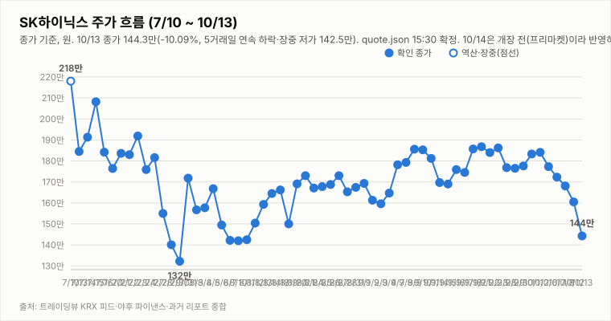
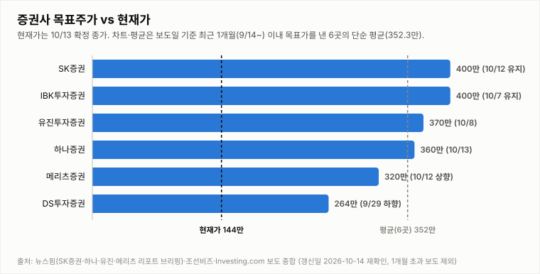

# SK하이닉스 투자 리포트 — 2026-10-14 (수) 아침 리포트 (전일 종가 확정 + 프리마켓)

> **작성** 2026-10-14 09:35 KST · **확정 판정: 중립 유지** (10/13 종가 기준, 긍정 2·부정 2) · 전일 종가 144.3만원(-10.09%)은 `quote.json`(marketTime 10/13 15:30 KST)으로 확정이며 트레이딩뷰 종가와 일치합니다. 프리마켓은 `night.yml` 스냅샷과 `updateTimeKST` 기준이고 개장 후 시세는 반영하지 않았습니다. 확정 판정은 종가 기준으로만 변경하며, 장중에는 같은 유지 규칙 표를 적용한 장중 판정(잠정)을 병기합니다.

> **종목** SK하이닉스 (KRX 000660 · NASDAQ 상장 7/10)
> 본 자료는 정보 제공 목적이며 투자 권유가 아닙니다.

## 핵심 요약

- **투자의견: 확정 판정 중립 유지** — 직전 확정 판정(10/13 종가 기준, 긍정 2·부정 2)을 그대로 인용합니다. 4요소는 ①부정·②긍정·③부정·④긍정이며 중립 상태의 진입 조건(매수 = 긍정 3개 이상·부정 0개, 매도 = 부정 3개 이상·긍정 0개)은 모두 미충족입니다. 아침 리포트에서는 표를 새로 적용하지 않고, 오늘 장중 업데이트(09:30~14:30)부터 같은 표로 장중 판정(잠정)을 병기하며 15:30 종가에서 확정합니다.
- **전일(10/13) 확정 종가 144.3만(-10.09%)** — 시가 153.8만·고가 155.4만·저가 142.5만, 거래량 586.7만주(20일 평균의 1.91배). 장중 한때 -11.2%(142.5만)까지 내려 -10%대 하락을 기록했고 5거래일 연속 하락으로 10/2 종가(184.1만) 대비 -21.6%입니다. 헤드라인 기준 코스피는 5.46% 하락한 6,035로 마감했고(자본시장뉴스), 삼성전자는 23.2만(-7.39%)입니다.
- **간밤·프리마켓**: 10/13 미국장은 SOX -0.23%·나스닥 -0.15%·S&P500 -0.02%로 낙폭이 크게 줄었고 엔비디아 +0.97%, 마이크론 -3.62%였습니다. SK하이닉스 ADR은 157.06달러(-3.19%), EWY -2.09%이며 원/달러는 1,340.76원(+0.05%, 08:08)입니다. 코스피200 야간선물(KRX:K2I1!)은 961.0으로 주간 종가(944.8) 대비 +1.71%이며 `updateTimeKST` 10-14 06:00(08:08 수집분, 20분 지연)입니다. 헤드라인 기준 지디넷코리아 "中 CXMT, 차세대 메모리 기술 약진…삼성·SK하이닉스 긴장" 등 CXMT 후속 보도가 이어지고 있으나 인과관계는 단정하지 않습니다.
- **지표(10/13 종가 확정, quote.json 복원한 10/12 봉 포함)**: DMI 격차 -26.1(+DI 19.3 < -DI 45.4), KDJ K 9.1·D 20.0(격차 -10.9, 과매도 구간), MACD 히스토그램 -3.59만(시그널 하회). 3Q26 실적 발표(10/27)까지 **D-13**이고 오늘(10/14, 수) 반도체대전이 개막합니다.

## 전일 시세 (10/13 15:30 마감, 확정)

| 시가 | 고가 | 저가 | 종가 | 등락 | 거래량 |
|---|---|---|---|---|---|
| ₩1,538,000 | ₩1,554,000 | ₩1,425,000 | **₩1,443,000** | **-10.09%** | 5,866,647주 |

출처: 야후 `quote.json`(marketTime 15:30 KST 확정)·트레이딩뷰 KRX 피드 교차 확인(종가 1,443,000원 일치). 전일(10/12) 확정 종가 1,605,000원 대비 -162,000원입니다. 10/14 개장 후 시세는 반영하지 않았습니다.

## 기술적 지표 (10/13 15:30 종가 확정 기준 quote.json, 복원한 10/12 봉 포함)

| 지표 | 값 | 해석 |
|---|---|---|
| MACD (12,26,9) | -3.00만 / 시그널 +0.58만 / 히스토그램 -3.59만 | 하락 모멘텀 확대 |
| ATR (14) | 9.09만 (6.3%) | 변동성 매우 큼 |
| ADX / DMI | ADX 12.7 · +DI 19.3 · -DI 45.4 | 추세 강도 약함, 격차 -26.1(-DI 우위) |
| KDJ (9,3,3) | K 9.1 · D 20.0 · J -12.8 | 과매도 구간, K<D 하락 우위(-10.9) |
| 거래량 / 20일 이평 | 586.7만 / 307.0만 | 평균의 1.91배 |

종가 기준 격차 흐름: DMI 9/29 +1.6 → 9/30 +4.3 → 10/1 +2.2 → 10/2 +3.9 → 10/6 -0.8 → 10/7 -4.7 → 10/8 -7.9 → 10/12 -13.9(15:14 집계) → 10/13 -26.1(종가 확정), KDJ 9/29 -8.4 → 9/30 -8.9 → 10/1 -5.2 → 10/2 -2.2 → 10/6 -8.2 → 10/7 -14.1 → 10/8 -15.1 → 10/12 -13.3(15:14 집계) → 10/13 -10.9(종가 확정).

## 최신 뉴스 Top 5 (구글 뉴스 헤드라인 기준)

1. 🔴 **[마감시황] SK하이닉스 10% 급락…코스피 5.46% 빠진 6035** (자본시장뉴스, 10/13) · "하이닉스, 10% 폭락해 '140만 닉스' 마감…삼전도 7.4%↓(종합2보)"(연합뉴스) · "삼성전자, SK하이닉스 하루만에 8~10%대 하락세 ‘검은 화요일’"(중앙일보) · "삼전닉스 단일레버리지 14∼20% 급락…'하닉' 상장 후 최저가"(연합뉴스)
2. 🔴 **美 증시 장초반 반도체 관련주 약세…마이크론·SK하이닉스ADR 5%대 하락** (블루밍비트, 10/13) · 최종 SOX -0.23%·마이크론 -3.62%·ADR -3.19%
3. ⚪ **中 CXMT, 차세대 메모리 기술 약진…삼성·SK하이닉스 긴장** (지디넷코리아, 10/13) · CXMT 4F² 셀 구조 DDR5 서버용 D램 연내 출시 예고(구체 사양·양산 일정 미공개)
4. ⚪ **144만원까지 추락한 SK하이닉스, 400만원 간다고?…증권가의 계산법** (경북매일, 10/13) · "300만원→145만원 ‘반토막’ SK하이닉스…폭락에도 증권가는 400만원"(더팩트)
5. ⚪ **삼성·SK하이닉스, 美 6.6조 ‘반도체 R&D 허브’ 합류…AI 칩 개발 속도전** (글로벌이코노믹, 10/13) · 하나증권 목표가 360만원 "컨센서스 부합"(뉴스핌)

※ 뉴스는 헤드라인 기준이며 본문 수치는 별도 검증하지 않았습니다.

## 실적 · 밸류에이션 (갱신일 2026-10-14 재확인)

2Q26 확정 매출 79.3조·영업이익 60.5조(영업이익률 76%), **3Q26 컨센서스(에프앤가이드 10/8 갱신)는 매출 98.4조·영업이익 77.1조(영업이익률 78.3%)**로 9/4 기준(100.3조/78.7조)·9/30 집계(영업이익 78.1조)에서 소폭 하향됐습니다. 메리츠증권은 원화 강세·개선 속도 둔화로 시장 컨센서스가 74조원까지 내려갔다고 분석했고(헤드라인 기준), 증권사별로는 메리츠 80.1조·SK증권 79조·IBK 75.1조·DS투자 70조로 편차가 큽니다. 3Q26 실적 발표는 10/27(D-13)입니다. 10/14 재확인에서 에프앤가이드 신규 집계(10/8 이후)와 증권사 추정치 변경은 확인하지 못했습니다.

> 밸류에이션 갱신일 2026-10-14 — 10/14 재조사에서 신규·변경 목표주가 보도를 확인하지 못해 10/13 기준 6곳을 유지했습니다. 직전 컨센서스 322만원은 9/3 한국경제 기준. **차트는 보도일 기준 최근 1개월(9/14~10/14) 이내 목표가를 낸 6곳만 표시하며 평균 목표가도 이 6곳의 단순 평균(352.3만원)입니다.** 1개월 초과 리포트(한국투자증권 470만원 7/30, KB증권 420만원 7/30 유지, 교보증권 400만원 7/9 등)는 평균에서도 제외했습니다. 참고: 뉴스핌 로보뉴스(SK증권 리포트 브리핑, 10/12) 집계의 최근 6개월 전체 증권사 평균 목표가는 3,232,083원이며 집계 방식에 따라 다른 평균이 보도될 수 있습니다(예: 연합인포맥스 약 268만원, 약 4개월 전 기사).

최근 1개월 이내 6곳의 평균 목표주가 352.3만원은 10/13 종가(144.3만) 대비 **+144.2%** 괴리입니다(10/12 종가 160.5만 기준 +119.5%). 6곳은 SK증권 400만원 유지(10/12), IBK 400만원 유지(10/7), 유진 370만원(10/8), 하나증권 360만원 "컨센서스 부합"(10/13), 메리츠 320만원 상향(10/12), DS투자 264만원(9/29 하향)입니다. 표본이 적어 평균은 참고용이며, 6개월 전체 평균(323.2만원) 대비 괴리율은 10/13 종가 기준 +124.0%입니다.

## 산업 동향 — HBM·DRAM·NAND (갱신일 2026-10-14)

> 직전 갱신: 2026-10-13 — 10/14 재조사에서 신규 가격 전망·점유율 발표를 확인하지 못해 수치는 10/13 조사분을 유지했습니다. 수치는 TrendForce 9/30 발표·산업통상부 10/1 발표·국내 언론 헤드라인 기준이며 차트의 점유율은 카운터포인트 1Q26(매출 기준)·트렌드포스 연간 전망입니다. 2Q26 이후 확정 점유율은 확인 불가.

**HBM / DRAM**

- **4Q26 범용 D램 계약가 +10~15%(QoQ)** — TrendForce 전망. 3Q26 전망(+13~18%)보다 둔화됐지만 AI 서버 수요와 첨단 공정 캐파 우선 배정으로 상승 기조는 유지.
- **2027년 HBM 가격 협상** — 헤드라인 기준 TrendForce는 내년 HBM 평균판매가 약 +121%를 전망(주체가 TrendForce 전망인지 마이크론 계약 기준인지 보도마다 엇갈림). 삼성전자는 HBM4 연간 공급가를 높게 제시했다는 보도가 있고, SK하이닉스는 2027년 물량·가격 협상 중으로 최종 내용은 확인 불가.
- **HBM 점유율** — 카운터포인트 1Q26 SK하이닉스 58%·삼성전자 21%·마이크론 21%, 트렌드포스 2026년 연간 50%·28%·22% 전망. 마이크론은 HBM4 10억달러 이상 출하·연말 점유율 20%대 목표, 삼성전자도 HBM4 양산 약 4개월 만에 누적 매출 10억달러 보도.
- **중국 CXMT 추격** — 10/9~10 콘퍼런스에서 4F² 셀 구조 DDR5 서버용 D램(RDIMM) 연내 출시를 예고(구체 사양·양산 일정 미공개, 우려와 과장 분석이 엇갈림). HBM이 아닌 범용 D램 기술이며 10/12~10/13 메모리주 급락의 계기로 거론됐으나 인과관계는 단정하지 않음.
- **수출** — 9월 반도체 수출 603억달러(+262.8%), 단일 품목 최초 600억달러 돌파(산업통상부 10/1).

**NAND**

- **4Q26 NAND 계약가 +15~20%(QoQ)** — 3Q26 전망(+18~23%)보다 둔화. eSSD 상승폭이 가장 크고 한 보도는 +23~28%를 전함(단일 보도 기준). eSSD 비트 수요는 전년 대비 80% 이상 증가 전망.
- **소비자 부문 부담** — PC·스마트폰은 원가 부담으로 SSD 용량을 줄이는 방식으로 대응 중. 솔리다임 상장 관련 주주가치 논란도 지속.

**해석**: 가격 상승률은 둔화(D램 +13~18%→+10~15%, 낸드 +18~23%→+15~20%)했지만 방향은 상승이고 HBM 2027년 가격 협상이 진행 중이라 요소 ④ 산업 사이클은 긍정 유지입니다. 상승률 둔화와 CXMT 추격은 업황 고점 논쟁을 키울 수 있어 10월 수출·4Q 계약가 실측·HBM4 협상 결과를 점검합니다.

## 투자 판단

**의견: 중립 (유지) — 10/13 종가 기준 확정 판정을 그대로 인용합니다 (확정은 종가 기준으로만 변경합니다)**

| 요소 | 방향 | 근거 |
|---|---|---|
| ① 추세/모멘텀 | 부정(약화) | 종가 기준 5거래일 연속 하락·10/13 종가 -10.09%(장중 저가 142.5만, 10/2 대비 -21.6%). 종가 확정 기준 MACD 시그널 하회(히스토그램 -3.59만)·DMI -DI 우위(-26.1)·KDJ 격차 -10.9(과매도 구간) |
| ② 밸류에이션 갭 | 긍정 | 최근 1개월 6곳 평균 목표가 352.3만 대비 10/13 종가 144.3만 — +144.2%(10/12 종가 기준 +119.5%) |
| ③ 촉매 | 부정(중립→부정) | 종가 시점 Top10 헤드라인 중 🔴 악재 7건(장중 10%대 급락 속보, "중국발 반도체 쇼크"·CXMT 추격 우려, 매도 사이드카 발동, 코스피 5%대 급락, 삼성전자도 7%대 하락)이고 🟢 호재 1건(인베스트조선 "자사주 안전판 사라지자 반등세 반납" — 자동분류는 호재이나 내용상 악재성)·⚪ 중립 2건이며, 하나증권 실적 전망 상향·목표가 유지(더팩트 "폭락에도 증권가는 400만원") 같은 우호 보도에도 반응하지 않는(호재 둔감) 점을 반영. 다음 거래일 헤드라인 구성이 달라지면 다시 판단 |
| ④ 산업 사이클 | 긍정 | HBM4 공급가 급등, 메모리 공급부족 구조, 3Q 이익 전망 상향 (산업 동향 갱신일 2026-10-13: 4Q 범용 D램 +10~15%·낸드 +15~20%, 상승률 둔화) |

**종합(10/13 종가 확정): 긍정 2·부정 2 → 중립 유지.** 오늘 아침에는 표를 새로 적용하지 않고 이 판정을 인용하며, 오늘 장중 업데이트(09:30~14:30)부터 같은 표로 장중 판정(잠정)을 병기하고 15:30 종가에서 확정합니다. 확정 판정(10/12 종가 기준 중립)을 현재 판정으로 삼아 10/13 종가에 유지 규칙 표를 적용한 결과 중립 상태의 진입 조건이 모두 미충족입니다. 매수 복귀는 긍정 3개 이상·부정 0개(①③이 모두 부정에서 중립 이상으로 개선되고 그중 하나 이상이 긍정으로 올라와야 함)가 필요하고, 매도 전환은 부정 3개 이상·긍정 0개입니다(현재 부정 2·긍정 2로 해당 없음; ②④가 모두 긍정에서 이탈해야 함).

## 오늘(10/14, 수) 전망

| 항목 | 내용 |
|---|---|
| 지지선 | 142.5만(10/13 장중 저가) — 하회 시 뚜렷한 지지 레벨 확인 불가(참고: 종가-ATR 135.2만) |
| 저항선 | 153.8만(10/13 시가) · 155.4만(10/13 고가) · 160.5만(10/12 종가) · 164.0만(10/12 시가) · 168.1만(10/8 종가) |
| 예상 등락 레인지(참고용) | ATR(9.09만, 10/13 종가 확정 기준) 기준 135.2만 ~ 153.4만 |
| 예정 이벤트 | 10/14(수) 반도체대전 개막 · 3Q26 실적 발표 10/27(D-13) · 中 CXMT 후속 보도 · 매도 사이드카 이후 변동성 · 솔리다임 상장 전 투자 유치·ADR 락업 해제 보도 · 외국인 수급 · 원/달러(1,340원대) |
| 관찰 포인트 | 개장 직후 갭 방향과 142.5만(전일 저가) 지지, 153.8만(전일 시가) 회복 여부, 외국인·기관 수급, 마이크론·ADR 약세의 영향, 종가 기준 DMI(-DI 우위)·KDJ(과매도 반등) 방향 |
| 상방 시나리오 | 야간선물 +1.71%·SOX 낙폭 축소·KDJ 과매도(K 9.1)로 갭업 후 기술적 반등 가능. 153.8만(전일 시가) 회복과 ①③ 개선이 종가 기준으로 확인돼야 매수 복귀 논의 가능 |
| 하방 시나리오 | 마이크론(-3.62%)·ADR(-3.19%) 약세와 CXMT 후속 보도로 반등이 제한되거나 142.5만을 이탈하면 추가 약세·변동성 확대 가능. 다만 ②④가 긍정인 한 매도 진입 조건(부정 3개 이상·긍정 0개)은 충족되지 않음 |
| 야간선물 | 961.0(주간 종가 944.8 대비 +1.71%, `updateTimeKST` 10-14 06:00·20분 지연; 첫 실측 검증은 2026-10-07 완료) |

이틀간의 급락(10/12 -4.52%, 10/13 -10.09%) 뒤에 야간선물이 반등하고 SOX 낙폭이 줄어 갭업 출발 가능성이 높아 보이나, 마이크론·ADR이 여전히 약해 상승폭은 제한될 수 있습니다(단정하지 않음). 확률적 관점일 뿐 가격 예측이 아닙니다.

---

*본 자료는 공개 보도·자료를 종합해 작성한 정보 제공 목적의 리포트이며 투자 판단과 책임은 투자자 본인에게 있습니다.*
