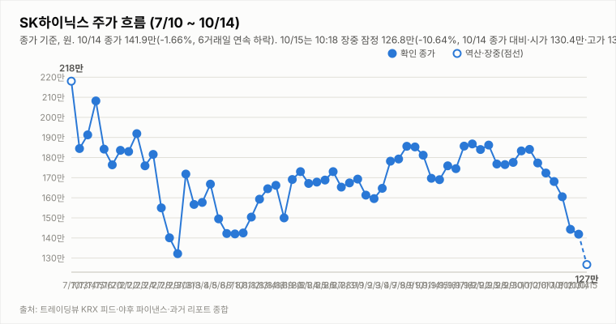

# SK하이닉스 투자 리포트 — 2026-10-15 (목) 장중 업데이트 (11:38, 11:18 지연 시세)

> **작성** 2026-10-15 11:38 KST · **장중 판정: 중립 유지(11:38 기준, 잠정) · 확정 판정: 중립(10/14 종가 기준)** · 전일 종가 141.9만원(-1.66%)은 `quote.json`(marketTime 10/14 15:30 KST)으로 확정이며 트레이딩뷰 종가와 일치합니다. 오늘 값은 야후 `quote.json` 20분 지연 시세(11:18)이며 장중 누적 거래량입니다. 확정 판정은 종가 기준으로만 변경하며, 장중에는 같은 유지 규칙 표를 적용한 장중 판정(잠정)을 병기합니다.

> **종목** SK하이닉스 (KRX 000660 · NASDAQ 상장 7/10)
> 본 자료는 정보 제공 목적이며 투자 권유가 아닙니다.

## 핵심 요약

- **투자의견: 장중 판정 중립 유지(잠정)** — 11:38 데이터로 유지 규칙 표를 적용했습니다(확정 판정은 10/14 종가 기준 중립). 방향성 4요소는 긍정 2개(②④)·부정 2개(①③)입니다. ①은 갭다운 출발·-10.22%(11:18 지연)와 -DI 우위(DMI 격차 -33.9)로 부정, ③은 Top10 헤드라인 중 🔴 악재 4건(Investing.com "오늘 왜 급락했나?", 연합뉴스 특징주 7∼8% 하락, 한국경제, 국민일보 ADR 하락)·🟢 호재 0건으로 부정입니다(한국경제 "초고수의 선택은 SK하이닉스…"는 자동분류가 🔴이나 제목상 SK하이닉스는 순매수라 호재성에 가까워 보이며, 그렇게 봐도 악재 3건·호재 1건으로 부정 유지). 중립 상태의 진입 조건(매수 = 긍정 3개 이상·부정 0개, 매도 = 부정 3개 이상·긍정 0개)은 모두 미충족이며, 매도 진입은 ②④가 모두 긍정에서 이탈해야 하므로 현재 해당 없습니다. 장중 판정은 다음 장중으로 이월하지 않고 15:30 종가에서 확정 판정을 갱신합니다.
- **10/15 장 초반(11:18 지연 시세)** — 시가 130.4만(어제 종가 대비 -8.10% 갭다운)·고가 133.2만·저가 125.1만, 현재 127.4만(**-10.22%**, -14.5만원), 거래량 251.2만주(20일 평균의 0.79배, 장중 누적). 10/2 종가(184.1만) 대비로는 -30.8%이며 종가 확정 전이지만 하락이 이어지면 7거래일 연속 하락이 됩니다. 간밤 SOX -4.30%·ADR -6.06%·야간선물 -2.89%를 넘는 낙폭이며, 에너지경제신문 헤드라인은 "美 CPI 충격·AI주 약세"를 거론하지만 원인은 단정하지 않습니다. 삼성전자는 확인 불가입니다.
- **간밤 변수·개장 전 헤드라인**: 미국장은 SOX -4.30%(11,684.38)·나스닥 -1.88%·S&P500 -1.11%로 약했고 마이크론 -4.10%, 엔비디아 -3.16%, SK하이닉스 ADR 147.55달러(-6.06%), EWY -4.04%였습니다. 코스피200 야간선물은 주간 종가 대비 -2.89%(20분 지연, 야간 세션 값인지 첫 실측 검증 중)이고 원/달러는 1,341.69원(+0.06%)입니다. 헤드라인 기준 조선비즈 "[특징주] 삼전닉스, 프리마켓에서 6~7% 급락 …SK하이닉스 시가총액 1000조 하회", 국민일보 "[속보] SK하이닉스 ADR 6.06%↓… 뉴욕증시 일제히 하락 마감"이 나왔습니다(헤드라인만 확인, 간밤 급락의 원인은 확인 불가). 
- **지표(10/15 11:18 지연 시세 포함, 야후 일봉 기준)**: DMI 격차 -33.9(+DI 15.7 < -DI 49.6), KDJ K 6.1·D 12.5(격차 -6.4, 과매도 구간), MACD 히스토그램 -5.70만(시그널 하회). 오늘 거래량은 장중 누적이라 평가하지 않습니다. 3Q26 실적 발표(10/27)까지 **D-12**이고 반도체대전이 진행 중입니다.

## 시세

| 시가 | 고가 | 저가 | 종가 | 등락 | 거래량 |
|---|---|---|---|---|---|
| ₩1,458,000 | ₩1,497,000 | ₩1,402,000 | **₩1,419,000** | **-1.66%** | 3,739,813주 |

출처: 야후 `quote.json`(marketTime 15:30 KST 확정)·트레이딩뷰 KRX 피드 교차 확인(종가 1,419,000원 일치). 전일(10/13) 확정 종가 1,443,000원 대비 -24,000원(-1.66%)이며 거래량만 야후 정정치입니다.

**오늘 10/15 (목) — 장 초반 (11:18 지연 시세, 확정 아님)** (출처: 야후 파이낸스 quote.json, 20분 지연)

| 시가 | 고가 | 저가 | 현재가 | 등락(10/14 종가 대비) | 거래량 |
|---|---|---|---|---|---|
| ₩1,304,000 | ₩1,332,000 | ₩1,251,000 | ₩1,274,000 | -10.22% | 2,511,886주 |

## 기술적 지표 (10/15 11:18 지연 시세 포함 야후 일봉 기준, 장중 잠정)

| 지표 | 값 | 해석 |
|---|---|---|
| MACD (12,26,9) | -7.66만 / 시그널 -1.96만 / 히스토그램 -5.70만 | 하락 모멘텀 지속 |
| ATR (14) | 9.67만 (7.6%) | 변동성 매우 큼 |
| ADX / DMI | ADX 17.5 · +DI 15.7 · -DI 49.6 | 추세 강도 약함, 격차 -33.9(-DI 우위) |
| KDJ (9,3,3) | K 6.1 · D 12.5 · J -6.7 | 과매도 구간, K<D 하락 우위(-6.4) |
| 거래량 / 20일 이평 | 251.2만 / 317.3만 | 평균의 0.79배(장중 누적, 장 마감까지 증가) |

야후가 10/13 일봉을 정정 반영하면서 어제 리포트의 값(MACD 히스토그램 -3.59만·DMI -26.1)과 달라졌습니다.

종가 기준 격차 흐름: DMI 9/29 +1.6 → 9/30 +4.3 → 10/1 +2.2 → 10/2 +3.9 → 10/6 -0.8 → 10/7 -4.7 → 10/8 -7.9 → 10/12 -13.9(15:14 집계) → 10/13 -26.1(어제 리포트 기준) → 10/14 -25.9(종가 확정) → 10/15 -33.9(11:18 잠정), KDJ 9/29 -8.4 → 9/30 -8.9 → 10/1 -5.2 → 10/2 -2.2 → 10/6 -8.2 → 10/7 -14.1 → 10/8 -15.1 → 10/12 -13.3(15:14 집계) → 10/13 -10.9(어제 리포트 기준) → 10/14 -8.4(종가 확정) → 10/15 -6.4(11:18 잠정).

## 최신 뉴스 Top 5 (구글 뉴스 헤드라인 기준, 같은 사안은 1건만)

1. 🔴 **[특징주] 삼성전자·SK하이닉스, 장 초반 7∼8% 하락세** (연합뉴스, 10/15) · 정규장 급락 사안(서울신문 "코스피 6000선 붕괴"·Investing.com "오늘 왜 급락했나?" 등 같은 사안은 1건만 수록, 헤드라인만 확인)
2. 🔴 **[속보] SK하이닉스 ADR 6.06%↓… 뉴욕증시 일제히 하락 마감** (국민일보, 10/15) · 간밤 미국 반도체 급락 사안
3. 🟢 **초고수의 선택은 SK하이닉스…삼성전자·LG엔솔은 순매도** (한국경제, 10/15) · 자동분류는 🔴이나 제목상 SK하이닉스는 순매수라 호재성으로 재분류(헤드라인만 확인)
4. ⚪ **삼성전자-SK하이닉스, 7세대 HBM 선보이며 "中보다 기술 우위"** (동아일보, 10/15) · SEDEX 전시 사안은 이 1건만 수록
5. ⚪ **SK, 솔리다임 중복상장 따져보니…총수는 이득, 주주는 손해** (한겨레, 10/14) · 솔리다임 상장 논란 사안

※ 뉴스는 헤드라인 기준이며 본문 수치는 별도 검증하지 않았습니다. 같은 사안을 다룬 기사는 가장 최신 1건만 남겼습니다(예: SEDEX 전시·기조연설 보도 3건, 프리마켓·ADR 급락 사안은 사안별 1건, [포토] 제외).

## 실적 · 밸류에이션 (갱신일 2026-10-14, 10/15 재확인: 신규 확인 불가)

2Q26 확정 매출 79.3조·영업이익 60.5조(영업이익률 76%), **3Q26 컨센서스(에프앤가이드 10/8 갱신)는 매출 98.4조·영업이익 77.1조(영업이익률 78.3%)**로 9/4 기준(100.3조/78.7조)·9/30 집계(영업이익 78.1조)에서 소폭 하향됐습니다. 메리츠증권은 원화 강세·개선 속도 둔화로 시장 컨센서스가 74조원까지 내려갔다고 분석했고(헤드라인 기준), 증권사별로는 메리츠 80.1조·SK증권 79조·IBK 75.1조·DS투자 70조로 편차가 큽니다. 3Q26 실적 발표는 10/27(D-13)입니다. 10/14 재확인에서 에프앤가이드 신규 집계(10/8 이후)와 증권사 추정치 변경은 확인하지 못했습니다.

> 밸류에이션 갱신일 2026-10-14 — 10/15 재조사에서도 신규·변경 목표주가 보도를 확인하지 못해 6곳을 유지했습니다(직전 확인 2026-10-14). 직전 컨센서스 322만원은 9/3 한국경제 기준. **차트는 보도일 기준 최근 1개월(9/15~10/15) 이내 목표가를 낸 6곳만 표시하며 평균 목표가도 이 6곳의 단순 평균(352.3만원)입니다.** 1개월 초과 리포트(한국투자증권 470만원 7/30, KB증권 420만원 7/30 유지, 교보증권 400만원 7/9 등)는 평균에서도 제외했습니다. 참고: 뉴스핌 로보뉴스(SK증권 리포트 브리핑, 10/12) 집계의 최근 6개월 전체 증권사 평균 목표가는 3,232,083원이며 집계 방식에 따라 다른 평균이 보도될 수 있습니다(예: 연합인포맥스 약 268만원, 약 4개월 전 기사).

최근 1개월 이내 6곳의 평균 목표주가 352.3만원은 11:18 지연 시세 127.4만 대비 **+176.6%** 괴리입니다(10/14 종가 141.9만 기준 +148.3%). 6곳은 SK증권 400만원 유지(10/12), IBK 400만원 유지(10/7), 유진 370만원(10/8), 하나증권 360만원 "컨센서스 부합"(10/13), 메리츠 320만원 상향(10/12), DS투자 264만원(9/29 하향)입니다. 표본이 적어 평균은 참고용이며, 6개월 전체 평균(323.2만원) 대비 괴리율은 11:18 지연 시세 기준 +153.7%입니다.

## 산업 동향 — HBM·DRAM·NAND (갱신일 2026-10-14)

> 10/15 재조사에서 신규 가격 전망·점유율 발표를 확인하지 못해 수치는 10/14 조사분을 유지했습니다(직전 확인 2026-10-14). 수치는 TrendForce 9/30 발표·산업통상부 10/1 발표·국내 언론 헤드라인 기준이며 차트의 점유율은 카운터포인트 1Q26(매출 기준)·트렌드포스 연간 전망입니다. 2Q26 이후 확정 점유율은 확인 불가.

**HBM / DRAM**

- **4Q26 범용 D램 계약가 +10~15%(QoQ)** — TrendForce 전망. 3Q26 전망(+13~18%)보다 둔화됐지만 AI 서버 수요와 첨단 공정 캐파 우선 배정으로 상승 기조는 유지.
- **2027년 HBM 가격 협상** — 헤드라인 기준 TrendForce는 내년 HBM 평균판매가 약 +121%를 전망(주체가 TrendForce 전망인지 마이크론 계약 기준인지 보도마다 엇갈림). 삼성전자는 HBM4 연간 공급가를 높게 제시했다는 보도가 있고, SK하이닉스는 2027년 물량·가격 협상 중으로 최종 내용은 확인 불가.
- **HBM 점유율** — 카운터포인트 1Q26 SK하이닉스 58%·삼성전자 21%·마이크론 21%, 트렌드포스 2026년 연간 50%·28%·22% 전망. 마이크론은 HBM4 10억달러 이상 출하·연말 점유율 20%대 목표, 삼성전자도 HBM4 양산 약 4개월 만에 누적 매출 10억달러 보도.
- **중국 CXMT 추격** — 10/9~10 콘퍼런스에서 4F² 셀 구조 DDR5 서버용 D램(RDIMM) 연내 출시를 예고(구체 사양·양산 일정 미공개, 우려와 과장 분석이 엇갈림). HBM이 아닌 범용 D램 기술이며 10/12~10/13 메모리주 급락의 계기로 거론됐으나 인과관계는 단정하지 않음.
- **수출** — 9월 반도체 수출 603억달러(+262.8%), 단일 품목 최초 600억달러 돌파(산업통상부 10/1).

**NAND**

- **4Q26 NAND 계약가 +15~20%(QoQ)** — 3Q26 전망(+18~23%)보다 둔화. eSSD 상승폭이 가장 크고 한 보도는 +23~28%를 전함(단일 보도 기준). eSSD 비트 수요는 전년 대비 80% 이상 증가 전망.
- **소비자 부문 부담** — PC·스마트폰은 원가 부담으로 SSD 용량을 줄이는 방식으로 대응 중. 솔리다임 상장 관련 주주가치 논란도 지속.

**해석**: 가격 상승률은 둔화(D램 +13~18%→+10~15%, 낸드 +18~23%→+15~20%)했지만 방향은 상승이고 HBM 2027년 가격 협상이 진행 중이라 요소 ④ 산업 사이클은 긍정 유지입니다. 상승률 둔화와 CXMT 추격은 업황 고점 논쟁을 키울 수 있어 10월 수출·4Q 계약가 실측·HBM4 협상 결과를 점검합니다.

## 투자 판단

**의견: 장중 판정 중립(유지, 11:38 기준 잠정) — 확정 판정은 10/14 종가 기준 중립 (확정은 종가 기준으로만 변경합니다)**

| 요소 | 방향 | 근거 |
|---|---|---|
| ① 추세/모멘텀 | 부정(약화) | 종가 기준 6거래일 연속 하락(10/14 -1.66%, 10/2 대비 -22.9%)이며 오늘 갭다운 출발·-10.22%(11:18 지연) 장 초반 흐름. 11:18 잠정 MACD 시그널 하회(히스토그램 -5.70만)·DMI -DI 우위(-33.9)·KDJ 격차 -6.4(과매도 구간, 장중 잠정) |
| ② 밸류에이션 갭 | 긍정 | 최근 1개월 6곳 평균 목표가 352.3만 대비 11:18 지연 시세 127.4만 — +176.6%(10/14 종가 기준 +148.3%) |
| ③ 촉매 | 부정(부정 유지, 장중 잠정) | 11:38 기준 Top10 자동분류는 🔴 악재 4건(Investing.com 한국어 "SK하이닉스 주가, 오늘 왜 급락했나?", 연합뉴스 "[특징주] 삼성전자·SK하이닉스, 장 초반 7∼8% 하락세", 한국경제 "초고수의 선택은 SK하이닉스…삼성전자·LG엔솔은 순매도"(제목상 SK하이닉스는 순매수라 호재성에 가까워 보이나 자동분류는 🔴), 국민일보 "ADR 6.06%↓…뉴욕증시 일제히 하락 마감")·🟢 호재 0건·⚪ 중립 6건으로 악재 우위입니다. 한국경제를 호재로 재분류해도 악재 2건·호재 1건이라 부정 유지. 종가에서 다시 판단 |
| ④ 산업 사이클 | 긍정 | HBM4 공급가 급등, 메모리 공급부족 구조, 3Q 이익 전망 상향 (산업 동향 갱신일 2026-10-14 재확인: 4Q 범용 D램 +10~15%·낸드 +15~20%, 상승률 둔화) |

**종합(장중 11:38): 긍정 2·부정 2 → 중립 유지(잠정).** 확정 판정(10/14 종가 기준 중립)을 현재 판정으로 삼아 11:38 데이터에 유지 규칙 표를 적용했으며, 장중 판정은 다음 장중으로 이월하지 않고 15:30 종가에서 확정 판정을 갱신합니다. 매수 복귀는 긍정 3개 이상·부정 0개(①③이 모두 부정에서 중립 이상으로 개선되고 그중 하나 이상이 긍정으로 올라와야 함)가 필요하고, 매도 진입은 부정 3개 이상·긍정 0개입니다(현재 부정 2·긍정 2로 해당 없음; ②④가 모두 긍정에서 이탈해야 함).

## 오늘(10/15, 목) 전망 — 갭다운 후 125.1만 지지 여부

| 항목 | 내용 |
|---|---|
| 지지선 | 125.1만(오늘 장중 저가, 11:18 지연) — 하회 시 뚜렷한 지지 레벨 확인 불가(어제 저가 140.2만은 이미 하회) |
| 저항선 | 130.4만(오늘 시가) · 133.2만(오늘 고가) · 140.2만(10/14 저가) · 141.9만(10/14 종가) · 144.3만(10/13 종가) · 145.8만(10/14 시가) · 149.7만(10/14 고가) |
| 예상 등락 레인지(참고용) | 10/14 종가 ± ATR 9.67만 = 132.2만 ~ 151.6만(잠정 ATR; 현재가는 이미 하단을 이탈한 상태) |
| 예정 이벤트 | 반도체대전(10/14 개막) 진행 중 · 3Q26 실적 발표 10/27(D-12) · 美 CPI·AI주 약세 헤드라인의 후속 흐름 · 中 CXMT·YMTC 추격 보도 · 솔리다임 중복상장 논란·ADR 락업 해제 보도 · 외국인 수급(확인 불가) · 원/달러(1,341.69원) |
| 관찰 포인트 | 125.1만(오늘 저가) 지지 여부와 130.4만(오늘 시가) 회복 여부, 낙폭이 -10%를 넘어선 뒤 추가 확대되는지(변동성 완화장치 발동 여부는 확인 불가), 외국인·기관 수급, 마이크론·ADR 약세의 영향, 종가 기준 DMI·KDJ 방향 |
| 상방 시나리오 | KDJ 과매도(K 6.1)·낙폭 과대 인식으로 기술적 반등이 나올 수 있음. 다만 141.9만(어제 종가) 회복과 ①③ 개선이 종가 기준으로 확인돼야 매수 복귀 논의가 가능 |
| 하방 시나리오 | 美 CPI 충격·AI주 약세 헤드라인과 마이크론·ADR 약세가 이어지면 125.1만 이탈과 변동성 확대 가능성이 큽니다. 다만 ②④가 긍정인 한 매도 진입 조건(부정 3개 이상·긍정 0개)은 충족되지 않음 |
| 야간선물 | -2.89%(코스피200 야간선물 916.95 부근, 주간 종가 944.20 대비·`updateTimeKST` 10-15 06:00·20분 지연; 야간 세션 값인지 첫 실측 검증 진행 중) |

간밤 미국 반도체 급락과 야간선물 하락이 갭다운(-8.10%)으로 이어졌고 시가(130.4만)보다 3.0만원 낮은 127.4만(-10.22%, 지연)에서 -10%대 낙폭을 이어가고 있습니다. KDJ가 깊은 과매도 구간이라 기술적 반등 여지는 있으나 방향은 단정하지 않으며, 확률적 관점일 뿐 가격 예측이 아닙니다.

---

*본 자료는 공개 보도·자료를 종합해 작성한 정보 제공 목적의 리포트이며 투자 판단과 책임은 투자자 본인에게 있습니다.*
