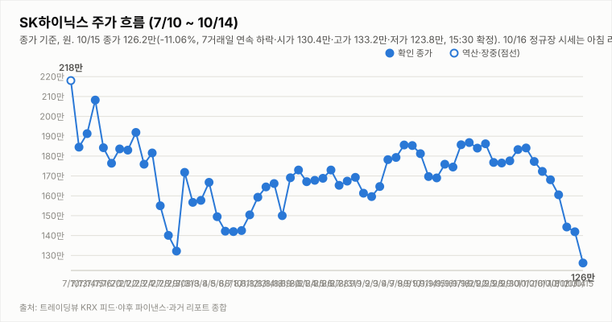
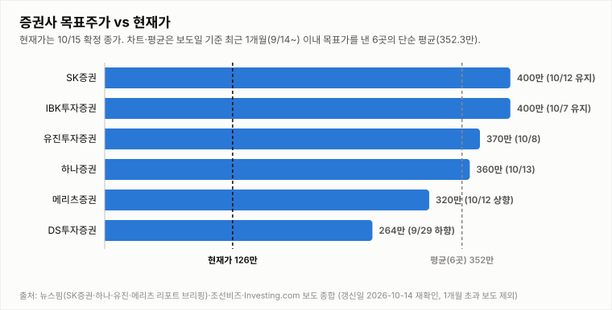

# SK하이닉스 투자 리포트 — 2026-10-16 (금) 마감 (종가 확정)

> **작성** 2026-10-16 15:57 KST · **확정 판정: 중립 유지(10/16 종가 기준)** · 종가 127.2만원(+0.79%)은 `quote.json`(marketTime 10/16 15:30 KST)으로 확정이며 트레이딩뷰 종가(1,272,000원)와 일치합니다(트레이딩뷰 거래량 437.4만주와 야후 470.4만주가 달라 야후 값 사용). 등락률은 10/15 확정 종가 기준, 기술지표는 종가 확정분입니다.

> **종목** SK하이닉스 (KRX 000660 · NASDAQ 상장 7/10)
> 본 자료는 정보 제공 목적이며 투자 권유가 아닙니다.

## 핵심 요약

- **투자의견: 확정 판정 중립 유지** — 10/16 종가 기준으로 유지 규칙 표를 적용했습니다(현재 판정 = 10/15 확정 중립). 방향성 4요소는 긍정 3개(②③④)·부정 1개(①)입니다. ①은 종가가 +0.79%로 반등해 7거래일 연속 하락은 끊었지만 -DI 우위(DMI 격차 -32.5)·MACD 시그널 하회(히스토그램 -6.22만)·KDJ K<D(과매도 구간)가 이어져 하루 반등만으로 방향을 뒤집지 않고 부정을 유지했습니다. ③은 종가 시점 Top10 자동분류가 🔴 1건·🟢 1건이나 🔴(인포스탁데일리 "급락은 '가격 왜곡'… 비중 확대 기회-KB")는 '급락' 키워드 때문에 악재로 분류됐을 뿐 헤드라인상 내용은 비중 확대 의견이고 악재성 헤드라인이 Top10에 없어 긍정(약함)으로 봤습니다(헤드라인만 확인, 헤드라인 구성에 민감한 판단이며 중립으로 봐도 결과는 같음). 긍정이 3개지만 중립→매수 진입은 긍정 3개 이상이면서 부정 0개여야 하므로 ①이 부정인 동안은 미충족이고, 매도 진입(부정 3개 이상·긍정 0개)도 해당 없어 중립을 유지합니다.
- **10/16 확정 종가 127.2만(+0.79%)** — 시가 129.0만·고가 132.5만·저가 124.7만, 거래량 470.4만주(야후 quote.json 15:30 확정, 20일 평균의 1.41배). 10/15 종가(126.2만) 대비 +1.0만원이며 시가부터 +2.22% 갭업 출발해 저가 124.7만(-1.2%)까지 내려갔다가 12시 이후 130만 안팎으로 올라 고가 132.5만(+5.0%)을 기록했으나, 14:18 지연 시세 130.2만에서 종가까지 3.0만원 되밀려 고가 대비 -4.0%로 마감했습니다(장 막판 되밀림의 원인은 확인 불가). 종가 기준 10/6부터 이어진 **7거래일 연속 하락이 끊겼고** 10/2 종가(184.1만) 대비로는 -30.9%입니다. 트레이딩뷰 피드 기준 삼성전자는 21.55만(+2.62%), 코스피200 주간선물(12월물)은 +2.61%였습니다.
- **장 마감 후 확인 변수**: 트레이딩뷰 피드(15:53 수집) 기준 원/달러는 1,331.68원(-0.71%, 15:15 기준)입니다. 미국장 10/16(금) 정규장 결과는 주말 이후 월요일 프리마켓에서 확인합니다. 야간선물은 이번 수집이 주간 시간대라 야간 값이 아니어서(night_futures_valid false) 확인 불가이며, SOX -0.88%(11,581.22)·나스닥 +0.08%·SK하이닉스 ADR 146.11달러(-0.98%)는 직전 미국장(10/15) 값입니다. 10/17(토)·10/18(일)은 휴장이라 다음 거래일은 10/19(월)입니다.
- **지표(10/16 quote.json 15:30 종가 확정)**: DMI 격차 -32.5(+DI 14.6 < -DI 47.1), KDJ K 5.9·D 10.3(격차 -4.4, 과매도 구간), MACD 히스토그램 -6.22만(시그널 하회). 거래량은 20일 평균의 1.41배로 늘었습니다. 3Q26 실적 발표(10/27)까지 **D-11**(10/19 기준 D-8)이고 10/14 개막한 반도체대전이 진행 중입니다.

## 시세

| 시가 | 고가 | 저가 | 종가 | 등락 | 거래량 |
|---|---|---|---|---|---|
| ₩1,304,000 | ₩1,332,000 | ₩1,238,000 | **₩1,262,000** | **-11.06%** | 5,898,372주 |

출처: 야후 `quote.json`(marketTime 15:30 KST 확정)·트레이딩뷰 KRX 피드 교차 확인(종가 1,262,000원·저가 1,238,000원 일치). 전일(10/14) 확정 종가 1,419,000원 대비 -157,000원(-11.06%)이며 저가·거래량은 야후 정정치입니다.

**오늘 10/16 (금) — 마감 (종가 확정)** (출처: 야후 `quote.json`(marketTime 15:30 KST 확정)·트레이딩뷰 KRX 피드(15:53 수집) 교차 확인, 종가 1,272,000원 일치)

| 시가 | 고가 | 저가 | 종가 | 등락(10/15 종가 대비) | 거래량 |
|---|---|---|---|---|---|
| ₩1,290,000 | ₩1,325,000 | ₩1,247,000 | **₩1,272,000** | **+0.79%** | 4,704,352주 |

## 기술적 지표 (10/16 15:30 종가 확정 기준, 야후 일봉)

| 지표 | 값 | 해석 |
|---|---|---|
| MACD (12,26,9) | -9.75만 / 시그널 -3.53만 / 히스토그램 -6.22만 | 하락 모멘텀 지속 |
| ATR (14) | 9.62만 (7.6%) | 변동성 매우 큼 |
| ADX / DMI | ADX 20.0 · +DI 14.6 · -DI 47.1 | 추세 강도 약함, 격차 -32.5(-DI 우위) |
| KDJ (9,3,3) | K 5.9 · D 10.3 · J -2.9 | 과매도 구간, K<D 하락 우위(-4.4) |
| 거래량 / 20일 이평 | 470.4만 / 333.7만 | 평균의 1.41배 |

야후가 10/13 일봉을 정정 반영하면서 어제 리포트의 값(MACD 히스토그램 -3.59만·DMI -26.1)과 달라졌습니다.

종가 기준 격차 흐름: DMI 9/29 +1.6 → 9/30 +4.3 → 10/1 +2.2 → 10/2 +3.9 → 10/6 -0.8 → 10/7 -4.7 → 10/8 -7.9 → 10/12 -13.9(15:14 집계) → 10/13 -26.1(어제 리포트 기준) → 10/14 -25.9(종가 확정) → 10/15 -34.5(종가 확정·정정) → 10/16 -32.5(종가 확정), KDJ 9/29 -8.4 → 9/30 -8.9 → 10/1 -5.2 → 10/2 -2.2 → 10/6 -8.2 → 10/7 -14.1 → 10/8 -15.1 → 10/12 -13.3(15:14 집계) → 10/13 -10.9(어제 리포트 기준) → 10/14 -8.4(종가 확정) → 10/15 -6.4(종가 확정·정정) → 10/16 -4.4(종가 확정).

## 최신 뉴스 Top 5 (구글 뉴스 헤드라인 기준, 같은 사안은 1건만)

1. ⚪ **SK하이닉스, AI 처리 속도 높일 차세대 메모리 기술 공개** (뉴스핌, 10/16) · 기술 로드맵 사안(헤드라인만 확인, 세부 내용 확인 불가)
2. 🔴 **삼성전자·SK하이닉스 급락은 '가격 왜곡'… 지금은 비중 확대 기회-KB** (인포스탁데일리, 10/16) · 자동분류는 🔴(급락 키워드)이나 헤드라인상 증권사 비중 확대 의견이라 호재성(헤드라인만 확인·근거 수치 확인 불가)
3. ⚪ **SK하이닉스, AI 응답 지연 줄일 공유 메모리 기술 검증** (매일일보, 10/16) · 기술 검증 사안(헤드라인만 확인, 세부 내용 확인 불가)
4. 🟢 **[오늘 이 종목] AI 수요 확인 SK하이닉스 · 실적 기대 삼성바이오로직스 '주목'** (머니투데이, 10/16) · 종목 코멘트성 호재 사안(헤드라인만 확인, 근거 수치 확인 불가)
5. ⚪ **삼성·SK하이닉스 급락 과도했나…실적 전망은 오히려 '상향'** (Investing.com 한국어/EBN, 10/16) · 급락 후 반등·실적 전망 사안(헤드라인만 확인·수치 확인 불가)

※ 뉴스는 헤드라인 기준이며 본문 수치는 별도 검증하지 않았습니다. 같은 사안을 다룬 기사는 가장 최신 1건만 남겼습니다(예: 홍보성 "초심 조형물" 기사 3건·구직자 관심 기업 순위 기사 제외, [포토] 제외).

## 실적 · 밸류에이션 (갱신일 2026-10-14, 10/16 재확인: 신규 확인 불가)

2Q26 확정 매출 79.3조·영업이익 60.5조(영업이익률 76%), **3Q26 컨센서스(에프앤가이드 10/8 갱신)는 매출 98.4조·영업이익 77.1조(영업이익률 78.3%)**로 9/4 기준(100.3조/78.7조)·9/30 집계(영업이익 78.1조)에서 소폭 하향됐습니다. 메리츠증권은 원화 강세·개선 속도 둔화로 시장 컨센서스가 74조원까지 내려갔다고 분석했고(헤드라인 기준), 증권사별로는 메리츠 80.1조·SK증권 79조·IBK 75.1조·DS투자 70조로 편차가 큽니다. 3Q26 실적 발표는 10/27(D-13)입니다. 10/14 재확인에서 에프앤가이드 신규 집계(10/8 이후)와 증권사 추정치 변경은 확인하지 못했습니다.

> 밸류에이션 갱신일 2026-10-14 — 10/16 재조사에서도 신규·변경 목표주가 보도를 확인하지 못해 6곳을 유지했습니다(직전 확인 2026-10-14). 직전 컨센서스 322만원은 9/3 한국경제 기준. **차트는 보도일 기준 최근 1개월(9/16~10/16) 이내 목표가를 낸 6곳만 표시하며 평균 목표가도 이 6곳의 단순 평균(352.3만원)입니다.** 1개월 초과 리포트(한국투자증권 470만원 7/30, KB증권 420만원 7/30 유지, 교보증권 400만원 7/9 등)는 평균에서도 제외했습니다. 참고: 뉴스핌 로보뉴스(SK증권 리포트 브리핑, 10/12) 집계의 최근 6개월 전체 증권사 평균 목표가는 3,232,083원이며 집계 방식에 따라 다른 평균이 보도될 수 있습니다(예: 연합인포맥스 약 268만원, 약 4개월 전 기사).

최근 1개월 이내 6곳의 평균 목표주가 352.3만원은 10/16 종가 127.2만 대비 **+177.0%** 괴리입니다(10/15 종가 126.2만 기준 +179.2%). 6곳은 SK증권 400만원 유지(10/12), IBK 400만원 유지(10/7), 유진 370만원(10/8), 하나증권 360만원 "컨센서스 부합"(10/13), 메리츠 320만원 상향(10/12), DS투자 264만원(9/29 하향)입니다. 표본이 적어 평균은 참고용이며, 6개월 전체 평균(323.2만원) 대비 괴리율은 10/16 종가 기준 +154.1%입니다.

## 산업 동향 — HBM·DRAM·NAND (갱신일 2026-10-14)

> 10/16 재조사에서 신규 가격 전망·점유율 발표를 확인하지 못해 수치는 10/14 조사분을 유지했습니다(직전 확인 2026-10-14). 수치는 TrendForce 9/30 발표·산업통상부 10/1 발표·국내 언론 헤드라인 기준이며 차트의 점유율은 카운터포인트 1Q26(매출 기준)·트렌드포스 연간 전망입니다. 2Q26 이후 확정 점유율은 확인 불가.

**HBM / DRAM**

- **4Q26 범용 D램 계약가 +10~15%(QoQ)** — TrendForce 전망. 3Q26 전망(+13~18%)보다 둔화됐지만 AI 서버 수요와 첨단 공정 캐파 우선 배정으로 상승 기조는 유지.
- **2027년 HBM 가격 협상** — 헤드라인 기준 TrendForce는 내년 HBM 평균판매가 약 +121%를 전망(주체가 TrendForce 전망인지 마이크론 계약 기준인지 보도마다 엇갈림). 삼성전자는 HBM4 연간 공급가를 높게 제시했다는 보도가 있고, SK하이닉스는 2027년 물량·가격 협상 중으로 최종 내용은 확인 불가.
- **HBM 점유율** — 카운터포인트 1Q26 SK하이닉스 58%·삼성전자 21%·마이크론 21%, 트렌드포스 2026년 연간 50%·28%·22% 전망. 마이크론은 HBM4 10억달러 이상 출하·연말 점유율 20%대 목표, 삼성전자도 HBM4 양산 약 4개월 만에 누적 매출 10억달러 보도.
- **중국 CXMT 추격** — 10/9~10 콘퍼런스에서 4F² 셀 구조 DDR5 서버용 D램(RDIMM) 연내 출시를 예고(구체 사양·양산 일정 미공개, 우려와 과장 분석이 엇갈림). HBM이 아닌 범용 D램 기술이며 10/12~10/13 메모리주 급락의 계기로 거론됐으나 인과관계는 단정하지 않음.
- **수출** — 9월 반도체 수출 603억달러(+262.8%), 단일 품목 최초 600억달러 돌파(산업통상부 10/1).

**NAND**

- **4Q26 NAND 계약가 +15~20%(QoQ)** — 3Q26 전망(+18~23%)보다 둔화. eSSD 상승폭이 가장 크고 한 보도는 +23~28%를 전함(단일 보도 기준). eSSD 비트 수요는 전년 대비 80% 이상 증가 전망.
- **소비자 부문 부담** — PC·스마트폰은 원가 부담으로 SSD 용량을 줄이는 방식으로 대응 중. 솔리다임 상장 관련 주주가치 논란도 지속.

**해석**: 가격 상승률은 둔화(D램 +13~18%→+10~15%, 낸드 +18~23%→+15~20%)했지만 방향은 상승이고 HBM 2027년 가격 협상이 진행 중이라 요소 ④ 산업 사이클은 긍정 유지입니다. 상승률 둔화와 CXMT 추격은 업황 고점 논쟁을 키울 수 있어 10월 수출·4Q 계약가 실측·HBM4 협상 결과를 점검합니다.

## 투자 판단

**의견: 확정 판정 중립(유지) — 10/16 종가 기준, 이전 확정(10/15 종가)도 중립 (확정은 종가 기준으로만 변경합니다)**

| 요소 | 방향 | 근거 |
|---|---|---|
| ① 추세/모멘텀 | 부정(약화) | 종가 기준 7거래일 연속 하락이 10/16 종가 +0.79%로 끊겼으나(10/2 대비 -30.9%) 하루 반등만으로 방향을 뒤집지 않음. 종가 확정 MACD 시그널 하회(히스토그램 -6.22만)·DMI -DI 우위(-32.5)·KDJ 격차 -4.4(과매도 구간, 어제 -6.4에서 축소) |
| ② 밸류에이션 갭 | 긍정 | 최근 1개월 6곳 평균 목표가 352.3만 대비 10/16 종가 127.2만 — +177.0%(10/15 종가 기준 +179.2%) |
| ③ 촉매 | 긍정(약함) | 종가 시점(15:54 수집) Top10 자동분류는 🔴 악재 1건(인포스탁데일리 "삼성전자·SK하이닉스 급락은 '가격 왜곡'… 지금은 비중 확대 기회-KB")·🟢 호재 1건(머니투데이 "[오늘 이 종목] AI 수요 확인 SK하이닉스")·⚪ 중립 8건입니다. 🔴 1건은 '급락' 키워드에 의한 자동분류로 헤드라인상 내용은 비중 확대 의견이라 호재성으로 보았고(헤드라인만 확인), 뉴스핌 "차세대 메모리 기술 공개"·매일일보 "공유 메모리 기술 검증"·Investing.com(EBN) "급락 과도했나…실적 전망은 오히려 '상향'" 등 악재성 헤드라인이 Top10에 없어 긍정(약함)으로 판단했습니다. 뉴스핌 "2029년 공급 과잉 경고"·경북매일 외국인 투매(10/15 밤~10/16 새벽)는 새 기사에 밀려 빠졌을 뿐 해소된 것은 아니며 헤드라인 구성에 크게 민감한 판단입니다. 중립으로 봐도 ①이 부정인 한 확정 판정은 중립. |
| ④ 산업 사이클 | 긍정 | HBM4 공급가 급등, 메모리 공급부족 구조, 3Q 이익 전망 상향 (산업 동향 갱신일 2026-10-14 재확인: 4Q 범용 D램 +10~15%·낸드 +15~20%, 상승률 둔화) |

**종합(10/16 종가 확정): 긍정 3·부정 1 → 중립 유지(확정).** 현재 판정(10/15 확정 중립)에 10/16 종가 데이터로 유지 규칙 표를 적용했습니다. 매수 복귀는 긍정 3개 이상·부정 0개(①이 부정에서 벗어나야 함)가 필요하고, 매도 진입은 부정 3개 이상·긍정 0개입니다(현재 부정 1·긍정 3으로 해당 없음). 이날 장중 판정(잠정)은 모두 중립 유지였고 확정 판정과 일치했습니다.

## 내일(10/19, 월) 전망 — 7거래일 연속 하락 종료 후 반등 지속 vs 장 막판 되밀림 재현

| 항목 | 내용 |
|---|---|
| 지지선 | 127.2만(10/16 종가) · 126.2만(10/15 종가) · 124.7만(10/16 저가) · 123.8만(10/15 저가) — 하회 시 뚜렷한 지지 레벨 확인 불가 |
| 저항선 | 129.0만(10/16 시가) · 132.5만(10/16 고가) · 133.2만(10/15 고가) · 140.2만(10/14 저가) · 141.9만(10/14 종가) · 144.3만(10/13 종가) · 145.8만(10/14 시가) |
| 예상 등락 레인지(참고용) | 10/16 종가 ± ATR 9.62만 = 117.6만 ~ 136.8만(참고용) |
| 예정 이벤트 | 3Q26 실적 발표 10/27(10/19 기준 D-8) · 반도체대전(10/14 개막) 진행 중(종료일 확인 불가) · 주말 중 미국장 10/16(금) 정규장 결과(SOX·나스닥·마이크론·ADR, 월요일 프리마켓에서 확인) · 외국인 수급(확인 불가) · 中 추격·공급과잉 경고 헤드라인(뉴스핌) · 솔리다임 중복상장 논란·ADR 락업 해제 보도 · 원/달러 1,331.68원(-0.71%, 10/16 15:15 기준) · 야간선물 확인 불가(수집 시점이 주간) |
| 관찰 포인트 | 129.0만(10/16 시가) 회복 여부와 126.2만(10/15 종가)·127.2만(10/16 종가) 지지 여부, 반등 시 거래량 동반 여부(10/16 거래량은 20일 평균의 1.41배), 장 막판 되밀림이 이어지는지(10/16 고가 132.5만 → 종가 127.2만), 외국인 순매도 지속 여부(확인 불가), 주말 사이 미국장·ADR 흐름, 종가 기준 DMI·KDJ 방향 |
| 상방 시나리오 | 종가 기준 연속 하락이 끊기고 KDJ 과매도(K 5.9)·주간선물 +2.61% 마감으로 반등이 이어질 수 있음. 다만 129.0만(10/16 시가) 회복과 ①의 개선(종가 기준 DMI·MACD)이 확인돼야 매수 복귀 논의가 가능하고, 긍정 3개 이상·부정 0개 조건이 필요(현재 긍정 3이나 ①이 부정) |
| 하방 시나리오 | 장 막판 고가 대비 -4.0% 되밀렸고 종가 기준 지표는 아직 하락 우위라, 반등이 꺾여 126.2만(10/15 종가)·124.7만(10/16 저가) 아래로 밀리면 변동성 확대 가능성이 있음. 긍정이 3개라 매도 진입 조건(부정 3개 이상·긍정 0개)은 충족되지 않음 |
| 야간선물 | 확인 불가 — 이번 night.yml 수집(15:53)이 주간 시간대라 야간선물이 아님(night_futures_valid false). 코스피200 주간선물(12월물)은 +2.61%(883.75, 15:32 기준) |

10/16은 갭업 후 124.7만까지 내려갔다가 12시 이후 130만 안팎으로 올라 132.5만까지 높였으나 장 막판 반락해 127.2만(+0.79%)에 마감했습니다. 종가가 10/15 종가를 웃돌아 7거래일 연속 하락은 끊겼고 거래량도 평균의 1.41배로 늘었지만 종가 기준 지표는 하락 우위라 방향은 단정하지 않으며, 확률적 관점일 뿐 가격 예측이 아닙니다.

---

*본 자료는 공개 보도·자료를 종합해 작성한 정보 제공 목적의 리포트이며 투자 판단과 책임은 투자자 본인에게 있습니다.*
