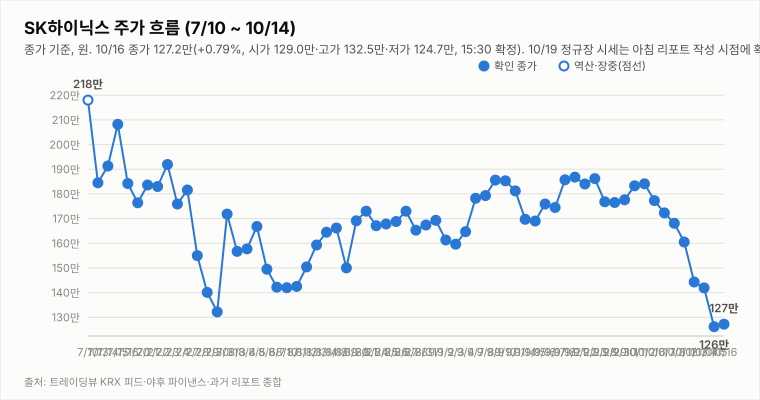
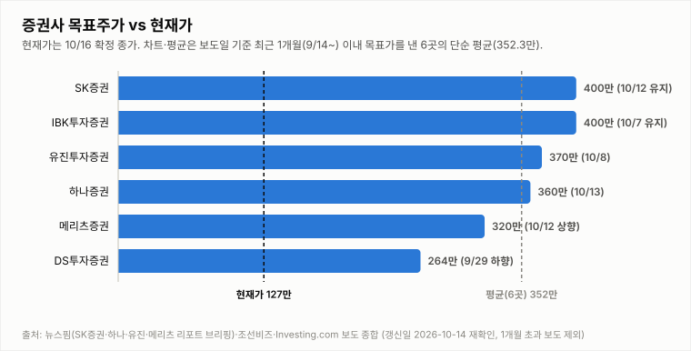

# SK하이닉스 투자 리포트 — 2026-10-19 (월) 장중 업데이트 (13:45, 13:24 지연 시세)

> **작성** 2026-10-19 13:45 KST · **장중 판정: 중립 유지(13:45 기준, 잠정) · 확정 판정: 중립(10/16 종가 기준)** · 전일 종가 127.2만원(+0.79%)은 `quote.json`(marketTime 10/16 15:30 KST)으로 확정이며 트레이딩뷰 종가와 일치합니다. 오늘 값은 야후 `quote.json` 20분 지연 시세(13:24)이며 장중 누적 거래량입니다. 확정 판정은 종가 기준으로만 변경하며, 장중에는 같은 유지 규칙 표를 적용한 장중 판정(잠정)을 병기합니다.

> **종목** SK하이닉스 (KRX 000660 · NASDAQ 상장 7/10)
> 본 자료는 정보 제공 목적이며 투자 권유가 아닙니다.

## 핵심 요약

- **투자의견: 장중 판정 중립 유지(잠정)** — 13:45 데이터로 유지 규칙 표를 적용했습니다(확정 판정은 10/16 종가 기준 중립). 방향성 4요소는 긍정 2개(②④)·부정 2개(①③)입니다. ①은 시가 121.2만(10/16 종가 대비 -4.72%) 갭다운 후 13:24 지연 시세 -1.02%로 낙폭이 작은 수준이지만 -DI 우위(DMI 격차 -33.9)·MACD 시그널 하회·KDJ K<D(과매도 구간)가 이어져 부정이고, ③은 12:44의 중립에서 부정(약함)으로 낮췄습니다. 새 Top10에 KBC광주방송 "[속보] SK하이닉스 솔리다임 美 중복상장?…금감원장 '규정 저촉 판단, 유권해석 대기'"가 들어와 솔리다임 중복상장의 규제 불확실성이 부각됐고, 🔴 글로벌이코노믹 "AI 업체 회사채 급락.. '약세'"도 남아 있는 반면 호재는 🟢 파이낸셜뉴스 "3분기 영업익 77조 '역대 최대' 전망" 한 건뿐이라 악재성이 앞선다고 봤습니다(헤드라인만 확인, 헤드라인 구성에 크게 민감한 판단이며 중립으로 보면 긍정 2·부정 1). 중립 상태의 진입 조건(매수 = 긍정 3개 이상·부정 0개, 매도 = 부정 3개 이상·긍정 0개)은 긍정 2·부정 2로 모두 미충족입니다. 장중 판정은 다음 장중으로 이월하지 않고 15:30 종가에서 확정 판정을 갱신합니다.
- **10/19 장중(13:24 지연 시세)** — 시가 121.2만(10/16 종가 대비 **-4.72%** 갭다운)·고가 126.8만·저가 120.8만, 현재 125.9만(**-1.02%**, -1.3만원), 거래량 235.0만주(20일 평균의 0.70배, 장중 누적). 12:24의 126.0만과 거의 같은 수준에서 횡보하며 시가보다 4.7만원 높고 고가(126.8만)에 0.9만원 못 미칩니다. 서울신문 "삼성SDI 9% 급등·삼바 7%대 상승… SK하이닉스는 1.3% 하락"(자동분류는 🟢이나 하이닉스는 하락 기사)이 시황을 전했고, KBC광주방송 "[속보] SK하이닉스 솔리다임 美 중복상장?…금감원장 '규정 저촉 판단, 유권해석 대기'"가 나왔으나(헤드라인만 확인, 세부 내용 확인 불가) 장중 가격과의 인과는 단정하지 않습니다. 10/2 종가(184.1만) 대비로는 -31.6%입니다.
- **간밤 변수·개장 전 헤드라인**: 미국장(10/16 금)은 SOX -3.83%(11,137.29)·나스닥 -2.14%·S&P500 -1.09%로 약했고 마이크론 -5.63%, 엔비디아 -1.43%, SK하이닉스 ADR 136.49달러(-6.58%), EWY -3.70%였습니다. 코스피200 야간선물은 주간 종가(881.05) 대비 -3.5%(850.25, 10/17 06:00 기준 20분 지연, 야간 세션 값인지 첫 실측 검증 진행 중)이고 원/달러는 1,334.30원(+0.01%)입니다. 헤드라인 기준 파이낸셜뉴스 "삼전 이어 SK하이닉스도 '실적 잔치'… 3분기 영업익 77조 '역대 최대' 전망"(🟢), YTN "주가 폭락에 '쪼개기 상장' 논란까지…시험대 오른 SK하이닉스"(🔴), IT조선 "솔리다임 美 상장… 성장 동력 vs 주주가치 훼손"이 주말에 나왔습니다. 미국 반도체 급락의 원인과 머스크 메모리 가격 발언 보도(AI타임스 10/16, 대상 업체 미지목이라는 요약만 확인)의 영향은 확인 불가입니다.
- **지표(10/19 13:24 지연 시세 포함, 야후 일봉 기준)**: DMI 격차 -33.9(+DI 13.9 < -DI 47.8), KDJ K 6.7·D 9.1(격차 -2.4, 과매도 구간), MACD 히스토그램 -6.22만(시그널 하회). 오늘 거래량은 장중 누적이라 평가하지 않습니다. 3Q26 실적 발표(10/27)까지 **D-8**이고 반도체대전이 진행 중입니다.

## 시세

| 시가 | 고가 | 저가 | 종가 | 등락 | 거래량 |
|---|---|---|---|---|---|
| ₩1,290,000 | ₩1,325,000 | ₩1,247,000 | **₩1,272,000** | **+0.79%** | 4,561,066주 |

출처: 야후 `quote.json`(marketTime 15:30 KST 확정)·트레이딩뷰 KRX 피드 교차 확인(종가 1,272,000원 일치). 전일(10/15) 확정 종가 1,262,000원 대비 +10,000원(+0.79%)이며 거래량은 야후 정정치(트레이딩뷰 446.5만주)입니다.

**오늘 10/19 (월) — 장중 (13:24 지연 시세, 확정 아님)** (출처: 야후 파이낸스 `quote.json`, 20분 지연)

| 시가 | 고가 | 저가 | 현재가 | 등락(10/16 종가 대비) | 거래량 |
|---|---|---|---|---|---|
| ₩1,212,000 | ₩1,268,000 | ₩1,208,000 | ₩1,259,000 | -1.02% | 2,350,280주 |

## 기술적 지표 (10/19 13:24 지연 시세 포함 야후 일봉 기준, 장중 잠정)

| 지표 | 값 | 해석 |
|---|---|---|
| MACD (12,26,9) | -11.31만 / 시그널 -5.09만 / 히스토그램 -6.22만 | 하락 모멘텀 지속 |
| ATR (14) | 9.39만 (7.5%) | 변동성 매우 큼 |
| ADX / DMI | ADX 22.5 · +DI 13.9 · -DI 47.8 | 추세 강도 약함, 격차 -33.9(-DI 우위) |
| KDJ (9,3,3) | K 6.7 · D 9.1 · J 1.9 | 과매도 구간, K<D 하락 우위(-2.4) |
| 거래량 / 20일 이평 | 235.0만 / 336.5만 | 평균의 0.70배(장중 누적, 장 마감까지 증가) |

야후가 10/13 일봉을 정정 반영하면서 어제 리포트의 값(MACD 히스토그램 -3.59만·DMI -26.1)과 달라졌습니다.

종가 기준 격차 흐름: DMI 9/29 +1.6 → 9/30 +4.3 → 10/1 +2.2 → 10/2 +3.9 → 10/6 -0.8 → 10/7 -4.7 → 10/8 -7.9 → 10/12 -13.9(15:14 집계) → 10/13 -26.1(어제 리포트 기준) → 10/14 -25.9(종가 확정) → 10/15 -34.5(종가 확정·정정) → 10/16 -32.5(종가 확정) → 10/19 -33.9(13:24 잠정), KDJ 9/29 -8.4 → 9/30 -8.9 → 10/1 -5.2 → 10/2 -2.2 → 10/6 -8.2 → 10/7 -14.1 → 10/8 -15.1 → 10/12 -13.3(15:14 집계) → 10/13 -10.9(어제 리포트 기준) → 10/14 -8.4(종가 확정) → 10/15 -6.4(종가 확정·정정) → 10/16 -4.4(종가 확정) → 10/19 -2.4(13:24 잠정).

## 최신 뉴스 Top 5 (구글 뉴스 헤드라인 기준, 같은 사안은 1건만)

1. ⚪ **[속보] SK하이닉스 솔리다임 美 중복상장?…금감원장 "규정 저촉 판단, 유권해석 대기"** (KBC광주방송, 10/19) · 솔리다임 중복상장 규제 사안(헤드라인만 확인, 유권해석 시점·결과 확인 불가)
2. 🔴 **[특징주] 삼성전자·SK하이닉스, AI 업체 회사채 급락.. '약세'** (글로벌이코노믹, 10/19) · AI 업체 신용 우려 사안(헤드라인만 확인, 세부 내용·낙폭 확인 불가)
3. 🟢 **삼전 이어 SK하이닉스도 '실적 잔치'... 3분기 영업익 77조 '역대 최대' 전망** (파이낸셜뉴스, 10/18) · 실적 전망 사안(헤드라인만 확인, 컨센서스 수치·집계 기준 확인 불가)
4. ⚪ **SK하이닉스, 국내 소부장 업체에 2조규모 수출보증 지원** (연합인포맥스, 10/19) · 협력사 지원 사안(헤드라인만 확인, 세부 내용 확인 불가)
5. 🟢 **삼성SDI 9% 급등·삼바 7%대 상승… SK하이닉스는 1.3% 하락** (서울신문, 10/19) · 시황 사안(자동분류는 🟢이나 하이닉스는 하락, 헤드라인만 확인)

※ 뉴스는 헤드라인 기준이며 본문 수치는 별도 검증하지 않았습니다. 같은 사안을 다룬 기사는 가장 최신 1건만 남겼습니다(예: 홍보성 "초심 조형물" 기사 3건·구직자 관심 기업 순위 기사 제외, [포토] 제외).

## 실적 · 밸류에이션 (갱신일 2026-10-14, 10/16 재확인: 신규 확인 불가)

2Q26 확정 매출 79.3조·영업이익 60.5조(영업이익률 76%), **3Q26 컨센서스(에프앤가이드 10/8 갱신)는 매출 98.4조·영업이익 77.1조(영업이익률 78.3%)**로 9/4 기준(100.3조/78.7조)·9/30 집계(영업이익 78.1조)에서 소폭 하향됐습니다. 메리츠증권은 원화 강세·개선 속도 둔화로 시장 컨센서스가 74조원까지 내려갔다고 분석했고(헤드라인 기준), 증권사별로는 메리츠 80.1조·SK증권 79조·IBK 75.1조·DS투자 70조로 편차가 큽니다. 3Q26 실적 발표는 10/27(D-13)입니다. 10/14 재확인에서 에프앤가이드 신규 집계(10/8 이후)와 증권사 추정치 변경은 확인하지 못했습니다.

> 밸류에이션 갱신일 2026-10-14 — 10/16 재조사에서도 신규·변경 목표주가 보도를 확인하지 못해 6곳을 유지했습니다(직전 확인 2026-10-14). 직전 컨센서스 322만원은 9/3 한국경제 기준. **차트는 보도일 기준 최근 1개월(9/16~10/16) 이내 목표가를 낸 6곳만 표시하며 평균 목표가도 이 6곳의 단순 평균(352.3만원)입니다.** 1개월 초과 리포트(한국투자증권 470만원 7/30, KB증권 420만원 7/30 유지, 교보증권 400만원 7/9 등)는 평균에서도 제외했습니다. 참고: 뉴스핌 로보뉴스(SK증권 리포트 브리핑, 10/12) 집계의 최근 6개월 전체 증권사 평균 목표가는 3,232,083원이며 집계 방식에 따라 다른 평균이 보도될 수 있습니다(예: 연합인포맥스 약 268만원, 약 4개월 전 기사).

최근 1개월 이내 6곳의 평균 목표주가 352.3만원은 13:24 지연 시세 125.9만 대비 **+179.8%** 괴리입니다(10/15 종가 126.2만 기준 +179.2%). 6곳은 SK증권 400만원 유지(10/12), IBK 400만원 유지(10/7), 유진 370만원(10/8), 하나증권 360만원 "컨센서스 부합"(10/13), 메리츠 320만원 상향(10/12), DS투자 264만원(9/29 하향)입니다. 표본이 적어 평균은 참고용이며, 6개월 전체 평균(323.2만원) 대비 괴리율은 13:24 지연 시세 기준 +156.7%입니다.

## 산업 동향 — HBM·DRAM·NAND (갱신일 2026-10-14)

> 10/16 재조사에서 신규 가격 전망·점유율 발표를 확인하지 못해 수치는 10/14 조사분을 유지했습니다(직전 확인 2026-10-14). 수치는 TrendForce 9/30 발표·산업통상부 10/1 발표·국내 언론 헤드라인 기준이며 차트의 점유율은 카운터포인트 1Q26(매출 기준)·트렌드포스 연간 전망입니다. 2Q26 이후 확정 점유율은 확인 불가.

**HBM / DRAM**

- **4Q26 범용 D램 계약가 +10~15%(QoQ)** — TrendForce 전망. 3Q26 전망(+13~18%)보다 둔화됐지만 AI 서버 수요와 첨단 공정 캐파 우선 배정으로 상승 기조는 유지.
- **2027년 HBM 가격 협상** — 헤드라인 기준 TrendForce는 내년 HBM 평균판매가 약 +121%를 전망(주체가 TrendForce 전망인지 마이크론 계약 기준인지 보도마다 엇갈림). 삼성전자는 HBM4 연간 공급가를 높게 제시했다는 보도가 있고, SK하이닉스는 2027년 물량·가격 협상 중으로 최종 내용은 확인 불가.
- **HBM 점유율** — 카운터포인트 1Q26 SK하이닉스 58%·삼성전자 21%·마이크론 21%, 트렌드포스 2026년 연간 50%·28%·22% 전망. 마이크론은 HBM4 10억달러 이상 출하·연말 점유율 20%대 목표, 삼성전자도 HBM4 양산 약 4개월 만에 누적 매출 10억달러 보도.
- **중국 CXMT 추격** — 10/9~10 콘퍼런스에서 4F² 셀 구조 DDR5 서버용 D램(RDIMM) 연내 출시를 예고(구체 사양·양산 일정 미공개, 우려와 과장 분석이 엇갈림). HBM이 아닌 범용 D램 기술이며 10/12~10/13 메모리주 급락의 계기로 거론됐으나 인과관계는 단정하지 않음.
- **수출** — 9월 반도체 수출 603억달러(+262.8%), 단일 품목 최초 600억달러 돌파(산업통상부 10/1).

**NAND**

- **4Q26 NAND 계약가 +15~20%(QoQ)** — 3Q26 전망(+18~23%)보다 둔화. eSSD 상승폭이 가장 크고 한 보도는 +23~28%를 전함(단일 보도 기준). eSSD 비트 수요는 전년 대비 80% 이상 증가 전망.
- **소비자 부문 부담** — PC·스마트폰은 원가 부담으로 SSD 용량을 줄이는 방식으로 대응 중. 솔리다임 상장 관련 주주가치 논란도 지속.

**해석**: 가격 상승률은 둔화(D램 +13~18%→+10~15%, 낸드 +18~23%→+15~20%)했지만 방향은 상승이고 HBM 2027년 가격 협상이 진행 중이라 요소 ④ 산업 사이클은 긍정 유지입니다. 상승률 둔화와 CXMT 추격은 업황 고점 논쟁을 키울 수 있어 10월 수출·4Q 계약가 실측·HBM4 협상 결과를 점검합니다.

## 투자 판단

**의견: 장중 판정 중립(유지, 13:45 기준 잠정) — 확정 판정은 10/16 종가 기준 중립 (확정은 종가 기준으로만 변경합니다)**

| 요소 | 방향 | 근거 |
|---|---|---|
| ① 추세/모멘텀 | 부정(약화) | 10/16 종가 +0.79%로 연속 하락은 끊겼으나 오늘 시가 -4.72% 갭다운 후 13:24 지연 시세 -1.02%로 낙폭을 대부분 만회해 횡보. 13:24 잠정 MACD 시그널 하회(히스토그램 -6.22만)·DMI -DI 우위(-33.9)·KDJ 격차 -2.4(과매도 구간, 장중 잠정) |
| ② 밸류에이션 갭 | 긍정 | 최근 1개월 6곳 평균 목표가 352.3만 대비 13:24 지연 시세 125.9만 — +179.8%(10/16 종가 기준 +177.0%) |
| ③ 촉매 | 부정(약함, 장중 잠정) | 13:45 기준 Top10 자동분류는 🔴 악재 1건(글로벌이코노믹 "[특징주] 삼성전자·SK하이닉스, AI 업체 회사채 급락.. '약세'")·🟢 호재 2건(파이낸셜뉴스 "3분기 영업익 77조 '역대 최대' 전망"·서울신문 시황 기사)·⚪ 중립 7건입니다. 서울신문 기사는 제목상 하이닉스가 1.3% 하락했다는 시황이라 🟢 분류를 호재로 보지 않았고, 새로 들어온 KBC광주방송 "[속보] SK하이닉스 솔리다임 美 중복상장?…금감원장 '규정 저촉 판단, 유권해석 대기'"는 중복상장의 규제 불확실성을 키우는 악재성으로 보았습니다. 그래서 12:44의 중립에서 부정(약함)으로 낮췄습니다(모두 헤드라인만 확인, 유권해석 시점·결과는 확인 불가). 헤드라인 구성에 크게 민감한 판단이며 중립으로 봐도 판정은 중립. 종가에서 다시 판단 |
| ④ 산업 사이클 | 긍정 | HBM4 공급가 급등, 메모리 공급부족 구조, 3Q 이익 전망 상향 (산업 동향 갱신일 2026-10-14 재확인: 4Q 범용 D램 +10~15%·낸드 +15~20%, 상승률 둔화) |

**종합(장중 13:45): 긍정 2·부정 2 → 중립 유지(잠정).** 확정 판정(10/16 종가 기준 중립)을 현재 판정으로 삼아 13:45 데이터에 유지 규칙 표를 적용했으며, 장중 판정은 다음 장중으로 이월하지 않고 15:30 종가에서 확정 판정을 갱신합니다. 매수 복귀는 긍정 3개 이상·부정 0개가 필요하고, 매도 진입은 부정 3개 이상·긍정 0개입니다(현재 부정 2·긍정 2로 해당 없음).

## 오늘(10/19, 월) 전망 — 낙폭 만회 후 횡보, 127.2만 회복 여부와 솔리다임 규제 불확실성

| 항목 | 내용 |
|---|---|
| 지지선 | 120.8만(오늘 저가) · 121.2만(오늘 시가) · 123.8만(10/15 저가) · 124.7만(10/16 저가) — 120.8만 하회 시 뚜렷한 지지 레벨 확인 불가 |
| 저항선 | 126.8만(오늘 고가) · 127.2만(10/16 종가) · 129.0만(10/16 시가) · 132.5만(10/16 고가) · 133.2만(10/15 고가) · 140.2만(10/14 저가) · 141.9만(10/14 종가) |
| 예상 등락 레인지(참고용) | 10/16 종가 ± ATR 9.39만 = 117.8만 ~ 136.6만(참고용, 잠정 ATR) |
| 예정 이벤트 | 3Q26 실적 발표 10/27(10/19 기준 D-8) · 반도체대전(10/14 개막) 진행 중(종료일 확인 불가) · 간밤 미국 반도체 급락(SOX -3.83%·마이크론 -5.63%·ADR -6.58%) · 코스피200 야간선물 -3.5% · AI 업체 회사채 급락 헤드라인(글로벌이코노믹) · 솔리다임 美 중복상장 금감원 유권해석 대기 헤드라인(KBC광주방송, 결과·시점 확인 불가) · 3분기 영업이익 77조 '역대 최대' 전망 헤드라인(파이낸셜뉴스, 컨센서스 갱신 여부는 확인 불가) · 국내 소부장 2조 수출보증 지원 헤드라인(연합인포맥스) · 외국인 수급(확인 불가) · 원/달러 1,334.30원 |
| 관찰 포인트 | 126.8만(오늘 고가)·127.2만(10/16 종가) 회복 여부와 121.2만(오늘 시가)·120.8만(오늘 저가) 지지 여부, 반등 시 거래량 동반 여부(현재 0.70배), 솔리다임 중복상장 금감원 유권해석 결과·시점, AI 업체 회사채 급락 우려 확산 여부, 외국인 순매도 여부(확인 불가), 종가 기준 DMI·KDJ 방향 |
| 상방 시나리오 | 갭다운 후 시가 대비 4.7만원 반등해 고가 126.8만에 근접했고 KDJ가 과매도(K 6.7)라 127.2만(10/16 종가) 회복을 시도할 여지가 있음. 다만 종가 기준 ①의 개선이 확인돼야 하고, 현재 긍정 2·부정 2라 매수 복귀(긍정 3개 이상·부정 0개)는 거리가 있음 |
| 하방 시나리오 | 반등이 126.8만에서 막히면 오전처럼 반납 흐름이 이어져 121.2만~120.8만 재시험과 변동성 확대 가능성이 있음. 솔리다임 중복상장의 규제 불확실성과 AI 업체 회사채 급락 우려가 겹칠 수 있으며, ②④가 긍정이라 매도 진입 조건(부정 3개 이상·긍정 0개)은 충족되지 않음 |
| 야간선물 | -3.5%(코스피200 야간선물 850.25, 주간 종가 881.05 대비·`updateTimeKST` 10-17 06:00·20분 지연; 야간 세션 값인지 첫 실측 검증 진행 중) |

갭다운(시가 121.2만) 후 저가 120.8만에서 126.8만까지 반등했다가 오전 중 123.3만까지 반납한 뒤 13:24에는 125.9만(-1.02%, 지연)으로 12:24와 비슷한 수준에서 횡보합니다. 거래량은 평균의 70% 수준이고 KDJ는 과매도 구간이라 방향은 단정하지 않으며, 확률적 관점일 뿐 가격 예측이 아닙니다.

---

*본 자료는 공개 보도·자료를 종합해 작성한 정보 제공 목적의 리포트이며 투자 판단과 책임은 투자자 본인에게 있습니다.*
