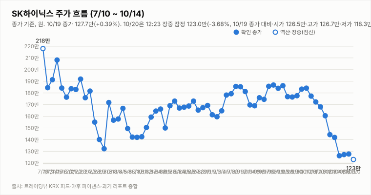
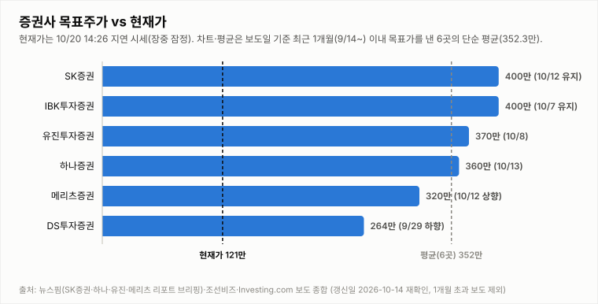

# SK하이닉스 투자 리포트 — 2026-10-20 (화) 아침 리포트 (09:10 KST, 개장 전 데이터)

> **작성** 2026-10-20 09:10 KST · **확정 판정: 중립 유지(10/19 종가 기준)** · 전일 종가 127.7만원(+0.39%)은 `quote.json`(marketTime 10/19 15:30 KST)으로 확정이며 트레이딩뷰 종가와 일치합니다(거래량은 야후 정정치). 간밤 지표는 night.yml 스냅샷(2026-10-20 08:04 KST)이고 오늘 정규장 시세는 수집 시점에 미반영이라 확인 불가입니다. 확정 판정은 종가 기준으로만 변경합니다.

> **종목** SK하이닉스 (KRX 000660 · NASDAQ 상장 7/10)
> 본 자료는 정보 제공 목적이며 투자 권유가 아닙니다.

## 핵심 요약

- **투자의견: 확정 판정 중립 유지** — 판정은 종가 기준으로만 변경하므로 아침 리포트는 10/19 종가 기준 확정 판정(중립)을 그대로 인용합니다. 방향성 4요소는 긍정 2개(②④)·부정 2개(①③)였고, 중립→매수는 긍정 3개 이상·부정 0개, 중립→매도는 부정 3개 이상·긍정 0개가 필요해 둘 다 미충족입니다. 간밤 미국 반도체 반등(SOX +1.61%·마이크론 +2.97%·ADR +4.67%)은 개장 후 ①에 우호적일 수 있으나 야간선물은 -0.13%로 보합권이라 엇갈리며, 판정은 오늘 종가에서만 바꿉니다.
- **10/19 확정 종가 127.7만(+0.39%)** — 시가 121.2만(10/16 종가 대비 -4.72% 갭다운)·고가 127.7만·저가 120.8만, 거래량 373.7만주(야후 최신 값, 20일 평균의 1.11배; 어제 마감 리포트의 371.7만주는 당시 야후 값이었고 이후 정정됐으며 트레이딩뷰 피드는 369.6만주). 10/16 종가(127.2만) 대비 +0.5만원, 종가가 장중 고가와 같았고 종가 기준 2거래일 연속 상승 마감입니다. 10/2 종가(184.1만) 대비로는 -30.6%입니다.
- **간밤 변수·개장 전 헤드라인**: 미국장(10/19 월)은 반등했습니다. SOX +1.61%(11,316.34)·나스닥 +1.11%·S&P500 +0.41%, 마이크론 +2.97%, 엔비디아 +1.38%, SK하이닉스 ADR 142.87달러(+4.67%), EWY +4.08%였고 원/달러는 1,330.59원(-0.13%)입니다. 코스피200 야간선물은 주간 종가(893.25) 대비 -0.13%(892.1, 10/20 06:00 기준 20분 지연, 야간 세션 값인지 첫 실측 검증 진행 중)로 보합권입니다. 헤드라인 기준 YTN "SK하이닉스 손자회사 '중복상장' 논란에…금감원 '문제 있어'"(🔴), 녹색경제신문 "美반도체 2.5% 반등에도 SK하이닉스 외국인 매도 지속…40조 자사주가 주가 방어", 머니투데이 "영업익 '76.9조' 6번째 신기록 쓰나", 조세일보 "우리은행, SK하이닉스 협력사에 7500억원 금융지원"이 나왔습니다(헤드라인만 확인, 외국인 매도 규모·금감원 후속 조치 확인 불가).
- **지표(10/19 quote.json 종가 확정)**: DMI 격차 -33.7(+DI 13.9 < -DI 47.6), KDJ K 7.6·D 9.4(격차 -1.8, 과매도 구간), MACD 히스토그램 -6.11만(시그널 하회). 거래량은 20일 평균의 1.11배입니다. 3Q26 실적 발표(10/27)까지 **D-7**이고 10/14 개막한 반도체대전이 진행 중입니다.

## 시세

| 시가 | 고가 | 저가 | 종가 | 등락 | 거래량 |
|---|---|---|---|---|---|
| ₩1,212,000 | ₩1,277,000 | ₩1,208,000 | **₩1,277,000** | **+0.39%** | 3,737,172주 |

출처: 야후 `quote.json`(marketTime 15:30 KST 확정)·트레이딩뷰 KRX 피드 교차 확인(종가 1,277,000원 일치). 전일(10/16) 확정 종가 1,272,000원 대비 +5,000원(+0.39%)이며 거래량은 야후 정정치(트레이딩뷰 369.6만주)입니다.

**오늘 10/20 (화) — 개장 전 (정규장 시세 확인 불가)** (야후 `quote.json` 09:10 수집 시점에 오늘 봉이 반영되지 않았습니다)

| 시가 | 고가 | 저가 | 현재가 | 등락(10/19 종가 대비) | 거래량 |
|---|---|---|---|---|---|
| 확인 불가 | 확인 불가 | 확인 불가 | 확인 불가 | 확인 불가 | 확인 불가 |

## 기술적 지표 (10/19 종가 확정 기준, 야후 일봉)

| 지표 | 값 | 해석 |
|---|---|---|
| MACD (12,26,9) | -11.17만 / 시그널 -5.06만 / 히스토그램 -6.11만 | 하락 모멘텀 지속 |
| ATR (14) | 9.43만 (7.4%) | 변동성 매우 큼 |
| ADX / DMI | ADX 22.5 · +DI 13.9 · -DI 47.6 | 추세 강도 약함, 격차 -33.7(-DI 우위) |
| KDJ (9,3,3) | K 7.6 · D 9.4 · J 4.0 | 과매도 구간, K<D 하락 우위(-1.8) |
| 거래량 / 20일 이평 | 373.7만 / 336.5만 | 평균의 1.11배 |

야후가 10/13 일봉을 정정 반영하면서 어제 리포트의 값(MACD 히스토그램 -3.59만·DMI -26.1)과 달라졌습니다.

종가 기준 격차 흐름: DMI 9/29 +1.6 → 9/30 +4.3 → 10/1 +2.2 → 10/2 +3.9 → 10/6 -0.8 → 10/7 -4.7 → 10/8 -7.9 → 10/12 -13.9(15:14 집계) → 10/13 -26.1(어제 리포트 기준) → 10/14 -25.9(종가 확정) → 10/15 -34.5(종가 확정·정정) → 10/16 -32.5(종가 확정) → 10/19 -33.7(종가 확정), KDJ 9/29 -8.4 → 9/30 -8.9 → 10/1 -5.2 → 10/2 -2.2 → 10/6 -8.2 → 10/7 -14.1 → 10/8 -15.1 → 10/12 -13.3(15:14 집계) → 10/13 -10.9(어제 리포트 기준) → 10/14 -8.4(종가 확정) → 10/15 -6.4(종가 확정·정정) → 10/16 -4.4(종가 확정) → 10/19 -1.8(종가 확정).

## 최신 뉴스 Top 5 (구글 뉴스 헤드라인 기준, 같은 사안은 1건만)

1. 🔴 **SK하이닉스 손자회사 '중복상장' 논란에...금감원 "문제 있어"** (YTN, 10/19) · 솔리다임 중복상장 규제 사안(헤드라인만 확인, 금감원 후속 조치·결과 확인 불가)
2. ⚪ **美반도체 2.5% 반등에도 SK하이닉스 외국인 매도 지속…40조 자사주가 주가 방어** (녹색경제신문, 10/20) · 수급·주주환원 사안(헤드라인만 확인, 매도 규모·자사주 집행 내용 확인 불가)
3. 🟢 **영업익 '76.9조' 6번째 신기록 쓰나…'겹호재' SK하이닉스 4Q도 질주** (머니투데이, 10/19) · 실적 전망 사안(같은 매체 "사상 최대 실적 예고"와 같은 사안은 1건만 수록, 헤드라인만 확인·컨센서스 집계 기준 확인 불가)
4. ⚪ **우리은행, SK하이닉스 협력사에 7500억원 금융지원** (조세일보, 10/20) · 협력사 금융지원 사안(2조원 보증 지원 기사들과 같은 계열 사안, 헤드라인만 확인·지원 효과 확인 불가)
5. ⚪ **마이크론, 로봇용 메모리 개발…삼성·SK하이닉스와 경쟁** (글로벌이코노믹, 10/20) · 경쟁 환경 사안(헤드라인만 확인, 제품·시점 확인 불가)

※ 뉴스는 헤드라인 기준이며 본문 수치는 별도 검증하지 않았습니다. 같은 사안을 다룬 기사는 가장 최신 1건만 남겼습니다(예: 홍보성 "초심 조형물" 기사 3건·구직자 관심 기업 순위 기사 제외, [포토] 제외).

## 실적 · 밸류에이션 (갱신일 2026-10-14, 10/16 재확인: 신규 확인 불가)

2Q26 확정 매출 79.3조·영업이익 60.5조(영업이익률 76%), **3Q26 컨센서스(에프앤가이드 10/8 갱신)는 매출 98.4조·영업이익 77.1조(영업이익률 78.3%)**로 9/4 기준(100.3조/78.7조)·9/30 집계(영업이익 78.1조)에서 소폭 하향됐습니다. 메리츠증권은 원화 강세·개선 속도 둔화로 시장 컨센서스가 74조원까지 내려갔다고 분석했고(헤드라인 기준), 증권사별로는 메리츠 80.1조·SK증권 79조·IBK 75.1조·DS투자 70조로 편차가 큽니다. 3Q26 실적 발표는 10/27(D-13)입니다. 10/14 재확인에서 에프앤가이드 신규 집계(10/8 이후)와 증권사 추정치 변경은 확인하지 못했습니다.

> 밸류에이션 갱신일 2026-10-14 — 10/16 재조사에서도 신규·변경 목표주가 보도를 확인하지 못해 6곳을 유지했습니다(직전 확인 2026-10-14). 직전 컨센서스 322만원은 9/3 한국경제 기준. **차트는 보도일 기준 최근 1개월(9/16~10/16) 이내 목표가를 낸 6곳만 표시하며 평균 목표가도 이 6곳의 단순 평균(352.3만원)입니다.** 1개월 초과 리포트(한국투자증권 470만원 7/30, KB증권 420만원 7/30 유지, 교보증권 400만원 7/9 등)는 평균에서도 제외했습니다. 참고: 뉴스핌 로보뉴스(SK증권 리포트 브리핑, 10/12) 집계의 최근 6개월 전체 증권사 평균 목표가는 3,232,083원이며 집계 방식에 따라 다른 평균이 보도될 수 있습니다(예: 연합인포맥스 약 268만원, 약 4개월 전 기사).

최근 1개월 이내 6곳의 평균 목표주가 352.3만원은 10/19 종가 127.7만 대비 **+175.9%** 괴리입니다(10/15 종가 126.2만 기준 +179.2%). 6곳은 SK증권 400만원 유지(10/12), IBK 400만원 유지(10/7), 유진 370만원(10/8), 하나증권 360만원 "컨센서스 부합"(10/13), 메리츠 320만원 상향(10/12), DS투자 264만원(9/29 하향)입니다. 표본이 적어 평균은 참고용이며, 6개월 전체 평균(323.2만원) 대비 괴리율은 10/19 종가 기준 +153.1%입니다.

## 산업 동향 — HBM·DRAM·NAND (갱신일 2026-10-14)

> 10/16 재조사에서 신규 가격 전망·점유율 발표를 확인하지 못해 수치는 10/14 조사분을 유지했습니다(직전 확인 2026-10-14). 수치는 TrendForce 9/30 발표·산업통상부 10/1 발표·국내 언론 헤드라인 기준이며 차트의 점유율은 카운터포인트 1Q26(매출 기준)·트렌드포스 연간 전망입니다. 2Q26 이후 확정 점유율은 확인 불가.

**HBM / DRAM**

- **4Q26 범용 D램 계약가 +10~15%(QoQ)** — TrendForce 전망. 3Q26 전망(+13~18%)보다 둔화됐지만 AI 서버 수요와 첨단 공정 캐파 우선 배정으로 상승 기조는 유지.
- **2027년 HBM 가격 협상** — 헤드라인 기준 TrendForce는 내년 HBM 평균판매가 약 +121%를 전망(주체가 TrendForce 전망인지 마이크론 계약 기준인지 보도마다 엇갈림). 삼성전자는 HBM4 연간 공급가를 높게 제시했다는 보도가 있고, SK하이닉스는 2027년 물량·가격 협상 중으로 최종 내용은 확인 불가.
- **HBM 점유율** — 카운터포인트 1Q26 SK하이닉스 58%·삼성전자 21%·마이크론 21%, 트렌드포스 2026년 연간 50%·28%·22% 전망. 마이크론은 HBM4 10억달러 이상 출하·연말 점유율 20%대 목표, 삼성전자도 HBM4 양산 약 4개월 만에 누적 매출 10억달러 보도.
- **중국 CXMT 추격** — 10/9~10 콘퍼런스에서 4F² 셀 구조 DDR5 서버용 D램(RDIMM) 연내 출시를 예고(구체 사양·양산 일정 미공개, 우려와 과장 분석이 엇갈림). HBM이 아닌 범용 D램 기술이며 10/12~10/13 메모리주 급락의 계기로 거론됐으나 인과관계는 단정하지 않음.
- **수출** — 9월 반도체 수출 603억달러(+262.8%), 단일 품목 최초 600억달러 돌파(산업통상부 10/1).

**NAND**

- **4Q26 NAND 계약가 +15~20%(QoQ)** — 3Q26 전망(+18~23%)보다 둔화. eSSD 상승폭이 가장 크고 한 보도는 +23~28%를 전함(단일 보도 기준). eSSD 비트 수요는 전년 대비 80% 이상 증가 전망.
- **소비자 부문 부담** — PC·스마트폰은 원가 부담으로 SSD 용량을 줄이는 방식으로 대응 중. 솔리다임 상장 관련 주주가치 논란도 지속.

**해석**: 가격 상승률은 둔화(D램 +13~18%→+10~15%, 낸드 +18~23%→+15~20%)했지만 방향은 상승이고 HBM 2027년 가격 협상이 진행 중이라 요소 ④ 산업 사이클은 긍정 유지입니다. 상승률 둔화와 CXMT 추격은 업황 고점 논쟁을 키울 수 있어 10월 수출·4Q 계약가 실측·HBM4 협상 결과를 점검합니다.

## 투자 판단

**의견: 확정 판정 중립(유지, 10/19 종가 기준) — 아침 리포트는 확정 판정만 인용하며 변경은 종가 기준으로만 합니다**

| 요소 | 방향 | 근거 |
|---|---|---|
| ① 추세/모멘텀 | 부정(완화 조짐) | 종가 기준 2거래일 연속 상승 마감(10/16 +0.79%, 10/19 +0.39%)과 KDJ 격차 축소(-1.8)에도 종가 확정 MACD 시그널 하회(히스토그램 -6.11만)·DMI -DI 우위(-33.7)·KDJ K<D(과매도 구간)로 종가 기준 반전 신호는 미확인(10/2 대비 -30.6%) |
| ② 밸류에이션 갭 | 긍정 | 최근 1개월 6곳 평균 목표가 352.3만 대비 10/19 종가 127.7만 — +175.9%(10/16 종가 기준 +177.0%) |
| ③ 촉매 | 부정(약함, 확정 유지) | 확정 판정 시점(10/19 종가) 부정(약함)을 유지했습니다. 개장 전(09:10) Top10 자동분류는 🔴 악재 1건(YTN "SK하이닉스 손자회사 '중복상장' 논란에…금감원 '문제 있어'")·🟢 호재 3건(Investing.com "SK하이닉스 주가, 오늘 급등한 이유는?"·머니투데이 "영업익 '76.9조' 6번째 신기록 쓰나"·같은 매체 "사상 최대 실적 예고", 뒤의 둘은 같은 실적 사안)·⚪ 중립 6건입니다. 호재(실적 전망·40조 자사주 방어 보도·우리은행 7,500억 협력사 금융지원)와 악재(금감원 '문제 있어' 규제 리스크, 외국인 매도 지속 헤드라인)가 맞서 개장 전 헤드라인은 혼조에 가깝고, 간밤 미국 반도체 반등은 아직 한국 헤드라인에 충분히 반영되지 않았으므로 확정 ③은 바꾸지 않고 개장 후 재확인합니다(모두 헤드라인만 확인, 금감원 후속 조치·외국인 매도 규모는 확인 불가). |
| ④ 산업 사이클 | 긍정 | HBM4 공급가 급등, 메모리 공급부족 구조, 3Q 이익 전망 상향 (산업 동향 갱신일 2026-10-14 재확인: 4Q 범용 D램 +10~15%·낸드 +15~20%, 상승률 둔화) |

**종합(10/19 종가 확정): 긍정 2·부정 2 → 중립 유지(확정).** 현재 판정(10/16 확정 중립)에 10/19 종가 데이터로 유지 규칙 표를 적용한 결과입니다. 매수 복귀는 긍정 3개 이상·부정 0개가 필요하고, 매도 진입은 부정 3개 이상·긍정 0개입니다(현재 부정 2·긍정 2로 해당 없음). 오늘 장중 업데이트에서는 같은 표로 잠정 판정을 병기하고 종가에서 확정합니다.

## 오늘(10/20, 화) 전망 — 간밤 미국 반도체 반등과 야간선물 보합, 127.7만 안착 여부

| 항목 | 내용 |
|---|---|
| 지지선 | 127.2만(10/16 종가) · 126.2만(10/15 종가) · 124.7만(10/16 저가) · 121.2만(10/19 시가) · 120.8만(10/19 저가) — 120.8만 하회 시 뚜렷한 지지 레벨 확인 불가 |
| 저항선 | 127.7만(10/19 종가·고가) · 129.0만(10/16 시가) · 132.5만(10/16 고가) · 133.2만(10/15 고가) · 140.2만(10/14 저가) · 141.9만(10/14 종가) · 144.3만(10/13 종가) · 145.8만(10/14 시가) |
| 예상 등락 레인지(참고용) | 10/19 종가 ± ATR 9.43만 = 118.3만 ~ 137.1만(참고용) |
| 예정 이벤트 | 3Q26 실적 발표 10/27(10/20 기준 D-7) · 반도체대전(10/14 개막) 진행 중(종료일 확인 불가) · 간밤 미국 반도체 반등(SOX +1.61%·마이크론 +2.97%·ADR +4.67%) · 코스피200 야간선물 -0.13% · 솔리다임 중복상장 금감원 "문제 있어" 보도 이후 후속 조치(결과·시점 확인 불가) · 외국인 순매도 지속·40조 자사주 방어 헤드라인(규모 확인 불가) · 우리은행 7,500억·2조 규모 협력사 금융지원 보도 · 영업이익 76.9조 6번째 신기록 전망 헤드라인(컨센서스 갱신 여부는 확인 불가) · 원/달러 1,330.59원(-0.13%) |
| 관찰 포인트 | 갭업 여부와 127.7만(10/19 종가)·129.0만(10/16 시가) 안착 여부, 127.2만(10/16 종가) 지지 여부, 반등 시 거래량 동반 여부, 솔리다임 중복상장 금감원 후속 조치, 외국인 순매도 지속 여부(확인 불가), 종가 기준 DMI·KDJ 방향(KDJ 격차 -1.8) |
| 상방 시나리오 | ADR +4.67%·SOX +1.61%·마이크론 +2.97%의 간밤 반등과 KDJ 과매도(K 7.6)로 갭업·반등 지속이 나올 수 있음. 다만 129.0만(10/16 시가) 돌파와 ①의 개선(종가 기준 DMI 재역전·MACD 시그널 상회)이 확인돼야 매수 복귀 논의가 가능하고, 긍정 3개 이상·부정 0개 조건이 필요(현재 긍정 2·부정 2) |
| 하방 시나리오 | 야간선물이 -0.13%로 보합권이라 갭업이 제한될 수 있고, 외국인 순매도 지속 헤드라인과 솔리다임 중복상장 규제 리스크가 이어지면 127.2만~126.2만 이탈 후 124.7만 재시험과 변동성 확대 가능성이 있음. ②④가 긍정이라 매도 진입 조건(부정 3개 이상·긍정 0개)은 충족되지 않음 |
| 야간선물 | -0.13%(코스피200 야간선물 892.1, 주간 종가 893.25 대비·`updateTimeKST` 10-20 06:00·20분 지연; 야간 세션 값인지 첫 실측 검증 진행 중) |

간밤 미국 반도체주 반등(SOX +1.61%, 마이크론 +2.97%, ADR +4.67%)은 우호적이나 야간선물이 -0.13%로 보합권이라 개장 직후 보합~갭업 가능성으로 보이며, 상승폭이 유지될지는 단정하기 어렵습니다. 종가 기준 2거래일 연속 상승 뒤 KDJ 격차도 -1.8로 좁혀져 있어 방향은 단정하지 않으며, 방향성 참고일 뿐 가격 예측이 아닙니다.

---

*본 자료는 공개 보도·자료를 종합해 작성한 정보 제공 목적의 리포트이며 투자 판단과 책임은 투자자 본인에게 있습니다.*
