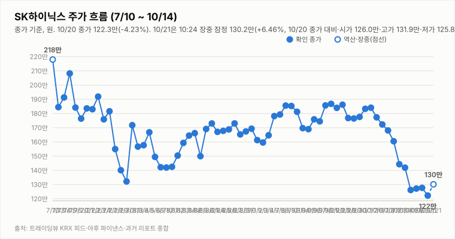
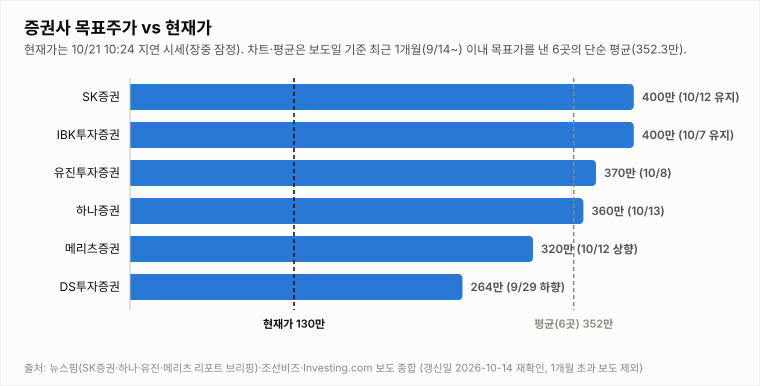
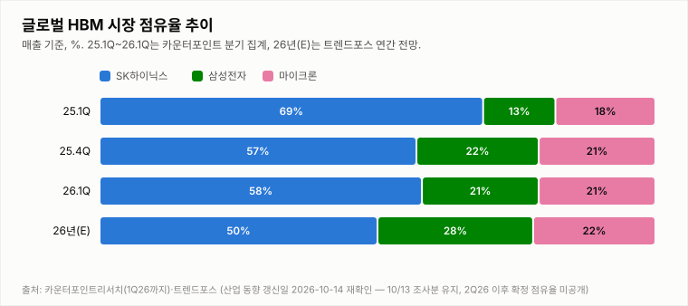

# SK하이닉스 투자 리포트 — 2026-10-21 (수) 아침 리포트 (09:13 KST, 개장 전 데이터)

> **작성** 2026-10-21 09:13 KST · **확정 판정: 중립 유지(10/20 종가 기준)** · 전일 종가 122.3만원(-4.23%)은 `quote.json`(marketTime 10/20 15:30 KST)으로 확정이며 트레이딩뷰 종가와 일치합니다(거래량은 야후 최신 정정치). 간밤 지표는 night.yml 스냅샷(2026-10-21 08:04 KST, 원/달러는 08:50)이고 오늘 정규장 시세는 수집 시점에 미반영이라 확인 불가입니다. 확정 판정은 종가 기준으로만 변경합니다.

> **종목** SK하이닉스 (KRX 000660 · NASDAQ 상장 7/10)
> 본 자료는 정보 제공 목적이며 투자 권유가 아닙니다.

## 핵심 요약

- **투자의견: 확정 판정 중립 유지** — 판정은 종가 기준으로만 변경하므로 아침 리포트는 10/20 종가 기준 확정 판정(중립)을 그대로 인용합니다. 방향성 4요소는 긍정 2개(②④)·부정 2개(①③)였고, 중립→매수는 긍정 3개 이상·부정 0개, 중립→매도는 부정 3개 이상·긍정 0개가 필요해 둘 다 미충족입니다. 간밤 코스피200 야간선물은 +1.84%(주간 종가 대비)로 반등을 가리키지만 ADR(-2.16%)·EWY(-1.65%)는 약세라 엇갈리며, 판정은 오늘 종가에서만 바꿉니다.
- **10/20 확정 종가 122.3만(-4.23%)** — 시가 126.5만(10/19 종가 대비 -0.94%)·고가 126.7만·저가 118.3만(-7.36%), 거래량 346.4만주(야후 최신값, 20일 평균의 1.01배; 마감 리포트의 328.5만주는 15:53 시점 값이었고 이후 정정됐으며 트레이딩뷰 20:00 기준은 341.4만주). 장중 저가에서 +3.4% 회복해 마감했고 종가 기준 2거래일 연속 상승이 끊겼습니다. 10/2 종가(184.1만) 대비로는 -33.6%입니다.
- **간밤 변수·개장 전 헤드라인**: 미국장(10/20 화)은 혼조였습니다. SOX -0.29%(11,283.81)·나스닥 -0.02%·S&P500 +0.28%, 마이크론 -0.98%, 엔비디아 -0.29%, SK하이닉스 ADR 139.79달러(-2.16%), EWY -1.65%였고 원/달러는 1,323.64원(-0.24%, 08:50)입니다. 코스피200 야간선물은 876.9로 주간 종가(861.05) 대비 +1.84%(10/21 06:00 기준 20분 지연, 야간 세션 값인지 첫 실측 검증 진행 중)입니다. 헤드라인은 연합인포맥스 "마이크론 파업 예고…삼성전자·SK하이닉스 반사이익 기대"(🟢), 얼라인 "SK㈜ 지분 1.5% 보유 공개…'하이닉스 가치 미반영'", 조선비즈 "초호황에 숨겨진 SK하이닉스의 걱정거리…HBM4 시장서 우위 약화", YTN "외국인, SK하이닉스 한 달째 순매도...중복상장 논란까지"(🔴)입니다(헤드라인만 확인, 파업 규모·시점과 외국인 순매도 규모는 확인 불가).
- **지표(10/20 quote.json 종가 확정)**: DMI 격차 -33.2(+DI 12.9 < -DI 46.1), KDJ K 7.3·D 8.7(격차 -1.4, 과매도 구간), MACD 히스토그램 -6.01만(시그널 하회). 거래량은 20일 평균의 1.01배입니다. 3Q26 실적 발표(10/27)까지 **D-6**이고 반도체대전(10/14 개막)이 진행 중입니다.

## 시세

| 시가 | 고가 | 저가 | 종가 | 등락 | 거래량 |
|---|---|---|---|---|---|
| ₩1,265,000 | ₩1,267,000 | ₩1,183,000 | **₩1,223,000** | **-4.23%** | 3,464,412주 |

출처: 야후 `quote.json`(marketTime 15:30 KST 확정)·트레이딩뷰 KRX 피드 교차 확인(종가 1,223,000원 일치). 전일(10/19) 확정 종가 1,277,000원 대비 -54,000원(-4.23%)이며 거래량은 야후 최신 정정치입니다(마감 리포트 328.5만주 → 346.4만주).

**오늘 10/21 (수) — 개장 전 (정규장 시세 확인 불가)** (야후 `quote.json` 09:13 수집 시점에 오늘 봉이 반영되지 않았습니다)

| 시가 | 고가 | 저가 | 현재가 | 등락(10/20 종가 대비) | 거래량 |
|---|---|---|---|---|---|
| 확인 불가 | 확인 불가 | 확인 불가 | 확인 불가 | 확인 불가 | 확인 불가 |

## 기술적 지표 (10/20 종가 확정 기준, 야후 일봉)

| 지표 | 값 | 해석 |
|---|---|---|
| MACD (12,26,9) | -12.58만 / 시그널 -6.56만 / 히스토그램 -6.01만 | 하락 모멘텀 지속 |
| ATR (14) | 9.43만 (7.7%) | 변동성 매우 큼 |
| ADX / DMI | ADX 24.9 · +DI 12.9 · -DI 46.1 | 추세 형성 중, 격차 -33.2(-DI 우위) |
| KDJ (9,3,3) | K 7.3 · D 8.7 · J 4.5 | 과매도 구간, K<D 하락 우위(-1.4) |
| 거래량 / 20일 이평 | 346.4만 / 341.5만 | 평균의 1.01배 |

야후가 10/13 일봉을 정정 반영하면서 어제 리포트의 값(MACD 히스토그램 -3.59만·DMI -26.1)과 달라졌습니다.

종가 기준 격차 흐름: DMI 9/29 +1.6 → 9/30 +4.3 → 10/1 +2.2 → 10/2 +3.9 → 10/6 -0.8 → 10/7 -4.7 → 10/8 -7.9 → 10/12 -13.9(15:14 집계) → 10/13 -26.1(어제 리포트 기준) → 10/14 -25.9(종가 확정) → 10/15 -34.5(종가 확정·정정) → 10/16 -32.5(종가 확정) → 10/19 -33.2(종가 확정), KDJ 9/29 -8.4 → 9/30 -8.9 → 10/1 -5.2 → 10/2 -2.2 → 10/6 -8.2 → 10/7 -14.1 → 10/8 -15.1 → 10/12 -13.3(15:14 집계) → 10/13 -10.9(어제 리포트 기준) → 10/14 -8.4(종가 확정) → 10/15 -6.4(종가 확정·정정) → 10/16 -4.4(종가 확정) → 10/19 -1.8(종가 확정).

## 최신 뉴스 Top 5 (구글 뉴스 헤드라인 기준, 같은 사안은 1건만)

1. 🟢 **마이크론 파업 예고…삼성전자·SK하이닉스 반사이익 기대** (연합인포맥스, 10/21) · 경쟁사 파업 예고 사안(헤드라인만 확인, 파업 규모·시점·실제 반사이익 확인 불가)
2. ⚪ **얼라인, SK㈜ 지분 1.5% 보유 공개…"하이닉스 가치 미반영"** (연합인포맥스, 10/21) · 지배구조·가치 재평가 사안(헤드라인만 확인, 요구 내용 확인 불가)
3. ⚪ **초호황에 숨겨진 SK하이닉스의 걱정거리… "HBM4 시장서 우위 약화"** (조선비즈, 10/21) · HBM4 경쟁 사안(헤드라인만 확인, 점유율 수치 확인 불가)
4. 🔴 **외국인, SK하이닉스 한 달째 순매도...중복상장 논란까지** (YTN, 10/20) · 수급·중복상장 사안(전남일보 "솔리다임 중복상장 논란에 하락 진일보" 등 같은 사안은 1건만 수록, 헤드라인만 확인, 순매도 규모 확인 불가)
5. ⚪ **"하이닉스 470만·삼성전자 67만 간다"…노무라 파격 전망, 왜** (중앙일보, 10/20) · 증권사 목표주가 사안(헤드라인만 확인, 9/4 보고서의 유지 목표가로 보여 1개월 평균에는 미반영)

※ 뉴스는 헤드라인 기준이며 본문 수치는 별도 검증하지 않았습니다. 같은 사안을 다룬 기사는 가장 최신 1건만 남겼습니다(예: 홍보성 "초심 조형물" 기사 3건·구직자 관심 기업 순위 기사 제외, [포토] 제외).

## 실적 · 밸류에이션 (갱신일 2026-10-14, 10/16 재확인: 신규 확인 불가)

2Q26 확정 매출 79.3조·영업이익 60.5조(영업이익률 76%), **3Q26 컨센서스(에프앤가이드 10/8 갱신)는 매출 98.4조·영업이익 77.1조(영업이익률 78.3%)**로 9/4 기준(100.3조/78.7조)·9/30 집계(영업이익 78.1조)에서 소폭 하향됐습니다. 메리츠증권은 원화 강세·개선 속도 둔화로 시장 컨센서스가 74조원까지 내려갔다고 분석했고(헤드라인 기준), 증권사별로는 메리츠 80.1조·SK증권 79조·IBK 75.1조·DS투자 70조로 편차가 큽니다. 3Q26 실적 발표는 10/27(D-13)입니다. 10/14 재확인에서 에프앤가이드 신규 집계(10/8 이후)와 증권사 추정치 변경은 확인하지 못했습니다.

> 밸류에이션 갱신일 2026-10-14 — 10/16 재조사에서도 신규·변경 목표주가 보도를 확인하지 못해 6곳을 유지했습니다(직전 확인 2026-10-14). 직전 컨센서스 322만원은 9/3 한국경제 기준. **차트는 보도일 기준 최근 1개월(9/16~10/16) 이내 목표가를 낸 6곳만 표시하며 평균 목표가도 이 6곳의 단순 평균(352.3만원)입니다.** 1개월 초과 리포트(한국투자증권 470만원 7/30, KB증권 420만원 7/30 유지, 교보증권 400만원 7/9 등)는 평균에서도 제외했습니다. 참고: 뉴스핌 로보뉴스(SK증권 리포트 브리핑, 10/12) 집계의 최근 6개월 전체 증권사 평균 목표가는 3,232,083원이며 집계 방식에 따라 다른 평균이 보도될 수 있습니다(예: 연합인포맥스 약 268만원, 약 4개월 전 기사).

최근 1개월 이내 6곳의 평균 목표주가 352.3만원은 10/20 확정 종가 122.3만 대비 **+188.1%** 괴리입니다(10/19 종가 127.7만 기준 +175.9%). 6곳은 SK증권 400만원 유지(10/12), IBK 400만원 유지(10/7), 유진 370만원(10/8), 하나증권 360만원 "컨센서스 부합"(10/13), 메리츠 320만원 상향(10/12), DS투자 264만원(9/29 하향)입니다. 표본이 적어 평균은 참고용이며, 6개월 전체 평균(323.2만원) 대비 괴리율은 10/20 종가 기준 +164.3%입니다.

## 산업 동향 — HBM·DRAM·NAND (갱신일 2026-10-14)

> 10/16 재조사에서 신규 가격 전망·점유율 발표를 확인하지 못해 수치는 10/14 조사분을 유지했습니다(직전 확인 2026-10-14). 수치는 TrendForce 9/30 발표·산업통상부 10/1 발표·국내 언론 헤드라인 기준이며 차트의 점유율은 카운터포인트 1Q26(매출 기준)·트렌드포스 연간 전망입니다. 2Q26 이후 확정 점유율은 확인 불가.

**HBM / DRAM**

- **4Q26 범용 D램 계약가 +10~15%(QoQ)** — TrendForce 전망. 3Q26 전망(+13~18%)보다 둔화됐지만 AI 서버 수요와 첨단 공정 캐파 우선 배정으로 상승 기조는 유지.
- **2027년 HBM 가격 협상** — 헤드라인 기준 TrendForce는 내년 HBM 평균판매가 약 +121%를 전망(주체가 TrendForce 전망인지 마이크론 계약 기준인지 보도마다 엇갈림). 삼성전자는 HBM4 연간 공급가를 높게 제시했다는 보도가 있고, SK하이닉스는 2027년 물량·가격 협상 중으로 최종 내용은 확인 불가.
- **HBM 점유율** — 카운터포인트 1Q26 SK하이닉스 58%·삼성전자 21%·마이크론 21%, 트렌드포스 2026년 연간 50%·28%·22% 전망. 마이크론은 HBM4 10억달러 이상 출하·연말 점유율 20%대 목표, 삼성전자도 HBM4 양산 약 4개월 만에 누적 매출 10억달러 보도.
- **중국 CXMT 추격** — 10/9~10 콘퍼런스에서 4F² 셀 구조 DDR5 서버용 D램(RDIMM) 연내 출시를 예고(구체 사양·양산 일정 미공개, 우려와 과장 분석이 엇갈림). HBM이 아닌 범용 D램 기술이며 10/12~10/13 메모리주 급락의 계기로 거론됐으나 인과관계는 단정하지 않음.
- **수출** — 9월 반도체 수출 603억달러(+262.8%), 단일 품목 최초 600억달러 돌파(산업통상부 10/1).

**NAND**

- **4Q26 NAND 계약가 +15~20%(QoQ)** — 3Q26 전망(+18~23%)보다 둔화. eSSD 상승폭이 가장 크고 한 보도는 +23~28%를 전함(단일 보도 기준). eSSD 비트 수요는 전년 대비 80% 이상 증가 전망.
- **소비자 부문 부담** — PC·스마트폰은 원가 부담으로 SSD 용량을 줄이는 방식으로 대응 중. 솔리다임 상장 관련 주주가치 논란도 지속.

**해석**: 가격 상승률은 둔화(D램 +13~18%→+10~15%, 낸드 +18~23%→+15~20%)했지만 방향은 상승이고 HBM 2027년 가격 협상이 진행 중이라 요소 ④ 산업 사이클은 긍정 유지입니다. 상승률 둔화와 CXMT 추격은 업황 고점 논쟁을 키울 수 있어 10월 수출·4Q 계약가 실측·HBM4 협상 결과를 점검합니다.

## 투자 판단

**의견: 확정 판정 중립(유지, 10/20 종가 기준) — 아침 리포트는 확정 판정만 인용하며 변경은 종가 기준으로만 합니다**

| 요소 | 방향 | 근거 |
|---|---|---|
| ① 추세/모멘텀 | 부정 | 종가 기준 2거래일 연속 상승이 10/20 -4.23% 하락 마감으로 끊겼고, 종가 확정 MACD 시그널 하회(히스토그램 -6.01만)·DMI -DI 우위(-33.2)·KDJ K<D(과매도 구간, 격차 -1.4)로 종가 기준 반전 신호는 미확인(10/2 종가 대비 -33.6%) |
| ② 밸류에이션 갭 | 긍정 | 최근 1개월 6곳 평균 목표가 352.3만 대비 10/20 종가 122.3만 — +188.1%(10/19 종가 기준 +175.9%) |
| ③ 촉매 | 부정(약함, 확정 유지) | 확정 판정 시점(10/20 종가) 부정(약함)을 유지했습니다. 개장 전(09:13) Top10(같은 내용 기사는 1건으로 묶은 뒤) 자동분류는 🔴 악재 2건(YTN "외국인, SK하이닉스 한 달째 순매도...중복상장 논란까지"·티제이비 "레버리지 ETF 5천원도 붕괴")·🟢 호재 1건(연합인포맥스 "마이크론 파업 예고…삼성전자·SK하이닉스 반사이익 기대")·⚪ 중립 7건입니다. 호재(경쟁사 마이크론 파업 예고 반사이익 기대)와 악재(외국인 순매도·중복상장 논란)가 맞서고, 조선비즈 "HBM4 시장서 우위 약화"·안성시의회 처리수 방류 반대 같은 우려성 중립 기사도 있어 개장 전 헤드라인은 혼조에 가깝습니다. 이에 확정 ③은 바꾸지 않고 개장 후 재확인합니다(모두 헤드라인만 확인, 파업 규모·외국인 순매도 규모·HBM4 점유율 수치는 확인 불가). |
| ④ 산업 사이클 | 긍정 | HBM4 공급가 급등, 메모리 공급부족 구조, 3Q 이익 전망 상향 (산업 동향 갱신일 2026-10-14 재확인: 4Q 범용 D램 +10~15%·낸드 +15~20%, 상승률 둔화) |

**종합(10/20 종가 확정): 긍정 2·부정 2 → 중립 유지(확정).** 현재 판정(10/19 확정 중립)에 10/20 종가 데이터로 유지 규칙 표를 적용한 결과입니다. 매수 복귀는 긍정 3개 이상·부정 0개가 필요하고, 매도 진입은 부정 3개 이상·긍정 0개입니다(현재 부정 2·긍정 2로 해당 없음).

## 오늘(10/21, 수) 전망 — 야간선물 반등 vs ADR·EWY 약세, 123.8만·121.2만 부근 공방과 118.3만 지지

| 항목 | 내용 |
|---|---|
| 지지선 | 121.2만(10/19 시가) · 120.8만(10/19 저가) · 118.3만(10/20 저가·10/19 종가-ATR 하단) — 118.3만 하회 시 뚜렷한 지지 레벨 확인 불가 |
| 저항선 | 123.8만(10/15 저가) · 124.7만(10/16 저가) · 126.5만(10/20 시가) · 126.7만(10/20 고가) · 127.2만(10/16 종가) · 127.7만(10/19 종가) · 129.0만(10/16 시가) · 132.5만(10/16 고가) |
| 예상 등락 레인지(참고용) | 10/20 종가 ± ATR 9.43만 = 112.9만 ~ 131.7만(참고용) |
| 예정 이벤트 | 3Q26 실적 발표 10/27(10/21 기준 D-6) · 반도체대전(10/14 개막) 진행 중(종료일 확인 불가) · 간밤 해외 지표(SOX -0.29%·마이크론 -0.98%·ADR -2.16%·EWY -1.65%)와 코스피200 야간선물 +1.84% · 마이크론 파업 예고 보도(규모·시점 확인 불가) · 솔리다임 중복상장 금감원 후속 조치(결과·시점 확인 불가) · 안성시의회 처리수 방류 반대(경인일보, 후속 영향 확인 불가) · 외국인 한 달째 순매도 헤드라인(규모 확인 불가) · 얼라인의 SK㈜ 지분 보유 공개(헤드라인만 확인) · 원/달러 1,323.64원(-0.24%) |
| 관찰 포인트 | 갭업 여부와 123.8만(10/15 저가)·124.7만(10/16 저가) 회복 여부, 121.2만(10/19 시가) 지지 여부, 반등 시 거래량 동반 여부(10/20 거래량은 평균의 1.01배), 외국인 순매도 지속 여부(확인 불가), 마이크론 파업 보도의 후속(확인 불가), 종가 기준 DMI·KDJ 방향(KDJ 격차 -1.4) |
| 상방 시나리오 | 야간선물 +1.84%와 마이크론 파업 예고 반사이익 기대(헤드라인 기준, 규모·시점 확인 불가)로 갭업·반등이 나올 수 있고 KDJ는 과매도 구간(K 7.3)입니다. 다만 123.8만·124.7만을 넘어 126.7만·127.7만을 회복하고 ①이 개선(종가 기준 DMI 재역전·MACD 시그널 상회)돼야 매수 복귀 논의가 가능하며, 긍정 3개 이상·부정 0개 조건이 필요(현재 긍정 2·부정 2) |
| 하방 시나리오 | ADR -2.16%·EWY -1.65%·마이크론 -0.98%의 약세와 외국인 순매도 지속 헤드라인이 반등을 제한하면 121.2만·120.8만을 이탈해 118.3만(10/20 저가)을 재시험할 수 있음(ATR 7.7%). 매도 진입에는 부정 3개 이상·긍정 0개가 필요해 ②④가 모두 긍정에서 이탈해야 하며 현재는 해당 없음 |
| 야간선물 | +1.84%(코스피200 야간선물 876.9, 주간 종가 861.05 대비·`updateTimeKST` 10-21 06:00·20분 지연; 야간 세션 값인지 첫 실측 검증 진행 중) |

야간선물이 주간 종가 대비 +1.84%로 반등을 가리키지만 ADR(-2.16%)·EWY(-1.65%)·마이크론(-0.98%)은 약세여서 개장 직후 보합~소폭 갭업 가능성 정도로 보이며, 상승폭이 유지될지는 단정하기 어렵습니다. 전일 -4.23% 이후 KDJ는 과매도 구간(격차 -1.4)이고 변동성이 커(ATR 7.7%) 장 초반 등락이 클 수 있습니다(방향성 참고일 뿐 가격 예측이 아닙니다).

---

*본 자료는 공개 보도·자료를 종합해 작성한 정보 제공 목적의 리포트이며 투자 판단과 책임은 투자자 본인에게 있습니다.*
