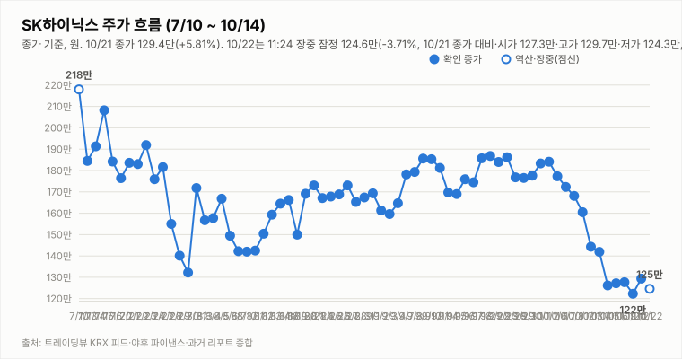
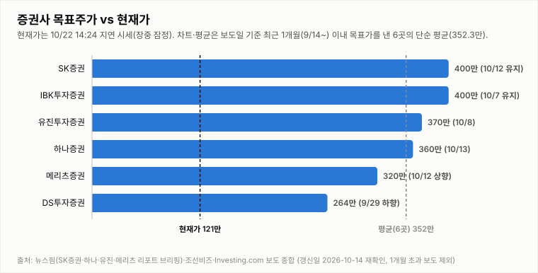

# SK하이닉스 투자 리포트 — 2026-10-22 (목) 마감 리포트 (종가 확정, 15:57 KST)

> **작성** 2026-10-22 15:57 KST · **확정 판정: 중립 유지(10/22 종가 기준)** · 종가 122.3만원(-5.49%)은 `quote.json`(marketTime 10/22 15:30 KST)이며 트레이딩뷰 KRX 피드의 종가(1,223,000원)·거래량(2,400,410주)과 일치합니다. 확정 판정은 종가 기준으로만 변경하며 다음 확정은 10/23 종가입니다.

> **종목** SK하이닉스 (KRX 000660 · NASDAQ 상장 7/10)
> 본 자료는 정보 제공 목적이며 투자 권유가 아닙니다.

## 핵심 요약

- **투자의견: 확정 판정 중립 유지** — 10/22 종가 데이터로 유지 규칙 표를 적용한 확정 결과입니다(직전 확정 10/21 중립). 방향성 4요소는 긍정 2개(②④)·부정 2개(①③)로 중립→매수(긍정 3개 이상·부정 0개)와 중립→매도(부정 3개 이상·긍정 0개) 모두 미충족입니다. 종가 -5.49%로 10/21 반등분을 모두 반납해 ①이 부정으로 남았고, ③은 중복상장 규제 대상 발언·외국인 순매도·자사주 매입 종료 이후 수급 우려 등 악재성 헤드라인이 우세해 부정(약함)으로 판정했습니다. 매도 전환에는 ②④가 모두 긍정에서 이탈해야 해 현재는 해당 없습니다.
- **10/22 확정 종가 122.3만(-5.49%)** — 시가 127.3만(10/21 종가 대비 -1.62% 갭다운)·고가 129.7만(+0.23%)·저가 120.4만(-6.96%), 거래량 240.0만주(20일 평균의 0.68배; 야후와 트레이딩뷰 모두 2,400,410주로 일치, 야후 거래량은 마감 후 정정될 수 있음). 고가 대비 -5.7%, 저가 대비 +1.6%에서 마감했고 종가는 10/20 종가(122.3만)와 같은 가격입니다. 같은 날 코스피200 12월물 선물이 -3.61%(860.85, 15:33), 삼성전자가 214,500원(-4.03%)으로 시장 전반이 약세였습니다. 10/2 종가(184.1만) 대비로는 -33.6%입니다.
- **마감 후 확인 변수**: 15:53 수집은 주간 시간대라 야간선물은 확인 불가(night_futures_valid false)이며 내일 08:00 프리마켓 스냅샷에서 확인합니다. 10/22 미국장(한국시간 10/23 새벽) 결과도 확인 불가입니다. 마감 직후 헤드라인은 뉴스핌 "SK하이닉스, '반도체의 날' 5관왕…권재순 부사장 동탑산업훈장", Investing.com "SK하이닉스 美 인디애나 공장 세수, 공원·도시 개발 등 현지 인프라 확충에 투입", 한국경제 "SK하이닉스 매도 나선 1% 초고수들…'이 종목'으로 갈아탔다"(🔴), 조선비즈 "이억원 “솔리다임은 중복상장 규제 대상…SK하이닉스 등 모회사 의무 발생”"(🔴)입니다(헤드라인만 확인, 규제 내용·초고수 매매 규모는 확인 불가).
- **지표(10/22 quote.json 종가 확정)**: DMI 격차 -27.8(+DI 15.4 < -DI 43.2), KDJ K 10.4·D 9.8(격차 +0.6, K>D, 과매도 구간), MACD 히스토그램 -4.68만(시그널 하회). 거래량은 20일 평균의 0.68배입니다. 3Q26 실적 발표(10/27)까지 **D-5**(10/23 기준 D-4)이고 반도체대전(10/14 개막)이 진행 중입니다.

## 시세

| 시가 | 고가 | 저가 | 종가 | 등락 | 거래량 |
|---|---|---|---|---|---|
| ₩1,260,000 | ₩1,329,000 | ₩1,254,000 | **₩1,294,000** | **+5.81%** | 4,228,927주 |

출처: 야후 `quote.json`(marketTime 15:30 KST 확정)·트레이딩뷰 KRX 피드 교차 확인(종가 1,294,000원 일치). 전일(10/20) 확정 종가 1,223,000원 대비 +71,000원(+5.81%)이며 거래량은 야후 최신 정정치입니다(마감 리포트 397.6만주 → 452.2만주 → 422.9만주).

**오늘 10/22 (목) — 마감 (종가 확정)** (야후 `quote.json` marketTime 15:30 KST 확정, 트레이딩뷰 KRX 피드와 종가·거래량 일치)

| 시가 | 고가 | 저가 | 종가 | 등락(10/21 종가 대비) | 거래량 |
|---|---|---|---|---|---|
| ₩1,273,000 | ₩1,297,000 | ₩1,204,000 | ₩1,223,000 | -5.49% | 2,400,410주 |

## 기술적 지표 (10/22 종가 확정 기준, 야후 일봉)

| 지표 | 값 | 해석 |
|---|---|---|
| MACD (12,26,9) | -13.70만 / 시그널 -9.02만 / 히스토그램 -4.68만 | 하락 모멘텀 지속 |
| ATR (14) | 9.50만 (7.8%) | 변동성 매우 큼 |
| ADX / DMI | ADX 27.8 · +DI 15.4 · -DI 43.2 | 추세 강함, 격차 -27.8(-DI 우위) |
| KDJ (9,3,3) | K 10.4 · D 9.8 · J 11.4 | 과매도 구간, K>D 소폭 우위(+0.6) |
| 거래량 / 20일 이평 | 240.0만 / 351.7만 | 평균의 0.68배 |

야후가 10/13 일봉을 정정 반영하면서 어제 리포트의 값(MACD 히스토그램 -3.59만·DMI -26.1)과 달라졌습니다.

종가 기준 격차 흐름: DMI 9/29 +1.6 → 9/30 +4.3 → 10/1 +2.2 → 10/2 +3.9 → 10/6 -0.8 → 10/7 -4.7 → 10/8 -7.9 → 10/12 -13.9(15:14 집계) → 10/13 -26.1(어제 리포트 기준) → 10/14 -25.9(종가 확정) → 10/15 -34.5(종가 확정·정정) → 10/16 -32.5(종가 확정) → 10/19 -33.2(종가 확정), KDJ 9/29 -8.4 → 9/30 -8.9 → 10/1 -5.2 → 10/2 -2.2 → 10/6 -8.2 → 10/7 -14.1 → 10/8 -15.1 → 10/12 -13.3(15:14 집계) → 10/13 -10.9(어제 리포트 기준) → 10/14 -8.4(종가 확정) → 10/15 -6.4(종가 확정·정정) → 10/16 -4.4(종가 확정) → 10/19 -1.8(종가 확정).

## 최신 뉴스 Top 5 (구글 뉴스 헤드라인 기준, 같은 사안은 1건만)

1. ⚪ **SK하이닉스, '반도체의 날' 5관왕…권재순 부사장 동탑산업훈장** (뉴스핌, 10/22) · 수상 사안(SK hynix·연합뉴스 등 같은 사안은 1건만 수록, 헤드라인만 확인, 수상 내용 확인 불가)
2. ⚪ **SK하이닉스 美 인디애나 공장 세수, 공원·도시 개발 등 현지 인프라 확충에 투입** (Investing.com 한국어, 10/22) · 미국 공장 지역 사안(헤드라인만 확인, 세수 규모·공장 현황 확인 불가)
3. 🔴 **이억원 “솔리다임은 중복상장 규제 대상…SK하이닉스 등 모회사 의무 발생”** (조선비즈, 10/22) · 솔리다임 중복상장 규제 사안(MBC·연합뉴스·연합인포맥스 "외국인 한 달째 16조 줄매도" 등 같은 사안은 1건만 수록, 헤드라인만 확인, 발언 주체의 직함·규제 내용·시점 확인 불가)
4. ⚪ **삼성E&A 15% 급등… 삼성전자·SK하이닉스는 동반 약세** (서울신문, 10/22) · 시황 기사(헤드라인만 확인, 내용 확인 불가)
5. ⚪ **SK하이닉스, 대규모 자사주 매입 마무리…추가 주주환원에 '눈길'** (연합인포맥스, 10/22) · 자사주 매입 종료·주주환원 사안(뉴스핌 "55조 자사주 매수 끝났다…약세" 등 같은 사안은 1건만 수록, 헤드라인만 확인, 추가 환원 내용·규모 확인 불가; 🔴 한국경제 "매도 나선 1% 초고수들"·🟢 연합뉴스 "3조원 채권시장 복귀"는 Top10 참조)

※ 뉴스는 헤드라인 기준이며 본문 수치는 별도 검증하지 않았습니다. 같은 사안을 다룬 기사는 가장 최신 1건만 남겼습니다(예: 홍보성 "초심 조형물" 기사 3건·구직자 관심 기업 순위 기사 제외, [포토] 제외).

## 실적 · 밸류에이션 (갱신일 2026-10-14, 10/16 재확인: 신규 확인 불가)

2Q26 확정 매출 79.3조·영업이익 60.5조(영업이익률 76%), **3Q26 컨센서스(에프앤가이드 10/8 갱신)는 매출 98.4조·영업이익 77.1조(영업이익률 78.3%)**로 9/4 기준(100.3조/78.7조)·9/30 집계(영업이익 78.1조)에서 소폭 하향됐습니다. 메리츠증권은 원화 강세·개선 속도 둔화로 시장 컨센서스가 74조원까지 내려갔다고 분석했고(헤드라인 기준), 증권사별로는 메리츠 80.1조·SK증권 79조·IBK 75.1조·DS투자 70조로 편차가 큽니다. 3Q26 실적 발표는 10/27(D-13)입니다. 10/14 재확인에서 에프앤가이드 신규 집계(10/8 이후)와 증권사 추정치 변경은 확인하지 못했습니다.

> 밸류에이션 갱신일 2026-10-14 — 10/16 재조사에서도 신규·변경 목표주가 보도를 확인하지 못해 6곳을 유지했습니다(직전 확인 2026-10-14). 직전 컨센서스 322만원은 9/3 한국경제 기준. **차트는 보도일 기준 최근 1개월(9/16~10/16) 이내 목표가를 낸 6곳만 표시하며 평균 목표가도 이 6곳의 단순 평균(352.3만원)입니다.** 1개월 초과 리포트(한국투자증권 470만원 7/30, KB증권 420만원 7/30 유지, 교보증권 400만원 7/9 등)는 평균에서도 제외했습니다. 참고: 뉴스핌 로보뉴스(SK증권 리포트 브리핑, 10/12) 집계의 최근 6개월 전체 증권사 평균 목표가는 3,232,083원이며 집계 방식에 따라 다른 평균이 보도될 수 있습니다(예: 연합인포맥스 약 268만원, 약 4개월 전 기사).

최근 1개월 이내 6곳의 평균 목표주가 352.3만원은 10/22 확정 종가 122.3만 대비 **+188.1%** 괴리입니다(10/21 종가 129.4만 기준 +172.3%). 6곳은 SK증권 400만원 유지(10/12), IBK 400만원 유지(10/7), 유진 370만원(10/8), 하나증권 360만원 "컨센서스 부합"(10/13), 메리츠 320만원 상향(10/12), DS투자 264만원(9/29 하향)입니다. 표본이 적어 평균은 참고용이며, 6개월 전체 평균(323.2만원) 대비 괴리율은 10/22 종가 기준 +164.3%입니다. 참고로 중앙일보(10/20)에 노무라 "하이닉스 470만" 헤드라인이 있으나 9/4 보고서에서 유지된 목표가로 보이며(이번 기사 본문 확인 불가) 최근 1개월 평균에는 반영하지 않았습니다.

## 산업 동향 — HBM·DRAM·NAND (갱신일 2026-10-14)

> 10/16 재조사에서 신규 가격 전망·점유율 발표를 확인하지 못해 수치는 10/14 조사분을 유지했습니다(직전 확인 2026-10-14). 수치는 TrendForce 9/30 발표·산업통상부 10/1 발표·국내 언론 헤드라인 기준이며 차트의 점유율은 카운터포인트 1Q26(매출 기준)·트렌드포스 연간 전망입니다. 2Q26 이후 확정 점유율은 확인 불가.

**HBM / DRAM**

- **4Q26 범용 D램 계약가 +10~15%(QoQ)** — TrendForce 전망. 3Q26 전망(+13~18%)보다 둔화됐지만 AI 서버 수요와 첨단 공정 캐파 우선 배정으로 상승 기조는 유지.
- **2027년 HBM 가격 협상** — 헤드라인 기준 TrendForce는 내년 HBM 평균판매가 약 +121%를 전망(주체가 TrendForce 전망인지 마이크론 계약 기준인지 보도마다 엇갈림). 삼성전자는 HBM4 연간 공급가를 높게 제시했다는 보도가 있고, SK하이닉스는 2027년 물량·가격 협상 중으로 최종 내용은 확인 불가.
- **HBM 점유율** — 카운터포인트 1Q26 SK하이닉스 58%·삼성전자 21%·마이크론 21%, 트렌드포스 2026년 연간 50%·28%·22% 전망. 마이크론은 HBM4 10억달러 이상 출하·연말 점유율 20%대 목표, 삼성전자도 HBM4 양산 약 4개월 만에 누적 매출 10억달러 보도.
- **중국 CXMT 추격** — 10/9~10 콘퍼런스에서 4F² 셀 구조 DDR5 서버용 D램(RDIMM) 연내 출시를 예고(구체 사양·양산 일정 미공개, 우려와 과장 분석이 엇갈림). HBM이 아닌 범용 D램 기술이며 10/12~10/13 메모리주 급락의 계기로 거론됐으나 인과관계는 단정하지 않음.
- **수출** — 9월 반도체 수출 603억달러(+262.8%), 단일 품목 최초 600억달러 돌파(산업통상부 10/1).

**NAND**

- **4Q26 NAND 계약가 +15~20%(QoQ)** — 3Q26 전망(+18~23%)보다 둔화. eSSD 상승폭이 가장 크고 한 보도는 +23~28%를 전함(단일 보도 기준). eSSD 비트 수요는 전년 대비 80% 이상 증가 전망.
- **소비자 부문 부담** — PC·스마트폰은 원가 부담으로 SSD 용량을 줄이는 방식으로 대응 중. 솔리다임 상장 관련 주주가치 논란도 지속.

**해석**: 가격 상승률은 둔화(D램 +13~18%→+10~15%, 낸드 +18~23%→+15~20%)했지만 방향은 상승이고 HBM 2027년 가격 협상이 진행 중이라 요소 ④ 산업 사이클은 긍정 유지입니다. 상승률 둔화와 CXMT 추격은 업황 고점 논쟁을 키울 수 있어 10월 수출·4Q 계약가 실측·HBM4 협상 결과를 점검합니다.

## 투자 판단

**의견: 확정 판정 중립(유지, 10/22 종가 기준) — 변경은 종가 기준으로만 하며 다음 확정은 10/23 종가입니다**

| 요소 | 방향 | 근거 |
|---|---|---|
| ① 추세/모멘텀 | 부정 | 종가 -5.49%로 10/21 반등분(+5.81%)을 모두 반납해 10/20 종가와 같은 가격(122.3만)이 됐고, KDJ는 K>D(격차 +0.6)이나 미미하며 DMI 격차는 -27.8로 벌어졌습니다. MACD 시그널 하회(히스토그램 -4.68만)·-DI 우위로 종가 기준 반전 신호는 미확인(10/2 종가 대비 -33.6%) |
| ② 밸류에이션 갭 | 긍정 | 최근 1개월 6곳 평균 목표가 352.3만 대비 10/22 종가 122.3만 — +188.1%(10/21 종가 기준 +172.3%) |
| ③ 촉매 | 부정(약함, 확정) | 확정 판정 시점(10/22 종가) 마감 후 Top10(같은 내용 기사는 1건으로 묶은 뒤) 자동분류는 🟢 호재 1건(연합뉴스 "SK하닉, '3조원' 들고 채권시장 복귀…여전채 중심 매수 전망"; 자금 운용 사안이라 주가 직접 재료로는 보지 않음)·🔴 악재 2건(조선비즈 "이억원 “솔리다임은 중복상장 규제 대상…SK하이닉스 등 모회사 의무 발생”"·한국경제 "SK하이닉스 매도 나선 1% 초고수들…'이 종목'으로 갈아탔다")·⚪ 중립 7건입니다. 중복상장 규제 대상 발언, 오전 외국인 순매도 헤드라인, 자사주 매입 종료 이후 수급 공백, 고수 매도 보도가 겹쳐 악재성이 우세하고 새 호재는 없어 ③을 부정(약함)으로 판정합니다. 소부장 2조 금융 지원·반도체의 날 수상·미국 인디애나 세수 활용 같은 사업 소식은 중립입니다. ③을 중립으로 봐도 ①이 부정이라 매수 조건(부정 0개)이 충족되지 않고, ③이 부정이어도 긍정 2개(②④)가 있어 매도 조건(긍정 0개)이 충족되지 않아 판정은 같습니다(모두 헤드라인만 확인, 규제 내용·순매도·매매 규모는 확인 불가). |
| ④ 산업 사이클 | 긍정 | HBM4 공급가 급등, 메모리 공급부족 구조, 3Q 이익 전망 상향 (산업 동향 갱신일 2026-10-14 재확인: 4Q 범용 D램 +10~15%·낸드 +15~20%, 상승률 둔화) |

**종합(10/22 종가 확정): 긍정 2·부정 2(①③) → 중립 유지(확정).** 현재 판정(10/21 확정 중립)에 10/22 종가 데이터로 유지 규칙 표를 적용한 결과입니다. 매수 복귀는 긍정 3개 이상·부정 0개가 필요하고, 매도 진입은 부정 3개 이상·긍정 0개입니다(현재 부정 2·긍정 2로 해당 없음).

## 내일(10/23, 금) 전망 — 종가 122.3만, 121.2만~120.4만 지지와 124.7만~127.3만 회복 여부

| 항목 | 내용 |
|---|---|
| 지지선 | 121.2만(10/19 시가) · 120.4만(10/22 저가) · 118.3만(10/20 저가) |
| 저항선 | 124.7만(10/16 저가) · 125.4만(10/21 저가) · 126.0만(10/21 시가) · 127.3만(10/22 시가) · 127.7만(10/19 종가) · 129.7만(10/22 고가) |
| 예상 등락 레인지(참고용) | 10/22 종가 ± ATR 9.50만 = 112.8만 ~ 131.8만(참고용) |
| 예정 이벤트 | 3Q26 실적 발표 10/27(10/23 기준 D-4) · 반도체대전(10/14 개막) 진행 중(종료일 확인 불가) · 10/22 미국장 결과(한국시간 10/23 새벽)와 코스피200 야간선물(확인 불가, 내일 08:00 프리마켓 스냅샷) · 솔리다임 중복상장 규제 관련 후속(규제 내용·시점 확인 불가) · 외국인 순매도와 자사주 매입 종료 이후 수급(확인 불가) · SK하이닉스 3조원 채권 매수 보도 후속(확인 불가) · 소부장 협력사 2조 금융 지원 후속(세부 확인 불가) |
| 관찰 포인트 | 121.2만(10/19 시가)·120.4만(10/22 저가) 지지 유지 여부, 124.7만~127.3만 회복 여부, 거래량 증가 동반 여부(10/22 거래량은 평균의 0.68배), 외국인 수급 전환 여부(확인 불가), 종가 기준 DMI·MACD 변화(MACD 시그널 상회 여부), 3Q26 실적(10/27) 앞둔 기대 변화 |
| 상방 시나리오 | 장중 저가 120.4만에서 종가 기준 1.6% 회복했고 KDJ는 과매도 구간(K 10.4)에서 K>D(격차 +0.6)여서 124.7만~127.3만 회복 시도가 가능함. 다만 ①의 종가 기준 개선(DMI 재역전·MACD 시그널 상회)이 확인돼야 하며, 매수 복귀에는 긍정 3개 이상·부정 0개가 필요(현재 긍정 2·부정 2) |
| 하방 시나리오 | 121.2만~120.4만을 이탈하면 118.3만(10/20 저가) 재시험 가능성이 있고 변동성은 매우 큼(ATR 7.8%). 매도 진입(부정 3개 이상·긍정 0개)은 ②④가 모두 긍정에서 이탈해야 해 현재는 해당 없음 |
| 야간선물 | 확인 불가(15:53 수집이 주간 시간대라 night_futures_valid false; 내일 08:00 프리마켓 스냅샷에서 확인). 참고: 코스피200 12월물 주간 마감 직후 860.85(-3.61%, 15:33) |

10/22는 야간선물 -0.53%와 미국 반도체·ADR 강세가 엇갈린 가운데 시가 127.3만(-1.62% 갭다운)으로 출발해 장중 120.4만(-6.96%)까지 밀렸고, 코스피200 선물 -3.61%·삼성전자 -4.03%의 시장 전반 약세 속에 122.3만(-5.49%)에 마감했습니다. 종가는 저가 대비 +1.6% 회복했고 거래량은 평균의 0.68배라 내일 방향은 단정하기 어렵습니다(방향성 참고일 뿐 가격 예측이 아닙니다).

---

*본 자료는 공개 보도·자료를 종합해 작성한 정보 제공 목적의 리포트이며 투자 판단과 책임은 투자자 본인에게 있습니다.*
