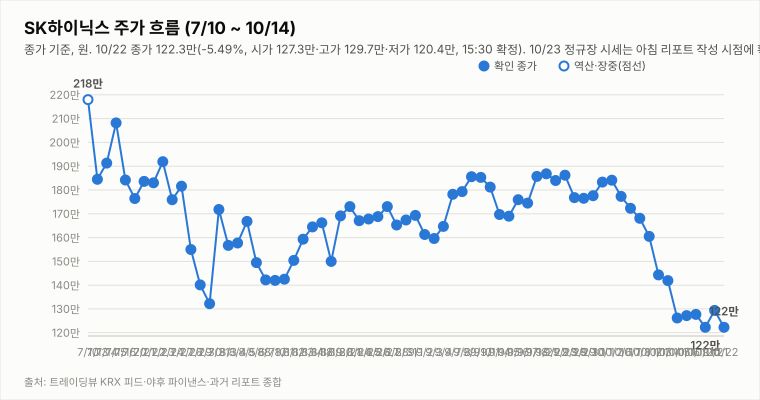
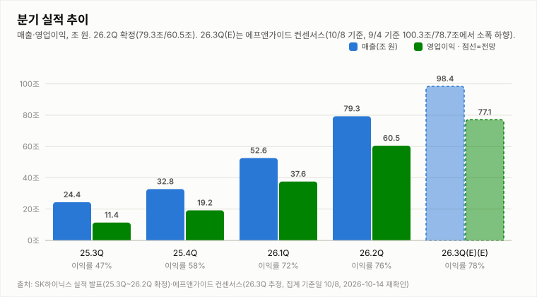
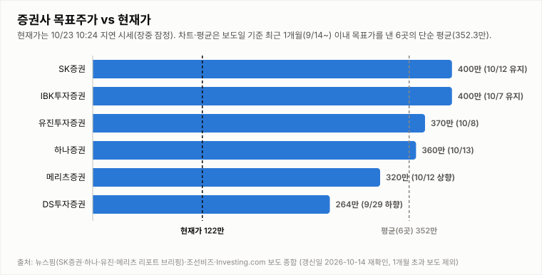

# SK하이닉스 투자 리포트 — 2026-10-23 (금) 장중 업데이트 (14:46, 14:24 지연 시세)

> **작성** 2026-10-23 14:46 KST · **장중 판정: 중립 유지(14:46 기준, 잠정) · 확정 판정: 중립(10/22 종가 기준)** · 전일 종가 122.3만원(-5.49%)은 `quote.json`(marketTime 10/22 15:30 KST)으로 확정이며 트레이딩뷰 종가와 일치합니다(거래량은 야후 최신 정정치). 오늘 시세는 야후 14:24 기준의 20분 지연 시세이며 확정이 아닙니다. 확정 판정은 종가 기준으로만 변경합니다.

> **종목** SK하이닉스 (KRX 000660 · NASDAQ 상장 7/10)
> 본 자료는 정보 제공 목적이며 투자 권유가 아닙니다.

## 핵심 요약

- **투자의견: 장중 판정 중립 유지(잠정)** — 14:46 데이터로 유지 규칙 표를 적용했습니다(확정 판정은 10/22 종가 기준 중립). 방향성 4요소는 긍정 2개(②④)·부정 1개(①)·중립 1개(③)로 중립→매수(긍정 3개 이상·부정 0개)와 중립→매도(부정 3개 이상·긍정 0개) 모두 미충족입니다. 저가 117.1만에서 +7.5% 반등해 +2.94%로 전일 종가를 웃돌고 있으며 머니투데이는 솔리다임 IPO 검토 중단의 영향을 거론합니다(헤드라인 기준). ③은 호재성과 악재성 헤드라인이 엇갈려 장중 잠정 중립이고, ①은 MACD 시그널 하회·-DI 우위로 부정입니다. 오늘 고가(126.3만) 부근의 종가 안착 여부가 15:30 확정 판정의 관건입니다.
- **10/23 장중(14:24 지연 시세)** — 시가 120.0만(10/22 종가 대비 -1.88% 갭다운)·고가 126.3만(+3.27%)·저가 117.1만(-4.25%), 현재 125.9만(**+2.94%**, +3.6만원), 거래량 273.2만주(20일 평균의 0.80배, 장중 누적). 13:24 시세(125.0만) 이후 소폭 추가 상승해 저가 대비 +7.5%이며 오늘 고가(126.3만)와 0.4만원 차이입니다. 헤드라인은 머니투데이 "SK하이닉스, 2%대 상승…솔리다임 IPO 검토 중단 영향"(⚪)이며 상승의 직접 원인과 외국인 수급은 확인 불가입니다.
- **간밤 변수·개장 전 헤드라인**: 미국장(10/22 목)은 반도체가 급락했습니다. SOX -6.72%(10,731.98)·나스닥 -2.60%·S&P500 -1.21%, 마이크론 -6.26%, 엔비디아 -4.40%, SK하이닉스 ADR 131.69달러(-8.07%), EWY -4.98%였고 원/달러는 1,325.15원(-0.02%, 08:04)입니다. 코스피200 야간선물은 834.6으로 주간 종가(857.00) 대비 -2.61%(10/23 06:00 기준 20분 지연, 야간 세션 값인지 첫 실측 검증 진행 중)입니다. 헤드라인은 글로벌이코노믹 "램리서치발 '공급망 병목' 쇼크…SK하이닉스 ADR 8.07% 폭락"(🔴), 에너지경제신문 "SK하이닉스, 솔리다임 IPO 검토 중단...“시장 여건 고려”"(🔴), Investing.com "번스타인 “삼성전자, 2026년 3분기 HBM 매출 SK하이닉스 추월”"(⚪)입니다(헤드라인만 확인, 램리서치 쇼크의 구체 내용·IPO 검토 중단의 배경과 영향은 확인 불가).
- **지표(10/23 14:24 지연 시세 포함, 야후 일봉 기준)**: DMI 격차 -28.4(+DI 14.3 < -DI 42.7), KDJ K 14.6·D 11.4(격차 +3.2, K>D 회복, 과매도 구간), MACD 히스토그램 -3.85만(시그널 하회). 오늘 거래량은 장중 누적 273.2만주로 20일 평균의 0.80배입니다. 3Q26 실적 발표(10/27)까지 **D-4**입니다.

## 시세

| 시가 | 고가 | 저가 | 종가 | 등락 | 거래량 |
|---|---|---|---|---|---|
| ₩1,273,000 | ₩1,297,000 | ₩1,204,000 | **₩1,223,000** | **-5.49%** | 2,841,149주 |

출처: 야후 `quote.json`(marketTime 15:30 KST 확정)·트레이딩뷰 KRX 피드 교차 확인(종가 1,223,000원 일치). 전일(10/21) 확정 종가 1,294,000원 대비 -71,000원(-5.49%)이며 거래량은 야후 최신 정정치입니다(마감 리포트 240.0만주 → 284.1만주).

**오늘 10/23 (금) — 장 초반 (14:24 지연 시세, 확정 아님)** (출처: 야후 파이낸스 `quote.json`, 20분 지연)

| 시가 | 고가 | 저가 | 현재가 | 등락(10/22 종가 대비) | 거래량 |
|---|---|---|---|---|---|
| ₩1,200,000 | ₩1,263,000 | ₩1,171,000 | ₩1,259,000 | +2.94% | 2,732,301주 |

## 기술적 지표 (10/23 14:24 지연 시세 포함 야후 일봉 기준, 장중 잠정)

| 지표 | 값 | 해석 |
|---|---|---|
| MACD (12,26,9) | -13.83만 / 시그널 -9.98만 / 히스토그램 -3.85만 | 하락 모멘텀 지속 |
| ATR (14) | 9.48만 (7.5%) | 변동성 매우 큼 |
| ADX / DMI | ADX 29.4 · +DI 14.3 · -DI 42.7 | 추세 강함, 격차 -28.4(-DI 우위) |
| KDJ (9,3,3) | K 14.6 · D 11.4 · J 20.9 | 과매도 구간, K>D 소폭 우위 회복(+3.2) |
| 거래량 / 20일 이평 | 273.2만 / 342.0만 | 평균의 0.80배(장중 누적) |

야후가 10/13 일봉을 정정 반영하면서 어제 리포트의 값(MACD 히스토그램 -3.59만·DMI -26.1)과 달라졌습니다.

종가 기준 격차 흐름: DMI 9/29 +1.6 → 9/30 +4.3 → 10/1 +2.2 → 10/2 +3.9 → 10/6 -0.8 → 10/7 -4.7 → 10/8 -7.9 → 10/12 -13.9(15:14 집계) → 10/13 -26.1(어제 리포트 기준) → 10/14 -25.9(종가 확정) → 10/15 -34.5(종가 확정·정정) → 10/16 -32.5(종가 확정) → 10/19 -33.2(종가 확정), KDJ 9/29 -8.4 → 9/30 -8.9 → 10/1 -5.2 → 10/2 -2.2 → 10/6 -8.2 → 10/7 -14.1 → 10/8 -15.1 → 10/12 -13.3(15:14 집계) → 10/13 -10.9(어제 리포트 기준) → 10/14 -8.4(종가 확정) → 10/15 -6.4(종가 확정·정정) → 10/16 -4.4(종가 확정) → 10/19 -1.8(종가 확정).

## 최신 뉴스 Top 5 (구글 뉴스 헤드라인 기준, 같은 사안은 1건만)

1. ⚪ **SK하이닉스, 2%대 상승…솔리다임 IPO 검토 중단 영향** (머니투데이, 10/23) · 솔리다임 상장 철회·주가 반응 사안(KBS·매일경제 마켓·연합뉴스 등 같은 사안은 1건만 수록, 헤드라인만 확인, 철회 배경·상승 원인의 구체 내용 확인 불가)
2. 🔴 **[특징주] 삼성전자·SK하이닉스, 美 AI 수익성 우려.. 동반 '약세'** (글로벌이코노믹, 10/23) · 시황 기사(10:59 작성, 헤드라인만 확인, 내용 확인 불가)
3. ⚪ **키옥시아 지분가치 41조 급감…"SK하이닉스, 왜 팔지 않았나"** (연합인포맥스, 10/23) · 키옥시아 지분 사안(헤드라인만 확인, 지분 규모·평가 기준 확인 불가)
4. ⚪ **골드만삭스 "SK하이닉스 ADR 유통물량 확대시 나스닥 100 편입 가능"** (연합인포맥스, 10/23) · ADR 유통물량·지수 편입 가능성 사안(매일경제 마켓 "미국선 47% 더 비싸…ADR 전환 한도 늘려야" 등 같은 ADR 사안은 1건만 수록, 헤드라인만 확인, 편입 조건·시점 확인 불가)
5. 🔴 **램리서치발 '공급망 병목' 쇼크…SK하이닉스 ADR 8.07% 폭락** (글로벌이코노믹, 10/23) · 반도체 장비 공급망·ADR 급락 사안(헤드라인만 확인, 쇼크의 구체 내용 확인 불가; 🔴 네이버 프리미엄콘텐츠 "여기서 매도합니다."·번스타인 HBM 매출 추월 전망(⚪)·자사주 매입 마무리(⚪)·3조원 채권시장 복귀(🟢)는 Top10 참조)

※ 뉴스는 헤드라인 기준이며 본문 수치는 별도 검증하지 않았습니다. 같은 사안을 다룬 기사는 가장 최신 1건만 남겼습니다(예: 홍보성 "초심 조형물" 기사 3건·구직자 관심 기업 순위 기사 제외, [포토] 제외).

## 실적 · 밸류에이션 (갱신일 2026-10-14, 10/16 재확인: 신규 확인 불가)

2Q26 확정 매출 79.3조·영업이익 60.5조(영업이익률 76%), **3Q26 컨센서스(에프앤가이드 10/8 갱신)는 매출 98.4조·영업이익 77.1조(영업이익률 78.3%)**로 9/4 기준(100.3조/78.7조)·9/30 집계(영업이익 78.1조)에서 소폭 하향됐습니다. 메리츠증권은 원화 강세·개선 속도 둔화로 시장 컨센서스가 74조원까지 내려갔다고 분석했고(헤드라인 기준), 증권사별로는 메리츠 80.1조·SK증권 79조·IBK 75.1조·DS투자 70조로 편차가 큽니다. 3Q26 실적 발표는 10/27(D-13)입니다. 10/14 재확인에서 에프앤가이드 신규 집계(10/8 이후)와 증권사 추정치 변경은 확인하지 못했습니다.

> 밸류에이션 갱신일 2026-10-14 — 10/16 재조사에서도 신규·변경 목표주가 보도를 확인하지 못해 6곳을 유지했습니다(직전 확인 2026-10-14). 직전 컨센서스 322만원은 9/3 한국경제 기준. **차트는 보도일 기준 최근 1개월(9/16~10/16) 이내 목표가를 낸 6곳만 표시하며 평균 목표가도 이 6곳의 단순 평균(352.3만원)입니다.** 1개월 초과 리포트(한국투자증권 470만원 7/30, KB증권 420만원 7/30 유지, 교보증권 400만원 7/9 등)는 평균에서도 제외했습니다. 참고: 뉴스핌 로보뉴스(SK증권 리포트 브리핑, 10/12) 집계의 최근 6개월 전체 증권사 평균 목표가는 3,232,083원이며 집계 방식에 따라 다른 평균이 보도될 수 있습니다(예: 연합인포맥스 약 268만원, 약 4개월 전 기사).

최근 1개월 이내 6곳의 평균 목표주가 352.3만원은 14:24 지연 시세 125.9만 대비 **+179.9%** 괴리입니다(10/22 종가 122.3만 기준 +188.1%). 6곳은 SK증권 400만원 유지(10/12), IBK 400만원 유지(10/7), 유진 370만원(10/8), 하나증권 360만원 "컨센서스 부합"(10/13), 메리츠 320만원 상향(10/12), DS투자 264만원(9/29 하향)입니다. 표본이 적어 평균은 참고용이며, 6개월 전체 평균(323.2만원) 대비 괴리율은 14:24 지연 시세 기준 +156.7%입니다. 참고로 중앙일보(10/20)에 노무라 "하이닉스 470만" 헤드라인이 있으나 9/4 보고서에서 유지된 목표가로 보이며(이번 기사 본문 확인 불가) 최근 1개월 평균에는 반영하지 않았습니다.

## 산업 동향 — HBM·DRAM·NAND (갱신일 2026-10-14)

> 10/16 재조사에서 신규 가격 전망·점유율 발표를 확인하지 못해 수치는 10/14 조사분을 유지했습니다(직전 확인 2026-10-14). 수치는 TrendForce 9/30 발표·산업통상부 10/1 발표·국내 언론 헤드라인 기준이며 차트의 점유율은 카운터포인트 1Q26(매출 기준)·트렌드포스 연간 전망입니다. 2Q26 이후 확정 점유율은 확인 불가.

**HBM / DRAM**

- **4Q26 범용 D램 계약가 +10~15%(QoQ)** — TrendForce 전망. 3Q26 전망(+13~18%)보다 둔화됐지만 AI 서버 수요와 첨단 공정 캐파 우선 배정으로 상승 기조는 유지.
- **2027년 HBM 가격 협상** — 헤드라인 기준 TrendForce는 내년 HBM 평균판매가 약 +121%를 전망(주체가 TrendForce 전망인지 마이크론 계약 기준인지 보도마다 엇갈림). 삼성전자는 HBM4 연간 공급가를 높게 제시했다는 보도가 있고, SK하이닉스는 2027년 물량·가격 협상 중으로 최종 내용은 확인 불가.
- **HBM 점유율** — 카운터포인트 1Q26 SK하이닉스 58%·삼성전자 21%·마이크론 21%, 트렌드포스 2026년 연간 50%·28%·22% 전망. 마이크론은 HBM4 10억달러 이상 출하·연말 점유율 20%대 목표, 삼성전자도 HBM4 양산 약 4개월 만에 누적 매출 10억달러 보도.
- **중국 CXMT 추격** — 10/9~10 콘퍼런스에서 4F² 셀 구조 DDR5 서버용 D램(RDIMM) 연내 출시를 예고(구체 사양·양산 일정 미공개, 우려와 과장 분석이 엇갈림). HBM이 아닌 범용 D램 기술이며 10/12~10/13 메모리주 급락의 계기로 거론됐으나 인과관계는 단정하지 않음.
- **수출** — 9월 반도체 수출 603억달러(+262.8%), 단일 품목 최초 600억달러 돌파(산업통상부 10/1).

**NAND**

- **4Q26 NAND 계약가 +15~20%(QoQ)** — 3Q26 전망(+18~23%)보다 둔화. eSSD 상승폭이 가장 크고 한 보도는 +23~28%를 전함(단일 보도 기준). eSSD 비트 수요는 전년 대비 80% 이상 증가 전망.
- **소비자 부문 부담** — PC·스마트폰은 원가 부담으로 SSD 용량을 줄이는 방식으로 대응 중. 솔리다임 상장 관련 주주가치 논란도 지속.

**해석**: 가격 상승률은 둔화(D램 +13~18%→+10~15%, 낸드 +18~23%→+15~20%)했지만 방향은 상승이고 HBM 2027년 가격 협상이 진행 중이라 요소 ④ 산업 사이클은 긍정 유지입니다. 상승률 둔화와 CXMT 추격은 업황 고점 논쟁을 키울 수 있어 10월 수출·4Q 계약가 실측·HBM4 협상 결과를 점검합니다.

## 투자 판단

**의견: 장중 판정 중립(유지, 14:46 기준 잠정) — 확정 판정은 10/22 종가 기준 중립 (확정은 종가 기준으로만 변경합니다)**

| 요소 | 방향 | 근거 |
|---|---|---|
| ① 추세/모멘텀 | 부정 | 10/22 종가 -5.49%로 10/21 반등분을 모두 반납한 뒤 오늘은 갭다운(-1.88%) 후 장중 저가 117.1만이 10/20 저가(118.3만)를 하회했으나 14:24 지연 시세 +2.94%로 전일 종가를 웃돌고 있습니다. KDJ는 K>D(격차 +3.2)로 회복했지만 DMI 격차는 -28.4로 10/22 종가(-27.8) 부근이고 MACD 시그널 하회(히스토그램 -3.85만)·-DI 우위로 종가 기준 반전 신호는 미확인(10/2 종가 대비 -31.6%) |
| ② 밸류에이션 갭 | 긍정 | 최근 1개월 6곳 평균 목표가 352.3만 대비 14:24 지연 시세 125.9만 — +179.9%(10/22 종가 기준 +188.1%) |
| ③ 촉매 | 중립(장중 잠정) | 확정 판정 시점(10/22 종가) 부정(약함)이었으나 장중 잠정에서는 중립으로 봅니다. 14:46 Top10(같은 내용 기사는 1건으로 묶은 뒤) 자동분류는 🔴 악재 3건(글로벌이코노믹 "[특징주] 삼성전자·SK하이닉스, 美 AI 수익성 우려.. 동반 '약세'"·글로벌이코노믹 "램리서치발 '공급망 병목' 쇼크…SK하이닉스 ADR 8.07% 폭락"·네이버 프리미엄콘텐츠 "SK하이닉스, 여기서 매도합니다.")·🟢 호재 1건(연합뉴스 "3조원 채권시장 복귀"; 자금 운용 사안)·⚪ 중립 6건입니다(신규: 연합인포맥스 “골드만삭스 ‘SK하이닉스 ADR 유통물량 확대시 나스닥 100 편입 가능’” ⚪, 제목만 확인하며 조건부 전망이라 호재로 단정하지 않음). 중립으로 분류된 머니투데이 "SK하이닉스, 2%대 상승…솔리다임 IPO 검토 중단 영향"은 중복상장 논란 완화가 주가에 긍정적으로 작용했다는 보도로 읽혀(헤드라인 기준) 호재성 재료로 보지만, 미국 AI 수익성 우려·램리서치 쇼크·경쟁 구도 헤드라인이 남아 ③은 중립(장중 잠정)으로 올립니다. ③을 긍정으로 올려도 ①이 부정이라 매수 조건(부정 0개)은 충족되지 않으며 종가에서 다시 판정합니다(모두 헤드라인만 확인, IPO 중단의 영향 규모·미국 AI 수익성 우려 내용은 확인 불가). |
| ④ 산업 사이클 | 긍정 | HBM4 공급가 급등, 메모리 공급부족 구조, 3Q 이익 전망 상향 (산업 동향 갱신일 2026-10-14 재확인: 4Q 범용 D램 +10~15%·낸드 +15~20%, 상승률 둔화) |

**종합(장중 14:46): 긍정 2·부정 1·중립 1(③) → 중립 유지(잠정).** 확정 판정(10/22 종가 기준 중립)에 14:46 데이터로 유지 규칙 표를 적용한 잠정 결과이며 종가에서 확정합니다. 중립→매수(긍정 3개 이상·부정 0개)는 ①이 부정이라 미충족이고, 중립→매도(부정 3개 이상·긍정 0개)도 미충족입니다.

## 오늘(10/23, 금) 전망 — 저가 117.1만에서 반등해 125.9만, 125.4만~126.3만 돌파 여부와 122.3만~124.7만 지지 유지 여부

| 항목 | 내용 |
|---|---|
| 지지선 | 124.7만(10/16 저가) · 122.3만(10/22 종가) · 118.3만(10/20 저가) · 117.1만(오늘 저가) |
| 저항선 | 125.4만(10/21 저가) · 126.0만(10/21 시가) · 126.3만(오늘 고가) · 127.3만(10/22 시가) · 127.7만(10/19 종가) · 129.0만(10/16 시가) |
| 예상 등락 레인지(참고용) | 10/22 종가 ± ATR 9.48만 = 112.8만 ~ 131.8만(참고용, 잠정 ATR) |
| 예정 이벤트 | 3Q26 실적 발표 10/27(10/23 기준 D-4) · 반도체대전(10/14 개막) 진행 중(종료일 확인 불가) · 간밤 해외 지표(SOX -6.72%·마이크론 -6.26%·ADR -8.07%·EWY -4.98%)와 코스피200 야간선물 -2.61% · 램리서치발 공급망 병목 쇼크 보도(구체 내용 확인 불가) · 솔리다임 IPO 검토 중단 보도(배경·영향 확인 불가) · 번스타인 HBM 매출 추월 전망 보도(수치 확인 불가) · 외국인 순매도와 자사주 매입 종료 이후 수급(확인 불가) · 원/달러 1,325.15원(-0.02%) |
| 관찰 포인트 | 126.3만(오늘 고가) 돌파 여부, 122.3만~124.7만 지지 유지 여부, 거래량 동반 여부(현재 0.80배), 솔리다임 IPO 중단 이후 외국인 수급(확인 불가), 미국 AI 수익성 우려·램리서치 쇼크 보도의 후속(확인 불가), 종가 기준 DMI·MACD 변화(MACD 시그널 상회 여부) |
| 상방 시나리오 | IPO 검토 중단(중복상장 논란 완화)과 과매도 반등(K 14.6, K>D 격차 +3.2)이 이어지면 126.3만~127.7만 저항대 돌파 시도가 가능함. 다만 ①의 종가 기준 개선(DMI 재역전·MACD 시그널 상회)이 확인돼야 하며, 매수 복귀에는 긍정 3개 이상·부정 0개가 필요(현재 긍정 2·부정 1·③ 중립) |
| 하방 시나리오 | 126.3만(오늘 고가) 부근에서 막히면 되밀려 122.3만~124.7만 지지를 시험할 수 있고, 이탈 시 갭다운 구간(118.3만~117.1만) 재시험 가능성이 있음(ATR 7.5%). 매도 진입(부정 3개 이상·긍정 0개)은 ②④가 모두 긍정에서 이탈해야 하므로 현재는 해당 없음 |
| 야간선물 | 834.6(코스피200 야간선물, 주간 종가 857.00 대비 -2.61%·`updateTimeKST` 10-23 06:00·20분 지연; 야간 세션 값인지 첫 실측 검증 진행 중) |

야간선물 -2.61%·SOX -6.72%·ADR -8.07% 약세를 반영해 시가 120.0만(-1.88% 갭다운)으로 출발하고 장중 저가 117.1만(-4.25%)까지 밀렸으나, 14:24 지연 시세 125.9만(+2.94%)으로 반등해 전일 종가를 웃돌고 있습니다. 머니투데이는 솔리다임 IPO 검토 중단의 영향을 거론합니다(헤드라인 기준). 누적 거래량은 평균의 0.80배라 지속 여부는 단정하기 어렵습니다(방향성 참고일 뿐 가격 예측이 아닙니다).

---

*본 자료는 공개 보도·자료를 종합해 작성한 정보 제공 목적의 리포트이며 투자 판단과 책임은 투자자 본인에게 있습니다.*
