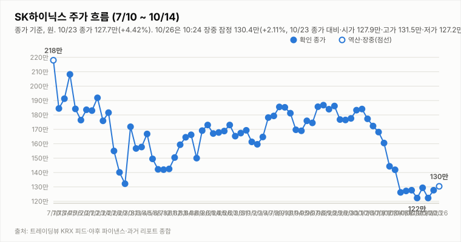
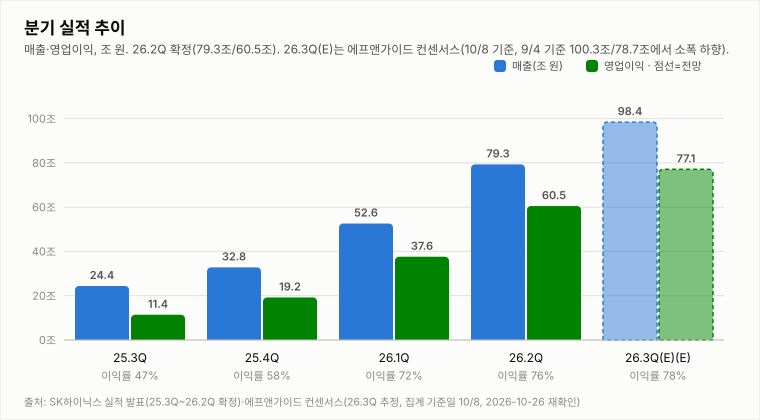
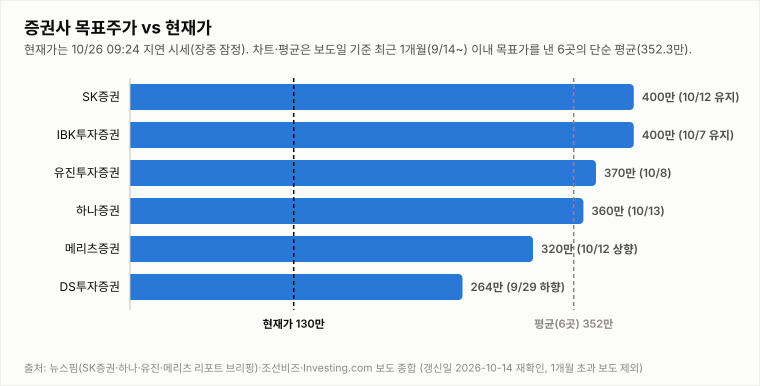

# SK하이닉스 투자 리포트 — 2026-10-26 (월) 장중 업데이트 (10:47, 10:24 지연 시세)

> **작성** 2026-10-26 10:47 KST · **장중 판정: 중립 유지(10:47 기준, 잠정) · 확정 판정: 중립(10/23 종가 기준)** · 전일 종가 127.7만원(+4.42%)은 `quote.json`(marketTime 10/23 15:30 KST)으로 확정이며 트레이딩뷰 종가와 일치합니다(거래량은 야후 최신 정정치). 오늘 시세는 야후 10:24 기준의 20분 지연 시세이며 확정이 아닙니다. 확정 판정은 종가 기준으로만 변경합니다.

> **종목** SK하이닉스 (KRX 000660 · NASDAQ 상장 7/10)
> 본 자료는 정보 제공 목적이며 투자 권유가 아닙니다.

## 핵심 요약

- **투자의견: 장중 판정 중립 유지(잠정)** — 10:47 데이터로 유지 규칙 표를 적용했습니다(확정 판정은 10/23 종가 기준 중립). 방향성 4요소는 긍정 3개(②③④)·부정 1개(①)로 중립→매수(긍정 3개 이상·부정 0개)는 ①이 부정이라 미충족이고 중립→매도(부정 3개 이상·긍정 0개)도 미충족입니다. 10:24 지연 시세 130.4만(+2.11%)은 09:24(130.0만)와 비슷한 수준에서 고가 131.5만 아래를 유지하고 있으며, ①은 MACD 시그널 하회·-DI 우위(DMI 격차 -24.7)라 종가 기준 반전 신호가 없고 ③은 솔리다임 상장 철회와 "약 16조원 특별 배당" 보도(헤드라인 기준, 금액·확정 여부는 확인 불가)가 뒷받침해 장중 잠정 긍정입니다. 확정 판정은 오늘 15:30 종가에서만 바꿉니다.
- **10/26 장중(10:24 지연 시세)** — 시가 127.9만(10/23 종가 대비 +0.16%)·고가 131.5만(+2.98%)·저가 127.2만(-0.39%), 현재 130.4만(**+2.11%**, +2.7만원), 거래량 92.4만주(20일 평균의 0.27배, 장중 누적). 09:24 시세(130.0만)보다 0.4만원 올라 고가(131.5만) 아래 130만대 초반에서 횡보 중이며, 글로벌이코노믹은 "[특징주] SK하이닉스, "약 16조원 특별 배당" 보도.. '강세'"로 전했습니다(헤드라인만 확인, 금액·지급 시점·회사 확정 여부는 확인 불가이며 웹검색으로도 16조원 수치는 확인하지 못했습니다). 10/27 3Q26 실적 발표를 앞두고 있습니다.
- **간밤 변수·개장 전 헤드라인**: 미국장(10/23 금)은 지수가 엇갈렸고 반도체는 강했습니다. SOX +0.44%(10,779.46)·나스닥 -0.21%·S&P500 -0.52%, 마이크론 +2.46%, 엔비디아 -0.59%, SK하이닉스 ADR 137.02달러(+4.05%), EWY +1.48%였고 원/달러는 1,323.39원(-0.02%, 08:12)입니다. 코스피200 야간선물은 861.7로 주간 종가(863.30) 대비 -0.19%(10/26 08:10 수집 20분 지연, 야간 세션 값인지 첫 실측 검증 진행 중)입니다. 헤드라인은 이데일리 "솔리다임 상장 접은 SK하이닉스…ADR 괴리율 해결 남았다"(⚪), YTN "삼성전자·SK하이닉스 영업이익 180조 전망...주주환원책 '주목'"(⚪), 연합뉴스 "고점 대비 56% 급락 SK하이닉스…이번주 실적발표 반등 계기되나"(⚪)입니다(헤드라인만 확인, 영업이익 전망 범위·주주환원 내용·급락 기준 시점은 확인 불가).
- **지표(10/26 10:24 지연 시세 포함, 야후 일봉 기준)**: DMI 격차 -24.7(+DI 16.0 < -DI 40.7), KDJ K 24.4·D 16.1(격차 +8.3, K>D 우위 확대, 중립 구간), MACD 히스토그램 -2.68만(시그널 하회). 오늘 거래량은 장중 누적 92.4만주로 20일 평균의 0.27배입니다. 3Q26 실적 발표(10/27)까지 **D-1**입니다.

## 시세

| 시가 | 고가 | 저가 | 종가 | 등락 | 거래량 |
|---|---|---|---|---|---|
| ₩1,200,000 | ₩1,284,000 | ₩1,171,000 | **₩1,277,000** | **+4.42%** | 3,941,446주 |

출처: 야후 `quote.json`(marketTime 15:30 KST 확정)·트레이딩뷰 KRX 피드 교차 확인(종가 1,277,000원 일치). 전일(10/22) 확정 종가 1,223,000원 대비 +54,000원(+4.42%)이며 거래량은 야후 최신 정정치입니다(마감 리포트 358.6만주 → 423.2만주 → 394.1만주).

**오늘 10/26 (월) — 장 초반 (10:24 지연 시세, 확정 아님)** (출처: 야후 파이낸스 `quote.json`, 20분 지연)

| 시가 | 고가 | 저가 | 현재가 | 등락(10/23 종가 대비) | 거래량 |
|---|---|---|---|---|---|
| ₩1,279,000 | ₩1,315,000 | ₩1,272,000 | ₩1,304,000 | +2.11% | 924,245주 |

## 기술적 지표 (10/26 10:24 지연 시세 포함 야후 일봉 기준, 장중 잠정)

| 지표 | 값 | 해석 |
|---|---|---|
| MACD (12,26,9) | -13.30만 / 시그널 -10.62만 / 히스토그램 -2.68만 | 하락 모멘텀 지속 |
| ATR (14) | 9.25만 (7.1%) | 변동성 매우 큼 |
| ADX / DMI | ADX 30.4 · +DI 16.0 · -DI 40.7 | 추세 강함, 격차 -24.7(-DI 우위) |
| KDJ (9,3,3) | K 24.4 · D 16.1 · J 40.9 | 중립 구간 진입, K>D 우위 확대(+8.3) |
| 거래량 / 20일 이평 | 92.4만 / 348.0만 | 평균의 0.27배(장중 누적) |

야후가 10/13 일봉을 정정 반영하면서 어제 리포트의 값(MACD 히스토그램 -3.59만·DMI -26.1)과 달라졌습니다.

종가 기준 격차 흐름: DMI 9/29 +1.6 → 9/30 +4.3 → 10/1 +2.2 → 10/2 +3.9 → 10/6 -0.8 → 10/7 -4.7 → 10/8 -7.9 → 10/12 -13.9(15:14 집계) → 10/13 -26.1(어제 리포트 기준) → 10/14 -25.9(종가 확정) → 10/15 -34.5(종가 확정·정정) → 10/16 -32.5(종가 확정) → 10/19 -33.2(종가 확정), KDJ 9/29 -8.4 → 9/30 -8.9 → 10/1 -5.2 → 10/2 -2.2 → 10/6 -8.2 → 10/7 -14.1 → 10/8 -15.1 → 10/12 -13.3(15:14 집계) → 10/13 -10.9(어제 리포트 기준) → 10/14 -8.4(종가 확정) → 10/15 -6.4(종가 확정·정정) → 10/16 -4.4(종가 확정) → 10/19 -1.8(종가 확정).

## 최신 뉴스 Top 5 (구글 뉴스 헤드라인 기준, 같은 사안은 1건만)

1. 🟢 **[특징주] SK하이닉스, "약 16조원 특별 배당" 보도.. '강세'** (글로벌이코노믹, 10/26) · 특별 배당 보도 사안(조선일보 "180조도 '예고된 호실적'… 가이던스, 감동 줄까"·YTN "영업이익 180조 전망...주주환원책 '주목'" 등 같은 주주환원·실적 기대 사안은 1건만 수록, 헤드라인만 확인, 금액 16조원·지급 시점·회사 확정 여부는 확인 불가이며 웹검색으로도 16조원 수치는 확인하지 못함)
2. 🟢 **[특징주] '솔리다임 상장 검토 철회' SK하이닉스, 장초반 2%대 상승** (연합뉴스, 10/26) · 솔리다임 상장 철회 사안(한겨레 "4%대 상승 마감…증권가 “중복상장 우려 해소 영향”"·YTN·이데일리·한국경제 등 같은 사안은 1건만 수록, 헤드라인만 확인, 철회 배경·주가 영향 규모 확인 불가)
3. 🔴 **SK하이닉스, 매도 우위 속 더블바텀 형성 중: 실시간 업데이트** (Investing.com 한국어, 10/26) · 기술적 분석 콘텐츠(키워드 자동분류 🔴이나 제목은 더블바텀 형성을 다루는 분석 글이라 방향 판단에는 쓰지 않음, 헤드라인만 확인)
4. ⚪ **SK하이닉스에 밀린 삼성의 반격…HBM4 판 뒤집을 ‘비장의 카드’** (이코노미스트, 10/26) · 경쟁 구도(HBM4) 사안(헤드라인만 확인, 카드의 내용 확인 불가)
5. ⚪ **고점 대비 56% 급락 SK하이닉스…이번주 실적발표 반등 계기되나** (연합뉴스, 10/25) · 3Q 실적 발표(10/27) 앞둔 주가 점검(용인신문 "안성 정치권·경기도 ‘SK하이닉스’ 압박" 등 별개 사안은 Top10 참조, 헤드라인만 확인, 고점 기준 시점·산출 방식 확인 불가)

※ 뉴스는 헤드라인 기준이며 본문 수치는 별도 검증하지 않았습니다. 같은 사안을 다룬 기사는 가장 최신 1건만 남겼습니다(예: 홍보성 "초심 조형물" 기사 3건·구직자 관심 기업 순위 기사 제외, [포토] 제외).

## 실적 · 밸류에이션 (갱신일 2026-10-26, 11:23 재확인: 신규 집계·목표가 변경 확인 불가)

2Q26 확정 매출 79.3조·영업이익 60.5조(영업이익률 76%), **3Q26 컨센서스(에프앤가이드 10/8 갱신)는 매출 98.4조·영업이익 77.1조(영업이익률 78.3%)**로 9/4 기준(100.3조/78.7조)·9/30 집계(영업이익 78.1조)에서 소폭 하향됐습니다. 메리츠증권은 원화 강세·개선 속도 둔화로 시장 컨센서스가 74조원까지 내려갔다고 분석했고(헤드라인 기준), 증권사별로는 메리츠 80.1조·SK증권 79조·IBK 75.1조·DS투자 70조로 편차가 큽니다. 3Q26 실적 발표는 10/27(D-1)입니다. 10/26 재확인에서도 에프앤가이드 신규 집계(10/8 이후)와 증권사 추정치 변경은 확인하지 못했습니다.

**10/26 장중 업데이트(재확인 11:23):** 에프앤가이드의 10/8 이후 신규 3Q26 컨센서스 집계는 확인하지 못했고 웹검색에서도 2026년 자료는 확인되지 않았습니다. 새로 나온 헤드라인은 YTN "삼성전자·SK하이닉스 영업이익 180조 전망...주주환원책 '주목'"(10/25, 합산 여부·산출 기준 확인 불가), 조선일보 "180조도 '예고된 호실적'... 삼전닉스 가이던스, 감동 줄까"(10/25, 기대가 선반영됐다는 취지로 보이며 본문 확인 불가), 글로벌이코노믹 "[특징주] SK하이닉스, "약 16조원 특별 배당" 보도.. '강세'"(10/26 09:29, 금액·확정 여부 확인 불가)입니다. 7월 말 뉴시스·IB토마토 보도(검색 요약 기준)에 따르면 회사는 추가 주주환원 방안을 검토 중이며 실제 규모·방식은 3Q 실적 발표에서 공개할 예정이라고 전해져, 10/27 발표의 주주환원 내용이 관전 포인트입니다(금액은 확인 불가).

> 밸류에이션 갱신일 2026-10-26 — 10/26 재조사에서도 신규·변경 목표주가 보도를 확인하지 못해 6곳을 유지했습니다(직전 확인 2026-10-16). 3Q 실적 발표(10/27) 직후 목표가 조정 리포트가 나올 수 있어 다음 갱신에서 점검합니다. 직전 컨센서스 322만원은 9/3 한국경제 기준. **차트는 보도일 기준 최근 1개월(9/26~10/26) 이내 목표가를 낸 6곳만 표시하며 평균 목표가도 이 6곳의 단순 평균(352.3만원)입니다.** 1개월 초과 리포트(한국투자증권 470만원 7/30, KB증권 420만원 7/30 유지, 교보증권 400만원 7/9 등)는 평균에서도 제외했습니다. 참고: 뉴스핌 로보뉴스(SK증권 리포트 브리핑, 10/12) 집계의 최근 6개월 전체 증권사 평균 목표가는 3,232,083원이며 집계 방식에 따라 다른 평균이 보도될 수 있습니다(예: 연합인포맥스 약 268만원, 약 4개월 전 기사).

최근 1개월 이내 6곳의 평균 목표주가 352.3만원은 10:24 지연 시세 130.4만 대비 **+170.2%** 괴리입니다(10/23 종가 127.7만 기준 +175.9%). 6곳은 SK증권 400만원 유지(10/12), IBK 400만원 유지(10/7), 유진 370만원(10/8), 하나증권 360만원 "컨센서스 부합"(10/13), 메리츠 320만원 상향(10/12), DS투자 264만원(9/29 하향)입니다. 표본이 적어 평균은 참고용이며, 6개월 전체 평균(323.2만원) 대비 괴리율은 10:24 지연 시세 기준 +147.9%입니다. 참고로 중앙일보(10/20)에 노무라 "하이닉스 470만" 헤드라인이 있으나 9/4 보고서에서 유지된 목표가로 보이며(이번 기사 본문 확인 불가) 최근 1개월 평균에는 반영하지 않았습니다.

## 산업 동향 — HBM·DRAM·NAND (갱신일 2026-10-26)

> 10/26 재조사에서도 신규 가격 전망·점유율 발표를 확인하지 못해 가격·점유율 수치는 10/14 조사분을 유지했고, "10/26 업데이트" 항목은 저장소 뉴스·night.yml 지표 기준입니다(직전 확인 2026-10-16). 수치는 TrendForce 9/30 발표·산업통상부 10/1 발표·국내 언론 헤드라인 기준이며 차트의 점유율은 카운터포인트 1Q26(매출 기준)·트렌드포스 연간 전망입니다. 2Q26 이후 확정 점유율은 확인 불가.

**HBM / DRAM**

- **4Q26 범용 D램 계약가 +10~15%(QoQ)** — TrendForce 전망. 3Q26 전망(+13~18%)보다 둔화됐지만 AI 서버 수요와 첨단 공정 캐파 우선 배정으로 상승 기조는 유지.
- **2027년 HBM 가격 협상** — 헤드라인 기준 TrendForce는 내년 HBM 평균판매가 약 +121%를 전망(주체가 TrendForce 전망인지 마이크론 계약 기준인지 보도마다 엇갈림). 삼성전자는 HBM4 연간 공급가를 높게 제시했다는 보도가 있고, SK하이닉스는 2027년 물량·가격 협상 중으로 최종 내용은 확인 불가.
- **HBM 점유율** — 카운터포인트 1Q26 SK하이닉스 58%·삼성전자 21%·마이크론 21%, 트렌드포스 2026년 연간 50%·28%·22% 전망. 마이크론은 HBM4 10억달러 이상 출하·연말 점유율 20%대 목표, 삼성전자도 HBM4 양산 약 4개월 만에 누적 매출 10억달러 보도.
- **중국 CXMT 추격** — 10/9~10 콘퍼런스에서 4F² 셀 구조 DDR5 서버용 D램(RDIMM) 연내 출시를 예고(구체 사양·양산 일정 미공개, 우려와 과장 분석이 엇갈림). HBM이 아닌 범용 D램 기술이며 10/12~10/13 메모리주 급락의 계기로 거론됐으나 인과관계는 단정하지 않음.
- **수출** — 9월 반도체 수출 603억달러(+262.8%), 단일 품목 최초 600억달러 돌파(산업통상부 10/1).

**NAND**

- **4Q26 NAND 계약가 +15~20%(QoQ)** — 3Q26 전망(+18~23%)보다 둔화. eSSD 상승폭이 가장 크고 한 보도는 +23~28%를 전함(단일 보도 기준). eSSD 비트 수요는 전년 대비 80% 이상 증가 전망.
- **소비자 부문 부담** — PC·스마트폰은 원가 부담으로 SSD 용량을 줄이는 방식으로 대응 중. 솔리다임은 10/23 상장 검토 철회 보도로 논란이 완화됐으나 ADR 괴리율 과제가 남음(헤드라인 기준).

**10/26 업데이트 (헤드라인·시장 지표 기준)**

- **간밤 반도체 지표** — 10/23 미국장에서 SOX +0.44%(10,779.46)·마이크론 +2.46%(877.55달러)·SK하이닉스 ADR +4.05%(137.02달러)로 10/22 급락(SOX -6.72%·마이크론 -6.26%·ADR -8.07%)에서 일부 회복했습니다(night.yml 스냅샷 2026-10-26 08:13 기준).
- **공급망·AI 수익성 헤드라인** — 글로벌이코노믹 "램리서치발 '공급망 병목' 쇼크…SK하이닉스 ADR 8.07% 폭락"(10/23)과 "[특징주] 삼성전자·SK하이닉스, 美 AI 수익성 우려.. 동반 '약세'"(10/23)가 있었습니다(헤드라인만 확인, 병목의 구체 내용·AI 수익성 우려 내용 확인 불가).
- **HBM 경쟁 구도** — 번스타인 "삼성전자, 2026년 3분기 HBM 매출 SK하이닉스 추월"(Investing.com, 10/22)과 이코노미스트 "SK하이닉스에 밀린 삼성의 반격…HBM4 판 뒤집을 '비장의 카드'"(10/26) 헤드라인이 나왔습니다(추월 수치·카드 내용 확인 불가). 위 점유율(1Q26 SK하이닉스 58%)은 갱신하지 못했습니다.
- **키옥시아** — 연합인포맥스 "키옥시아 지분가치 41조 급감…'SK하이닉스, 왜 팔지 않았나'"(10/23) 헤드라인이 있었습니다(지분 규모·평가 기준 확인 불가이며 NAND 업황 해석은 단정하지 않습니다).

**해석**: 가격 상승률은 둔화(D램 +13~18%→+10~15%, 낸드 +18~23%→+15~20%)했지만 방향은 상승이고 HBM 2027년 가격 협상이 진행 중이라 요소 ④ 산업 사이클은 긍정 유지입니다. 상승률 둔화와 CXMT 추격은 업황 고점 논쟁을 키울 수 있어 10월 수출·4Q 계약가 실측·HBM4 협상 결과를 점검합니다. 10/26 기준 신규 가격 발표가 없어 판단은 유지합니다.

## 투자 판단

**의견: 장중 판정 중립(유지, 10:47 기준 잠정) — 확정 판정은 10/23 종가 기준 중립 (확정은 종가 기준으로만 변경합니다)**

| 요소 | 방향 | 근거 |
|---|---|---|
| ① 추세/모멘텀 | 부정 | 10/23 종가 +4.42%로 10/22 하락분을 되돌린 데 이어 오늘 10:24 지연 시세 +2.11%로 10/23 고가(128.4만)와 10/22 고가(129.7만)를 넘어섰습니다. KDJ는 K>D(격차 +8.3)로 중립 구간에 올라섰고 DMI 격차는 -24.7로 10/23 종가(-28.0)보다 좁혀졌지만 MACD 시그널 하회(히스토그램 -2.68만)·-DI 우위로 종가 기준 반전 신호는 미확인입니다(10/2 종가 대비 -29.2%) |
| ② 밸류에이션 갭 | 긍정 | 최근 1개월 6곳 평균 목표가 352.3만 대비 10:24 지연 시세 130.4만 — +170.2%(10/23 종가 기준 +175.9%) |
| ③ 촉매 | 긍정(장중 잠정) | 확정 판정 시점(10/23 종가) 중립(확정)이었으나 장중 잠정에서는 긍정으로 봅니다. 10:47 Top10(같은 내용 기사는 1건으로 묶은 뒤) 자동분류는 🟢 호재 2건(글로벌이코노믹 "[특징주] SK하이닉스, "약 16조원 특별 배당" 보도.. '강세'"·연합뉴스 "[특징주] '솔리다임 상장 검토 철회' SK하이닉스, 장초반 2%대 상승")·🔴 악재 1건(Investing.com "SK하이닉스, 매도 우위 속 더블바텀 형성 중: 실시간 업데이트"; 키워드 분류이며 제목은 기술적 분석 글이라 방향 판단에는 쓰지 않음)·⚪ 중립 7건입니다. 솔리다임 상장 철회에 따른 중복상장 우려 해소와 특별 배당 보도가 호재성 재료이지만, 특별 배당은 헤드라인 보도일 뿐 회사 공시가 아니고 금액(16조원)도 웹검색으로 확인하지 못했으며, 7월 말 보도에서 회사는 추가 주주환원을 3Q 실적 발표에서 공개한다고 밝힌 것으로 전해졌습니다. 조선일보 "180조도 '예고된 호실적'… 가이던스, 감동 줄까"와 이코노미스트 "삼성의 반격…HBM4" 같은 기대 선반영·경쟁 구도 헤드라인도 남아 종가에서 다시 판정합니다. ③이 긍정이어도 ①이 부정이라 매수 조건(부정 0개)은 충족되지 않습니다(모두 헤드라인만 확인, 배당 금액·시점·삼성 HBM4 카드 내용은 확인 불가). |
| ④ 산업 사이클 | 긍정 | HBM4 공급가 급등, 메모리 공급부족 구조, 3Q 이익 전망 상향 (산업 동향 갱신일 2026-10-26 재확인: 4Q 범용 D램 +10~15%·낸드 +15~20%, 상승률 둔화) |

**종합(장중 10:47): 긍정 3·부정 1(①) → 중립 유지(잠정).** 확정 판정(10/23 종가 기준 중립)에 10:47 데이터로 유지 규칙 표를 적용한 잠정 결과이며 종가에서 확정합니다. 중립→매수(긍정 3개 이상·부정 0개)는 ①이 부정이라 미충족이고, 중립→매도(부정 3개 이상·긍정 0개)는 부정 1개·긍정 3개라 미충족입니다.

## 오늘(10/26, 월) 전망 — 보합 출발 후 상승, 128.4만~127.7만 지지와 131.5만(오늘 고가) 돌파 여부

| 항목 | 내용 |
|---|---|
| 지지선 | 128.4만(10/23 고가) · 127.9만(오늘 시가) · 127.7만(10/23 종가) · 127.3만(10/22 시가) · 126.0만(10/21 시가) |
| 저항선 | 131.5만(오늘 고가) · 132.9만(10/21 고가) · 그 위 저항 기준은 확인 불가 |
| 예상 등락 레인지(참고용) | 10/23 종가 ± ATR 9.25만 = 118.5만 ~ 136.9만(참고용, 잠정 ATR) |
| 예정 이벤트 | 3Q26 실적 발표 10/27(오늘 기준 D-1) · 반도체대전(10/14 개막) 진행 중(종료일 확인 불가) · 간밤 해외 지표(SOX +0.44%·마이크론 +2.46%·ADR +4.05%·EWY +1.48%)와 코스피200 야간선물 -0.19% · 솔리다임 상장 철회 후속(ADR 괴리율 과제, 구체 내용 확인 불가) · 삼성전자·SK하이닉스 영업이익 180조 전망과 주주환원책 보도(범위·내용 확인 불가) · 외국인 수급(확인 불가) · 원/달러 1,323.39원(-0.02%) |
| 관찰 포인트 | 128.4만~127.7만 지지 유지 여부(10/23 고가·종가 부근), 131.5만(오늘 고가)·132.9만(10/21 고가) 돌파 시도와 거래량 동반 여부(현재 장중 누적 0.27배), 특별 배당 보도의 확정 여부와 금액(확인 불가), 솔리다임 상장 철회 이후 외국인 수급(확인 불가), 3Q26 실적(10/27) 앞둔 기대·차익 매물, 종가 기준 DMI·MACD 변화(MACD 시그널 상회 여부) |
| 상방 시나리오 | 특별 배당·상장 철회 헤드라인이 이어지고 KDJ가 중립 구간(K 24.4, K>D 격차 +8.3)을 유지하면 고가 131.5만 재시도와 132.9만 시험이 가능함. 다만 ①은 MACD 시그널 하회·-DI 우위라 종가 기준 개선이 확인돼야 하며, 매수 복귀에는 긍정 3개 이상·부정 0개가 필요(현재 긍정 3(②③④)·부정 1(①), ③은 장중 잠정) |
| 하방 시나리오 | 특별 배당 보도가 미확정으로 남거나 실적 발표(10/27) 전 차익 매물이 나와 128.4만~127.7만을 종가 기준으로 지키지 못하면 127.3만~125.4만 지지를 시험할 수 있고 변동성이 매우 큼(ATR 7.1%). 매도 진입(부정 3개 이상·긍정 0개)은 ②③④가 모두 긍정에서 이탈해야 하므로 현재는 해당 없음 |
| 야간선물 | 861.7(코스피200 야간선물, 주간 종가 863.30 대비 -0.19%·`updateTimeKST` 10-26 08:10·20분 지연; 야간 세션 값인지 첫 실측 검증 진행 중) |

시가 127.9만(+0.16%)으로 보합 출발한 뒤 고가 131.5만(+2.98%)을 찍고 10:24 지연 시세 130.4만(+2.11%)에서 130만대 초반을 유지하고 있습니다. 헤드라인은 솔리다임 상장 철회에 따른 중복상장 우려 해소와 "약 16조원 특별 배당" 보도를 거론하지만 특별 배당은 확정 공시가 아니며 금액도 확인하지 못했습니다. 장중 누적 거래량이 평균의 0.27배이고 10/27 실적 발표 전 기대 선반영·차익 매물 변수가 있어 지속 여부는 단정하기 어렵습니다(방향성 참고일 뿐 가격 예측이 아닙니다).

---

*본 자료는 공개 보도·자료를 종합해 작성한 정보 제공 목적의 리포트이며 투자 판단과 책임은 투자자 본인에게 있습니다.*
