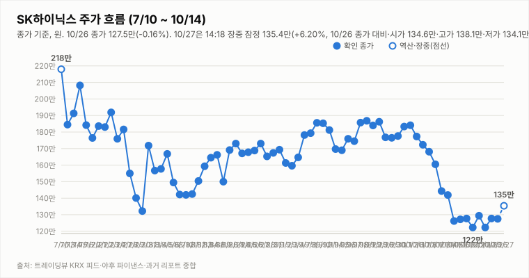
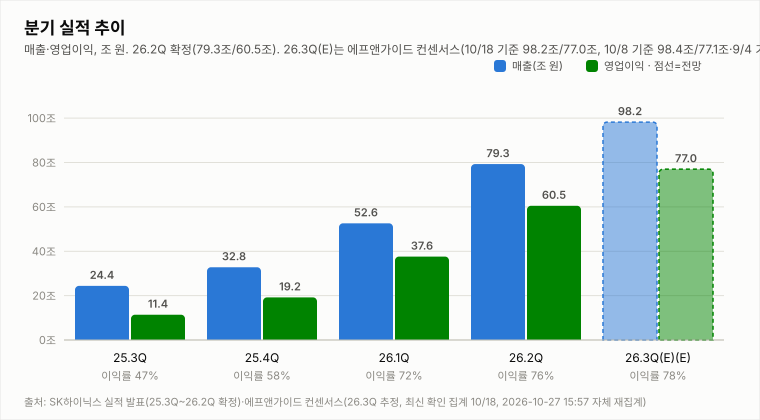
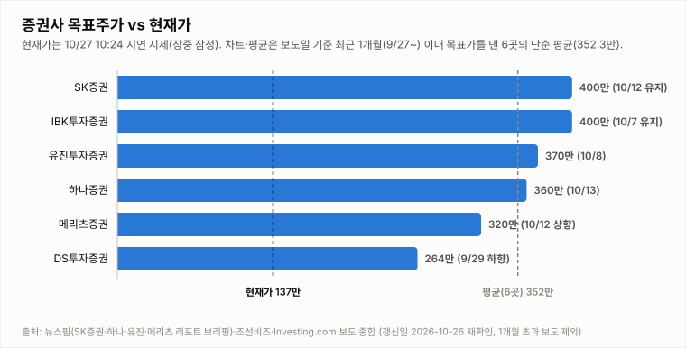
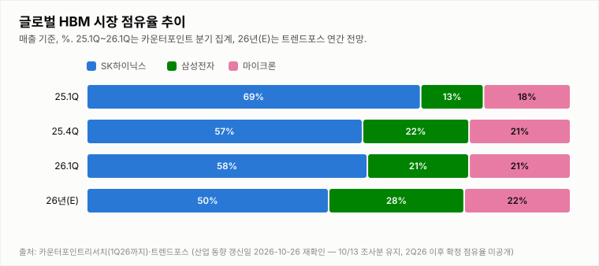

# SK하이닉스 투자 리포트 — 2026-10-27 (화) 장중 업데이트 (13:46, 13:24 지연 시세)

> **작성** 2026-10-27 13:46 KST · **장중 판정: 중립 유지(13:46 기준, 잠정) · 확정 판정: 중립(10/26 종가 기준)** · 전일 종가 127.5만원(-0.16%)은 `quote.json`(marketTime 10/26 15:30 KST)으로 확정이며 트레이딩뷰 종가와 일치합니다(거래량은 야후 최신 정정치). 오늘 시세는 야후 13:24 기준의 20분 지연 시세이며 확정이 아닙니다. 확정 판정은 종가 기준으로만 변경합니다.

> **종목** SK하이닉스 (KRX 000660 · NASDAQ 상장 7/10)
> 본 자료는 정보 제공 목적이며 투자 권유가 아닙니다.

## 핵심 요약

- **투자의견: 장중 판정 중립 유지(잠정)** — 13:46 데이터로 유지 규칙 표를 적용했습니다(확정 판정은 10/26 종가 기준 중립). 방향성 4요소는 긍정 2개(②④)·부정 1개(①)·중립 1개(③)로 중립→매수(긍정 3개 이상·부정 0개)와 중립→매도(부정 3개 이상·긍정 0개) 모두 미충족입니다. 시가 134.6만(+5.57% 갭업)에서 장중 고가 138.1만(+8.31%)까지 올랐다가 13:24 지연 시세 135.4만(+6.20%)으로 내려왔지만 10/21 고가(132.9만)와 10/26 고가(131.5만)는 여전히 웃돌고, ①은 MACD 시그널 하회·-DI 우위(DMI 격차 -17.5)라 종가 기준 반전 신호가 없고 ③은 16조원 특별배당 보도(10:35 Investing.com)와 추가 주주환원 가능성 보도(10:58 전자신문)가 나왔지만 10/26 회사가 확정된 것 없다고 한 기대 수준 사안의 반복이라 중립입니다. 확정 판정은 오늘 15:30 종가에서만 바꿉니다.
- **10/27 장중(13:24 지연 시세)** — 시가 134.6만(10/26 종가 대비 +5.57% 갭업)·고가 138.1만(+8.31%)·저가 134.1만(+5.18%), 현재 135.4만(**+6.20%**, +7.9만원), 거래량 191.4만주(20일 평균의 0.55배, 13:24까지 누적). 코스피200 현물 887.03(+4.17%)·코스피200 선물 890.85(+4.81%)로 시장 전반의 강세가 이어졌고(night_futures.json 11:24, 09:23에는 현물 +4.72%·선물 +4.16%), 10:17 연합인포맥스 “코스피 매수 사이드카…SK하이닉스 7% 급등”과 10:35 Investing.com “SK하이닉스, 16조원 특별배당 보도에 2주 만에 최고가 기록”, 10:58 전자신문 “[ET특징주] SK하이닉스 대규모 추가 주주환원 가능성에… SK·스퀘어 동반 급등”, 13:21 글로벌이코노믹 “[특징주] 삼성전자·SK하이닉스, 앤트로픽 사상 최대 IPO.. ‘강세’”가 나왔습니다(헤드라인만 확인, 16조원·추가 주주환원은 10/26 회사가 “확정된 것 없다”고 한 가능성·기대 수준이며 앤트로픽 IPO의 내용·규모는 확인 불가). 갭업을 직접 설명하는 확정 호재는 확인하지 못했습니다(외국인 수급 확인 불가). 전일 10/26 확정 종가는 127.5만(-0.16%)이었고 10/28 3Q26 실적 발표를 앞두고 있습니다.
- **간밤 변수·개장 전 헤드라인**: 미국장(10/26 월)은 지수와 반도체가 모두 올랐습니다. SOX +2.82%(11,083.47)·나스닥 +0.82%·S&P500 +0.70%, 마이크론 +2.98%, 엔비디아 +2.39%, SK하이닉스 ADR 142.62달러(+4.09%), EWY +0.97%였고 원/달러는 1,324.79원(-0.03%)입니다(night.yml 2026-10-27 08:04 스냅샷). 코스피200 야간선물은 872.35로 주간 종가(850.00) 대비 +2.63%(10/27 06:00, 20분 지연, 야간 세션 값인지 첫 실측 검증 진행 중)입니다. 헤드라인은 연합인포맥스 KB증권 "삼성전자·SK하이닉스, 추가 주주환원 120조 기대"(🟢, 08:54), YTN "SK하이닉스 내일 3분기 실적 발표...주주환원 관심"(⚪, 08:53), 뉴스핌 "[특징주] 삼전닉스 프리마켓 동반 강세…SK하이닉스 3%↑"(🟢, 08:08)입니다(헤드라인만 확인, 120조의 산출 기준·SK하이닉스 몫과 주주환원 내용·금액은 확인 불가).
- **지표(10/27 13:24 지연 시세 포함, 야후 일봉 기준)**: DMI 격차 -17.5(+DI 19.7 < -DI 37.2), KDJ K 43.3·D 24.5(격차 +18.8, K>D 우위 확대, 중립 구간 상단), MACD 히스토그램 -1.57만(시그널 하회). 오늘 거래량은 13:24까지 누적 191.4만주로 20일 평균의 0.55배입니다. 3Q26 실적 발표(10/28)까지 **D-1**입니다.

## 시세

| 시가 | 고가 | 저가 | 종가 | 등락 | 거래량 |
|---|---|---|---|---|---|
| ₩1,279,000 | ₩1,315,000 | ₩1,267,000 | **₩1,275,000** | **-0.16%** | 2,681,007주 |

출처: 야후 `quote.json`(marketTime 15:30 KST 확정)·트레이딩뷰 KRX 피드 교차 확인(종가 1,275,000원 일치). 전일(10/23) 확정 종가 1,277,000원 대비 -2,000원(-0.16%)이며 거래량은 야후 최신 정정치입니다(마감 리포트 234.1만주 → 290.9만주 → 268.1만주).

**오늘 10/27 (화) — 장 초반 (13:24 지연 시세, 확정 아님)** (출처: 야후 파이낸스 `quote.json`, 20분 지연)

| 시가 | 고가 | 저가 | 현재가 | 등락(10/26 종가 대비) | 거래량 |
|---|---|---|---|---|---|
| ₩1,346,000 | ₩1,381,000 | ₩1,341,000 | ₩1,354,000 | +6.20% | 1,914,466주 |

## 기술적 지표 (10/27 13:24 지연 시세 포함 야후 일봉 기준, 장중 잠정)

| 지표 | 값 | 해석 |
|---|---|---|
| MACD (12,26,9) | -12.63만 / 시그널 -11.06만 / 히스토그램 -1.57만 | 하락 모멘텀 지속 |
| ATR (14) | 9.38만 (6.9%) | 변동성 매우 큼 |
| ADX / DMI | ADX 30.4 · +DI 19.7 · -DI 37.2 | 추세 강함, 격차 -17.5(-DI 우위) |
| KDJ (9,3,3) | K 43.3 · D 24.5 · J 80.9 | 중립 구간, K>D 우위 확대(+18.8) |
| 거래량 / 20일 이평 | 191.4만 / 345.0만 | 평균의 0.55배(장중 누적) |

야후가 10/13 일봉을 정정 반영하면서 어제 리포트의 값(MACD 히스토그램 -3.59만·DMI -26.1)과 달라졌습니다.

종가 기준 격차 흐름: DMI 9/29 +1.6 → 9/30 +4.3 → 10/1 +2.2 → 10/2 +3.9 → 10/6 -0.8 → 10/7 -4.7 → 10/8 -7.9 → 10/12 -13.9(15:14 집계) → 10/13 -26.1(어제 리포트 기준) → 10/14 -25.9(종가 확정) → 10/15 -34.5(종가 확정·정정) → 10/16 -32.5(종가 확정) → 10/19 -33.2(종가 확정), KDJ 9/29 -8.4 → 9/30 -8.9 → 10/1 -5.2 → 10/2 -2.2 → 10/6 -8.2 → 10/7 -14.1 → 10/8 -15.1 → 10/12 -13.3(15:14 집계) → 10/13 -10.9(어제 리포트 기준) → 10/14 -8.4(종가 확정) → 10/15 -6.4(종가 확정·정정) → 10/16 -4.4(종가 확정) → 10/19 -1.8(종가 확정).

## 최신 뉴스 Top 5 (구글 뉴스 헤드라인 기준, 같은 사안은 1건만)

1. 🟢 **KB증권 “삼성전자·SK하이닉스, 추가 주주환원 120조 기대”** (연합인포맥스, 10/27) · 추가 주주환원·실적 발표 앞둔 기대 사안(YTN “SK하이닉스 내일 3분기 실적 발표...주주환원 관심”·연합인포맥스 “[남승표의 궁변통구] SK하이닉스 실적발표서 듣고 싶은 말”·조선비즈 10/26 “추가 주주환원안 이사회 거쳐 발표… 키옥시아 차익 특별배당엔 ‘미확정’” 등 같은 사안은 1건만 수록, 헤드라인만 확인, 120조의 산출 기준·SK하이닉스 몫·발표 내용 확인 불가)
2. 🟢 **[특징주] 삼전닉스 프리마켓 동반 강세…SK하이닉스 3%↑** (뉴스핌, 10/27) · 프리마켓 가격 결과 기사(Investing.com “오늘 SK하이닉스 주가가 상승한 이유는?” 등 같은 사안은 1건만 수록, 헤드라인만 확인, 프리마켓 거래 규모 확인 불가)
3. 🟢 **美 반도체주 일제히 상승…마이크론 3%·SK하이닉스 ADR 4%↑** (뉴스1, 10/27) · 10/26 미국장 반도체 강세(night.yml 스냅샷의 SOX +2.82%·마이크론 +2.98%·ADR +4.09%와 일치, 헤드라인만 확인)
4. ⚪ **美서 사라지는 SK하이닉스 2배 ETF…출시 석 달 만에 청산** (중앙일보, 10/27) · 美 상장 레버리지 ETF 사안(블루밍비트 10/26 “美 상장 SK하이닉스 레버리지 ETF 2종, 출시 3개월 만에 상장폐지” 등 같은 사안은 1건만 수록, 헤드라인만 확인, 청산 사유·규모 확인 불가)
5. 🟢 **HD현대, SK하이닉스 전력기기 수주 릴레이** (디일렉, 10/26) · 전력기기 수주 사안(키워드 자동분류 🟢이나 수주 규모·대상 설비 확인 불가라 방향 판단에는 쓰지 않음, 헤드라인만 확인; 매일일보 “여의도 IFC몰 기업광고 캠페인”·Investing.com “여의도서 ’초심’ 전시” 등 홍보성 기사는 제외)

※ 뉴스는 헤드라인 기준이며 본문 수치는 별도 검증하지 않았습니다. 같은 사안을 다룬 기사는 가장 최신 1건만 남겼습니다(예: 홍보성 "초심 조형물" 기사 3건·구직자 관심 기업 순위 기사 제외, [포토] 제외).

## 실적 · 밸류에이션 (갱신일 2026-10-27, 13:46 재확인: 3Q 컨센서스 재집계 완료·에프앤가이드 10/18 집계 확인, 목표가 변경은 확인 불가)

2Q26 확정 매출 79.3조·영업이익 60.5조(영업이익률 76%). **3Q26 컨센서스 재집계(13:46)**: 에프앤가이드 최신 확인 집계는 **10/18 기준 매출 98.23조·영업이익 76.96조(영업이익률 78.4%)**로 3개월 전(81.51조) 대비 -5.6%, 10/8 집계(매출 98.42조·영업이익 약 77.1조)·9/30 집계(영업이익 78.06조)·9/4 집계(매출 100.3조·영업이익 78.7조)에서 계속 낮아졌습니다(파이낸셜뉴스 10/18 보도 등 검색 요약 기준, 원문 접속 불가로 미확인).

| 증권사 | 매출(조) | 영업이익(조) | 출처·확인 수준 |
|---|---|---|---|
| 메리츠증권 | 확인 불가 | 80.1 | 이전 조사 수록(조선비즈·뉴스핌 헤드라인 기준, 보도일 확인 불가) |
| SK증권 | 확인 불가 | 79.0 | 이전 조사 수록(헤드라인 기준, 보도일 확인 불가) |
| IBK투자증권 | 95.8 | 75.1 | 검색 요약 기준(보도일 확인 불가) |
| DS투자증권 | 확인 불가 | 70.0 | 검색 요약 기준(보도일 확인 불가) |
| **4곳 단순 평균** | 산출 불가(1곳) | **76.05** | 중앙값 77.05 · 범위 70.0~80.1 |
| **에프앤가이드(10/18)** | 98.23 | **76.96** | 자체 4곳 평균과 -0.91조(-1.2%) 차이 |

참고(표본 제외): 같은 검색 요약에 “최근 1개월 내 보고서 10곳 평균 매출 96.66조·영업이익 75.97조”와 “8개 증권사 평균 영업이익 74.3조”가 있으나 출처 기관·기준일이 확인되지 않고 서로 달라 표본에서 제외했습니다. 메리츠증권은 10월 초 시장 컨센서스가 74조원까지 내려갔다고 분석했습니다(헤드라인 기준). 증권사별 표는 4곳뿐이라 통계적 의미는 제한적입니다. 3Q26 실적 발표는 10/28(D-1)로 보입니다(YTN·전자신문 헤드라인 기준, IR 공지 미확인).

**10/27 장중 업데이트(재확인 13:46):** 위 컨센서스는 이번 회차에서 처음부터 다시 집계한 값입니다(에프앤가이드 최신 집계는 10/18 기준으로 확인, 10/8 값 대비 영업이익 -0.2%). 머니투데이 “영업익 ‘76.9조’ 6번째 신기록 쓰나…”(10/19) 헤드라인도 같은 76.9조대입니다. **실적 발표일은 10/28(수)**: YTN “SK하이닉스 내일 3분기 실적 발표...주주환원 관심”(10/27 08:53)과 전자신문 “28일 발표”(10/26 12:28)에 더해 검색 요약상 TrendForce 10/26 프리뷰도 10/28을 가리킵니다(SK하이닉스 IR 공지·DART는 확인 불가). 주주환원: 연합인포맥스 KB증권 “삼성전자·SK하이닉스, 추가 주주환원 120조 기대”(10/27 08:54), 10:35 Investing.com “16조원 특별배당 보도에 2주 만에 최고가 기록”, 10:58 전자신문 “[ET특징주] SK하이닉스 대규모 추가 주주환원 가능성에… SK·스퀘어 동반 급등” 헤드라인이 나왔으나 10/26 회사 입장(문화일보 “확정된 것 없다”·조선비즈 “추가 주주환원안 이사회 거쳐 발표… 키옥시아 차익 특별배당엔 ‘미확정’”)과 달라진 확정 내용은 확인하지 못했습니다(가능성·기대 수준, 금액 근거 확인 불가). 13:21 글로벌이코노믹 “[특징주] 삼성전자·SK하이닉스, 앤트로픽 사상 최대 IPO.. ‘강세’” 헤드라인도 있었습니다(헤드라인만 확인, IPO 내용·규모 확인 불가). 8/7 분기배당 공시 보도(검색 요약 기준)에서 회사는 추가 주주환원안을 3분기 실적 발표 시 확정·발표할 예정이라고 밝힌 것으로 전해졌습니다.

> 밸류에이션 갱신일 2026-10-27 — 10/27 재조사에서도 신규·변경 목표주가 보도를 확인하지 못해 6곳을 유지했습니다(직전 확인 2026-10-16). 3Q 실적 발표(10/28) 직후 목표가 조정 리포트가 나올 수 있어 다음 갱신에서 점검합니다. 직전 컨센서스 322만원은 9/3 한국경제 기준. **차트는 보도일 기준 최근 1개월(9/27~10/27) 이내 목표가를 낸 6곳만 표시하며 평균 목표가도 이 6곳의 단순 평균(352.3만원)입니다.** 1개월 초과 리포트(한국투자증권 470만원 7/30, KB증권 420만원 7/30 유지, 교보증권 400만원 7/9 등)는 평균에서도 제외했습니다. 참고: 뉴스핌 로보뉴스(SK증권 리포트 브리핑, 10/12) 집계의 최근 6개월 전체 증권사 평균 목표가는 3,232,083원이며 집계 방식에 따라 다른 평균이 보도될 수 있습니다(예: 연합인포맥스 약 268만원, 약 4개월 전 기사).

최근 1개월 이내 6곳의 평균 목표주가 352.3만원은 13:24 지연 시세 135.4만 대비 **+160.2%** 괴리입니다(10/26 확정 종가 127.5만 기준 +176.3%). 6곳은 SK증권 400만원 유지(10/12), IBK 400만원 유지(10/7), 유진 370만원(10/8), 하나증권 360만원 "컨센서스 부합"(10/13), 메리츠 320만원 상향(10/12), DS투자 264만원(9/29 하향)입니다. 표본이 적어 평균은 참고용이며, 6개월 전체 평균(323.2만원) 대비 괴리율은 13:24 지연 시세 기준 +138.7%입니다. 참고로 중앙일보(10/20)에 노무라 "하이닉스 470만" 헤드라인이 있으나 9/4 보고서에서 유지된 목표가로 보이며(이번 기사 본문 확인 불가) 최근 1개월 평균에는 반영하지 않았습니다.

## 산업 동향 — HBM·DRAM·NAND (갱신일 2026-10-27)

> 10/27 재조사에서도 신규 가격 전망·점유율 발표를 확인하지 못해 가격·점유율 수치는 10/14 조사분을 유지했고, "10/27 업데이트" 항목은 저장소 뉴스·night.yml 지표 기준입니다(직전 확인 2026-10-16). 수치는 TrendForce 9/30 발표·산업통상부 10/1 발표·국내 언론 헤드라인 기준이며 차트의 점유율은 카운터포인트 1Q26(매출 기준)·트렌드포스 연간 전망입니다. 2Q26 이후 확정 점유율은 확인 불가.

**HBM / DRAM**

- **4Q26 범용 D램 계약가 +10~15%(QoQ)** — TrendForce 전망. 3Q26 전망(+13~18%)보다 둔화됐지만 AI 서버 수요와 첨단 공정 캐파 우선 배정으로 상승 기조는 유지.
- **2027년 HBM 가격 협상** — 헤드라인 기준 TrendForce는 내년 HBM 평균판매가 약 +121%를 전망(주체가 TrendForce 전망인지 마이크론 계약 기준인지 보도마다 엇갈림). 삼성전자는 HBM4 연간 공급가를 높게 제시했다는 보도가 있고, SK하이닉스는 2027년 물량·가격 협상 중으로 최종 내용은 확인 불가.
- **HBM 점유율** — 카운터포인트 1Q26 SK하이닉스 58%·삼성전자 21%·마이크론 21%, 트렌드포스 2026년 연간 50%·28%·22% 전망. 마이크론은 HBM4 10억달러 이상 출하·연말 점유율 20%대 목표, 삼성전자도 HBM4 양산 약 4개월 만에 누적 매출 10억달러 보도.
- **중국 CXMT 추격** — 10/9~10 콘퍼런스에서 4F² 셀 구조 DDR5 서버용 D램(RDIMM) 연내 출시를 예고(구체 사양·양산 일정 미공개, 우려와 과장 분석이 엇갈림). HBM이 아닌 범용 D램 기술이며 10/12~10/13 메모리주 급락의 계기로 거론됐으나 인과관계는 단정하지 않음.
- **수출** — 9월 반도체 수출 603억달러(+262.8%), 단일 품목 최초 600억달러 돌파(산업통상부 10/1).

**NAND**

- **4Q26 NAND 계약가 +15~20%(QoQ)** — 3Q26 전망(+18~23%)보다 둔화. eSSD 상승폭이 가장 크고 한 보도는 +23~28%를 전함(단일 보도 기준). eSSD 비트 수요는 전년 대비 80% 이상 증가 전망.
- **소비자 부문 부담** — PC·스마트폰은 원가 부담으로 SSD 용량을 줄이는 방식으로 대응 중. 솔리다임은 10/23 상장 검토 철회 보도로 논란이 완화됐으나 ADR 괴리율 과제가 남음(헤드라인 기준).

**10/27 업데이트 (헤드라인·시장 지표 기준)**

- **간밤 반도체 지표** — 10/26 미국장에서 SOX +2.82%(11,083.47)·마이크론 +2.98%(903.70달러)·엔비디아 +2.39%(216.00달러)·SK하이닉스 ADR +4.09%(142.62달러)로 10/23(SOX +0.44%·ADR +4.05%)에 이어 반도체 강세가 이어졌습니다(night.yml 스냅샷 2026-10-27 08:04 기준). 뉴스1 “美 반도체주 일제히 상승…마이크론 3%·SK하이닉스 ADR 4%↑”(10/27 05:18) 헤드라인과 일치합니다.
- **공급망·AI 수익성 헤드라인** — 글로벌이코노믹 “램리서치발 ‘공급망 병목’ 쇼크…SK하이닉스 ADR 8.07% 폭락”(10/23)과 “[특징주] 삼성전자·SK하이닉스, 美 AI 수익성 우려.. 동반 ‘약세’”(10/23)가 있었으나 10/26 미국장에서는 반도체가 반등했습니다(헤드라인만 확인, 병목의 구체 내용·AI 수익성 우려 내용 확인 불가).
- **AI 거품 논란과 투자 규모** — 이코노미스트 “AI 거품이라는데…SK하이닉스가 54조 쏟아붓는 이유”(10/26 08:02) 헤드라인이 있었습니다(54조원의 대상·기간 확인 불가).
- **HBM 경쟁 구도** — 번스타인 “삼성전자, 2026년 3분기 HBM 매출 SK하이닉스 추월”(Investing.com, 10/22)과 이코노미스트 “SK하이닉스에 밀린 삼성의 반격…HBM4 판 뒤집을 ‘비장의 카드’”(10/26) 헤드라인이 있었습니다(추월 수치·카드 내용 확인 불가). 위 점유율(1Q26 SK하이닉스 58%)은 갱신하지 못했습니다.
- **키옥시아** — 연합인포맥스 “키옥시아 지분가치 41조 급감…‘SK하이닉스, 왜 팔지 않았나’”(10/23) 헤드라인이 있었습니다(지분 규모·평가 기준 확인 불가이며 NAND 업황 해석은 단정하지 않습니다).
- **美 상장 레버리지 ETF** — 중앙일보 “美서 사라지는 SK하이닉스 2배 ETF…출시 석 달 만에 청산”(10/27 01:03)과 블루밍비트 “美 상장 SK하이닉스 레버리지 ETF 2종, 출시 3개월 만에 상장폐지”(10/26 14:46)는 같은 사안으로 보이는 헤드라인입니다(상장폐지 사유·규모 확인 불가).
- **전력기기 수주** — 디일렉 “HD현대, SK하이닉스 전력기기 수주 릴레이”(10/26 16:53) 헤드라인이 있었습니다(수주 규모·대상 설비·시점 확인 불가이며 메모리 업황 판단에는 반영하지 않습니다).

**해석**: 가격 상승률은 둔화(D램 +13~18%→+10~15%, 낸드 +18~23%→+15~20%)했지만 방향은 상승이고 HBM 2027년 가격 협상이 진행 중이라 요소 ④ 산업 사이클은 긍정 유지입니다. 상승률 둔화와 CXMT 추격은 업황 고점 논쟁을 키울 수 있어 10월 수출·4Q 계약가 실측·HBM4 협상 결과를 점검합니다. 10/26 기준 신규 가격 발표가 없어 판단은 유지합니다.

## 투자 판단

**의견: 장중 판정 중립(유지, 13:46 기준 잠정) — 확정 판정은 10/26 종가 기준 중립 (확정은 종가 기준으로만 변경합니다)**

| 요소 | 방향 | 근거 |
|---|---|---|
| ① 추세/모멘텀 | 부정 | 10/26 종가 127.5만 대비 13:24 지연 시세 +6.20%로 갭업(시가 134.6만, +5.57%)해 10/21 고가(132.9만)와 10/26 고가(131.5만)를 모두 넘어섰습니다. KDJ는 K>D(격차 +18.8)로 중립 구간 상단(K 43.3)에 올라섰고 DMI 격차는 -17.5로 10/26 종가(-24.6)보다 좁혀졌지만 MACD 시그널 하회(히스토그램 -1.57만)·-DI 우위로 종가 기준 반전 신호는 미확인입니다(10/2 종가 대비 -26.5%) |
| ② 밸류에이션 갭 | 긍정 | 최근 1개월 6곳 평균 목표가 352.3만 대비 13:24 지연 시세 135.4만 — +160.2%(10/26 확정 종가 기준 +176.3%) |
| ③ 촉매 | 중립(장중 잠정) | 확정 판정 시점(10/26 종가) 중립(확정)이며 13:46 장중 잠정에서도 중립을 유지합니다. Top10(같은 내용 기사는 1건으로 묶은 뒤) 자동분류는 🟢 호재 5건(글로벌이코노믹 “[특징주] 삼성전자·SK하이닉스, 앤트로픽 사상 최대 IPO.. ‘강세’”·전자신문 “[ET특징주] SK하이닉스 대규모 추가 주주환원 가능성에… SK·스퀘어 동반 급등”·뉴시스 “[속보]삼성전자·SK하이닉스 4% 상승 출발”·뉴스1 “美 반도체주 일제히 상승…마이크론 3%·SK하이닉스 ADR 4%↑”·Investing.com “오늘 SK하이닉스 주가가 상승한 이유는?”; 모두 가격·시장 결과 기사이거나 가능성·보도 수준)·🔴 악재 0건·⚪ 중립 5건(ETF 상장 폐지·YTN 실적 발표 예고·연합인포맥스 칼럼·슈퍼트렌드 기술적 분석 글·이천시의회 발언)입니다(10:35 Investing.com 16조원 특별배당 보도와 10:17 코스피 매수 사이드카 헤드라인은 Top10 집계 밖으로 밀렸고 08:54 KB증권 120조 헤드라인도 증권사 기대 수준이라는 판단은 유지). 13:24 지연 시세의 +6.20% 갭업은 코스피 매수 사이드카 헤드라인(10:17, 발동 시각·세부 확인 불가)이 보여주듯 시장 전반의 가격 결과이고, 10:35 Investing.com 16조원 특별배당 보도와 10:58 전자신문 “대규모 추가 주주환원 가능성” 헤드라인은 10/26에 이미 “확정된 것 없다”(문화일보)·“미확정”(조선비즈)으로 전해진 가능성·기대 수준 사안의 반복이라 호재로 확정하기 어렵고(출처·내용 확인 불가), 13:21 앤트로픽 IPO 강세 헤드라인은 시장 반응을 전하는 기사라 개별 호재를 직접 설명하는 확정 헤드라인은 확인하지 못했고, KB증권 120조는 증권사 기대 수준이며 회사는 특별배당을 확정하지 않았다고 전해졌고(추가 주주환원안은 이사회 발표) 실적 발표(10/28)가 하루 남아 있어 ③은 중립을 유지하며 종가에서 다시 판정합니다. ③을 긍정으로 보더라도 긍정 3·부정 1이라 매수 조건(부정 0개)은 충족되지 않아 판정은 같습니다(모두 헤드라인만 확인, 120조 산출 기준·16조원 보도의 출처·주주환원 내용·갭업 원인은 확인 불가). |
| ④ 산업 사이클 | 긍정 | HBM4 공급가 급등, 메모리 공급부족 구조, 3Q 이익 전망 상향 (산업 동향 갱신일 2026-10-27 재확인: 4Q 범용 D램 +10~15%·낸드 +15~20%, 상승률 둔화) |

**종합(장중 13:46): 긍정 2·부정 1(①)·③ 중립 → 중립 유지(잠정).** 확정 판정(10/26 종가 기준 중립)에 13:46 데이터로 유지 규칙 표를 적용한 잠정 결과이며 종가에서 확정합니다. 중립→매수(긍정 3개 이상·부정 0개)와 중립→매도(부정 3개 이상·긍정 0개) 모두 미충족입니다.

## 오늘(10/27, 화) 전망 — 갭업 출발, 134.1만 지지와 138.1만(오늘 고가) 돌파·안착 여부

| 항목 | 내용 |
|---|---|
| 지지선 | 134.6만(오늘 시가) · 134.1만(오늘 저가) · 132.9만(10/21 고가) · 131.5만(10/26 고가) · 129.7만(10/22 고가) |
| 저항선 | 138.1만(오늘 고가) · 그 위 저항 기준은 확인 불가 |
| 예상 등락 레인지(참고용) | 10/26 종가 ± ATR 9.38만 = 118.1만 ~ 136.9만(참고용, 잠정 ATR; 오늘 고가 138.1만은 상단을 넘어섬) |
| 예정 이벤트 | 3Q26 실적 발표 10/28(내일 D-1; YTN 10/27 “내일 3분기 실적 발표”·전자신문 “28일 발표” 헤드라인 기준, IR 공지는 확인 불가) · 추가 주주환원안 이사회 발표 예정(조선비즈 10/26, 키옥시아 차익 특별배당은 미확정; KB증권 “추가 주주환원 120조 기대”는 기대 수준, 내용 확인 불가) · 간밤 해외 지표(SOX +2.82%·마이크론 +2.98%·ADR +4.09%·EWY +0.97%)와 코스피200 야간선물 +2.63% · 반도체대전(10/14 개막) 진행 중(종료일 확인 불가) · 외국인 수급(확인 불가) · 원/달러 1,324.79원(-0.03%) |
| 관찰 포인트 | 갭업 유지 여부(시가 134.6만·저가 134.1만 지지, 10/26에는 고가에서 되밀린 전례), 138.1만(오늘 고가) 돌파·안착과 거래량 동반 여부(현재 13:24까지 누적 0.55배), 실적·추가 주주환원 발표(10/28) 앞둔 차익 매물, 외국인 수급(확인 불가), 종가 기준 DMI·MACD 변화(MACD 시그널 상회 여부) |
| 상방 시나리오 | KDJ가 중립 구간 상단(K 43.3, K>D 격차 +18.8)으로 올라서고 코스피200 +4.17%의 시장 강세가 이어지면 138.1만 돌파 시도가 가능함. 다만 ①은 MACD 시그널 하회·-DI 우위라 종가 기준 개선이 확인돼야 하며, 매수 복귀에는 긍정 3개 이상·부정 0개가 필요(현재 긍정 2(②④)·부정 1(①)·③ 중립) |
| 하방 시나리오 | 갭업 폭(+5.57%)이 커서 10/26처럼 고점에서 매물이 나오고 갭 구간(134.1만~131.5만)을 되돌리면 129.7만~127.7만까지 열려 있고 변동성이 매우 큼(ATR 6.9%). 실적·추가 주주환원 발표(10/28) 앞둔 차익 매물이 변수. 매도 진입(부정 3개 이상·긍정 0개)은 ②④가 모두 긍정에서 이탈해야 해 현재는 해당 없음 |
| 야간선물 | 872.35(코스피200 야간선물, 주간 종가 850.00 대비 +2.63%·`updateTimeKST` 10-27 06:00·20분 지연; 야간 세션 값인지 첫 실측 검증 진행 중) |

시가 134.6만(+5.57%)으로 갭업 출발해 13:24 지연 시세 135.4만(+6.20%)입니다(고가 138.1만, +8.31%). 아침 리포트가 본 갭업 시나리오(야간선물 +2.63%·ADR +4.09%·SOX +2.82%)보다 폭이 컸고 코스피200 현물이 09:23에 +4.72%(891.67)로 시장 전반의 강세가 겹쳤습니다(night_futures.json 09:23 기준). 13:24 시세는 135.4만(+6.20%)으로 12:24(134.8만)보다 올랐고 고가 138.1만·저가 134.1만 범위의 갭업 가격대를 유지했습니다. 10:17 코스피 매수 사이드카, 10:35 “16조원 특별배당 보도에 2주 만에 최고가” 헤드라인이 나왔습니다(헤드라인만 확인, 16조원은 확정되지 않은 보도·기대 수준). 11:24 코스피200 현물은 +4.17%로 09:23(+4.72%)보다 상승폭이 줄었습니다. 13:24까지 누적 거래량은 평균의 0.55배라 지속 여부는 단정하기 어렵고 10/26에도 고점에서 되밀린 전례와 10/28 실적·주주환원 발표 전 차익 매물 변수가 있습니다(방향성 참고일 뿐 가격 예측이 아닙니다).

---

*본 자료는 공개 보도·자료를 종합해 작성한 정보 제공 목적의 리포트이며 투자 판단과 책임은 투자자 본인에게 있습니다.*
