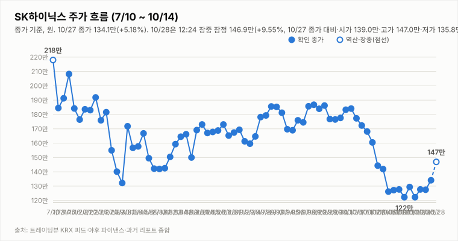
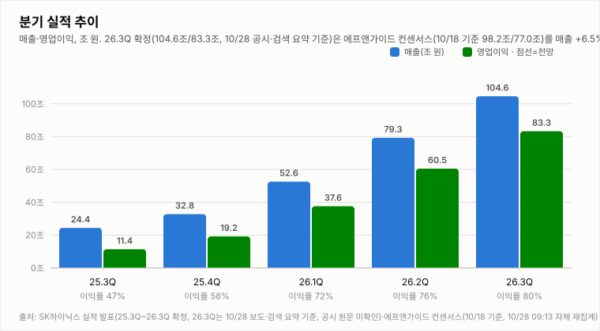
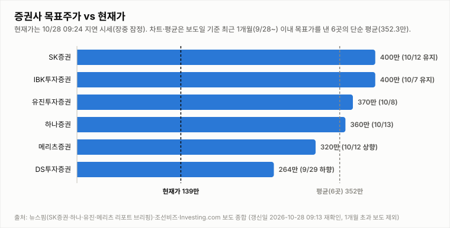

# SK하이닉스 투자 리포트 — 2026-10-28 (수) 장중 업데이트 (14:45, 14:24 지연 시세)

> **작성** 2026-10-28 14:45 KST · **장중 판정: 매수 전환(14:45 기준, 잠정) · 확정 판정: 중립(10/27 종가 기준)** · 전일 종가 134.1만원(+5.18%)은 `quote.json`(marketTime 10/27 15:30 KST)으로 확정이며 트레이딩뷰 종가와 일치합니다(거래량은 야후 최신 정정치). 오늘 시세는 야후 14:24 기준의 20분 지연 시세이며 확정이 아닙니다. 3Q26 실적·주주환원은 헤드라인·검색 요약 기준입니다. 확정 판정은 종가 기준으로만 변경합니다.

> **종목** SK하이닉스 (KRX 000660 · NASDAQ 상장 7/10)
> 본 자료는 정보 제공 목적이며 투자 권유가 아닙니다.

## 핵심 요약

- **투자의견: 장중 판정 매수 전환(잠정)** — 14:45 데이터로 진입 규칙 표를 적용했습니다(확정 판정은 10/27 종가 기준 중립). 방향성 4요소는 긍정 3개(②③④)·부정 0개·중립 1개(①)로 중립→매수 진입 조건(긍정 3개 이상·부정 0개)을 충족합니다. ①은 MACD가 시그널을 상향 돌파(히스토그램 +0.24만)했고 최근 3일 동안 MACD 히스토그램 -2.86만(10/26)→-1.65만(10/27)→+0.24만, DMI 격차 -24.6→-17.5→-7.7으로 개선되며 KDJ도 K>D(격차 +24.6)를 유지한 흐름을 반영해 부정에서 중립으로 올렸지만, +DI가 -DI 아래이고 MACD가 0선 아래라 긍정은 아닙니다. ③은 3Q26 실적(영업이익 83.3조, 컨센서스 76.96조 상회)과 총 약 100조원 주주환원 확정 발표로 장중 잠정 긍정, 14:24 지연 시세는 148.9만(+11.04%)입니다. 장중 판정은 잠정이며 확정 판정은 오늘 15:30 종가에서만 바꿉니다(종가에서 ①이 다시 부정으로 돌아가면 중립을 유지합니다).
- **10/28 장중(14:24 지연 시세)** — 시가 139.0만(10/27 종가 대비 +3.65% 갭업)·고가 149.0만(+11.11%)·저가 135.8만(+1.27%), 현재 148.9만(**+11.04%**, +14.8만원), 거래량 316.9만주(20일 평균의 0.92배, 장중 누적). 3Q26 실적(영업이익 83.3조, 컨센서스 76.96조 상회)과 총 약 100조원 주주환원 발표 이후 갭업했고 고가 부근까지 올랐습니다. 코스피200 현물은 936.76(+6.32%)·선물 936.60(+6.14%)입니다(night_futures.json 11:34 기준). 외국인 수급은 확인 불가입니다.
- **간밤 변수·개장 전 헤드라인**: 미국장(10/27 화)은 지수와 반도체가 모두 올랐습니다. SOX +3.60%(11,482.50)·나스닥 +1.18%·S&P500 +0.60%, 마이크론 +2.77%, 엔비디아 +0.90%, SK하이닉스 ADR 145.36달러(+1.92%), EWY +3.10%였고 원/달러는 1,326.34원(-0.04%)입니다(night.yml 2026-10-28 08:04 스냅샷). 코스피200 야간선물은 900.05로 주간 종가(882.45) 대비 +1.99%(10/28 06:00, 20분 지연, 야간 세션 값인지 첫 실측 검증 진행 중)입니다. 헤드라인은 연합인포맥스 “SK하이닉스, 3Q 매출 104.6조…사상 첫 100조 돌파”(🟢, 08:29), 연합인포맥스 “SK하이닉스 ‘14개 고객과 LTA 체결…일부는 5년이상 논의’”(⚪, 08:48), 연합인포맥스 “코스피, 2.23% 상승한 5,763.85 출발…SK하이닉스 주주환원 훈풍”(🟢, 09:01), 연합뉴스TV “[속보] SK하이닉스 3분기 영업익 83조…사상 최대”(🟢, 09:03)입니다(헤드라인 및 검색 요약 기준, 공시 원문·컨퍼런스콜 내용은 미확인).
- **지표(10/28 14:24 지연 시세 포함, 야후 일봉 기준)**: DMI 격차 -7.7(+DI 25.5 < -DI 33.2), KDJ K 60.7·D 36.1(격차 +24.6, K>D, 중립 구간 상단), MACD 히스토그램 +0.24만(시그널 상향 돌파, 0선 아래). 오늘 거래량은 장중 누적 316.9만주로 20일 평균의 0.92배입니다. 3Q26 실적은 오늘 새벽 발표됐습니다(영업이익 83.3조, 검색 요약 기준).

## 시세

| 시가 | 고가 | 저가 | 종가 | 등락 | 거래량 |
|---|---|---|---|---|---|
| ₩1,346,000 | ₩1,381,000 | ₩1,336,000 | **₩1,341,000** | **+5.18%** | 3,136,495주 |

출처: 야후 `quote.json`(marketTime 15:30 KST 확정)·트레이딩뷰 KRX 피드 교차 확인(종가 1,341,000원 일치). 전일(10/26) 확정 종가 1,275,000원 대비 +66,000원(+5.18%)이며 거래량은 야후 최신 정정치입니다(마감 리포트 283.1만주 → 344.1만주 → 313.6만주).

**오늘 10/28 (수) — 장중 (14:24 지연 시세, 확정 아님)** (출처: 야후 파이낸스 `quote.json`, 20분 지연)

| 시가 | 고가 | 저가 | 현재가 | 등락(10/27 종가 대비) | 거래량 |
|---|---|---|---|---|---|
| ₩1,390,000 | ₩1,490,000 | ₩1,358,000 | ₩1,489,000 | +11.04% | 3,168,792주 |

## 기술적 지표 (10/28 14:24 지연 시세 포함 야후 일봉 기준, 장중 잠정)

| 지표 | 값 | 해석 |
|---|---|---|
| MACD (12,26,9) | -10.78만 / 시그널 -11.02만 / 히스토그램 +0.24만 | 하락 모멘텀 지속 |
| ATR (14) | 9.77만 (6.6%) | 변동성 매우 큼 |
| ADX / DMI | ADX 29.2 · +DI 25.5 · -DI 33.2 | 추세 강함, 격차 -7.7(-DI 우위) |
| KDJ (9,3,3) | K 60.7 · D 36.1 · J 109.9 | 중립 구간, K>D 우위 확대(+24.6) |
| 거래량 / 20일 이평 | 316.9만 / 346.0만 | 평균의 0.92배(장중 누적) |

야후가 10/13 일봉을 정정 반영하면서 어제 리포트의 값(MACD 히스토그램 -3.59만·DMI -26.1)과 달라졌습니다.

종가 기준 격차 흐름: DMI 9/29 +1.6 → 9/30 +4.3 → 10/1 +2.2 → 10/2 +3.9 → 10/6 -0.8 → 10/7 -4.7 → 10/8 -7.9 → 10/12 -13.9(15:14 집계) → 10/13 -26.1(어제 리포트 기준) → 10/14 -25.9(종가 확정) → 10/15 -34.5(종가 확정·정정) → 10/16 -32.5(종가 확정) → 10/19 -33.2(종가 확정), KDJ 9/29 -8.4 → 9/30 -8.9 → 10/1 -5.2 → 10/2 -2.2 → 10/6 -8.2 → 10/7 -14.1 → 10/8 -15.1 → 10/12 -13.3(15:14 집계) → 10/13 -10.9(어제 리포트 기준) → 10/14 -8.4(종가 확정) → 10/15 -6.4(종가 확정·정정) → 10/16 -4.4(종가 확정) → 10/19 -1.8(종가 확정).

## 최신 뉴스 Top 5 (구글 뉴스 헤드라인 기준, 같은 사안은 1건만)

1. ⚪ **SK하이닉스, 주당 2만원 현금배당…연간 총 100조원 푼다(종합)** (연합뉴스, 10/28) · 3Q26 실적·주주환원 사안(JTBC “분기 영업익 83조 ‘역대 최대’”·한겨레·문화일보·연합뉴스TV “기록 경신…‘주주와 성과 나눌 것’” 등 같은 사안은 1건만 수록, 헤드라인 및 검색 요약 기준: 영업이익 83.3조로 컨센서스 76.96조 상회·3Q 배당 14조·추가 자사주 20조, 공시 원문 미확인)
2. 🟢 **[컨콜 종합] SK하이닉스, 반도체 고점론에 성장 자신감…HBM4·장기계약 승부** (Investing.com(EBN), 10/28) · 컨퍼런스콜 종합 사안(KBC광주방송 “고점론에 맞불”·국제신문 “메모리 위기론 일축…2029년까지 완판”[키워드 자동분류 🔴이나 위기론을 일축한 기사]·매일경제 등 같은 사안은 1건만 수록, 헤드라인만 확인)
3. ⚪ **SK하이닉스 “2029년까지 3년간 D램·HBM 사실상 완판”** (연합뉴스, 10/28) · 컨퍼런스콜 업황 코멘트(연합인포맥스 “HBM4, 4Q 출하량·매출 비중 모두 HBM3E 넘을 것” 등 같은 사안은 1건만 수록, 헤드라인만 확인)
4. ⚪ **SK하이닉스 “기존 6F² 구조 최대한 활용…4F²는 이후 로드맵”(종합)** (연합인포맥스, 10/28) · CXMT 기술전환 대응 사안(연합뉴스 “CXMT 기술전환에 ‘기존 기술 최대한 활용이 우선’” 같은 사안은 1건만 수록, 헤드라인만 확인, 4F² 도입 시점 확인 불가)
5. ⚪ **앤트로픽이 끌고 SK하이닉스가 밀고…반도체 투심 되살아나나** (연합뉴스, 10/28) · 시장 반응 기사(비즈워치 “메타 훈풍에 SK하이닉스 ‘역대급 실적’…코스피 5% 급등하며 6000선 근접” 등 같은 사안은 1건만 수록, 헤드라인만 확인; 🔴 연합뉴스 “고객 재무건전성도 점검…투자 리스크 면밀 관리”는 고객사 신용 리스크 점검 발언으로 방향 판단에는 쓰지 않음)

※ 뉴스는 헤드라인 기준이며 본문 수치는 별도 검증하지 않았습니다. 같은 사안을 다룬 기사는 가장 최신 1건만 남겼습니다(예: 홍보성 "초심 조형물" 기사 3건·구직자 관심 기업 순위 기사 제외, [포토] 제외).

## 실적 · 밸류에이션 (갱신일 2026-10-28, 14:45 재확인: 3Q26 확정 실적 반영·컨센서스 대비 재집계, 원화 목표가 변경은 확인 불가)

2Q26 확정 매출 79.3조·영업이익 60.5조(영업이익률 76%). **3분기 확정 실적(10/28 공시, 검색 요약 기준) vs 컨센서스 — 14:45 재집계**: SK하이닉스는 3Q26 **매출 104.62조·영업이익 83.33조(영업이익률 약 80%)**, 순이익 약 39.78조를 공시한 것으로 전해졌습니다(전분기 대비 매출 +31.9%·영업이익 +37.6%, 전년 동기 대비 매출 +328%·영업이익 +631%; 일부 기사는 영업이익을 83.3333조로 표기해 소수점 단위는 출처마다 다름). 에프앤가이드 최신 컨센서스(10/18 기준 매출 98.23조·영업이익 76.96조)를 각각 **+6.5%·+8.3%(영업이익 약 +6.37조)** 웃돈 서프라이즈입니다.

| 증권사 | 매출(조) | 영업이익(조) | 확정(83.33조) 대비 | 출처·확인 수준 |
|---|---|---|---|---|
| 메리츠증권 | 확인 불가 | 80.1 | +4.0% | 뉴시스 10/12 보도(김선우 연구원), 검색 요약 기준 |
| SK증권 | 확인 불가 | 79.0 | +5.5% | 10/13 보고서(한동희 연구원, 컨센서스 7% 상회 전망), 검색 요약 기준 |
| IBK투자증권 | 95.8 | 75.1 | +11.0% | 검색 요약 기준(보도일 확인 불가) |
| DS투자증권 | 확인 불가 | 70.0 | +19.1% | 검색 요약 기준(보도일 확인 불가) |
| **4곳 단순 평균** | 산출 불가(1곳) | **76.05** | **+9.6%** | 중앙값 77.05 · 범위 70.0~80.1 |
| **에프앤가이드(10/18)** | 98.23 | **76.96** | **+8.3%** | 확정 매출은 +6.5%(104.62조) |

확정 실적은 연합뉴스TV·연합인포맥스·한국경제·이투데이·EBN·세계일보 등의 10/28 보도 제목과 검색 요약 기준이며 SK하이닉스 공시 원문은 확인하지 못했습니다. 4곳 모두 확정 실적보다 낮았습니다(표본이 적어 참고용). 서울경제는 1개월 기준 증권사 평균(영업이익 75.97조)을 약 7.36조(+9.7%) 웃돌았다고 전했습니다(검색 요약 기준). 같은 검색 요약에 4분기 영업이익 컨센서스 87.27조가 제시됐으나 출처·기준일 확인 불가로 표본에 넣지 않았습니다.

**10/28 장중 업데이트(재확인 14:45):** 서울경제 “[속보] 3분기 영업이익률 79.7% 역대 최고” 헤드라인은 영업이익률이 시장 예상(78.6%)을 웃돈 것으로 전합니다(검색 요약 기준). 컨퍼런스콜(뉴스핌 10/28)에서 김우현 CFO는 주요 고객과 내년 HBM 물량·가격 등 거래 조건 협의를 마무리했고 HBM과 일반 D램의 수익성 격차가 줄 것으로 본다고 밝혔으며, 4Q 출하는 D램 20%대 중반·낸드 한 자릿수 중반 증가를 전망하고(낸드 기준 시점 불명확), LTA에는 예치금 등 이행 장치가 포함되고 계약 기간은 통상 5년이라고 설명한 것으로 전해졌습니다. 컨콜 헤드라인으로 연합인포맥스 “2029년까지 D램·HBM 물량 완판”(09:57), 매일경제 “향후 2년 생산능력 절반 계약완료”(10:05), 연합인포맥스 “AI 투자 지속 전망…메모리 수요 공급 압도”(10:13)·“주가 저평가…자사주 매입·소각이 효과적”(10:14)이 있었습니다. 연합인포맥스 09:14 “3분기 D램 ASP, 20% 후반대 상승률”, 09:20 “4분기 HBM4 출하량·매출 비중 HBM3E 넘어설 예정”, 09:26 “키옥시아 나머지 투자수익, 결산배당에 포함” 헤드라인도 있었습니다. **주주환원**: 이사회가 3Q 현금배당 14조원과 자사주 매입 20조원을 결의했고 매입 자사주 중 10조원은 소각·약 10조원은 임직원 보상용이라고 전해졌으며 주당 배당금은 2만원(특별배당 1만원 포함)입니다(검색 요약 기준). 10/26~10/27의 ‘16조원 특별배당’ 보도와 금액이 같은지는 확인 불가입니다. 연합뉴스 10:07 “2029년까지 3년간 D램·HBM 사실상 완판”, 10:19 “고객 재무건전성도 점검…투자 리스크 면밀 관리”(컨콜), 연합뉴스TV 11:38 “기록 경신 SK하이닉스…‘주주와 성과 나눌 것’” 헤드라인도 있었습니다(헤드라인만 확인). 연합뉴스 11:04 “주당 2만원 현금배당…연간 총 100조원 푼다(종합)”과 Investing.com(EBN) 12:34 “[컨콜 종합] 반도체 고점론에 성장 자신감…HBM4·장기계약 승부” 헤드라인이 이를 뒷받침합니다(헤드라인만 확인). 서울경제 “60조 추가 주주환원”(현금배당 30조·자사주 매입·소각 30조, 검색 요약 기준)은 앞서 완료된 40조원 자사주 매입을 제외한 추가분으로 보이며 총 약 100조원 표기와 같은 맥락이지만 산출 방식은 확인 불가입니다. 검색 요약에는 SK증권이 목표주가를 300만원에서 400만원으로 올렸다는 내용이 있으나 기존 보고(10/12·10/13 유지 400만원)와 상충해 반영하지 않았습니다. 모든 수치는 헤드라인·검색 요약 기준이며 공시 원문과 컨퍼런스콜 원문은 확인하지 못했습니다.

> 밸류에이션 갱신일 2026-10-28 — 10/27 15:57 재조사에서도 원화 주식 신규·변경 목표주가 보도를 확인하지 못해 6곳을 유지했습니다(직전 확인 2026-10-16). 3Q 실적 발표(10/28 새벽) 직후 목표가 조정 리포트가 나올 수 있어 장중 갱신에서 점검합니다. 직전 컨센서스 322만원은 9/3 한국경제 기준. **차트는 보도일 기준 최근 1개월(9/28~10/28) 이내 목표가를 낸 6곳만 표시하며 평균 목표가도 이 6곳의 단순 평균(352.3만원)입니다.** 1개월 초과 리포트(한국투자증권 470만원 7/30, KB증권 420만원 7/30 유지, 교보증권 400만원 7/9 등)는 평균에서도 제외했습니다. 참고: 뉴스핌 로보뉴스(SK증권 리포트 브리핑, 10/12) 집계의 최근 6개월 전체 증권사 평균 목표가는 3,232,083원이며 집계 방식에 따라 다른 평균이 보도될 수 있습니다(예: 연합인포맥스 약 268만원, 약 4개월 전 기사).

최근 1개월 이내 6곳의 평균 목표주가 352.3만원은 14:24 지연 시세 148.9만 대비 **+136.6%** 괴리입니다(10/26 확정 종가 127.5만 기준 +176.3%). 6곳은 SK증권 400만원 유지(10/12), IBK 400만원 유지(10/7), 유진 370만원(10/8), 하나증권 360만원 "컨센서스 부합"(10/13), 메리츠 320만원 상향(10/12), DS투자 264만원(9/29 하향)입니다. 표본이 적어 평균은 참고용이며, 6개월 전체 평균(323.2만원) 대비 괴리율은 14:24 지연 시세 기준 +117.1%입니다. 참고로 중앙일보(10/20)에 노무라 "하이닉스 470만" 헤드라인이 있으나 9/4 보고서에서 유지된 목표가로 보이며(이번 기사 본문 확인 불가) 최근 1개월 평균에는 반영하지 않았습니다.

## 산업 동향 — HBM·DRAM·NAND (갱신일 2026-10-28)

> 10/28 14:45 재조사에서도 신규 가격 전망·점유율 발표를 확인하지 못해 가격·점유율 수치는 10/14 조사분을 유지했고, "10/28 업데이트" 항목은 저장소 뉴스·night.yml 지표 기준입니다(직전 확인 2026-10-16). 수치는 TrendForce 9/30 발표·산업통상부 10/1 발표·국내 언론 헤드라인 기준이며 차트의 점유율은 카운터포인트 1Q26(매출 기준)·트렌드포스 연간 전망입니다. 2Q26 이후 확정 점유율은 확인 불가.

**HBM / DRAM**

- **4Q26 범용 D램 계약가 +10~15%(QoQ)** — TrendForce 전망. 3Q26 전망(+13~18%)보다 둔화됐지만 AI 서버 수요와 첨단 공정 캐파 우선 배정으로 상승 기조는 유지.
- **2027년 HBM 가격 협상** — 헤드라인 기준 TrendForce는 내년 HBM 평균판매가 약 +121%를 전망(주체가 TrendForce 전망인지 마이크론 계약 기준인지 보도마다 엇갈림). 삼성전자는 HBM4 연간 공급가를 높게 제시했다는 보도가 있고, SK하이닉스는 2027년 물량·가격 협상 중으로 최종 내용은 확인 불가.
- **HBM 점유율** — 카운터포인트 1Q26 SK하이닉스 58%·삼성전자 21%·마이크론 21%, 트렌드포스 2026년 연간 50%·28%·22% 전망. 마이크론은 HBM4 10억달러 이상 출하·연말 점유율 20%대 목표, 삼성전자도 HBM4 양산 약 4개월 만에 누적 매출 10억달러 보도.
- **중국 CXMT 추격** — 10/9~10 콘퍼런스에서 4F² 셀 구조 DDR5 서버용 D램(RDIMM) 연내 출시를 예고(구체 사양·양산 일정 미공개, 우려와 과장 분석이 엇갈림). HBM이 아닌 범용 D램 기술이며 10/12~10/13 메모리주 급락의 계기로 거론됐으나 인과관계는 단정하지 않음.
- **수출** — 9월 반도체 수출 603억달러(+262.8%), 단일 품목 최초 600억달러 돌파(산업통상부 10/1).

**NAND**

- **4Q26 NAND 계약가 +15~20%(QoQ)** — 3Q26 전망(+18~23%)보다 둔화. eSSD 상승폭이 가장 크고 한 보도는 +23~28%를 전함(단일 보도 기준). eSSD 비트 수요는 전년 대비 80% 이상 증가 전망.
- **소비자 부문 부담** — PC·스마트폰은 원가 부담으로 SSD 용량을 줄이는 방식으로 대응 중. 솔리다임은 10/23 상장 검토 철회 보도로 논란이 완화됐으나 ADR 괴리율 과제가 남음(헤드라인 기준).

**10/28 업데이트 (재조사·헤드라인·시장 지표 기준)**

- **3Q26 컨퍼런스콜·실적 코멘트(10/28, 검색 요약 기준)** — 내년 HBM 물량·가격 협의 마무리(HBM4 가치 반영), HBM과 일반 D램의 수익성 격차 축소 전망, 4Q D램 출하 +20%대 중반·낸드 한 자릿수 중반 증가(321단 eSSD 공급 확대), LTA는 예치금 등 이행 장치 포함·통상 5년이 전해졌습니다. 연합인포맥스 헤드라인: “2029년까지 D램·HBM 물량 완판…중장기 판매 가시성 높아져”(09:57), “HBM4, 4Q 출하량·매출 비중 모두 HBM3E 넘을 것”(09:59), “3분기 D램 ASP, 20% 후반대 상승률”(09:14), “AI 투자 지속 전망…메모리 수요 공급 압도”(10:13), “14개 고객과 LTA 체결…일부는 5년이상 논의”(08:48); 매일경제 “향후 2년 생산능력 절반 계약완료…AI고점론에 맞불”(10:05)(헤드라인·검색 요약 기준, 가격 상승률의 비교 기준과 LTA 세부는 확인 불가).
- **컨퍼런스콜 추가 코멘트(11:44 재조사)** — 연합뉴스 “2029년까지 3년간 D램·HBM 사실상 완판”(10:07), 연합뉴스 “고객 재무건전성도 점검…투자 리스크 면밀 관리”(10:19, 고객사 신용 리스크 관리 발언), 연합뉴스TV “기록 경신 SK하이닉스…‘주주와 성과 나눌 것’”(11:38) 헤드라인이 있었습니다(헤드라인만 확인, 세부 발언·수치 확인 불가). 연합뉴스 10:51 “앤트로픽이 끌고 SK하이닉스가 밀고…반도체 투심 되살아나나”도 시장 반응 기사입니다.
- **컨퍼런스콜 종합 보도(12:34)** — Investing.com(EBN) “[컨콜 종합] SK하이닉스, 반도체 고점론에 성장 자신감…HBM4·장기계약 승부”(12:34), KBC광주방송 “‘AI가 고점이라고?’…2년 치 생산능력 절반 계약하며 고점론에 맞불”(11:10), 국제신문 “메모리 위기론 일축…‘2029년까지 D램·HBM 완판’”(11:29) 보도가 있었습니다(헤드라인만 확인, 새 수치 확인 불가). 14:45 기준 신규 계약가·점유율 발표는 확인하지 못했습니다.
- **중국 CXMT 대응** — 연합인포맥스 “SK하이닉스 ‘기존 6F² 구조 최대한 활용…4F²는 이후 로드맵’(종합)”(10:21)과 연합뉴스 “CXMT 기술전환에 ‘기존 기술 최대한 활용이 우선’”(10:27) 헤드라인이 있었습니다(헤드라인만 확인, 4F² 도입 시점·투자 규모는 확인 불가).
- **카운터포인트 의견** — Investing.com(EBN) “카운터포인트 ‘SK하이닉스 실적 정점 아직’…HBM4·가격 전략 주목”(10/28 10:04) 헤드라인이 있었습니다(헤드라인만 확인, 점유율·가격 수치 확인 불가).
- **간밤 반도체 지표** — 10/27 미국장에서 SOX +3.60%(11,482.50)·마이크론 +2.77%(928.76달러)·엔비디아 +0.90%(217.94달러)·SK하이닉스 ADR +1.92%(145.36달러)로 반도체 강세가 이어졌습니다(night.yml 스냅샷 2026-10-28 08:04 기준). Investing.com 보도 기준 ADR은 시간외 거래에서 154.24달러까지 올랐습니다(보도 시점·거래량 확인 불가). 10/28 미국장(한국시간 10/29 새벽) 결과는 확인 불가입니다.
- **TrendForce 4Q26 계약가 전망(기준일 9/30)** — 4Q26 범용 D램 +10~15%(QoQ), HBM 포함 D램 전체 +15~20%, NAND 전체 +15~20%(중국 매체가 인용한 TrendForce 9/30 발표). 10/28 오전 검색에서도 신규 발표는 확인하지 못했습니다(2025년 자료는 사용하지 않음).
- **HBM 경쟁 구도·점유율** — 카운터포인트 1Q26 SK하이닉스 58%·삼성전자 21%·마이크론 21%(위 차트)가 마지막으로 확인한 점유율입니다. 검색 요약에 UBS가 내년 HBM 비트 점유율을 삼성전자 41%·SK하이닉스 39%로 전망했다는 내용이 있으나 발표 시점을 확인하지 못해 반영하지 않았습니다. 번스타인 “삼성전자, 2026년 3분기 HBM 매출 SK하이닉스 추월”(Investing.com, 10/22) 헤드라인도 있었습니다(추월 수치 확인 불가).
- **HBM4 사양 헤드라인** — 전자신문 “엔비디아, 베라 루빈 HBM4 대역폭 13% 하향…삼성·SK하이닉스 공급 확대 기대”(10/27 13:58) 헤드라인이 있었습니다(헤드라인만 확인, 하향 폭의 근거·실제 공급량 영향은 확인 불가).
- **키옥시아** — 연합인포맥스 “SK하이닉스 ‘키옥시아 나머지 투자수익, 결산배당에 포함’”(10/28 09:26)과 센TV “키옥시아 투자 수익 공유” 헤드라인이 있었고 3Q 배당의 특별배당 주당 1만원이 키옥시아 투자 수익을 반영한 것으로 전해졌습니다(검색 요약 기준, 규모 확인 불가이며 NAND 업황 해석은 단정하지 않습니다).

**해석**: 가격 상승률은 둔화(D램 +13~18%→+10~15%, 낸드 +18~23%→+15~20%)했지만 방향은 상승이고 HBM 2027년 가격 협상이 진행 중이라 요소 ④ 산업 사이클은 긍정 유지입니다. 상승률 둔화와 CXMT 추격은 업황 고점 논쟁을 키울 수 있어 10월 수출·4Q 계약가 실측·HBM4 협상 결과를 점검합니다. 10/26 기준 신규 가격 발표가 없어 판단은 유지합니다.

## 투자 판단

**의견: 장중 판정 매수 전환(잠정, 14:45 기준) — 확정 판정은 10/27 종가 기준 중립 (확정은 종가 기준으로만 변경합니다)**

| 요소 | 방향 | 근거 |
|---|---|---|
| ① 추세/모멘텀 | 중립(개선, 장중 잠정) | MACD가 시그널을 상향 돌파(히스토그램 +0.24만)했고 최근 3일 동안 히스토그램 -2.86만→-1.65만→+0.24만, DMI 격차 -24.6→-17.5→-7.7으로 개선됐으며 KDJ K>D(격차 +24.6)가 유지돼 부정에서 중립으로 올렸습니다. 다만 +DI(25.5)가 -DI(33.2) 아래이고 MACD가 0선 아래라 긍정은 아니며, 종가 기준으로 다시 확인합니다(10/2 종가 대비 -19.1%) |
| ② 밸류에이션 갭 | 긍정 | 최근 1개월 6곳 평균 목표가 352.3만 대비 14:24 지연 시세 148.9만 — +136.6%(10/27 확정 종가 기준 +162.7%) |
| ③ 촉매 | 긍정(장중 잠정) | 확정 판정 시점(10/27 종가) 중립(확정)이었으나 장중 잠정에서는 긍정으로 올립니다. 14:45 Top10(같은 내용 기사는 1건으로 묶은 뒤) 자동분류는 🟢 호재 6건(Investing.com(EBN) “[컨콜 종합] 반도체 고점론에 성장 자신감…HBM4·장기계약 승부”·문화일보 “3분기 영업익 83조·매출 104조”·연합뉴스TV “기록 경신 SK하이닉스…‘주주와 성과 나눌 것’”·국제신문 “메모리 위기론 일축…‘2029년까지 D램·HBM 완판’”·KBC광주방송 “2년 치 생산능력 절반 계약하며 고점론에 ‘맞불’”·연합뉴스 “주당 2만원 현금배당…연간 총 100조원 푼다(종합)”)·⚪ 중립 4건·🔴 악재 0건입니다(저장소 커밋본 news.json 12:44 수집분 기준이며 분류 규칙을 보완한 뒤 재분류한 결과입니다: 이전에 🔴로 잡혔던 국제신문 “위기론 일축”은 위기론을 반박한 기사라 호재로, 연합뉴스 “고객 재무건전성도 점검…투자 리스크 면밀 관리”는 리스크 관리 발언이라 중립으로 바뀌었습니다). 자동분류는 참고용이며 실적·업황·주주환원 재료는 호재성으로 봅니다. 3Q26 영업이익 83.3조가 에프앤가이드 컨센서스(76.96조)를 약 +6.4조 상회하고 영업이익률 79.7%가 시장 예상(78.6%)을 웃돌았으며, 이사회가 3Q 배당 14조·자사주 매입 20조 등 총 약 100조원 주주환원을 결의한 것으로 전해져(검색 요약 기준) 어제까지 미확정이던 재료가 호재로 확정돼 ③을 긍정(장중 잠정)으로 올립니다. 연합인포맥스 “4분기 HBM4 출하량·매출 비중 HBM3E 넘어설 예정”(09:20)과 컨퍼런스콜 보도(내년 HBM 협상 마무리)도 업황 호재성 재료입니다. 다만 호재 선반영(어제 종가가 고가 대비 -2.9%)과 시장 기사 비중이 있어 종가에서 다시 판정합니다. ③이 긍정이고 ①이 중립으로 올라 긍정 3·부정 0이 되어 매수 전환(장중 잠정) 조건을 충족하지만, 종가에서 ①이 다시 부정이 되면 중립을 유지합니다(모두 헤드라인·검색 요약 기준, 공시 원문 미확인). |
| ④ 산업 사이클 | 긍정 | HBM4 공급가 급등, 메모리 공급부족 구조, 3Q 이익 전망 상향 (산업 동향 갱신일 2026-10-27 재확인: 4Q 범용 D램 +10~15%·낸드 +15~20%, 상승률 둔화) |

**종합(장중 14:45): 긍정 3·부정 0·① 중립 → 매수 전환(장중 잠정).** 확정 판정(10/27 종가 기준 중립)에 14:45 데이터로 진입 규칙 표를 적용한 잠정 결과이며 종가에서 확정합니다. 중립→매수 진입 조건(긍정 3개 이상·부정 0개)을 충족하지만 ①은 최근 2~3일 흐름과 종가 기준으로 다시 판단하며, 종가에서 MACD가 시그널 아래로 되돌아가거나 DMI 개선이 꺾이면 ①이 부정으로 돌아가 중립을 유지합니다.

## 오늘(10/28, 수) 전망 — 급등, 149.0만(오늘 고가) 안착과 종가 기준 ① 유지 여부

| 항목 | 내용 |
|---|---|
| 지지선 | 139.0만(오늘 시가) · 138.1만(10/27 고가) · 135.8만(오늘 저가) · 134.6만(10/27 시가) · 134.1만(10/27 종가) |
| 저항선 | 149.0만(오늘 고가) · 148.9만(14:24 지연 시세) · 그 위 저항 기준은 확인 불가 |
| 예상 등락 레인지(참고용) | 10/27 종가 ± ATR 9.77만 = 124.3만 ~ 143.9만(참고용, 잠정 ATR; 오늘 고가 149.0만은 상단을 넘어섬) |
| 예정 이벤트 | 3Q26 실적 발표 완료(10/28 새벽 공시, 매출 104.6조·영업이익 83.3조, 검색 요약 기준) · 주주환원 총 약 100조원(현금배당 30조 이상·자사주 매입·소각 60조 이상, 3Q 배당 14조·추가 자사주 20조 이사회 결의, 검색 요약 기준) · 연합인포맥스 “14개 고객과 LTA 체결…일부는 5년이상 논의”(08:48, 세부 확인 불가) · 간밤 해외 지표(SOX +3.60%·마이크론 +2.77%·ADR +1.92%·EWY +3.10%)와 코스피200 야간선물 +1.99% · 반도체대전(10/14 개막) 진행 중(종료일 확인 불가) · 외국인 수급(확인 불가) · 원/달러 1,326.34원(-0.04%) |
| 관찰 포인트 | 149.0만(오늘 고가) 안착 여부와 거래량 동반 여부(장중 누적 0.92배), 종가에서 MACD 시그널 상회·DMI 격차 개선이 유지되는지(①), 호재 선반영 차익 매물(139.0만 시가·135.8만 저가·138.1만 10/27 고가 지지), 증권사 목표주가 상향 보도, 외국인 수급(확인 불가) |
| 상방 시나리오 | 실적 서프라이즈·주주환원 확정과 코스피200 +6%대 강세가 이어지면 149.0만 위 안착과 추가 상승 시도가 가능함. ①이 종가 기준으로도 MACD 시그널 상회를 유지하면 긍정 3·부정 0으로 매수 전환이 확정될 수 있음(진입 조건: 긍정 3개 이상·부정 0개) |
| 하방 시나리오 | 고점 부근(149.0만) 마감 부담과 호재 선반영 차익 매물이 나오면 143.9만(ATR 상단 참고)·139.0만(시가)~135.8만(저가)을 시험할 수 있고, 종가에서 MACD가 시그널 아래로 되돌아가면 ①이 부정으로 돌아가 중립을 유지함. 변동성이 매우 큼(ATR 6.6%). 매도 진입(부정 3개 이상·긍정 0개)은 해당 없음 |
| 야간선물 | 900.05(코스피200 야간선물, 주간 종가 882.45 대비 +1.99%·`updateTimeKST` 10-28 06:00·20분 지연; 야간 세션 값인지 첫 실측 검증 진행 중) |

3Q26 영업이익 83.3조·영업이익률 79.7%·약 100조원 주주환원 확정 발표에 코스피200 현물 +6.32%(936.76)의 강세가 겹쳐 시가 139.0만(+3.65%) 갭업 이후 14:24 지연 시세 148.9만(+11.04%)까지 올라 고가(149.0만) 부근입니다. MACD 히스토그램이 +0.24만으로 시그널을 상향 돌파했고 DMI 격차는 -7.7(+DI 25.5 < -DI 33.2)으로 좁혀졌지만 0선 아래·-DI 우위는 이어집니다. 장중 누적 거래량은 평균의 0.92배이고 고점 부근이라 호재 선반영에 따른 차익 매물과 종가 기준 ① 유지 여부가 변수입니다(방향성 참고일 뿐 가격 예측이 아닙니다).

---

*본 자료는 공개 보도·자료를 종합해 작성한 정보 제공 목적의 리포트이며 투자 판단과 책임은 투자자 본인에게 있습니다.*
