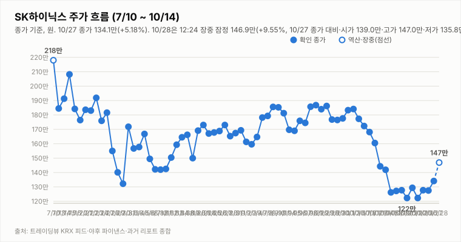
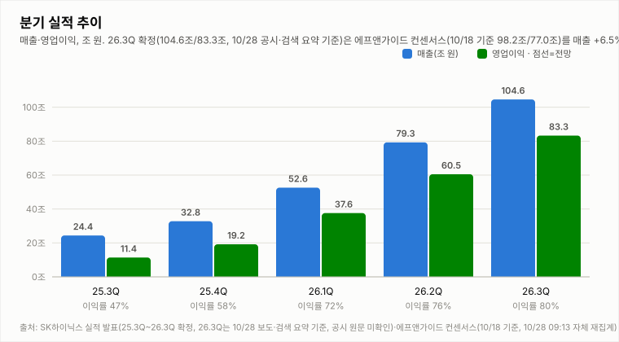
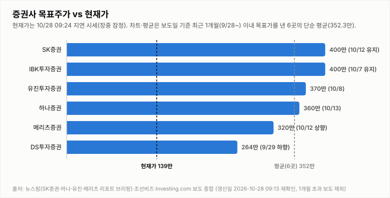
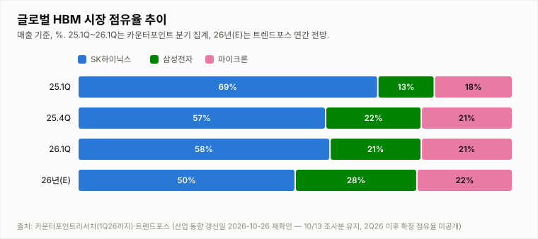

# SK하이닉스 투자 리포트 — 2026-11-03 (화) 장중 업데이트 (13:55, 13:24 지연 시세)

> **작성** 2026-11-03 13:55 KST · **장중 판정: 매수 유지(13:55 기준, 잠정) · 확정 판정: 매수 유지(11/2 종가 기준)** · 전일 종가 147.2만원(+3.81%)은 `quote.json`(marketTime 11/2 15:30 KST)으로 확정이며 트레이딩뷰와 일치합니다. 오늘 시세는 야후 13:24 기준의 20분 지연 시세이며 확정이 아닙니다. 간밤 지표는 night.yml 11/3 08:04 스냅샷, 3Q26 실적·주주환원은 헤드라인·검색 요약 기준입니다. 확정 판정은 종가 기준으로만 변경합니다.

> **종목** SK하이닉스 (KRX 000660 · NASDAQ 상장 7/10)
> 본 자료는 정보 제공 목적이며 투자 권유가 아닙니다.

## 핵심 요약

- **투자의견: 장중 판정 매수 유지(잠정)** — 13:55 데이터(13:24 지연 시세)로 같은 표를 적용했습니다(확정 판정은 11/2 종가 기준 매수 유지). 방향성 4요소는 긍정 3개(②③④)·부정 0개·중립 1개(①)로 매수 유지 조건(긍정 3개 이상·부정 1개 이하)을 충족합니다. ①은 MACD 히스토그램이 +2.21만으로 시그널 위를 유지했지만 12:24(+2.32만)보다 줄었고 KDJ도 K>D(격차 +2.8)이나 12:24(+3.7)보다 축소됐으며, DMI 격차는 -3.4(-DI 30.2 > +DI 26.8)로 12:24(-3.0)보다 벌어지고 MACD가 0선 아래라 긍정은 아니며 종가에서 부정으로 바뀔 가능성이 커졌습니다. 13:24 지연 시세 138.3만(-6.05%)은 시가 141.0만(전일 종가 대비 -4.21% 갭다운)·고가 143.3만(-2.65%)·저가 138.1만(-6.18%) 범위로, 12:24(140.0만)보다 1.7만원 내려 11/2 저가(138.9만)와 이전 오늘 저가(138.7만)를 밑돌며 10/30 저가(138.1만)와 같은 가격까지 내려왔습니다. 장중 판정은 잠정이며 확정 판정은 오늘 15:30 종가에서만 바꿉니다(종가에서 ①이 부정으로 돌아가도 ②③④가 긍정이면 긍정 3·부정 1로 매수가 유지되지만 ③·④가 약해져 긍정 2개 이하가 되면 이탈 조건입니다).
- **11/2 확정 종가 147.2만(+3.81%)** — 시가 140.2만(-1.13% 갭다운)·고가 149.8만(+5.64%)·저가 138.9만(-2.05%), 거래량 252.5만주(트레이딩뷰 11/2 20:08 시점, 20일 평균의 0.70배; 거래량은 시점마다 달라져 야후 합성 봉은 195.3만주, 트레이딩뷰 15:50 시점은 243.8만주). 시가·고가·저가·종가는 트레이딩뷰와 일치합니다(종가 1,472,000원). 고가 대비 -1.7%에서 마감했고 같은 날 삼성전자는 229,000원(+1.78%), 코스피200 12월물 주간 선물은 918.65(마감 기준)였습니다. 금요일 미국장 급락(SOX -7.20%) 신호와 달리 시가 -1.13% 갭다운 후 반등했으며 원인은 확인 불가입니다(한국경제 “코스피, 장중 상승 전환해 1%대 오름세…하이닉스 반등”, 헤드라인만 확인).
- **11/3 장중(13:24 지연 시세)** — 시가 141.0만(11/2 종가 대비 -4.21% 갭다운)·고가 143.3만(-2.65%)·저가 138.1만(-6.18%), 현재 138.3만(**-6.05%**, -8.9만원), 거래량 151.4만주(20일 평균의 0.42배, 개장 264분 누적). 12:24(140.0만) 이후 1.7만원 내려 11/2 저가(138.9만)·10/30 종가(141.8만)를 밑돌았고, 저가 138.1만은 10/30 저가(138.1만)와 같은 가격이며 고가(143.3만)는 12:24와 같습니다. 하락 원인은 확인 불가이며 외국인 수급도 확인 불가입니다.
- **간밤 변수·개장 전 헤드라인**: 미국장(11/2 월)은 반도체 중심으로 약세였습니다. SOX -3.37%(10,328.33)·나스닥 -1.07%(25,164.32)·S&P500 -0.51%(7,541.40), 마이크론 -5.78%(833.59달러), 엔비디아 -1.26%, SK하이닉스 ADR 147.71달러(-1.01%), EWY -0.83%였고 원/달러는 1,344.49원(-0.08%)입니다(night.yml 2026-11-03 08:04 스냅샷). 코스피200 야간선물은 883.4로 주간 종가(918.65) 대비 -3.84%(11/3 06:00, 20분 지연, 야간 세션 값인지 첫 실측 검증 진행 중)입니다. 갭다운 출발 가능성이 높아 보이지만, 11/2에도 SOX -7.20%·야간선물 -2.93%였는데 실제 시가는 -1.13%에 그치고 장중 반등했던 만큼 낙폭 크기는 불확실합니다(급락·반등 원인은 확인 불가). 헤드라인은 Investing.com “SK하이닉스 주가, 오늘 상승하는 이유는?”(🟢, 11/3 00:03), 인공지능신문 “SK스퀘어, SK하이닉스 배당 4.3조원 이상 주주환원…출범 이후 최대 규모”(🟢, 11/2 17:39), 주간한국 “반도체고점론? 3년치 일감 꽉 차…삼성·SK하이닉스, 합산 영업익 190兆”(⚪, 14:25)입니다(헤드라인만 확인, 세부 수치 확인 불가).
- **지표(11/3 13:24 지연 시세 포함, 야후 일봉 기준)**: DMI 격차 -3.4(+DI 26.8 < -DI 30.2, 12:24 -3.0에서 확대), KDJ K 62.1·D 59.3(격차 +2.8, K>D, 12:24 +3.7에서 축소하고 11/2 종가 +9.8보다 작음), MACD 히스토그램 +2.21만(시그널 위, 0선 아래). 오늘 거래량은 장중 누적 151.4만주로 20일 평균(363.6만주)의 0.42배입니다(개장 264분 누적이라 마감까지 비교 불가).

## 시세

| 시가 | 고가 | 저가 | 종가 | 등락 | 거래량 |
|---|---|---|---|---|---|
| ₩1,402,000 | ₩1,498,000 | ₩1,389,000 | **₩1,472,000** | **+3.81%** | 2,524,549주 |

출처: 야후 `quote.json`(marketTime 15:30 KST 확정)·트레이딩뷰 KRX 피드 교차 확인(종가 1,472,000원 일치). 10/30 확정 종가 1,418,000원 대비 +54,000원(+3.81%)이며 거래량은 트레이딩뷰 11/2 20:08 시점 값입니다.

**오늘 11/3 (화) — 장중 (13:24 지연 시세, 확정 아님)** (출처: 야후 파이낸스 `quote.json`, 20분 지연)

| 시가 | 고가 | 저가 | 현재가 | 등락(11/2 종가 대비) | 거래량 |
|---|---|---|---|---|---|
| ₩1,410,000 | ₩1,433,000 | ₩1,381,000 | ₩1,383,000 | -6.05% | 1,513,714주 |

## 기술적 지표 (11/3 13:24 지연 시세 포함 야후 일봉 기준, 장중 잠정)

| 지표 | 값 | 해석 |
|---|---|---|
| MACD (12,26,9) | -6.70만 / 시그널 -8.91만 / 히스토그램 +2.21만 | 하락 모멘텀 지속 |
| ATR (14) | 10.17만 (7.4%) | 변동성 매우 큼 |
| ADX / DMI | ADX 23.1 · +DI 26.8 · -DI 30.2 | 추세 강함, 격차 -3.4(-DI 우위) |
| KDJ (9,3,3) | K 62.1 · D 59.3 · J 67.8 | 중립 구간, K>D 우위 축소(+2.8) |
| 거래량 / 20일 이평 | 151.4만 / 363.6만 | 평균의 0.42배(장중 누적) |

야후가 10/13 일봉을 정정 반영하면서 어제 리포트의 값(MACD 히스토그램 -3.59만·DMI -26.1)과 달라졌습니다.

종가 기준 격차 흐름: DMI 9/29 +1.6 → 9/30 +4.3 → 10/1 +2.2 → 10/2 +3.9 → 10/6 -0.8 → 10/7 -4.7 → 10/8 -7.9 → 10/12 -13.9(15:14 집계) → 10/13 -26.1(어제 리포트 기준) → 10/14 -25.9(종가 확정) → 10/15 -34.5(종가 확정·정정) → 10/16 -32.5(종가 확정) → 10/19 -33.2(종가 확정), KDJ 9/29 -8.4 → 9/30 -8.9 → 10/1 -5.2 → 10/2 -2.2 → 10/6 -8.2 → 10/7 -14.1 → 10/8 -15.1 → 10/12 -13.3(15:14 집계) → 10/13 -10.9(어제 리포트 기준) → 10/14 -8.4(종가 확정) → 10/15 -6.4(종가 확정·정정) → 10/16 -4.4(종가 확정) → 10/19 -1.8(종가 확정).

## 최신 뉴스 Top 5 (구글 뉴스 헤드라인 기준, 같은 사안은 1건만)

1. 🟢 **SK하이닉스 주가, 오늘 상승하는 이유는?** (Investing.com 한국어, 11/03 00:03) · SK하이닉스 주가가 오늘 상승하는 이유를 짚은 Investing.com 한국어판 기사(제목 기준, 구체적 이유·수치는 확인 불가).
2. 🟢 **SK스퀘어, SK하이닉스 배당 4.3조원 이상 주주환원…출범 이후 최대 규모** (인공지능신문, 11/02 17:39) · SK스퀘어가 SK하이닉스 배당 등을 바탕으로 4.3조원 이상 규모의 주주환원에 나서며 출범 이후 최대 규모라고 전한 보도(제목 기준, 세부 내용 확인 불가).
3. ⚪ **“반도체고점론? 3년치 일감 꽉 차”…삼성·SK하이닉스, 합산 영업익 190兆** (주간한국, 11/02 14:25) · 반도체 고점론에도 삼성전자·SK하이닉스가 3년치 일감을 확보했고 합산 영업이익이 190조원에 이른다는 취지의 기사(제목 기준, 연도·집계 기준 확인 불가).
4. ⚪ **속도보다 지속성...삼성전자·SK하이닉스, 증설 방법도 '유연성'에 집중** (글로벌이코노믹, 11/02 14:10) · 삼성전자와 SK하이닉스가 메모리 증설에서 속도보다 지속성과 유연성을 중시하는 방향에 집중한다는 분석 기사(제목 기준, 세부 내용 확인 불가).
5. 🟢 **코스피, 장중 상승 전환해 1%대 오름세…하이닉스 반등** (한국경제, 11/02 10:50) · 코스피가 장중 상승 전환해 1%대 오름세를 보였고 SK하이닉스도 반등했다는 시황 기사로, 종목 고유 이슈가 아니라 시장 흐름 기사(제목 기준).

※ 뉴스는 헤드라인 기준이며 본문 수치는 별도 검증하지 않았습니다. 같은 사안을 다룬 기사는 가장 최신 1건만 남겼습니다(예: 홍보성 "초심 조형물" 기사 3건·구직자 관심 기업 순위 기사 제외, [포토] 제외).

## 실적 · 밸류에이션 (갱신일 2026-11-03, 13:55 재확인: 3Q26 확정 실적 반영·컨센서스 대비 재집계, 원화 목표가 변경은 확인 불가)

2Q26 확정 매출 79.3조·영업이익 60.5조(영업이익률 76%). **3분기 확정 실적(10/28 공시, 검색 요약 기준) vs 컨센서스 — 13:55 재집계**: SK하이닉스는 3Q26 **매출 104.62조·영업이익 83.33조(영업이익률 약 80%)**, 순이익 약 39.78조를 공시한 것으로 전해졌습니다(전분기 대비 매출 +31.9%·영업이익 +37.6%, 전년 동기 대비 매출 +328%·영업이익 +631%; 일부 기사는 영업이익을 83.3333조로 표기해 소수점 단위는 출처마다 다름). 에프앤가이드 최신 컨센서스(10/18 기준 매출 98.23조·영업이익 76.96조)를 각각 **+6.5%·+8.3%(영업이익 약 +6.37조)** 웃돈 서프라이즈입니다.

| 증권사 | 매출(조) | 영업이익(조) | 확정(83.33조) 대비 | 출처·확인 수준 |
|---|---|---|---|---|
| 메리츠증권 | 확인 불가 | 80.1 | +4.0% | 뉴시스 10/12 보도(김선우 연구원), 검색 요약 기준 |
| SK증권 | 확인 불가 | 79.0 | +5.5% | 10/13 보고서(한동희 연구원, 컨센서스 7% 상회 전망), 검색 요약 기준 |
| IBK투자증권 | 95.8 | 75.1 | +11.0% | 검색 요약 기준(보도일 확인 불가) |
| DS투자증권 | 확인 불가 | 70.0 | +19.1% | 검색 요약 기준(보도일 확인 불가) |
| **4곳 단순 평균** | 산출 불가(1곳) | **76.05** | **+9.6%** | 중앙값 77.05 · 범위 70.0~80.1 |
| **에프앤가이드(10/18)** | 98.23 | **76.96** | **+8.3%** | 확정 매출은 +6.5%(104.62조) |

확정 실적은 연합뉴스TV·연합인포맥스·한국경제·이투데이·EBN·세계일보 등의 10/28 보도 제목과 검색 요약 기준이며 SK하이닉스 공시 원문은 확인하지 못했습니다. 4곳 모두 확정 실적보다 낮았습니다(표본이 적어 참고용). 서울경제는 1개월 기준 증권사 평균(영업이익 75.97조)을 약 7.36조(+9.7%) 웃돌았다고 전했습니다(검색 요약 기준). 같은 검색 요약에 4분기 영업이익 컨센서스 87.27조가 제시됐으나 출처·기준일 확인 불가로 표본에 넣지 않았습니다.

**11/3 장중 업데이트(재확인 13:55):** 서울경제 “[속보] 3분기 영업이익률 79.7% 역대 최고” 헤드라인은 영업이익률이 시장 예상(78.6%)을 웃돈 것으로 전합니다(검색 요약 기준). 컨퍼런스콜(뉴스핌 10/28)에서 김우현 CFO는 주요 고객과 내년 HBM 물량·가격 등 거래 조건 협의를 마무리했고 HBM과 일반 D램의 수익성 격차가 줄 것으로 본다고 밝혔으며, 4Q 출하는 D램 20%대 중반·낸드 한 자릿수 중반 증가를 전망하고(낸드 기준 시점 불명확), LTA에는 예치금 등 이행 장치가 포함되고 계약 기간은 통상 5년이라고 설명한 것으로 전해졌습니다. 컨콜 헤드라인으로 연합인포맥스 “2029년까지 D램·HBM 물량 완판”(09:57), 매일경제 “향후 2년 생산능력 절반 계약완료”(10:05), 연합인포맥스 “AI 투자 지속 전망…메모리 수요 공급 압도”(10:13)·“주가 저평가…자사주 매입·소각이 효과적”(10:14)이 있었습니다. 연합인포맥스 09:14 “3분기 D램 ASP, 20% 후반대 상승률”, 09:20 “4분기 HBM4 출하량·매출 비중 HBM3E 넘어설 예정”, 09:26 “키옥시아 나머지 투자수익, 결산배당에 포함” 헤드라인도 있었습니다. **주주환원**: 이사회가 3Q 현금배당 14조원과 자사주 매입 20조원을 결의했고 매입 자사주 중 10조원은 소각·약 10조원은 임직원 보상용이라고 전해졌으며 주당 배당금은 2만원(특별배당 1만원 포함)입니다(검색 요약 기준). 10/26~10/27의 ‘16조원 특별배당’ 보도와 금액이 같은지는 확인 불가입니다. 연합뉴스 10:07 “2029년까지 3년간 D램·HBM 사실상 완판”, 10:19 “고객 재무건전성도 점검…투자 리스크 면밀 관리”(컨콜), 연합뉴스TV 11:38 “기록 경신 SK하이닉스…‘주주와 성과 나눌 것’” 헤드라인도 있었습니다(헤드라인만 확인). 연합뉴스 11:04 “주당 2만원 현금배당…연간 총 100조원 푼다(종합)”과 Investing.com(EBN) 12:34 “[컨콜 종합] 반도체 고점론에 성장 자신감…HBM4·장기계약 승부” 헤드라인이 이를 뒷받침합니다(헤드라인만 확인). 서울경제 “60조 추가 주주환원”(현금배당 30조·자사주 매입·소각 30조, 검색 요약 기준)은 앞서 완료된 40조원 자사주 매입을 제외한 추가분으로 보이며 총 약 100조원 표기와 같은 맥락이지만 산출 방식은 확인 불가입니다. 검색 요약에는 SK증권이 목표주가를 300만원에서 400만원으로 올렸다는 내용이 있으나 기존 보고(10/12·10/13 유지 400만원)와 상충해 반영하지 않았습니다. 모든 수치는 헤드라인·검색 요약 기준이며 공시 원문과 컨퍼런스콜 원문은 확인하지 못했습니다. 머니투데이 속보(10/29 19:22)는 주주환원이 100조원이며 구성이 배당 30조·자사주 소각 60조라고 전했습니다(헤드라인만 확인, 앞서 보도된 3Q 배당 14조·자사주 매입 20조 및 ‘60조 추가 주주환원’ 구성과 어떻게 맞는지 확인 불가). 신규 에프앤가이드 집계와 새 증권사 추정치는 확인하지 못해 에프앤가이드 10/18 집계 그대로 + 자체 재집계(15:56) 표를 유지합니다. 시사저널e(10/29 16:53)는 20조원 규모 자사주 매입이 첫날 25만주로 시작됐다고 전했습니다(헤드라인만 확인, 조기 종료 여부 확인 불가). 문화일보 10/30 07:18 “목표 주가 370만원?…내년 영업익 600조” 헤드라인은 주체·근거를 확인하지 못해 추정치 표본에 넣지 않았고, 10/30 마감까지 신규 에프앤가이드 집계와 새 증권사 3Q 추정치는 확인하지 못했습니다. 11/2 아침 재확인에서도 신규 에프앤가이드 집계와 새 증권사 3Q 추정치는 확인하지 못했습니다. 11/2 마감 재집계: 11/2 마감까지 신규 에프앤가이드 집계와 새 증권사 3Q 추정치는 확인하지 못했고 3Q26 실적은 확정치(영업이익 83.3조) 기준을 유지합니다. 11/3 아침 재확인에서도 신규 에프앤가이드 집계와 새 증권사 3Q 추정치는 확인하지 못했습니다.

> 밸류에이션 갱신일 2026-10-30 — 15:56 재조사(아침)에서도 10/30~11/3 보도 중 원화 주식 신규·변경 목표주가를 확인하지 못했습니다(문화일보 10/30 07:18 “SK하이닉스, 목표 주가 370만원?…내년 영업익 600조라구요?” 헤드라인은 어느 기관의 목표가인지 확인할 수 없어 반영하지 않음)(글로벌이코노믹 10/29 “노무라 목표가 470만원”은 9/4 유지분과 같아 신규 여부 확인 불가, “NH투자증권 3분기 호실적” 헤드라인은 목표주가 수치 확인 불가, RBC ADR 200달러는 달러 목표가라 제외). **기준 창 이동: 최근 1개월이 9/30~10/30으로 옮겨 가면서 DS투자증권 264만원(9/29)이 창 밖으로 나가 5곳이 됐고, 평균 목표가는 이 5곳의 단순 평균(370.0만원)입니다**(6곳 평균 352.3만원보다 올라간 것은 가장 낮은 값이 빠진 효과이며 신규 상향이 아님). 1개월 초과 리포트(한국투자증권 470만원 7/30, KB증권 420만원 7/30 유지, 교보증권 400만원 7/9, DS투자증권 264만원 9/29 등)는 평균에서 제외했습니다. 참고: 뉴스핌 로보뉴스(SK증권 리포트 브리핑, 10/12) 집계의 최근 6개월 전체 증권사 평균 목표가는 3,232,083원이며 집계 방식에 따라 다른 평균이 보도될 수 있습니다(예: 연합인포맥스 약 268만원, 약 4개월 전 기사).

최근 1개월 이내 5곳의 평균 목표주가 370.0만원은 11/2 확정 종가 147.2만 대비 **+151.4%** 괴리입니다(10/30 확정 종가 141.8만 기준 +160.9%, 6곳 평균 352.3만 기준 +139.3%). 5곳은 SK증권 400만원 유지(10/12), IBK 400만원 유지(10/7), 유진 370만원(10/8), 하나증권 360만원 "컨센서스 부합"(10/13), 메리츠 320만원 상향(10/12)입니다. 표본이 적어 평균은 참고용이며, 6개월 전체 평균(323.2만원) 대비 괴리율은 11/2 확정 종가 기준 +119.6%입니다. 참고로 노무라 470만원(9/4 유지분으로 보임)은 최근 1개월 평균에 반영하지 않았습니다.

## 산업 동향 — HBM·DRAM·NAND (갱신일 2026-10-28)

> 11/3 13:55 재조사에서도 신규 가격 전망·점유율 발표를 확인하지 못해 가격·점유율 수치는 10/14 조사분을 유지했고, "10/28 업데이트" 항목은 저장소 뉴스·night.yml 지표 기준입니다(직전 확인 2026-10-16). 수치는 TrendForce 9/30 발표·산업통상부 10/1 발표·국내 언론 헤드라인 기준이며 차트의 점유율은 카운터포인트 1Q26(매출 기준)·트렌드포스 연간 전망입니다. 2Q26 이후 확정 점유율은 확인 불가.

**HBM / DRAM**

- **4Q26 범용 D램 계약가 +10~15%(QoQ)** — TrendForce 전망. 3Q26 전망(+13~18%)보다 둔화됐지만 AI 서버 수요와 첨단 공정 캐파 우선 배정으로 상승 기조는 유지.
- **2027년 HBM 가격 협상** — 헤드라인 기준 TrendForce는 내년 HBM 평균판매가 약 +121%를 전망(주체가 TrendForce 전망인지 마이크론 계약 기준인지 보도마다 엇갈림). 삼성전자는 HBM4 연간 공급가를 높게 제시했다는 보도가 있고, SK하이닉스는 2027년 물량·가격 협상 중으로 최종 내용은 확인 불가.
- **HBM 점유율** — 카운터포인트 1Q26 SK하이닉스 58%·삼성전자 21%·마이크론 21%, 트렌드포스 2026년 연간 50%·28%·22% 전망. 마이크론은 HBM4 10억달러 이상 출하·연말 점유율 20%대 목표, 삼성전자도 HBM4 양산 약 4개월 만에 누적 매출 10억달러 보도.
- **중국 CXMT 추격** — 10/9~10 콘퍼런스에서 4F² 셀 구조 DDR5 서버용 D램(RDIMM) 연내 출시를 예고(구체 사양·양산 일정 미공개, 우려와 과장 분석이 엇갈림). HBM이 아닌 범용 D램 기술이며 10/12~10/13 메모리주 급락의 계기로 거론됐으나 인과관계는 단정하지 않음.
- **수출** — 9월 반도체 수출 603억달러(+262.8%), 단일 품목 최초 600억달러 돌파(산업통상부 10/1).

**NAND**

- **4Q26 NAND 계약가 +15~20%(QoQ)** — 3Q26 전망(+18~23%)보다 둔화. eSSD 상승폭이 가장 크고 한 보도는 +23~28%를 전함(단일 보도 기준). eSSD 비트 수요는 전년 대비 80% 이상 증가 전망.
- **소비자 부문 부담** — PC·스마트폰은 원가 부담으로 SSD 용량을 줄이는 방식으로 대응 중. 솔리다임은 10/23 상장 검토 철회 보도로 논란이 완화됐으나 ADR 괴리율 과제가 남음(헤드라인 기준).

**10/28 업데이트 (재조사·헤드라인·시장 지표 기준)**

- **3Q26 컨퍼런스콜·실적 코멘트(10/28, 검색 요약 기준)** — 내년 HBM 물량·가격 협의 마무리(HBM4 가치 반영), HBM과 일반 D램의 수익성 격차 축소 전망, 4Q D램 출하 +20%대 중반·낸드 한 자릿수 중반 증가(321단 eSSD 공급 확대), LTA는 예치금 등 이행 장치 포함·통상 5년이 전해졌습니다. 연합인포맥스 헤드라인: “2029년까지 D램·HBM 물량 완판…중장기 판매 가시성 높아져”(09:57), “HBM4, 4Q 출하량·매출 비중 모두 HBM3E 넘을 것”(09:59), “3분기 D램 ASP, 20% 후반대 상승률”(09:14), “AI 투자 지속 전망…메모리 수요 공급 압도”(10:13), “14개 고객과 LTA 체결…일부는 5년이상 논의”(08:48); 매일경제 “향후 2년 생산능력 절반 계약완료…AI고점론에 맞불”(10:05)(헤드라인·검색 요약 기준, 가격 상승률의 비교 기준과 LTA 세부는 확인 불가).
- **컨퍼런스콜 추가 코멘트(11:44 재조사)** — 연합뉴스 “2029년까지 3년간 D램·HBM 사실상 완판”(10:07), 연합뉴스 “고객 재무건전성도 점검…투자 리스크 면밀 관리”(10:19, 고객사 신용 리스크 관리 발언), 연합뉴스TV “기록 경신 SK하이닉스…‘주주와 성과 나눌 것’”(11:38) 헤드라인이 있었습니다(헤드라인만 확인, 세부 발언·수치 확인 불가). 연합뉴스 10:51 “앤트로픽이 끌고 SK하이닉스가 밀고…반도체 투심 되살아나나”도 시장 반응 기사입니다.
- **컨퍼런스콜 종합 보도(12:34)** — Investing.com(EBN) “[컨콜 종합] SK하이닉스, 반도체 고점론에 성장 자신감…HBM4·장기계약 승부”(12:34), KBC광주방송 “‘AI가 고점이라고?’…2년 치 생산능력 절반 계약하며 고점론에 맞불”(11:10), 국제신문 “메모리 위기론 일축…‘2029년까지 D램·HBM 완판’”(11:29) 보도가 있었습니다(헤드라인만 확인, 새 수치 확인 불가). 15:56 기준 신규 계약가·점유율 발표는 확인하지 못했습니다.
- **10/29 업황 헤드라인(15:56 재조사)** — 연합인포맥스 08:00 카운터포인트 “D램 가격 2달러 시대…SK하이닉스 실적 더 뛴다”와 08:26 “HBM 12단서 8단으로…SK하이닉스 수익성 셈법 달라지나” 헤드라인이 있었습니다(헤드라인만 확인, 기준 제품·수치·세부 내용 확인 불가). 신규 TrendForce 계약가·점유율 발표는 확인하지 못해 가격·점유율 수치는 직전 조사분을 유지합니다.
- **10/30 업황 헤드라인·간밤 지표(15:56 재조사)** — AI타임스 “CXMT, 수율 20%에도 HBM3E 양산 추진…SK하이닉스는 70%”(10/29 16:26)와 KB Think “삼성·SK하이닉스 나란히 HBM ‘완판’…메모리 슈퍼사이클 장기화하나”(10/29 13:30) 헤드라인이 있었습니다(헤드라인만 확인, 수율 기준·출처·세부 수치 확인 불가). 간밤 미국장(10/29)은 SOX -1.42%·마이크론 -4.98%·SK하이닉스 ADR -1.58%(162.09달러)로 반도체가 약했습니다(night.yml 2026-10-30 08:04 스냅샷; 하락 원인은 확인 불가). 신규 TrendForce 계약가·점유율 발표는 확인하지 못해 가격·점유율 수치는 직전 조사분(TrendForce 9/30, 카운터포인트 1Q26)을 유지합니다.
- **10/30 마감 재조사(15:56)** — TrendForce 2Q26 DRAM 매출 점유율은 삼성전자 39.4%·SK하이닉스 24.9%·CXMT 9.5%로 보도됐습니다(헤럴드경제 2026-09-08 보도, 검색 요약 기준·원문 미확인이며 기관마다 수치가 달라 HBM 점유율 차트와는 별개). 조선일보 10/30 08:39 “미국 기술주 덮친 AI 투자 우려…삼성전자·SK하이닉스 반등에도 걸림돌”과 10:09 “코스피 4%대 급락에 매도 사이드카 발동…삼성전자·SK하이닉스 동반 약세” 헤드라인이 있었습니다(헤드라인만 확인, 업황 지표가 아니라 시장·수급 변수). 신규 TrendForce 4Q26 계약가·HBM 점유율 발표는 확인하지 못해 가격·HBM 점유율 수치는 직전 조사분을 유지합니다.
- **11/2 업황 헤드라인·간밤 지표(13:55 재조사)** — 간밤 미국장(10/30 금)은 SOX -7.20%(10,688.80)·마이크론 -5.30%·엔비디아 -4.22%·SK하이닉스 ADR -7.95%(149.21달러)로 반도체가 급락했습니다(night.yml 2026-11-02 08:04 스냅샷; 급락 원인은 확인 불가). 10/30 헤드라인으로 지디넷코리아 “SK하이닉스, 日서 첫 ‘파트너스데이’…소부장 협력 강화”(19:52)와 디일렉 “비아트론, SK하이닉스와 3D D램 적층 장비 개발”(16:03)이 있었습니다(헤드라인만 확인, 세부 수치 확인 불가). 신규 TrendForce 4Q26 계약가·HBM 점유율 발표는 확인하지 못해 가격·점유율 수치는 직전 조사분을 유지합니다.
- **11/2 마감 재조사(13:55)** — 신규 TrendForce 4Q26 계약가·HBM 점유율 발표는 확인하지 못했습니다(검색 결과: TrendForce 9/23 불러틴 기준 4Q26 범용 D램 +10~15%·NAND +15~20% 보도는 기존 수치와 같고, StockHub 10/20 보도의 “D램 계약가 약 +20%”는 2차 출처이며 HBM 포함 여부·원문을 확인하지 못해 반영하지 않음). 11/1~11/2 헤드라인으로 연합뉴스TV “HBM4 경쟁 새 국면…삼성 추격·SK하이닉스 수성”(11/1 09:05), 이코노미스트 “AI 거품이라는데…SK하이닉스가 54조 쏟아붓는 이유”(11/1 00:50), 글로벌이코노믹 “속도보다 지속성...삼성전자·SK하이닉스, 증설 방법도 ‘유연성’에 집중”(11/2 14:10)이 있었습니다(헤드라인만 확인, 세부 수치 확인 불가). 가격·HBM 점유율 수치는 직전 조사분을 유지합니다.
- **11/3 업황 헤드라인·간밤 지표(13:55 재조사)** — 간밤 미국장(11/2 월)은 SOX -3.37%(10,328.33)·마이크론 -5.78%·엔비디아 -1.26%·SK하이닉스 ADR -1.01%(147.71달러)로 반도체 중심 약세였습니다(night.yml 2026-11-03 08:04 스냅샷; 원인은 확인 불가). 11/2 헤드라인으로 주간한국 “반도체고점론? 3년치 일감 꽉 차…삼성·SK하이닉스, 합산 영업익 190兆”(14:25)와 글로벌이코노믹 “속도보다 지속성...삼성전자·SK하이닉스, 증설 방법도 ‘유연성’에 집중”(14:10)이 있었습니다(헤드라인만 확인, 연도·집계 기준 등 세부 수치 확인 불가). 신규 TrendForce 4Q26 계약가·HBM 점유율 발표는 확인하지 못해 가격·점유율 수치는 직전 조사분을 유지합니다.
- **중국 CXMT 대응** — 연합인포맥스 “SK하이닉스 ‘기존 6F² 구조 최대한 활용…4F²는 이후 로드맵’(종합)”(10:21)과 연합뉴스 “CXMT 기술전환에 ‘기존 기술 최대한 활용이 우선’”(10:27) 헤드라인이 있었습니다(헤드라인만 확인, 4F² 도입 시점·투자 규모는 확인 불가).
- **카운터포인트 의견** — Investing.com(EBN) “카운터포인트 ‘SK하이닉스 실적 정점 아직’…HBM4·가격 전략 주목”(10/28 10:04) 헤드라인이 있었습니다(헤드라인만 확인, 점유율·가격 수치 확인 불가).
- **간밤 반도체 지표** — 10/27 미국장에서 SOX +3.60%(11,482.50)·마이크론 +2.77%(928.76달러)·엔비디아 +0.90%(217.94달러)·SK하이닉스 ADR +1.92%(145.36달러)로 반도체 강세가 이어졌습니다(night.yml 스냅샷 2026-10-28 08:04 기준). Investing.com 보도 기준 ADR은 시간외 거래에서 154.24달러까지 올랐습니다(보도 시점·거래량 확인 불가). 10/28 미국장(한국시간 10/29 새벽) 결과는 확인 불가입니다.
- **TrendForce 4Q26 계약가 전망(기준일 9/30)** — 4Q26 범용 D램 +10~15%(QoQ), HBM 포함 D램 전체 +15~20%, NAND 전체 +15~20%(중국 매체가 인용한 TrendForce 9/30 발표). 10/28 오전 검색에서도 신규 발표는 확인하지 못했습니다(2025년 자료는 사용하지 않음).
- **HBM 경쟁 구도·점유율** — 카운터포인트 1Q26 SK하이닉스 58%·삼성전자 21%·마이크론 21%(위 차트)가 마지막으로 확인한 점유율입니다. 검색 요약에 UBS가 내년 HBM 비트 점유율을 삼성전자 41%·SK하이닉스 39%로 전망했다는 내용이 있으나 발표 시점을 확인하지 못해 반영하지 않았습니다. 번스타인 “삼성전자, 2026년 3분기 HBM 매출 SK하이닉스 추월”(Investing.com, 10/22) 헤드라인도 있었습니다(추월 수치 확인 불가).
- **HBM4 사양 헤드라인** — 전자신문 “엔비디아, 베라 루빈 HBM4 대역폭 13% 하향…삼성·SK하이닉스 공급 확대 기대”(10/27 13:58) 헤드라인이 있었습니다(헤드라인만 확인, 하향 폭의 근거·실제 공급량 영향은 확인 불가).
- **키옥시아** — 연합인포맥스 “SK하이닉스 ‘키옥시아 나머지 투자수익, 결산배당에 포함’”(10/28 09:26)과 센TV “키옥시아 투자 수익 공유” 헤드라인이 있었고 3Q 배당의 특별배당 주당 1만원이 키옥시아 투자 수익을 반영한 것으로 전해졌습니다(검색 요약 기준, 규모 확인 불가이며 NAND 업황 해석은 단정하지 않습니다).

**해석**: 가격 상승률은 둔화(D램 +13~18%→+10~15%, 낸드 +18~23%→+15~20%)했지만 방향은 상승이고 HBM 2027년 가격 협상이 진행 중이라 요소 ④ 산업 사이클은 긍정 유지입니다. 상승률 둔화와 CXMT 추격은 업황 고점 논쟁을 키울 수 있어 10월 수출·4Q 계약가 실측·HBM4 협상 결과를 점검합니다. 10/26 기준 신규 가격 발표가 없어 판단은 유지합니다.

## 투자 판단

**의견: 장중 판정 매수 유지(잠정, 13:55 기준) — 확정 판정은 11/2 종가 기준 매수 유지 (확정은 종가 기준으로만 변경합니다)**

| 요소 | 방향 | 근거 |
|---|---|---|
| ① 추세/모멘텀 | 중립(악화, 장중 잠정) | MACD 히스토그램이 시그널 위를 유지(11/2 종가 +2.51만→11:24 +2.43만→12:24 +2.32만→13:24 +2.21만)하고 KDJ K>D(격차 11/2 종가 +9.8→11:24 +4.7→12:24 +3.7→13:24 +2.8)가 유지돼 중립이지만 둘 다 점차 줄고 있고, DMI 격차는 12:24 -3.0에서 -3.4로 벌어졌습니다. +DI(26.8)가 -DI(30.2) 아래이고 MACD는 0선 아래라 긍정은 아니며, 가격이 11/2 저가(138.9만) 아래로 내려와 10/30 저가(138.1만)에 닿아 종가에서 ①이 부정으로 바뀔 가능성이 큽니다(10/2 종가 대비 -24.9%) |
| ② 밸류에이션 갭 | 긍정 | 최근 1개월 5곳 평균 목표가 370.0만원 대비 13:24 지연 시세 138.3만원 — 괴리율 **+167.5%**(11/2 확정 종가 147.2만원 기준 +151.4%, 6곳 평균 352.3만 기준 +154.7%, 6개월 전체 평균 323.2만원 대비 +133.7%) |
| ③ 촉매 | 긍정(확정) | 3Q26 확정 실적(영업이익 83.3조·컨센서스 76.96조 상회·영업이익률 79.7%)과 총 약 100조원 주주환원 이사회 결의, 20조원 자사주 매입 진행(뉴스핌 10/30 “이틀째 25만주 매입…증시 하단 지지”, 헤드라인만 확인)으로 긍정(확정)을 유지합니다(검색 요약·헤드라인 기준, 공시 원문 미확인). 개장 전 Top10(같은 내용 기사는 1건으로 묶은 뒤, 11/3 02:00 수집분) 자동분류는 🟢 호재 3건(Investing.com “SK하이닉스 주가, 오늘 상승하는 이유는?”·인공지능신문 “SK스퀘어, SK하이닉스 배당 4.3조원 이상 주주환원…출범 이후 최대 규모”·한국경제 “코스피, 장중 상승 전환해 1%대 오름세…하이닉스 반등”)·⚪ 중립 5건(주간한국 3년치 일감 기사·증설 전략 분석·비즈워치 코스피 시황·목표주가 350만원 기사·미국 중간선거 전망)·🔴 악재 2건(글로벌이코노믹 “[특징주] 삼성전자·SK하이닉스, 美 반도체주 급락에도 ‘선방’”·조선비즈 “채용연계 AI 해커톤, 접속 오류로 예선 차질”)입니다. 🔴 2건은 제목의 ‘급락’ 때문에 분류됐을 뿐 내용은 미국 반도체주 급락에도 선방했다는 시황 기사와 채용 행사 운영 이슈라 SK하이닉스의 실적·사업 악재가 아니어서 ③ 방향에는 쓰지 않았고, 🟢 중 시황 기사 2건도 ③ 근거로 쓰지 않았습니다. 간밤 반도체 약세(SOX -3.37%)는 시장 변수로 따로 점검합니다. 매일경제 “목표주가 350만원”은 주체·근거를 확인하지 못해 반영하지 않았습니다. |
| ④ 산업 사이클 | 긍정 | HBM4 공급가 급등, 메모리 공급부족 구조, 3Q 이익 전망 상향 (산업 동향 갱신일 2026-10-27 재확인: 4Q 범용 D램 +10~15%·낸드 +15~20%, 상승률 둔화) |

**종합(장중 13:55): 긍정 3·부정 0·① 중립 → 매수 유지(장중 잠정).** 확정 판정(11/2 종가 기준 매수 유지)에 13:24 지연 시세 데이터로 같은 표를 적용한 잠정 결과이며 종가에서 확정합니다. 매수 유지 조건(긍정 3개 이상·부정 1개 이하)을 충족합니다. 12:24 대비 1.7만원 내려 -6.05%로 10/30 저가(138.1만) 부근까지 내려왔고 ②③④의 방향은 바뀌지 않았으나, ①의 KDJ 격차(+2.8)와 MACD 히스토그램(+2.21만)이 계속 줄고 DMI 격차도 -3.4로 벌어져 종가에서 부정으로 돌아갈 가능성이 커졌습니다. ①이 부정으로 돌아가도 긍정 3·부정 1로 매수가 유지되지만 ③·④가 약해져 긍정 2개 이하가 되면 이탈 조건입니다.

## 오늘(11/3, 화) 전망 — 갭다운 후 재하락, 138.1만 지지와 138.9만~141.8만 회복 여부

| 항목 | 내용 |
|---|---|
| 지지선 | 138.1만(오늘 저가=10/30 저가) · 135.8만(10/28 저가) · 134.1만(10/27 종가) · 133.6만(10/27 저가) · 127.5만(10/26 종가) · 126.7만(10/26 저가) |
| 저항선 | 138.9만(11/2 저가) · 140.2만(11/2 시가) · 141.0만(오늘 시가) · 141.8만(10/30 종가) · 143.3만(오늘 고가) · 144.4만(10/30 시가) |
| 예상 등락 레인지(참고용) | 11/2 종가 147.2만 ± ATR 10.17만 = 137.0만 ~ 157.4만(참고용, 잠정 ATR 7.4%; 현재 138.3만·오늘 저가 138.1만은 범위 안) |
| 예정 이벤트 | SK하이닉스 3Q26 실적 발표 완료(10/28 새벽 공시, 매출 104.6조·영업이익 83.3조, 검색 요약 기준) · 주주환원 총 약 100조원(검색 요약 기준; 머니투데이 속보 10/29는 “배당 30조·자사주 소각 60조” 구성으로 전해 세부 구성은 확인 불가) · 20조원 규모 자사주 매입 진행(시사저널e 10/29 “첫날 25만주”, 뉴스핌 10/30 “이틀째 25만주”, 헤드라인만 확인) · 미국 중간선거(11/3 미국 현지 예정으로 알려짐; 글로벌이코노믹 11/2 04:00 “美 중간선거에 삼성·SK하이닉스 촉각” 헤드라인 기준, 세부 내용 확인 불가) · 증권사 목표주가·추정치 변경 리포트는 13:55 재확인까지 확인하지 못함(매일경제 11/2 08:15 “목표주가 350만원”은 주체 확인 불가) · 10월 수출입 동향(산업통상부) 내용은 확인하지 못함 · 다음 정례 실적(4Q26) 발표일은 확인 불가라 D-day 산출 불가 |
| 관찰 포인트 | 138.1만(오늘 저가=10/30 저가) 지지 유지 여부와 138.9만~140.2만(11/2 저가·시가) 회복 여부, 이탈 시 135.8만(10/28 저가)~133.6만(10/27 저가) 시험, 141.8만(10/30 종가) 재도전, 장중 누적 거래량(현재 0.42배, 개장 264분 누적)의 증가 속도(투매 여부), 마감 직전(14:30~15:30) 매물, MACD 시그널 상회 유지와 KDJ 격차(+2.8)·DMI 격차(-3.4) 추가 악화 여부(①), 미국 중간선거 관련 변동성, 자사주 매입 지속, 증권사 목표주가 보도, 외국인 수급(확인 불가) |
| 상방 시나리오 | 138.9만~140.2만(11/2 저가·시가)을 종가로 회복하면 낙폭 일부가 만회되고 141.0만~141.8만(오늘 시가·10/30 종가)이 다음 저항이 되며 ①의 약화가 제한됨. 매수 유지 조건: 긍정 3개 이상·부정 1개 이하 |
| 하방 시나리오 | 138.1만(오늘 저가=10/30 저가)을 이탈하면 135.8만(10/28 저가)~133.6만(10/27 저가), 그 아래는 127.5만(10/26 종가)까지 열려 있음. ①이 부정으로 돌아가도 ②③④가 긍정이면 긍정 3·부정 1로 매수가 유지되지만 ③·④가 약해져 긍정 2개 이하가 되면 이탈 조건에 해당함. 변동성이 매우 큼(ATR 7.4%). 매도 진입(부정 3개 이상·긍정 0개)은 해당 없음 |
| 야간선물 | 883.4(코스피200 야간선물, 주간 종가 918.65 대비 -3.84%·updateTimeKST 11-03 06:00·20분 지연; 야간 세션 값인지 첫 실측 검증 진행 중) — 실제 개장은 시가 141.0만(전일 종가 대비 -4.21%)으로 야간선물·미국장 약세 신호와 같은 방향이었고 13:24 지연 시세는 -6.05%로 낙폭이 야간선물(-3.84%)보다 커졌음 |

간밤 미국장 SOX -3.37%·마이크론 -5.78%·나스닥 -1.07%·ADR -1.01%와 코스피200 야간선물 -3.84%의 약세 신호대로 시가 141.0만(-4.21%)으로 갭다운 출발한 뒤 10:24 142.4만까지 반등했다가 13:24 지연 시세 138.3만(-6.05%)으로 밀려 저가 138.1만(-6.18%)은 10/30 저가와 같은 가격입니다. 하락 원인은 확인 불가입니다. 확정 판정(매수 유지)은 종가에서만 바뀌며 장중 판정은 ①이 중립(악화, KDJ 격차 +2.8·DMI 격차 -3.4), ②③④ 긍정으로 매수 유지(잠정)입니다. 138.1만 지지 유지 여부와 138.9만~141.8만 회복 여부가 변수입니다(방향성 참고일 뿐 가격 예측이 아닙니다).

---

*본 자료는 공개 보도·자료를 종합해 작성한 정보 제공 목적의 리포트이며 투자 판단과 책임은 투자자 본인에게 있습니다.*
