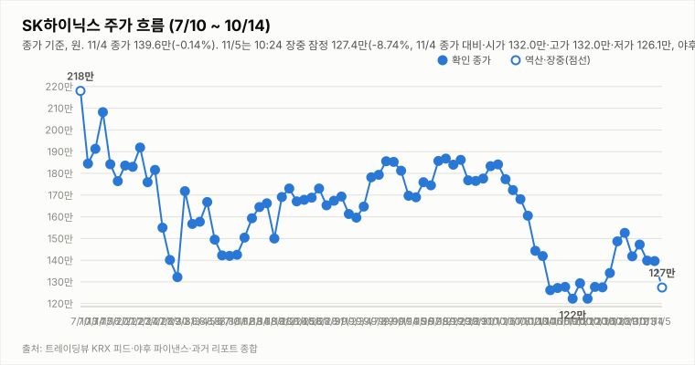
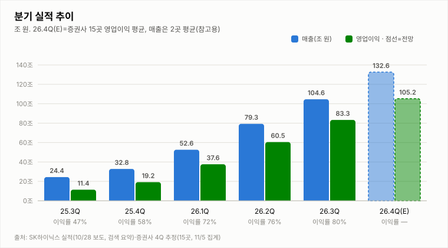
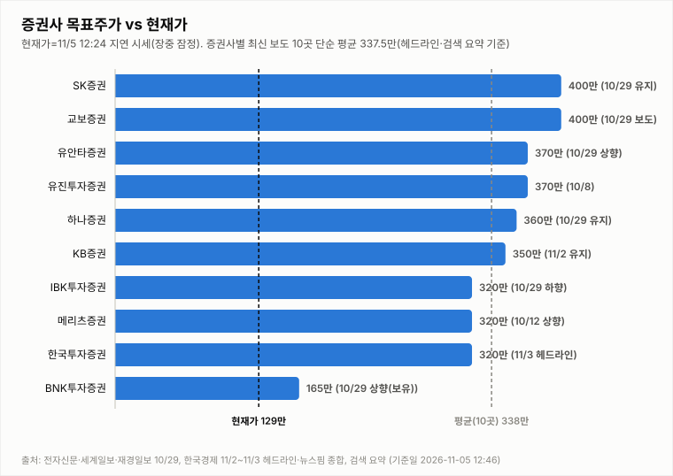
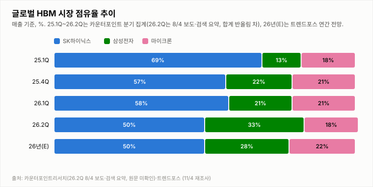

# SK하이닉스 투자 리포트 — 2026-11-05 (목) 아침 리포트 (09:10)

> **작성** 2026-11-05 09:10 KST · **확정 판정: 매수 유지(11/4 종가 기준, 직전 확정 11/3 매수 유지)** · 전일 확정 종가 139.6만원(-0.14%)은 `quote.json`(marketTime 11/4 15:30 KST)으로 확정이며 트레이딩뷰와 일치합니다. 간밤 지표는 night.yml 11/5 08:04 스냅샷이며 증권사 수치는 헤드라인·검색 요약 기준입니다. 확정 판정은 종가 기준으로만 변경합니다.

> **종목** SK하이닉스 (KRX 000660 · NASDAQ 상장 7/10)
> 본 자료는 정보 제공 목적이며 투자 권유가 아닙니다.

## 핵심 요약

- **투자의견: 확정 판정 매수 유지** — 판정은 종가 기준으로만 변경하므로 아침 리포트는 11/4 종가 기준 확정 판정(매수 유지, 직전 확정 11/3 매수 유지)을 그대로 인용합니다. 방향성 4요소는 긍정 3개(②③④)·부정 0개·중립 1개(①)였고 매수 유지 조건은 긍정 3개 이상·부정 1개 이하, 이탈 조건은 긍정 2개 이하 또는 부정 2개 이상입니다. ①은 종가 기준 MACD 히스토그램 +2.12만(시그널 위), KDJ K>D(+0.4), DMI 격차 -8.2(-DI 31.9 > +DI 23.7)로 DMI가 악화된 중립이며, 간밤 SOX -3.13%·마이크론 -7.00%·ADR -5.12%·야간선물 -1.66%가 오늘 종가에 반영되면 ①이 부정으로 바뀔 수 있습니다. ①이 부정으로 돌아가도 ②③④가 긍정이면 긍정 3·부정 1로 유지되지만 ③(미국 대중 반도체 규제·다롄 장비 반입 변수 등 11/4 헤드라인 점검) 또는 ④가 약해지면 이탈 조건에 해당합니다.
- **11/4 확정 종가 139.6만(-0.14%)** — 시가 145.8만(11/3 종가 대비 +4.29% 갭업)·고가 147.6만(+5.58%)·저가 130.3만(-6.80%), 종가 -0.2만원, 거래량 438.6만주(20일 평균의 1.20배, 11/3 하루 거래량의 1.9배; 야후 quote.json 15:30 확정이며 트레이딩뷰 KRX 피드의 시가·고가·저가·종가·거래량(4,386,412주)과 일치하지만 거래량은 마감 후 정정될 수 있음). 고가 대비 -5.4%, 저가 대비 +7.1%, 시가 대비 -4.3%에서 마감했고 14:24 지연 시세(138.2만)보다 약 1.5만원 높아 마감 직전에도 상승했습니다. 장중에는 갭업 후 13:24 131.5만·저가 130.3만까지 밀렸다가 급반등해 낙폭을 거의 모두 회복했습니다. 같은 날 삼성전자는 218,000원(-0.68%, 15:52 지연 시세; 장중 저가 208,000원·고가 228,000원), 코스피200 12월물 주간 선물은 888.30(+0.36%, 15:33 네이버)이었습니다. 장중 하락·반등 원인은 확인 불가이며, 경제타임스 헤드라인은 “5800 넘었지만 반납…코스피, 美 선거 개표에 출렁”(검색 요약)으로 미국 선거 개표를 변수로 언급했고 글로벌이코노믹 10:20 “나란히 상승하다 하락세 전환”(제목 기준)도 있었습니다. 10/2 종가(184.1만) 대비 -24.2%, 11/2 종가(147.2만) 대비 -5.2%입니다. 외국인 수급은 11/3 순매도 6,376억원(CBC뉴스, 검색 요약)만 확인했고 11/4는 확인 불가입니다.
- **간밤 변수·개장 전 헤드라인**: 미국장(11/4 수)은 지수는 올랐지만 반도체만 급락했습니다. SOX -3.13%(10,268.65)·마이크론 -7.00%(795.23달러)·엔비디아 -3.17%(200.13달러), SK하이닉스 ADR 143.07달러(-5.12%), EWY -1.90%였고 나스닥 +1.44%(25,736.51)·S&P500 +1.58%(7,688.62), 원/달러 1,339.98원(-0.06%)입니다(night.yml 2026-11-05 08:04 스냅샷). 코스피200 야간선물은 875.1로 주간 종가(889.85) 대비 -1.66%(11/5 06:00, 20분 지연, 야간 세션 값인지 첫 실측 검증 진행 중)입니다. 갭다운 출발 가능성이 높아 보이지만 11/3(SOX -3.37%·야간선물 -3.84%)과 11/4에도 개장 신호와 다르게 장중 변동이 매우 컸던 만큼 낙폭과 유지 여부는 불확실합니다(반도체 급락 원인은 검색으로 확인하지 못함). 11/4 저녁 헤드라인은 중앙일보 “美 대중 반도체 규제에 SK하이닉스 60조원 뉴욕 공장 투자 ‘빨간불’”(17:06), 블루밍비트 “최태원, SK하이닉스 美 AI 투자법인 이사회 의장 맡는다”(22:08)이며 제목만 확인해 세부 내용은 확인 불가입니다.
- **지표(11/4 quote.json 종가 확정, 야후 일봉 기준)**: DMI 격차 -8.2(+DI 23.7 < -DI 31.9, 11/3 종가 -3.5에서 악화), KDJ K 60.3·D 59.9(격차 +0.4, K>D 회복, 11/3 종가 +3.6보다 작음), MACD 히스토그램 +2.12만(시그널 위, 0선 아래; 11/3 종가 +2.30만). 오늘 거래량은 20일 평균(364.9만주)의 1.20배입니다.

## 시세

| 시가 | 고가 | 저가 | 종가 | 등락 | 거래량 |
|---|---|---|---|---|---|
| ₩1,458,000 | ₩1,476,000 | ₩1,303,000 | **₩1,396,000** | **-0.14%** | 4,386,412주 |

출처: 야후 `quote.json`(marketTime 15:30 KST 확정)·트레이딩뷰 KRX 피드 교차 확인(종가 1,396,000원 일치). 11/3 확정 종가 1,398,000원 대비 -2,000원(-0.14%)이며 거래량은 마감 시점 값(트레이딩뷰 20:08 시점 4,532,107주)입니다.

## 기술적 지표 (11/4 종가 확정 야후 일봉 기준)

| 지표 | 값 | 해석 |
|---|---|---|
| MACD (12,26,9) | -6.23만 / 시그널 -8.35만 / 히스토그램 +2.12만 | 하락 모멘텀 지속 |
| ATR (14) | 10.70만 (7.7%) | 변동성 매우 큼 |
| ADX / DMI | ADX 22.5 · +DI 23.7 · -DI 31.9 | 추세 강함, 격차 -8.2(-DI 우위 확대) |
| KDJ (9,3,3) | K 60.3 · D 59.9 · J 61.0 | 중립 구간, K>D 우위 회복(+0.4) |
| 거래량 / 20일 이평 | 438.6만 / 364.9만 | 평균의 1.20배(마감 확정) |

야후가 10/13 일봉을 정정 반영하면서 어제 리포트의 값(MACD 히스토그램 -3.59만·DMI -26.1)과 달라졌습니다.

종가 기준 격차 흐름: DMI 9/29 +1.6 → 9/30 +4.3 → 10/1 +2.2 → 10/2 +3.9 → 10/6 -0.8 → 10/7 -4.7 → 10/8 -7.9 → 10/12 -13.9(15:14 집계) → 10/13 -26.1(어제 리포트 기준) → 10/14 -25.9(종가 확정) → 10/15 -34.5(종가 확정·정정) → 10/16 -32.5(종가 확정) → 10/19 -33.2(종가 확정), KDJ 9/29 -8.4 → 9/30 -8.9 → 10/1 -5.2 → 10/2 -2.2 → 10/6 -8.2 → 10/7 -14.1 → 10/8 -15.1 → 10/12 -13.3(15:14 집계) → 10/13 -10.9(어제 리포트 기준) → 10/14 -8.4(종가 확정) → 10/15 -6.4(종가 확정·정정) → 10/16 -4.4(종가 확정) → 10/19 -1.8(종가 확정).

## 최신 뉴스 Top 5 (구글 뉴스 헤드라인 기준, 같은 사안은 1건만)

1. ⚪ **최태원, SK하이닉스 美 AI 투자법인 이사회 의장 맡는다** (블루밍비트, 11/04 22:08) · 최태원 SK 회장이 SK하이닉스의 미국 AI 투자법인 이사회 의장을 맡는다는 보도(제목 기준, 법인 규모·시점 등 세부 내용 확인 불가).
2. ⚪ **[종목상담 주식민원처리반] SK하이닉스에 반도체 제조장비 공급 진행 '워트'** (MTN 머니투데이방송, 11/04 19:01) · SK하이닉스에 반도체 제조장비를 공급 중인 ‘워트’ 종목을 다룬 MTN 종목상담 기사(제목 기준, 공급 규모 등 세부 내용 확인 불가).
3. ⚪ **SK하이닉스 1주도 100개로 쪼개 24시간 거래…“자산 토큰화, 투자자 문턱 낮춰”** (전자신문, 11/04 17:59) · SK하이닉스 주식 1주를 100개로 쪼개 24시간 거래하는 자산 토큰화 서비스를 다룬 기사(제목 기준, 사업 주체·시행 시점 확인 불가).
4. 🔴 **美 대중 반도체 규제에 SK하이닉스 60조원 뉴욕 공장 투자 ‘빨간불’** (중앙일보, 11/04 17:06) · 미국의 대중 반도체 규제로 SK하이닉스의 60조원 규모 뉴욕 공장 투자에 빨간불이 켜졌다는 보도로, 제목 기준 악재로 분류됨(규제 내용·SK하이닉스 입장은 확인 불가).
5. ⚪ **SK하이닉스, 中 다롄 공장 증설 허가 난항…美 뉴욕 투자에도 변수** (녹색경제신문, 11/04 15:11) · SK하이닉스의 중국 다롄 공장 증설 허가가 난항을 겪으면서 미국 뉴욕 투자 계획에도 변수가 될 수 있다는 보도(제목 기준, 세부 내용 확인 불가).

※ 뉴스는 헤드라인 기준이며 본문 수치는 별도 검증하지 않았습니다. 같은 사안을 다룬 기사는 가장 최신 1건만 남겼습니다(예: 홍보성 "초심 조형물" 기사 3건·구직자 관심 기업 순위 기사 제외, [포토] 제외).

## 실적 · 밸류에이션 (갱신일 2026-11-05 재확인(09:10), 직전 집계 11/4 15:58: 4Q26 증권사 추정치 15곳 재집계·목표주가 10곳 반영, 에프앤가이드 신규 집계는 확인 불가·11/5 09:10 재확인)

**2Q26 확정 실적: 매출 79.3조·영업이익 60.5조·영업이익률 76%**로 분기 역대 최대였고, 3Q26(10/28 공시)는 **매출 104.62조(첫 100조 돌파)·영업이익 83.33조(영업이익률 약 80%, 79.7%로 쓴 기사도 있음)·순이익 39.78조**입니다. 전분기 대비 매출 +31.9%·영업이익 +37.6%이며, 에프앤가이드 컨센서스(10/18 기준 매출 98.23조·영업이익 76.96조)를 각각 +6.5%·+8.3% 웃돌았습니다. 실적 발표 전 3Q 증권사 추정치 4곳(70.0~80.1조, 평균 76.05조)은 모두 확정치보다 낮았습니다. 순이익은 전분기 대비 약 58% 감소했는데, 검색 요약은 환율 손실과 투자자산 평가손실을 이유로 들었습니다(영업 실적과 별개이며 공시 원문은 확인하지 못함).

**11/4 재집계: 4Q26 영업이익 증권사 추정치** — 실적 발표 이후 증권사들이 4분기 전망을 일제히 올렸습니다. 아래 15곳은 모두 100조원 이상이며 3Q 확정(83.33조) 대비 +21~42%입니다. 보도일은 10/29~11/3이고 대부분 제목·검색 요약만 확인했습니다.

| 증권사 | 4Q26 영업이익(조) | 3Q 확정 대비 | 비고 | 출처·확인 수준 |
|---|---|---|---|---|
| SK증권 | 105.0 | +26.0% | 목표가 400만원 유지·메모리 공급 부족·HBM4 기여 근거 | 10/29 보도 묶음, 검색 요약 기준 |
| NH투자증권 | 102.7 | +23.2% | — | 10/29 보도 묶음, 검색 요약 기준(이전 “100조원 이상”만 확인) |
| BNK투자증권 | 103.6 | +24.3% | 목표가 148→165만원 상향·투자의견 보유 유지 | 10/29 보도 묶음, 검색 요약 기준 |
| 유안타증권 | 118.2 | +41.8% | 목표가 330→370만원 상향(10/29 보도 묶음) | 10/29 기준 보도 묶음, 검색 요약 기준 |
| 한국투자증권 | 112.1 | +34.5% | 매출 136.3조(전분기 대비 +30%)·목표가 320만원(헤드라인) | 한국경제 11/3 헤드라인·검색 요약, 원문 미확인 |
| IBK투자증권 | 112.0 | +34.4% | 목표가 400→320만원 하향(10/29 보도 묶음, 검색 요약) | 검색 요약 기준(10/29 전후 보도 묶음, 정확한 보도일 확인 불가) |
| 씨티증권 | 107.0 | +28.4% | 기존 89.8조에서 상향 | 10/29 기준 보도 묶음, 검색 요약 기준 |
| KB증권 | 104.0 | +24.8% | 목표가 350만원 유지·“분기 사상 첫 100조 돌파” 전망(10/29 보도 묶음은 목표가 420→350만원 하향·4Q 89조로 제시, 이후 상향) | 한국경제 11/2 헤드라인·검색 요약 기준 |
| 메리츠증권 | 104.0 | +24.8% | 86조대→103조대 상향이라는 요약도 있어 103~104조(출처마다 다름) | 검색 요약 기준, 104조로 계산 |
| 유진투자증권 | 103.5 | +24.2% | 103조라는 요약도 있음 | 검색 요약 기준, 103.5조로 계산 |
| DS투자증권 | 102.1 | +22.5% | — | 10/29 기준 보도 묶음, 검색 요약 기준 |
| 다올투자증권 | 101.0 | +21.2% | 매출 128.8조·올해 282조/내년 466조(연간) | 한국경제 10/29 헤드라인·검색 요약 기준 |
| 대신증권 | 101.0 | +21.2% | — | 검색 요약 기준(보도일 확인 불가) |
| 삼성증권 | 101.0 | +21.2% | — | 검색 요약 기준(보도일 확인 불가) |
| 신한투자증권 | 101.0 | +21.2% | — | 검색 요약 기준(보도일 확인 불가) |
| **15곳 단순 평균** | **105.2** | **+26.3%** | 중앙값 103.5조 · 범위 101.0~118.2조 | 단순 평균(표본 15곳, 참고용) |
| **에프앤가이드 4Q26** | 확인 불가 | — | 이전 검색 요약의 87.27조는 출처·기준일 불명이라 제외 | 신규 집계 확인하지 못함 |

매출 추정치는 한국투자증권 136.3조·다올투자증권 128.8조 두 곳만 확인했습니다(평균 132.6조, 차트의 26.4Q(E) 매출 막대에 사용하며 표본이 매우 작음). KB증권은 4Q 영업이익을 전년 동기 대비 +441%로 제시했습니다(헤드라인 기준). 영업이익률은 MTN 11/2 헤드라인에 “4분기 영업이익률 83%”가 있으나 어느 기관의 추정인지 확인하지 못했습니다. 일부 증권사는 내년 대규모 설비투자가 수익성을 낮출 수 있다고 지적했습니다(검색 요약 기준). 한국경제·파이낸셜뉴스 원문은 이 환경에서 열리지 않아 수치는 모두 검색 요약 기준이며 증권사 보고서 원문은 확인하지 못했습니다.

**업계 비교** — 삼성전자는 3Q26 매출 195.3조·영업이익 107.4조로 분기 영업이익 100조원을 처음 넘겼다고 밝혔습니다(10/29, 아주경제·삼성뉴스룸 검색 요약). 두 회사 3Q 영업이익을 합치면 약 190.7조로, 주간한국 11/2 헤드라인(“합산 영업익 190兆”)과 같은 규모입니다. SK하이닉스 4Q 추정치 평균(105.2조)은 삼성전자 3Q 실적과 비슷한 수준입니다.

**11/3 신규 조사(15:58):** 실적 컨퍼런스콜(뉴스핌 10/28)에서 김우현 CFO는 주요 고객과 내년 HBM 물량·가격 협의를 마무리했고 HBM과 일반 D램의 수익성 격차가 줄 것으로 본다고 밝혔으며, 4Q에 HBM4가 출하량·매출 비중 모두 HBM3E를 넘을 것으로 내다봤다고 전해졌습니다. 3Q 평균판매가(ASP)는 D램이 전분기 대비 20%대 후반, 낸드가 20%대 중반 올랐고, LTA 고객은 14곳이며 D램·HBM이 2029년까지 사실상 완판이라는 발언이 보도됐습니다(TrendForce 10/28 기사·연합인포맥스 헤드라인, 검색 요약 기준). 11/4 재조사(15:58)에서도 에프앤가이드의 새 4Q26 컨센서스는 확인하지 못했고, SK증권 105조원·NH투자증권 102.7조원·BNK투자증권 103.6조원(모두 10/29 보도 묶음, 검색 요약 기준)을 표에 새로 반영했습니다. KB증권은 같은 보도 묶음에서 4Q 89조원(목표가 하향)으로, 11/2 헤드라인에서는 104조원(전년 동기 +441%)으로 보도돼 최근 값(104조원)을 썼고 원문은 확인하지 못했습니다. 하나증권 등 수치 없이 “100조원 이상”만 확인된 증권사는 표본에서 제외했습니다. 11/5 아침 재확인(09:10): 새 에프앤가이드 4Q26 컨센서스와 추가 증권사 4Q 추정치는 확인하지 못했습니다.

> 밸류에이션 갱신일 2026-11-04(15:58 재조사) — 세계일보·재경일보 10/29 보도(“SK하이닉스 목표주가 165만~400만원…증권사 격차 235만원”, 검색 요약)를 포함한 10/29 보도 묶음에서 실적 발표 후 변경을 확인해 반영했습니다: BNK투자증권 148→165만원 상향(투자의견 보유 유지, 최저), IBK투자증권 400→320만원 하향(업황 우려보다 주가와 목표가 사이 괴리율을 반영했다는 설명), KB증권 420→350만원 하향(매수 유지; 11/2 헤드라인은 350만원 유지), 유안타증권 330→370만원 상향, SK증권·교보증권 400만원(최고), 하나증권 360만원 유지, 유진투자증권 370만원(적극 매수, 10/8 보도), 그리고 한국투자증권 320만원(한국경제 11/3 07:47 헤드라인, 기존 7/30 보도 470만원에서의 변경으로 보이나 상·하향 표기 확인 불가)입니다. 평균은 증권사별 최신 보도 목표가 10곳의 단순 평균(337.5만원, 중앙값 355.0만원: SK증권 400·교보 400·유안타 370·유진 370·하나 360·KB 350·IBK 320·메리츠 320·한투 320·BNK 165)이며, 이전 8곳 평균(351.2만원)에는 BNK 165만원과 교보 400만원이 없었습니다. 최고 400만원과 최저 165만원의 차이는 235만원으로 보도와 일치합니다. 유진 370(10/8)·메리츠 320(10/12)은 실적 발표 후 변경 여부를 확인하지 못해 기존 값을 유지했고, 교보증권 400만원은 기존 7/9 보도와 같은 값으로 보이나 이번 보도 묶음의 날짜(10/29)를 썼습니다. 제외한 항목: 노무라 470만원(9/4 유지분과 같아 신규 여부 확인 불가), RBC ADR 200달러(달러 목표가), 매일경제 11/2 “목표주가 350만원”(주체 확인 불가, KB증권 350만원과 같은 건일 수 있음), DS투자증권 264만원(9/29, 기준 창 밖). 원문 리포트는 이 환경에서 열리지 않아 모두 헤드라인·검색 요약 기준입니다.

최근 1개월 이내 10곳의 평균 목표주가 **337.5만 원**은 11/4 확정 종가 139.6만 대비 **+141.8%** 괴리입니다(11/3 확정 종가 139.8만 기준 +141.4%, 직전 8곳 평균 351.2만 기준 +151.6%). 표본이 10곳으로 적고 헤드라인·검색 요약 기준이라 평균은 참고용입니다. 10곳 모두 현재가보다 높지만 최저(BNK 165만원, 보유 의견)와 최고(400만원) 사이 폭이 235만원으로 의견이 크게 갈립니다. 11/5 아침 재확인(09:10)에서도 신규·변경 목표주가 보도는 확인하지 못했습니다(괴리율은 11/4 확정 종가 139.6만 기준 +141.8%).

## 산업 동향 — HBM·DRAM·NAND (갱신일 2026-11-05, 09:10 재조사: 11/4 저녁 헤드라인·간밤 지표 + 이전 조사분 기준일 표기)

> 차트의 점유율은 카운터포인트 25.1Q·25.4Q·26.1Q·26.2Q(26.2Q는 8/4 보도·검색 요약)와 트렌드포스 2026년 연간 전망(E)이며 3Q26 확정 점유율은 확인하지 못했습니다. 수치는 대부분 검색 요약·헤드라인 기준입니다.

**새로 확인한 내용**

- **카운터포인트 2Q26 점유율(8/4 발표, 검색 요약 기준·원문 미확인)** — D램 전체 매출 점유율은 삼성전자 39%·SK하이닉스 26%(전년 동기 39%)·마이크론 25%로 보도됐고(10/2 보도는 같은 자료로 38%·25%·24%를 전해 수치가 달라 정정 여부 확인 불가), HBM 매출 점유율은 SK하이닉스 50%(전년 동기 64%)·삼성전자 33%·마이크론 18%로 전해졌습니다. SK하이닉스는 2Q 매출이 전년 동기 대비 214% 늘었지만 점유율은 내려갔다는 요약입니다. 두 지표(D램 전체 vs HBM)는 서로 다르며 차트에는 HBM 기준 26.2Q를 반영했습니다. 3Q26 점유율은 확인 불가입니다.
- **삼성전자 3Q26 컨퍼런스콜(10/29, 아주경제·디일렉 컨콜 전문 검색 요약)** — HBM4 매출이 3Q에 전분기 대비 3배 늘었고 전체 HBM 매출에서 HBM4 비중이 60%에 이르렀으며, 올 하반기 목표였던 “HBM 점유율을 D램 점유율 수준으로” 끌어올리는 일을 3Q에 이미 달성한 것으로 보인다고 밝혔습니다. 3Q D램 ASP는 약 +20%, 낸드 ASP는 10% 후반 상승했고, 4Q에도 높은 메모리 가격이 이어지며 비트그로스는 D램 10% 중후반·낸드 10% 중반을 예상했습니다. 서버용 SSD 수요 증가와 내년 HBM 물량 완판 발언도 요약에 있었습니다.
- **SK하이닉스와 삼성전자 3Q 컨콜 비교** — 아래 표는 두 회사가 밝힌 수치를 나란히 둔 것이며, 기준 정의(출하·비트그로스)가 다를 수 있어 단순 비교는 조심해야 합니다.

| 항목 | SK하이닉스(10/28) | 삼성전자(10/29) |
|---|---|---|
| 3Q D램 ASP(전분기 대비) | 20%대 후반 상승 | 약 +20% |
| 3Q 낸드 ASP(전분기 대비) | 20%대 중반 상승 | 10% 후반 상승 |
| 4Q D램 물량 전망 | 출하 20%대 중반 증가(뉴스핌) | 비트그로스 10% 중후반 |
| 4Q 낸드 물량 전망 | 출하 한 자릿수 중반 증가(기준 시점 불명확) | 비트그로스 10% 중반 |
| HBM4 | 3Q 본격 양산·출하, 4Q 출하·매출 비중 HBM3E 상회 | 3Q 매출 3배, HBM 내 비중 60% |

- **HBM 점유율 보도의 엇갈림 정리** — 비즈워치 9/4의 삼성전자 점유율 “33%”는 카운터포인트 2Q26 HBM 값(33%)과 같은 수치로 보이고, 서울경제의 “40% 육박”(날짜 확인 불가)과 UBS의 2027년 비트 기준 삼성 41%·SK하이닉스 39% 전망(발표 시점 확인 불가)은 기관·기준·시점이 달라 차트에 반영하지 않았습니다. 삼성전자의 HBM 점유율 상승은 SK하이닉스 요소 ④ 산업 사이클의 모니터링 항목입니다.
- **중국 CXMT** — 4F² 셀 구조 서버용 D램의 고객 검증용 샘플을 연내 출하하겠다는 계획이 보도됐습니다(글로벌이코노믹 11/3 헤드라인·검색 요약). 마이크론은 이 접근을 “공정이 복잡하고 수율이 낮아 비용이 폭증한다”고 비판했고, 발표 직후 마이크론 주가가 3.8% 내렸다는 보도가 있습니다(재경일보, 날짜 확인 불가). DDR5 현물가는 사상 최고 수준에서 계속 올랐다고 전해졌습니다(MoneyToday 10/15). SK하이닉스는 “기존 6F² 구조를 최대한 활용하고 4F²는 이후 로드맵”이라는 입장입니다(연합인포맥스 10/28 헤드라인). 이 기술은 HBM이 아니라 범용 D램입니다.
- **간밤 시장 지표(night.yml 11/5 08:04)** — 11/4 미국장에서 지수는 나스닥 +1.44%·S&P500 +1.58%로 올랐지만 SOX -3.13%·마이크론 -7.00%·엔비디아 -3.17%·SK하이닉스 ADR -5.12%·EWY -1.90%로 반도체만 급락했습니다(원인은 검색으로 확인하지 못함). 직전 11/3에는 SOX +2.63%·마이크론 +2.58%였습니다. 업황 지표가 아니라 시장 변수로 따로 봅니다.
- **11/4 저녁~밤 헤드라인(제목만 확인, 세부 내용 확인 불가)** — 중앙일보 “美 대중 반도체 규제에 SK하이닉스 60조원 뉴욕 공장 투자 ‘빨간불’”(17:06)과 앞서 나온 뉴스핌 “美, 다롄 공장 장비 허가 보류…SK하이닉스 ‘정상 반입 중’”(14:59)·주간한국 “美, SK하이닉스 중국 공장 업그레이드 지연…‘뉴욕 투자 차질 불가피’”(11:31)·조세일보 “美에 133조 투자하려는 SK하이닉스…발목 잡은 건 ‘中 공장’”(14:01)이 있었습니다. 검색에서는 11/4 신규 보류 조치 자체를 확인하지 못했고 배경으로 2025년 8월 미국의 VEU 폐지 후 연간 승인제로 전환됐다는 보도(2025년 12월 말)만 확인돼, 이번 헤드라인이 같은 제도 하의 건별 지연인지는 확인 불가입니다. 블루밍비트 “최태원, SK하이닉스 美 AI 투자법인 이사회 의장 맡는다”(22:08)와 전자신문 “SK하이닉스 1주도 100개로 쪼개 24시간 거래…자산 토큰화”(17:59)도 제목만 확인했습니다. 규제·미국 투자 이슈는 ③·④ 점검 항목입니다.

**기준 수치 (신규 발표 확인 못 해 유지, 기준일 표기)**

- **4Q26 계약가 전망 (TrendForce 9/30 발표)** — 범용 D램 +10~15%(QoQ, 3Q26 전망 +13~18%보다 둔화), HBM 포함 D램 전체 +15~20%, NAND 전체 +15~20%(3Q26 +18~23%보다 둔화), eSSD가 가장 강합니다. StockHub 10/20 보도의 “D램 약 +20%”는 2차 출처이고 HBM 포함 여부를 확인하지 못해 반영하지 않았습니다. 이후 신규 TrendForce 발표는 확인하지 못했습니다. 11/4 재조사에서도 11월 신규 TrendForce 발표는 확인하지 못했습니다(검색 결과 최신은 9/23 불러틴·9/30 보도와 StockHub 10/20 2차 보도). 11/5 아침 재확인(09:10)에서도 11월 TrendForce·카운터포인트 신규 발표는 확인하지 못했습니다(검색 결과의 TrendForce 관련 최신은 5/29 보도(2027년 글로벌 메모리 시장 규모 1.28조 달러 이상 상향, itiger 재인용·원문 미확인)와 6/2 “2027년 HBM 계약가 수 배 급등” 헤드라인). 마감 재확인(15:58)에서도 11월 TrendForce·카운터포인트 신규 발표와 11월 HBM4 가격 수치는 확인하지 못했습니다.
- **2027년 HBM 가격** — TrendForce가 내년 HBM 평균판매가(blended ASP)를 약 +121%로 전망했다는 보도가 있으나 보도마다 기준이 엇갈려 원문 확인이 필요합니다. 삼성전자의 HBM4 연간 공급가 제시 보도가 있고, SK하이닉스는 주요 고객과 2027년 물량·가격 협의를 마무리했다고 밝혔으나 확정 가격은 확인 불가입니다.
- **수출·기타** — 9월 반도체 수출 603억달러(+262.8%, 산업통상부 10/1). 관세청 10월 1~20일 잠정치(검색 요약)에서 반도체 수출은 10월 기준 역대 최대로 보도됐고 1~10일 잠정치는 전년 대비 +170.9%였으나, 11/1 산업통상부의 10월 월간 확정치와 반도체 금액은 확인하지 못했습니다. 솔리다임 상장 검토 철회(10/23, YTN)로 중복상장 논란은 완화됐고 ADR 괴리율 과제는 남았습니다(헤드라인 기준).

**해석** — 삼성전자도 4Q 높은 메모리 가격과 비트그로스를 전망해 가격 환경은 우호적이고, SK하이닉스 4Q 영업이익 추정치가 100조원을 넘는 등 이익 전망은 계속 올라가고 있어 요소 ④ 산업 사이클은 **긍정 유지**입니다. 다만 삼성전자 HBM4 비중 확대(HBM 매출의 60%)와 카운터포인트 2Q26 HBM 점유율 하락(SK하이닉스 50%·삼성전자 33%, 검색 요약 기준)과 보도 간 점유율 차이, CXMT의 4F² 추격은 SK하이닉스의 HBM 점유율과 고점 논쟁에 영향을 줄 수 있어 카운터포인트 3Q 점유율, 4Q 계약가 실측, HBM4 가격 협상 결과를 계속 점검합니다.

## 투자 판단

**의견: 확정 판정 매수 유지 (11/4 종가 기준) — 아침 리포트는 확정 판정만 인용합니다 (확정은 종가 기준으로만 변경합니다)**

| 요소 | 방향 | 근거 |
|---|---|---|
| ① 추세/모멘텀 | 중립(DMI 악화) | MACD 히스토그램이 시그널 위(11/3 종가 +2.30만→11/4 종가 +2.12만), KDJ K>D(격차 +3.6→+0.4)로 중립이지만 DMI 격차가 -3.5에서 -8.2로 악화되고 +DI(23.7)가 -DI(31.9) 아래이며 MACD는 0선 아래라 긍정은 아닙니다. 장중 저가 130.3만을 되돌려 부정 전환은 나타나지 않아 중립(DMI 악화)으로 판정합니다(10/2 종가 대비 -24.2%) |
| ② 밸류에이션 갭 | 긍정 | 최근 1개월 10곳 평균 목표가 337.5만원(증권사별 최신 보도, BNK 165만원 포함) 대비 11/4 확정 종가 139.6만원 — 괴리율 **+141.8%**(11/3 확정 종가 139.8만원 기준 +141.4%, 직전 8곳 평균 351.2만 기준 +151.6%, 헤드라인·검색 요약 기준) |
| ③ 촉매 | 긍정(확정) | 3Q26 확정 실적(영업이익 83.3조·컨센서스 76.96조 상회)과 총 약 100조원 주주환원, 4Q 영업이익 증권사 추정치 상향(15곳 평균 105.2조, 표 참조)으로 긍정(확정)을 유지합니다(검색 요약·헤드라인 기준, 원문 미확인). 개장 전(09:10) Top10(11/5 00:21 수집분) 자동분류는 🟢 호재 2건(매일경제 “삼성전자 저가매수 나선 초고수…SK하이닉스는 이익 확정”, 초고수들이 SK하이닉스는 차익 실현했다는 내용이라 실제로는 호재가 아님·중부매일 “SK하이닉스 100조 투자, 충북 기업 성장으로 이어져야”)·⚪ 중립 6건·🔴 악재 2건(중앙일보 “美 대중 반도체 규제에 SK하이닉스 60조원 뉴욕 공장 투자 ‘빨간불’”·주간한국 “美, SK하이닉스 중국 공장 업그레이드 지연…뉴욕 투자 차질 불가피”)입니다. 🔴 두 건은 제목만 확인했고 다롄 공장 장비 반입 보류는 SK하이닉스가 “정상 반입 중”이라고 밝혀(뉴스핌 11/4 14:59) 영향이 불확실해 ③ 방향에는 쓰지 않았습니다. 다만 미국 대중 반도체 규제가 뉴욕 투자에 영향을 준다는 보도가 이어져 확인되면 ③ 약화 요인입니다. |
| ④ 산업 사이클 | 긍정 | 삼성전자 3Q 콜(10/29): 4Q 높은 메모리 가격·비트그로스(D램 10% 중후반) 전망과 SK하이닉스 4Q 영업이익 추정치 100조원 이상으로 이익 전망 상향 흐름 지속; 카운터포인트 2Q26 HBM 점유율 SK하이닉스 50%(전년 64%)·삼성 33%는 모니터링(검색 요약 기준); 11/4 애플 메모리 비용 경고 헤드라인(제목만 확인)은 수요 측 부담 점검 항목 |

**종합(확정, 11/4 종가): 긍정 3·부정 0·① 중립 → 매수 유지(확정).** 아침 리포트는 직전 확정 판정(11/4 종가 기준 매수 유지)을 그대로 인용하며 판정은 종가에서만 변경합니다. 매수 유지 조건(긍정 3개 이상·부정 1개 이하)을 충족하고, 간밤 반도체 급락(SOX -3.13%·마이크론 -7.00%·ADR -5.12%·야간선물 -1.66%)이 ①의 악화로 이어질 수 있지만 11/3·11/4처럼 신호와 다르게 움직일 수 있습니다. ①이 부정으로 돌아가도 긍정 3·부정 1로 매수가 유지되지만 ③ 또는 ④가 약해져 긍정 2개 이하가 되면 이탈(→중립) 조건에 해당합니다.

## 오늘(11/5, 목) 전망 — 갭다운 가능성 속 138.9만~137.9만 지지 여부와 139.8만~141.8만 재돌파 여부

| 항목 | 내용 |
|---|---|
| 지지선 | 138.9만(11/2 저가) · 138.1만(10/30 저가) · 137.9만(11/3 저가) · 135.8만(10/28 저가) · 134.1만(10/27 종가) · 133.6만(10/27 저가) · 130.3만(11/4 저가) · 127.5만(10/26 종가) |
| 저항선 | 139.8만(11/3 종가) · 140.2만(11/2 시가) · 141.0만(11/3 시가) · 141.8만(10/30 종가) · 144.4만~144.9만(10/30 시가·고가) · 147.2만(11/2 종가) · 147.6만(11/4 고가) |
| 예상 등락 레인지(참고용) | 11/4 종가 139.6만 ± ATR 10.70만 = 128.9만 ~ 150.3만(참고용, ATR 7.7%; 11/4 고가 147.6만·저가 130.3만은 범위 안) |
| 예정 이벤트 | 4Q26 실적 발표일은 확인 불가라 D-day 산출 불가(3Q26은 10/28 발표) · 미국 대중 반도체 규제·SK하이닉스 뉴욕 공장 투자(중앙일보 11/4 17:06 헤드라인)와 다롄 공장 장비 반입 허가 보류 보도(뉴스핌 11/4 14:59, SK하이닉스는 “정상 반입 중”, 제목만 확인) · 최태원 회장 SK하이닉스 美 AI 투자법인 이사회 의장 보도(블루밍비트 11/4 22:08, 제목만 확인) · 4Q26 영업이익 증권사 추정치 15곳 평균 105.2조(표 참조) · 증권사 목표가 10곳 평균 337.5만(BNK 165만~SK증권·교보 400만) · 10월 수출입 동향 월간 확정치는 확인 불가 · 다음 거래일은 금요일 11/6 |
| 관찰 포인트 | 갭다운 폭(SOX -3.13%·마이크론 -7.00%·ADR -5.12%·야간선물 -1.66% 반영 정도)과 138.9만(11/2 저가)~137.9만(11/3 저가) 지지 여부, 이탈 시 135.8만(10/28 저가)~133.6만(10/27 저가) 시험, 반대로 갭이 제한되면 139.8만(11/3 종가)~141.8만(10/30 종가) 재돌파, 거래량(전일 1.20배) 유지 여부, 종가 DMI 격차(-8.2)·KDJ K&gt;D 유지·MACD 시그널 상회 유지(①), 미국 대중 반도체 규제·다롄 장비 반입 후속 보도(③ 점검), 삼성전자와의 상대 강도, 외국인 수급(확인 불가) |
| 상방 시나리오 | 갭다운이 제한되고 138.9만~137.9만을 지키며 139.8만~141.8만을 종가로 되찾으면 11/4 반등이 이어지고 144.4만~144.9만(10/30 시가·고가)이 다음 저항이 되며 ①의 DMI 악화가 멈출 수 있음. 매수 유지 조건: 긍정 3개 이상·부정 1개 이하 |
| 하방 시나리오 | 간밤 반도체 급락이 그대로 반영돼 138.9만~137.9만(11/2·11/3 저가)을 이탈하면 135.8만(10/28 저가)~133.6만(10/27 저가), 11/4 저가 130.3만·127.5만(10/26 종가)까지 열려 있음. ①이 부정으로 돌아가도 ②③④가 긍정이면 긍정 3·부정 1로 매수가 유지되지만 ③·④가 약해져 긍정 2개 이하가 되면 이탈 조건에 해당함. 변동성이 매우 큼(ATR 7.7%). 매도 진입(부정 3개 이상·긍정 0개)은 해당 없음 |
| 야간선물 | 875.1(코스피200 야간선물, 주간 종가 889.85 대비 -1.66%·`updateTimeKST` 11-05 06:00·20분 지연; 야간 세션 값인지 첫 실측 검증 진행 중) |

간밤 미국장에서 나스닥 +1.44%·S&P500 +1.58%로 지수는 올랐지만 SOX -3.13%·마이크론 -7.00%·엔비디아 -3.17%·ADR -5.12%·EWY -1.90%로 반도체만 급락했고 코스피200 야간선물이 -1.66%여서 개장 직후 갭다운 출발 가능성이 높아 보입니다. 다만 11/3(SOX -3.37%·야간선물 -3.84%)에는 갭다운 후 장중 변동이 컸고 11/4에는 갭업 후 저가 130.3만까지 밀렸다가 139.6만에 마감하는 등 개장 신호와 다른 흐름이 이어져 낙폭과 유지 여부는 불확실하며, 138.9만~137.9만 지지 여부가 첫 관건입니다. 확정 판정(매수 유지)은 11/4 종가 기준이며 ①은 MACD 히스토그램 +2.12만·K>D(+0.4)·DMI 격차 -8.2로 중립(DMI 악화)이지만 오늘 종가에서 약화될 수 있습니다(방향성 참고일 뿐 가격 예측이 아닙니다).

---

*본 자료는 공개 보도·자료를 종합해 작성한 정보 제공 목적의 리포트이며 투자 판단과 책임은 투자자 본인에게 있습니다.*
