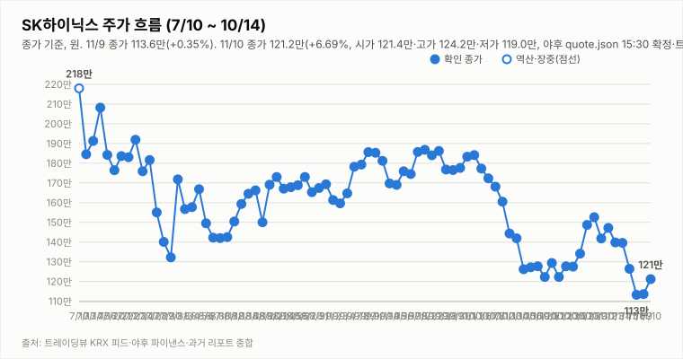
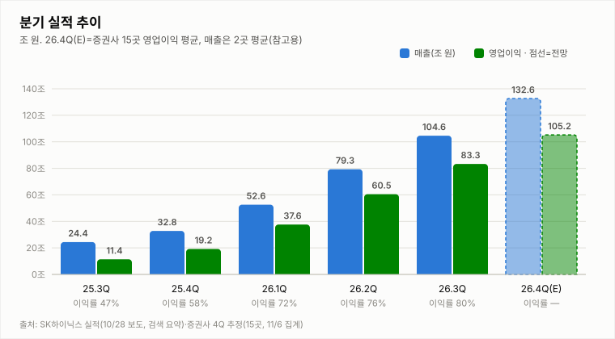
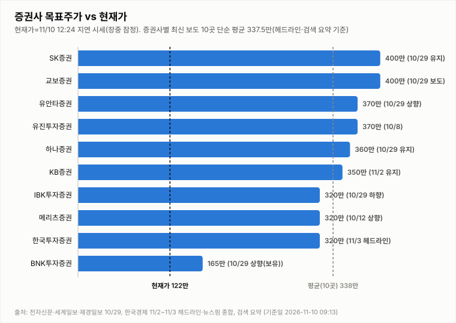
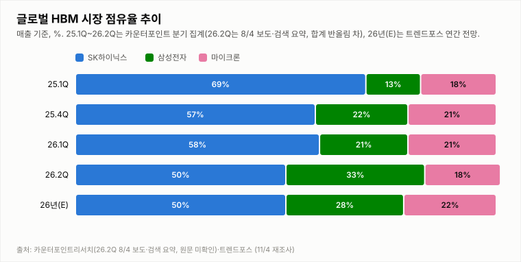

# SK하이닉스 투자 리포트 — 2026-11-10 (화) 장중 업데이트 (11:45, 11:24 지연 시세)

> **작성** 2026-11-10 11:45 KST · **확정 판정: 중립(v2, 11/9 종가 기준) · 장중 잠정: 점수 0·위험 극단·비중 배수 0.45** · 전일 종가 113.6만원(+0.35%)은 `quote.json`(marketTime 11/9 15:30 KST)으로 확정이며 트레이딩뷰와 일치합니다. 오늘 시세는 야후 11:24 기준의 20분 지연 시세이며 확정이 아닙니다. 간밤 지표는 night.yml 11/10 08:04 스냅샷입니다.

> **종목** SK하이닉스 (KRX 000660 · NASDAQ 상장 7/10)
> 본 자료는 정보 제공 목적이며 투자 권유가 아닙니다.

## 핵심 요약

- **투자의견: 확정 판정 중립(v2) 유지, 장중 잠정 점검** — 확정 판정은 11/9 종가 기준 중립(전략 점수 0·위험 극단·확신도 낮음)입니다. 11:45 데이터(11:24 지연 시세)로 같은 로직을 임시 적용하면 전략 점수 0(중립), 위험 레짐 극단(10일 변동성 6.7%·20일 고점 대비 -20.8%), 비중 배수 0.45입니다. 장중 가격 변화는 방향 점수(F4 정책 리스크·F5 외국인 수급)를 바꾸지 못하고 위험 레짐과 비중 배수만 움직이며, 판정은 종가에서만 확정합니다. 매수 전환은 F4·F5가 함께 0 이상, 매도 전환은 F1 또는 F2가 -1일 때입니다.
- **11/9 확정 종가 113.6만(+0.35%)** — 시가 113.0만(11/6 종가 대비 -0.18%)·고가 119.3만(+5.39%)·저가 111.6만(-1.41%), 종가 +0.4만원, 거래량 433.2만주(20일 평균의 1.07배; 야후 quote.json 15:30 확정이며 트레이딩뷰 KRX 피드의 시가·고가·저가·종가와 일치하고, 거래량은 트레이딩뷰 15:53 4,064,757주와 달라 정정·시간외 포함 여부는 확인 불가). 금요일 미국 반등을 받아 오전 한때 119.3만(+5.4%)까지 올랐으나 오후에 되밀려 15:06 지연 시세 114.7만보다 1.1만원 낮은 113.6만에 마감했습니다(고가 대비 -4.8%, 저가 대비 +1.8%). 코스피는 5,018.85(-0.81%)로 하락 마감해 오전 반등분을 모두 반납했고 11/4 종가(139.6만) 대비 SK하이닉스 누적은 -18.6%입니다. 원인은 WHY 섹션을 참조하세요.
- **11/10 장중(11:24 지연 시세)** — 시가 121.4만(11/9 종가 대비 +6.87% 갭상승)·고가 124.2만(+9.33%)·저가 119.3만(+5.02%), 현재 120.8만(**+6.34%**, +7.2만원), 거래량 155.3만주(20일 평균의 0.38배, 개장 144분 누적). 직전 조회(10:24 지연 시세, 120.7만)보다 0.1만원(+0.1%) 올라, 저가 대비 +1.3%·고가 대비 -2.7% 위치입니다. 10:24 대비 보합권(+0.1만원)에서 +6%대 상승폭을 유지했고 고가(124.2만)·저가(119.3만)는 그대로이며, 거래량은 개장 144분 누적으로 20일 평균의 0.38배입니다. 원인은 WHY 섹션을 참조하세요.
- **간밤 변수·개장 전 헤드라인**: 11/9(월) 미국장은 크게 반등했습니다(night.yml 11/10 08:04 스냅샷). SOX +6.85%(10,033.93)·마이크론 +6.25%(733.15달러)·AMD +13.26%·브로드컴 +8.78%·SK하이닉스 ADR 134.38달러(+5.53%)·EWY +3.72%였지만 엔비디아는 -4.27%(178.67달러)로 홀로 하락했습니다. 나스닥 +2.74%(25,253.14)·S&P500 +2.35%(7,549.94)·VIX 19.92(-22.31%), 원/달러 1,341.8원(+0.13%)입니다. 코스피200 야간선물은 820.7로 주간 종가(775.85) 대비 +5.78%(11/10 06:00, 20분 지연, 야간 세션 값인지 첫 실측 검증 진행 중)입니다. 갭 상승 신호가 강하지만 어제도 야간선물 +1.60%·미국 반등에도 외국인 순매도(6,284억~6,889억원(매체별 상이), 7거래일 연속)에 오전 상승분을 반납했으므로 지속성은 불확실합니다. 엔비디아 하락은 젠슨 황 관련 이사회 조사 보도(검색 요약 기준)로 알려졌습니다. 11/9 장중 헤드라인(제목만 확인, 세부 내용 확인 불가)은 비즈니스포스트 “삼성전자·SK하이닉스, 미국 AI 데이터센터 규제 변수에 메모리 수요 셈법 복잡해지나”(16:57)·뉴스인 “뉴욕 반도체지수 4.21% 급등에도…삼성전자·SK하이닉스 상승폭 제한”(16:31)·강원도민일보 “‘반도체 깐부’ 젠슨 황 공작 의혹…삼성·SK하이닉스 협력 영향 우려”(16:25)입니다.
- **지표(11/10 11:24 지연 시세 포함, 야후 일봉 기준)**: DMI 격차 -14.3(+DI 20.1 < -DI 34.4, 직전 -14.3·11/9 종가 -18.7), KDJ K 23.7·D 33.6(격차 -9.9, K<D 약세, 직전 -10.0·11/9 종가 -15.0), MACD 히스토그램 -1.01만(시그널 아래, 0선 아래; 직전 -1.02만·11/9 종가 -1.11만), ATR 11.13만(9.2%). 오늘 거래량은 개장 144분 누적 155.3만주로 20일 평균(412.0만주)의 0.38배이며 장중 잠정입니다.

<!--CAUSE:START-->
## 주간 변동 원인 분석 — 국내·해외·미국 빅테크 (11/2~11/6 주간 + 주말 점검, 기준 2026-11-10(화) 11:45 KST (11:24 지연 시세))

**한 줄 결론** — 이번 주 급락의 1차 원인은 ‘미국 중간선거(민주당 의회 장악) 후 AI 데이터센터 규제·투자 둔화 우려 → 미국 AI 반도체 투매(11/5 SOX -12.25%·마이크론 -17.46%)’이고, 외국인의 대규모 순매도(11/5 약 3.39조·11/6 약 2.77조원, 11/2~6 주간 약 10.4~11.1조원)가 이를 코스피와 고베타 메모리 대표주 SK하이닉스에 증폭시켰습니다. 11/9(월) 한국장은 금요일 美 반등을 반영해 SK하이닉스가 장중 +5.4%(119.3만)까지 올랐으나 외국인 순매도(6,284억~6,889억원, 7거래일 연속)에 코스피가 5,018.85(-0.81%)로 반락 마감해 +0.35%에 그쳤습니다. 간밤(11/9) 美장은 SOX +6.85%로 더 크게 반등(엔비디아만 -4.27%)했고 야간선물도 +5.78%라 오늘은 갭 상승 신호가 강하지만, 외국인 순매수 전환 전에는 지속성이 불확실합니다.

> 방법: 한국 시장(코스피·외국인 수급·사이드카) + 해외 시장(미국 지수·반도체·빅테크·VIX) + 국내외 뉴스를 교차해 사건을 시간순으로 놓고, 수치가 복수 출처에서 일치하면 ‘높음’, 매체의 해석이면 ‘중간’, 정황 추정이면 ‘낮음’으로 표시합니다. 수치는 트레이딩뷰 실측(night.yml 2026-11-10 08:04 KST 수집)과 검색 요약 보도를 병기했으며, 원인 기사는 요약 기준이라 원문 확인이 필요할 수 있습니다.

**① 시장 현황**

| 종목·지수 | 11/6(금) | 11/9(월) | 주간 | 11/10(화) 장중 |
|---|---|---|---|---|
| **한국 시장 (KRX 정규장, 해당일 15:30 마감)** | | | | |
| 코스피 | -6.02% | -0.81% | -10.98% | — |
| 코스닥 | -5.03% | -0.82% | -10.81% | — |
| SK하이닉스 | -10.44% | +0.35% | -18.97% | +6.34% |
| 삼성전자 | -6.35% | +0.64% | -13.29% | — |
| **미국 지수·변동성 (美 정규장, 11/6·11/9 현지 마감)** | | | | |
| 나스닥 | +1.09% | +2.74% | -1.36% | — |
| S&P500 | +0.31% | +2.35% | -0.80% | — |
| 필라델피아 반도체(SOX) | +4.21% | +6.85% | -6.77% | — |
| VIX (11/9 종가 19.92) | -9.01% | -22.31% | +4.57% | — |
| **미국 AI 반도체·메모리 (공급 측)** | | | | |
| 마이크론(MU) | +5.12% | +6.25% | -17.67% | — |
| 엔비디아(NVDA) | +2.78% | -4.27% | -13.91% | — |
| AMD | +11.04% | +13.26% | -0.42% | — |
| 브로드컴(AVGO) | +0.74% | +8.78% | -2.71% | — |
| 퀄컴(QCOM) | +5.52% | +3.66% | +3.02% | — |
| SK하이닉스 ADR(SKHY) | +2.78% | +5.53% | -12.91% | — |
| 한국 ETF(EWY) | +4.07% | +3.72% | -10.27% | — |
| **미국 빅테크 (수요 측·플랫폼)** | | | | |
| 애플(AAPL) | -0.52% | +2.43% | +2.34% | — |
| 마이크로소프트(MSFT) | -0.99% | +2.75% | +4.04% | — |
| 알파벳(GOOGL) | +0.78% | +1.18% | +2.01% | — |
| 아마존(AMZN) | -0.35% | +2.94% | +9.84% | — |
| 메타(META) | +0.84% | +5.12% | +4.38% | — |
| 테슬라(TSLA) | +4.23% | +5.54% | -6.58% | — |

> 주간=트레이딩뷰 Perf.W(한국은 11/9 종가, 미국은 11/9 현지 종가 기준 1주 변동)이며 보도의 주간 수치와 기준 시점 차이로 다를 수 있습니다. 한국장은 미국장보다 먼저 열려 11/9 한국장은 11/6 美 반등을, 오늘(11/10) 한국장은 11/9 美 반등을 반영합니다. 엔비디아 -4.27%는 보도 요약 기준 개별 이슈입니다.

**② 원인 사슬 (시간순)**

| 시점 | 사건·수치 | 확신·출처 |
|---|---|---|
| 11/3(화) 美 | 미국 중간선거에서 민주당이 상·하원을 장악. | 높음 — 파이낸셜뉴스·SBS Biz·CNBC 일치 |
| 11/4(수) 美 | 선거 직후 지수는 ‘역대급 랠리’였지만 반도체는 약세: SOX -3.13%·마이크론 -7.00%·SK하이닉스 ADR -5.12%(저장소 night.yml 11/5 수집분). 야간선물 -1.66%. | 높음(수치 실측) / 랠리는 CNN·Yahoo 보도 |
| 11/5(목) 韓 | 코스피 -5.28%(5,383.80), 외국인 약 3.39조원 순매도, 코스피200 선물 급락에 매도 사이드카(10:16), 코스닥 -5.1%대. SK하이닉스 -9.46%·삼성전자 -7.57%. ‘美 증시 상승에도 반도체 약세’로 보도. | 높음 — 헤럴드경제·파이낸셜뉴스·마이데일리 일치 |
| 11/5(목) 美 | AI 반도체 투매: 나스닥 -5.52%(24,315, 2025년 4월 이후 최대 낙폭)·S&P500 -4.36%·다우 약 -1,830p. SOX -12.25%(Yahoo: 2020년 3월 이후 최악)·엔비디아 -9.26%·마이크론 -17.46%·퀄컴 -9%대(분기 가이던스 부진)·브로드컴 -10%대·테슬라 -10.8%·메타 -3.9%·MS -3.6%. 나스닥 시총 약 2.5조달러 증발, 나스닥은 10/6 고점 대비 -10% 조정장, VIX 장중 28.09. | 수치 높음 / 원인(규제 우려) 중간 — CNN·CNBC·Fox Business·SBS Biz·파이낸셜뉴스 |
| 11/6(금) 韓 | 코스피 -6.02%(5,059.69, 장중 -8%대 급락 보도·5,000선 사수), 코스닥 -5.03%(644.27), 외국인 약 2.77조원 순매도(이틀 6조원대), 매도 사이드카(코스닥 09:06·코스피 09:34). SK하이닉스 -10.44%(113.2만, 시가=저가 108.9만)·삼성전자 -6.35%. | 높음 — 디지털데일리·아시아투데이·뉴스핌 + 저장소 실측 |
| 11/6(금) 美 | 반등: 나스닥 +1.09%(24,579)·S&P500 +0.31%·다우 -0.46%, SOX +4.21%(9,390.25)·마이크론 +5.12%·AMD +11.04%·엔비디아 +2.78%. 그러나 주간으로는 나스닥 -3.96%·S&P500 -3.33%로 4주 연속 하락. 보도: 강한 경제지표로 추가 긴축(금리 인상) 베팅 부담. | 수치 높음(실측) / 긴축 베팅은 헤드라인 수준 — Yahoo Finance·UPI·TradingKey |
| 11/7(토) 06:00 韓 | 코스피200 야간선물 795.5(+1.60%, 주간 종가 782.95 대비). 야간 세션 종료 시각(06:00) 값으로 보이나 첫 실측 검증 진행 중. | 중간 — night.yml 실측 |
| 11/7~8(주말) | 미국·한국 휴장. 중간선거 후 AI 규제 우려의 구체화 보도: 민주당 중진이 AI 규제와 개발 일시 중단을 촉구했다는 보도, 데이터센터 800~1,000곳이 2년간 지연될 수 있다는 한 분석이 나왔으나 다수 분석가는 입법보다 청문·조사 수준이라고 보고 실제 의회 조치는 아직 보도 없음. | 중간 — StockTwits·Reuters 인용(Devdiscourse)·Finimize 등 검색 요약 |
| 11/9(월) 오전~11:24 韓 | 장중 반등: 코스피는 장 초반 5,000선 아래로 밀렸다가 10:55 기준 5,117.13(+1.14%)로 회복(기관 저가 매수 주도, 개인 매수). 외국인은 순매도 지속이나 규모가 오전 약 4,274억~5,200억원(매체별 상이)으로 11/6(약 2.77조원)보다 급감. SK하이닉스 118.3만(+4.51%, 11:24 지연)·삼성전자 +2.54%(보도) — 코스피 상승폭보다 큰 고베타 반등. | 높음(SK하이닉스 수치 실측) / 코스피·수급은 중간(보도, 집계 시점·기준 상이) — 글로벌이코노믹·헤럴드경제·MoneyToday |
| 11/9(월) 오후~마감 韓 | 코스피는 장중 고가 5,172.94(+2.2%)에서 마감 5,018.85(-0.81%, 9개월 만의 최저 수준 보도), 코스닥 638.97(-0.82%)로 하락 마감해 오전 반등분을 반납했습니다. 외국인은 6,284억~6,889억원(매체별 상이) 순매도로 7거래일 연속 ‘팔자’였고 기관이 약 7,000억원 순매수로 일부 방어, 개인은 순매도(4,889억~5,318억원, 매체별 상이)로 보도됐습니다. 코스피200 12월물 주간 선물 774.75(-1.05%). SK하이닉스는 고가 119.3만(+5.4%)에서 되밀려 113.6만(+0.35%), 삼성전자 189,900원(+0.64%)으로 마감했습니다. | 높음 — 아시아경제·비즈니스코리아·파이낸스투데이·재경일보 보도와 트레이딩뷰·야후 수치 일치(순매도 금액만 매체별 상이) |
| 11/9(월) 밤 美 | 반등 확대: 나스닥 +2.74%(25,253)·S&P500 +2.35%(7,550), SOX +6.85%(10,034, 1만선 회복)·마이크론 +6.25%·AMD +13.26%(증권사 상향·구글 클라우드 협력 보도)·브로드컴 +8.78%·SK하이닉스 ADR +5.53%·EWY +3.72%, VIX 19.92(-22.31%). 엔비디아만 -4.27%(젠슨 황 관련 이사회 조사 보도, 검색 요약). 유가 하락과 Anthropic 상장 일정 보도가 심리를 지지. | 수치 높음(트레이딩뷰 실측) / 원인은 중간 — Benzinga·TradingKey 검색 요약 |
| 11/10(화) 06:00 韓 | 코스피200 야간선물 820.7(주간 종가 775.85 대비 +5.78%, 야간 세션 종료 시각 값으로 보이나 첫 실측 검증 진행 중). 원/달러 1,341.8(+0.13%). | 중간 — night.yml 실측, 야간선물은 야간 세션 값인지 검증 중(11/9 야간선물 +1.60%는 실제 개장 상승폭보다 과대했음) |
| 11/10(화) 장중 11:24 韓 | SK하이닉스 시가 121.4만(+6.87%)·고가 124.2만·저가 119.3만, 11:24 지연 시세 120.8만(+6.34%). 10:24(120.7만) 대비 보합권(120.8만)에서 +6%대 상승폭을 유지했습니다. 새 수급·정책 이벤트와 같은 날짜의 국내 시황 기사는 이번에도 확인되지 않았고, 외국인 순매매 수치는 확인 불가라 어제의 ‘오후 되밀림’ 재현 여부는 다음 갱신에서 확인합니다. | 높음(SK하이닉스 수치 실측) / 수급은 확인 불가 |

**③ 원인 순위**

| 순위 | 원인 | 근거 | 확신 |
|---|---|---|---|
| 1 | 미국 AI 반도체 투매의 한국 전이 | SOX 11/4 -3.13% → 11/5 -12.25%, 마이크론 -7.00% → -17.46%, ADR -5.12% → -13.40%가 한국장에 하루 시차로 반영: 11/5 코스피 -5.28%(SK하이닉스 -9.46%), 11/6 코스피 -6.02%(SK하이닉스 -10.44%). 11/9 美장은 SOX +6.85%·마이크론 +6.25%로 반등해 같은 전이 경로가 반대로 작동합니다(오늘 한국장 반영 대상). | 높음 |
| 2 | 외국인 대규모 순매도(프로그램·선물 연쇄 포함) | 11/5 약 3.39조 + 11/6 약 2.77조원 = 이틀 6조원대, 11/2~6 주간 약 10.4~11.1조원(매체별 상이; SK하이닉스 약 5.4~5.8조, 삼성전자 약 2.2~2.6조). 코스피200 선물 급락에 사이드카 3회(11/5 코스피, 11/6 코스닥·코스피). 11/9: 장중 美 반등 속에 코스피가 5,170선까지 올랐다가 외국인 순매도(6,284억~6,889억원, 7거래일 연속)에 막혀 5,018.85(-0.81%)로 마감, 기관 약 7,000억원 순매수가 낙폭을 일부 방어. 매체별 금액 차이가 있어 KRX 확정 집계 확인 필요. | 높음(수급 수치·방향 복수 출처 일치) / 선물·프로그램 비중은 미확인 |
| 3 | 트리거: 중간선거 후 AI 데이터센터 규제·투자 둔화 우려 | 파이낸셜뉴스·SBS Biz·CNBC(로이터 인용)가 같은 해석: 민주당 의회 장악 → AI 인프라 확장이 늦고 비싸질 것이라는 우려 → 공급 측(엔비디아·마이크론·브로드컴) 급락. 구체 법안·정책 내용은 보도되지 않음. 주말 보강: 민주당 중진의 AI 규제·개발 일시 중단 촉구 보도와 ‘데이터센터 800~1,000곳 지연 가능’ 분석이 있으나, 다수 분석가는 청문·조사 수준으로 입법 가능성에는 회의적이며 금지가 아닌 둔화 우려가 시장 해석의 핵심. | 중간 — 시장의 해석(구체성 일부 보강, 입법 가능성은 회의적) |
| 4 | 메모리·AI 하드웨어 쏠림 해소(고베타) | 주간 마이크론 -21.95%·SK하이닉스 -21.61%는 엔비디아 -10.67%·AMD -11.70%·브로드컴 -11.20%·SOX -13.5%·코스피 -12.2%의 약 2배. 반면 수요 측 빅테크는 MSFT +1.02%·GOOGL +1.30%·AMZN +11.51%로 버팀. | 중간 — 수치 실측, 해석은 추정 |
| 5 | 개별 악재 중첩 | 퀄컴 분기 가이던스 부진(CNBC 제목), 메타 데이터센터 관련 발언 후 -3.9%(발언 내용 미확인), 11/6 글로벌이코노믹 ‘ADR 13% 폭락…수요 절벽 공포’(제목만 확인). | 중간~낮음 |
| 6 | 심리·거시: 조정장 진입과 긴축 베팅 | 나스닥 -10% 조정장, VIX 28.09(주간 +39%), 11/6 강한 경제지표 → 추가 긴축 베팅 보도(지표 수치 미확인), 원/달러 1,363.64(주간 +1.8%). | 낮음 — 정황 |

**④ 분석 판단 (추정 포함)**

- 이번 하락은 ‘이익 전망 하향’보다 ‘멀티플·수급 충격’의 성격이 강하다고 판단합니다(추정). 근거: 같은 기간 4Q26 영업이익 증권사 추정치(15곳 평균 105.2조)와 TrendForce 4Q 계약가 전망은 하향 보도가 확인되지 않았고, 하락률이 업종 베타 순서(메모리 > 파운드리·GPU > 빅테크 플랫폼)와 일치합니다.
- 공급 측(반도체)만 크게 빠지고 수요 측(MSFT·GOOGL·AMZN)은 버틴 구도는 ‘AI 투자 속도 둔화·규제’ 해석과 정합적이지만, 이 구도만으로 AI 투자 계획이 실제로 줄었다고 단정할 수 없습니다(CAPEX 하향 보도 없음).
- 한국장이 美장보다 먼저 열리는 시차 때문에 한국 낙폭에는 美 투매가 하루 늦게 합산됐고(11/5·11/6), 11/6 美 반등은 11/9 한국장에 반영됩니다.
- 11/9 한국장은 美 반등 신호(야간선물 +1.60%)에도 시가 -0.18%로 출발하고 오전 고가(+5.4%)를 반납해, 가격 반등만으로는 외국인 순매도를 이기지 못한다는 점을 보여줬습니다(확신도 중간: 외국인 순매도·코스피 장중 고가 5,172.94→마감 5,018.85는 확정 수치, 인과 비중은 추정). 간밤 엔비디아만 -4.27%인 구도는 AI 반도체 전체의 수요 둔화가 아니라 엔비디아 개별 이슈(젠슨 황 관련 조사 보도)가 작용했다는 해석과 정합적이어서, 오늘 갭 상승이 나오더라도 수급 개선 여부가 핵심입니다(추정, 확신도 낮음~중간).

**⑤ 아직 모르는 것과 반증 조건**

- ‘AI 규제’의 실제 입법·행정 조치는 보도되지 않았습니다(발언·청문 가능성 수준) → 의회 일정과 후속 보도가 나오면 3순위 원인의 확신도를 조정합니다.
- 11/9 외국인 순매도 금액은 매체별로 6,284억~6,889억원으로 달라(기관 순매수 약 7,000억원, 개인 순매도 4,889억~5,318억원) KRX 확정 집계 확인이 필요하고, 선물·프로그램 매매 비중은 확인하지 못했습니다.
- 영문 매체 일부가 전한 11/9 코스피 5,137.22(+1.5%)·SK하이닉스 +3.9%는 국내 확정 보도(코스피 5,018.85, -0.81%)와 달라 장중 값으로 보고 사용하지 않았습니다.
- 엔비디아 -4.27%의 배경인 젠슨 황 관련 이사회 조사 보도는 검색 요약 기준이며 원문·사실관계는 확인하지 못했습니다. 퀄컴 가이던스 수치, 마이크론 대만 HBM 공장 건설 중단 보도(제목만 확인)의 범위·사유도 확인하지 못했습니다.
- 반증 조건: 오늘 외국인이 순매수로 전환하고 갭 상승이 유지되면 ‘일시적 투매·수급 충격’ 가설이 강화됩니다. 반대로 갭 상승 후 외국인 순매도에 어제처럼 되밀리거나 빅테크 AI CAPEX 하향·메모리 계약가 하향 보도가 나오면 ‘수요 둔화’·‘수급 우위’ 가설로 무게를 옮깁니다.

**⑥ 다음 거래일 시사점** — 오늘(11/10, 화) 한국장은 간밤(11/9) 美 반등(SOX +6.85%·마이크론 +6.25%·ADR +5.53%)과 야간선물 +5.78%를 반영해 갭 상승 신호가 강하지만, 어제도 같은 구도에서 외국인 순매도(7거래일 연속)가 상승분을 반납시켰으므로 폭과 지속성은 불확실하며 확률 관점으로만 봅니다. 엔비디아 -4.27%(젠슨 황 관련 보도)는 AI 서버 공급망 심리에 부담이 될 수 있습니다. 확정 판정(v2)은 11/9 종가 기준 중립이며 다음 확정은 오늘 종가입니다.

출처: [CNN 11/5](https://www.cnn.com/2026/11/05/investing/tech-heavy-nasdaq-plunges) · [CNBC 11/5](https://www.cnbc.com/2026/11/05/qualcomm-earnings-chip-stocks-election.html) · [Fox Business 11/5](https://www.foxbusiness.com/markets/stocks-nov-5-2026) · [Yahoo Finance 11/6 마감](https://finance.yahoo.com/markets/live/stock-market-today-friday-november-6-dow-sp-500-nasdaq-jobs-report-earnings-135953863.html) · [Yahoo 칩 반등](https://finance.yahoo.com/markets/article/nvidia-amd-micron-sandsik-lead-chip-sector-higher-134336542.html) · [UPI 11/6](https://www.upi.com/Top_News/US/2026/11/06/nasdaq-rebounds-tech-stocks/5901794005326/) · [파이낸셜뉴스 11/6](https://www.fnnews.com/news/202611060834515879) · [SBS Biz 11/6](https://biz.sbs.co.kr/article/20000344723) · [헤럴드경제 11/5](https://biz.heraldcorp.com/article/10927440) · [디지털데일리 11/6](https://www.ddaily.co.kr/page/view/2026110615524945049) · [아시아투데이 11/6](https://www.asiatoday.co.kr/kn/view.php?key=20261106010002606) · [StockTwits 마이크론·규제](https://stocktwits.com/news-articles/markets/equity/micron-hits-3-month-low-amid-chip-rout-after-top-democratic-lawmaker-calls-for-ai-regulation-pause-in-development/cNG14kWR9Eh) · [Reuters 인용(Devdiscourse)](https://www.devdiscourse.com/article/international/4001686-us-stocks-wall-street-rallies-after-democrats-win-congress-data-center-stocks-slide) · [글로벌이코노믹 11/9](https://www.g-enews.com/article/Securities/2026/11/202611091102167807923c501012_1) · [MoneyToday EN 11/9](https://www.mt.co.kr/en/stock/2026/11/09/2026110910110484191) · [헤럴드경제 11/9](https://biz.heraldcorp.com/article/10930383) · [이투데이 — 코스피 오후 상승폭 축소·외국인 매도 속 5100선 등락](https://www.etoday.co.kr/news/view/2645772) · [재경일보 — 외국인 10조원 매도에 코스피 5000선 급락·주간 11% 하락](https://news.jkn.co.kr/post/1079576) · [MoneyToday — Retail investors lift Samsung and SK hynix as ETF buying offsets 7-day foreign selling](https://www.mt.co.kr/en/stock/2026/11/09/2026110911301182528) · [Invezz — KOSPI today: Why South Korea's stock market rebounded above 5,100](https://invezz.com/news/2026/11/09/kospi-today-south-korea-stock-market-rebound/) · [Finimize — South Korea's KOSPI bounced back as chip stocks recovered](https://finimize.com/content/south-koreas-kospi-bounced-back-as-chip-stocks-recovered) · [아시아경제 — 힘 잃고 주저앉은 코스피…0.81% 하락한 5018 마감](https://view.asiae.co.kr/article/2026110916013525615) · [Businesskorea — 외국인·개인 ‘팔자’에 코스피 5,018선 턱걸이 마감](https://www.businesskorea.co.kr/news/articleView.html?idxno=280833) · [파이낸스투데이 — 코스피, 외국인 7일 연속 매도에 0.8% 또 하락](https://www.fntoday.co.kr/news/articleView.html?idxno=397349) · [Benzinga — Nasdaq Jumps 3%, Nvidia Lags Most Since DeepSeek](https://www.benzinga.com/markets/equities/26/11/63055270/stock-market-today-nasdaq-100-chip-rebound-nvidia-deepseek) · [TradingKey — Nasdaq extends gains 2.7%, SOX reclaims 10,000, Nvidia falls 4%](https://www.tradingkey.com/analysis/stocks/us-stocks/262297090-us-stock-nasdaq-dow-rise-anthropic-ipo-nvidia-spacex-tesla-tradingkey)

<!--CAUSE:END-->

## 시세

**전일 확정 (11/9 월 15:30)**

| 시가 | 고가 | 저가 | 종가 | 등락 | 거래량 |
|---|---|---|---|---|---|
| ₩1,130,000 | ₩1,193,000 | ₩1,116,000 | **₩1,136,000** | **+0.35%** | 4,380,339주 |

출처: 야후 `quote.json`(marketTime 15:30 KST 확정)·트레이딩뷰 KRX 피드 교차 확인(시가·고가·저가·종가 일치). 거래량은 시점별로 다릅니다.

**오늘 장중 (11/10 화 11:24 지연 시세, 확정 아님)**

| 시가 | 고가 | 저가 | 현재가 | 등락 | 거래량 |
|---|---|---|---|---|---|
| ₩1,214,000 | ₩1,242,000 | ₩1,193,000 | **₩1,208,000** | **+6.34%** | 1,553,326주 |

출처: 야후 `quote.json` 20분 지연 시세. 11/9 확정 종가 1,136,000원 대비 +72,000원(+6.34%)이며 거래량은 개장 144분 누적입니다.

## 기술적 지표 (11/10 11:24 지연 시세 포함 야후 일봉 기준, 장중 잠정)

| 지표 | 값 | 해석 |
|---|---|---|
| MACD (12,26,9) | -9.69만 / 시그널 -8.68만 / 히스토그램 **-1.01만** | 하락 모멘텀(MACD가 시그널 아래·0선 아래) |
| ATR (14) | 11.13만 (9.2%) | 변동성 매우 큼 |
| ADX / DMI | ADX 24.1 · +DI 20.1 · -DI 34.4 | 격차 -14.3(-DI 우위, 11/9 종가 -18.7) |
| KDJ (9,3,3) | K 23.7 · D 33.6 · J 3.8 | 중립 구간, K<D 약세(-9.9, 11/9 종가 -15.0) |
| 거래량 / 20일 이평 | 155.3만 / 412.0만 | 평균의 0.38배(개장 144분 누적, 장중 잠정) |

야후가 10/13 일봉을 정정 반영하면서 어제 리포트의 값(MACD 히스토그램 -3.59만·DMI -26.1)과 달라졌습니다.

종가 기준 격차 흐름: DMI 9/29 +1.6 → 9/30 +4.3 → 10/1 +2.2 → 10/2 +3.9 → 10/6 -0.8 → 10/7 -4.7 → 10/8 -7.9 → 10/12 -13.9(15:14 집계) → 10/13 -26.1(어제 리포트 기준) → 10/14 -25.9(종가 확정) → 10/15 -34.5(종가 확정·정정) → 10/16 -32.5(종가 확정) → 10/19 -33.2(종가 확정), KDJ 9/29 -8.4 → 9/30 -8.9 → 10/1 -5.2 → 10/2 -2.2 → 10/6 -8.2 → 10/7 -14.1 → 10/8 -15.1 → 10/12 -13.3(15:14 집계) → 10/13 -10.9(어제 리포트 기준) → 10/14 -8.4(종가 확정) → 10/15 -6.4(종가 확정·정정) → 10/16 -4.4(종가 확정) → 10/19 -1.8(종가 확정).

## 최신 뉴스 Top 5 (구글 뉴스 헤드라인 기준, 같은 사안은 1건만)

1. ⚪ **"주식 열공하는데 왜 나만 잃을까"…SK하이닉스 250층 물린 8년 차 개미의 '눈물'** (뉴시스, 11/10 00:00) · SK하이닉스 주식을 8년 차 개인투자자가 높은 가격에 사 물려 손실을 겪는 사연을 다룬 뉴시스 기사(제목 기준, 매수 시점·손실률 확인 불가).
2. ⚪ **[삼성전자·SK하이닉스] 나란히 내렸다… SK하이닉스 10.44%** (CEO경제신문, 11/09 23:11) · 삼성전자·SK하이닉스가 나란히 내렸다며 SK하이닉스 -10.44%를 전한 CEO경제신문 기사(제목 기준; -10.44%는 11/6 낙폭과 같은 수치이며 11/9 마감 +0.35%와 달라 작성 기준일 확인 불가).
3. ⚪ **[엔비디아 AI 데이] 엔비디아 기술 업은 반도체 시뮬레이션…삼성·SK하이닉스 열·기계 해석 가속** (팍스경제TV, 11/09 21:27) · 엔비디아 AI 기술을 활용한 반도체 시뮬레이션이 삼성·SK하이닉스의 열·기계 해석을 가속한다는 팍스경제TV 보도(제목 기준, 가속 수치·적용 범위 확인 불가).
4. ⚪ **SK하이닉스, 반도체 공정 분석 30배 가속한 비결은 엔비디아 AI** (아이뉴스24, 11/09 17:52) · SK하이닉스가 엔비디아 AI로 반도체 공정 분석을 30배 가속했다는 아이뉴스24 보도(제목 기준, 적용 공정 확인 불가).
5. ⚪ **시리즈** (SK hynix, 11/09 17:23) · SK hynix 시리즈 연재 콘텐츠로 보이는 게시물(제목만 확인, 내용 확인 불가).

※ 뉴스는 헤드라인 기준이며 본문 수치는 별도 검증하지 않았습니다. 같은 사안을 다룬 기사는 가장 최신 1건만 남겼습니다(예: 홍보성 "초심 조형물" 기사 3건·구직자 관심 기업 순위 기사 제외, [포토] 제외).

## 실적 · 밸류에이션 (기준일 2026-11-10 09:13: 4Q26 증권사 추정치 15곳 집계·목표주가 10곳 반영, 에프앤가이드 4Q26 컨센서스는 확인 불가)

**2Q26 확정 실적: 매출 79.3조·영업이익 60.5조·영업이익률 76%**로 분기 역대 최대였고, 3Q26(10/28 공시)는 **매출 104.62조(첫 100조 돌파)·영업이익 83.33조(영업이익률 약 80%, 79.7%로 쓴 기사도 있음)·순이익 39.78조**입니다. 전분기 대비 매출 +31.9%·영업이익 +37.6%이며, 에프앤가이드 컨센서스(10/18 기준 매출 98.23조·영업이익 76.96조)를 각각 +6.5%·+8.3% 웃돌았습니다. 실적 발표 전 3Q 증권사 추정치 4곳(70.0~80.1조, 평균 76.05조)은 모두 확정치보다 낮았습니다. 순이익은 전분기 대비 약 58% 감소했는데, 검색 요약은 환율 손실과 투자자산 평가손실을 이유로 들었습니다(영업 실적과 별개이며 공시 원문은 확인하지 못함).

**4Q26 영업이익 증권사 추정치 — 11/10 09:13 기준 집계** — 실적 발표(10/28) 이후 증권사들이 4분기 전망을 일제히 올렸습니다. 아래 15곳(보도일 10/29~11/3; 11/10 검색에서 11/5~11/10자 신규 추정치·목표가 기사는 확인하지 못함)은 모두 100조원 이상이며 3Q 확정(83.33조) 대비 +21~42%입니다. 대부분 제목·검색 요약만 확인했고, 에프앤가이드의 4Q26 컨센서스는 실적 발표 후 집계를 확인하지 못했습니다(10/18 기준 3Q 컨센서스만 확인).

| 증권사 | 4Q26 영업이익(조) | 3Q 확정 대비 | 비고 | 출처·확인 수준 |
|---|---|---|---|---|
| SK증권 | 105.0 | +26.0% | 목표가 400만원 유지·메모리 공급 부족·HBM4 기여 근거 | 10/29 보도 묶음, 검색 요약 기준 |
| NH투자증권 | 102.7 | +23.2% | — | 10/29 보도 묶음, 검색 요약 기준 |
| BNK투자증권 | 103.6 | +24.3% | 목표가 148→165만원 상향·투자의견 보유 유지 | 10/29 보도 묶음, 검색 요약 기준 |
| 유안타증권 | 118.2 | +41.8% | 목표가 330→370만원 상향(10/29 보도 묶음) | 10/29 기준 보도 묶음, 검색 요약 기준 |
| 한국투자증권 | 112.1 | +34.5% | 매출 136.3조(전분기 대비 +30%)·목표가 320만원(헤드라인) | 한국경제 11/3 헤드라인·검색 요약, 원문 미확인 |
| IBK투자증권 | 112.0 | +34.4% | 목표가 400→320만원 하향(10/29 보도 묶음, 검색 요약) | 검색 요약 기준(10/29 전후 보도 묶음, 정확한 보도일 확인 불가) |
| 씨티증권 | 107.0 | +28.4% | 기존 89.8조에서 상향 | 10/29 기준 보도 묶음, 검색 요약 기준 |
| KB증권 | 104.0 | +24.8% | 목표가 350만원 유지·“분기 사상 첫 100조 돌파” 전망(10/29 보도 묶음은 목표가 420→350만원 하향·4Q 89조로 제시, 이후 상향) | 한국경제 11/2 헤드라인·검색 요약 기준 |
| 메리츠증권 | 104.0 | +24.8% | 86조대→103조대 상향이라는 요약도 있어 103~104조(출처마다 다름) | 검색 요약 기준, 104조로 계산 |
| 유진투자증권 | 103.5 | +24.2% | 103조라는 요약도 있음 | 검색 요약 기준, 103.5조로 계산 |
| DS투자증권 | 102.1 | +22.5% | — | 10/29 기준 보도 묶음, 검색 요약 기준 |
| 다올투자증권 | 101.0 | +21.2% | 매출 128.8조·올해 282조/내년 466조(연간) | 한국경제 10/29 헤드라인·검색 요약 기준 |
| 대신증권 | 101.0 | +21.2% | — | 검색 요약 기준(보도일 확인 불가) |
| 삼성증권 | 101.0 | +21.2% | — | 검색 요약 기준(보도일 확인 불가) |
| 신한투자증권 | 101.0 | +21.2% | — | 검색 요약 기준(보도일 확인 불가) |
| **15곳 단순 평균** | **105.2** | **+26.3%** | 중앙값 103.5조 · 범위 101.0~118.2조 | 단순 평균(표본 15곳, 참고용) |
| **에프앤가이드 4Q26** | 확인 불가 | — | 이전 검색 요약의 87.27조는 출처·기준일 불명이라 제외 | 신규 집계 확인하지 못함 |

매출 추정치는 한국투자증권 136.3조·다올투자증권 128.8조 두 곳만 확인했습니다(평균 132.6조, 차트의 26.4Q(E) 매출 막대에 사용하며 표본이 매우 작음). KB증권은 4Q 영업이익을 104조원(전년 동기 +441%, 11/2 헤드라인)으로 제시했고 10/29 보도 묶음에는 89조원(목표가 하향)으로 전해져 최근 값을 썼습니다. 하나증권 등 “100조원 이상”만 확인된 증권사는 표본에서 제외했습니다. 영업이익률은 MTN 11/2 헤드라인에 “4분기 영업이익률 83%”가 있으나 어느 기관의 추정인지 확인하지 못했습니다. 일부 증권사는 내년 대규모 설비투자가 수익성을 낮출 수 있다고 지적했습니다(검색 요약 기준). 한국경제·파이낸셜뉴스 원문은 이 환경에서 열리지 않아 수치는 모두 검색 요약 기준이며 증권사 보고서 원문은 확인하지 못했습니다.

**업계 비교** — 삼성전자는 3Q26 매출 195.3조·영업이익 107.4조로 분기 영업이익 100조원을 처음 넘겼다고 밝혔습니다(10/29, 아주경제·삼성뉴스룸 검색 요약). 두 회사 3Q 영업이익을 합치면 약 190.7조로, 주간한국 11/2 헤드라인(“합산 영업익 190兆”)과 같은 규모입니다. SK하이닉스 4Q 추정치 평균(105.2조)은 삼성전자 3Q 실적과 비슷한 수준입니다.

**컨퍼런스콜 정리(SK하이닉스 3Q26, 10/28 발표)** — 실적 컨퍼런스콜(뉴스핌 10/28)에서 김우현 CFO는 주요 고객과 내년 HBM 물량·가격 협의를 마무리했고 HBM과 일반 D램의 수익성 격차가 줄 것으로 본다고 밝혔으며, 4Q에 HBM4가 출하량·매출 비중 모두 HBM3E를 넘을 것으로 내다봤다고 전해졌습니다. 3Q 평균판매가(ASP)는 D램이 전분기 대비 20%대 후반, 낸드가 20%대 중반 올랐고, LTA 고객은 14곳이며 D램·HBM이 2029년까지 사실상 완판이라는 발언이 보도됐습니다(TrendForce 10/28 기사·연합인포맥스 헤드라인, 검색 요약 기준).

> 밸류에이션 기준일 2026-11-10(09:13 집계) — 보도일 기준 최근 1개월(10/10~11/10) 증권사별 최신 목표주가를 집계했습니다. 실적 발표 후 변경은 세계일보·재경일보 10/29 보도(“SK하이닉스 목표주가 165만~400만원…증권사 격차 235만원”, 검색 요약) 등에서 확인했습니다: BNK투자증권 148→165만원 상향(투자의견 보유 유지, 최저), IBK투자증권 400→320만원 하향(업황 우려보다 주가와 목표가 사이 괴리율을 반영했다는 설명), KB증권 420→350만원 하향(매수 유지; 11/2 헤드라인은 350만원 유지), 유안타증권 330→370만원 상향, SK증권·교보증권 400만원(최고), 하나증권 360만원 유지, 유진투자증권 370만원(적극 매수, 10/8 보도), 한국투자증권 320만원(한국경제 11/3 07:47 헤드라인, 기존 7/30 보도 470만원에서의 변경으로 보이나 상·하향 표기 확인 불가)입니다. 평균은 증권사별 최신 보도 목표가 10곳의 단순 평균(337.5만원, 중앙값 355.0만원: SK증권 400·교보 400·유안타 370·유진 370·하나 360·KB 350·IBK 320·메리츠 320·한투 320·BNK 165)이며, 최고 400만원과 최저 165만원의 차이는 235만원으로 보도와 일치합니다. 유진 370(10/8)·메리츠 320(10/12)은 실적 발표 후 변경 여부를 확인하지 못해 기존 값을 썼고, 교보증권 400만원은 기존 7/9 보도와 같은 값으로 보이나 10/29 보도 묶음의 날짜를 썼습니다. 제외한 항목: 노무라 470만원(9/4 유지분과 같아 신규 여부 확인 불가), RBC ADR 200달러(달러 목표가), 매일경제 11/2 “목표주가 350만원”(주체 확인 불가, KB증권 350만원과 같은 건일 수 있음), DS투자증권 264만원(9/29, 기준 창 밖). 원문 리포트는 이 환경에서 열리지 않아 모두 헤드라인·검색 요약 기준입니다.

최근 1개월 이내 10곳의 평균 목표주가 **337.5만 원**은 전일(11/9) 확정 종가 113.6만 대비 **+197.1%** 괴리입니다(11/6 확정 종가 113.2만 기준 +198.1%). 표본이 10곳으로 적고 헤드라인·검색 요약 기준이라 평균은 참고용입니다. 10곳 모두 현재가보다 높지만 최저(BNK 165만원, 보유 의견)와 최고(400만원) 사이 폭이 235만원으로 의견이 크게 갈립니다.

## 산업 동향 — HBM·DRAM·NAND (기준일 2026-11-10 09:13, 항목별 기준일 표기)

> 차트의 점유율은 카운터포인트 25.1Q·25.4Q·26.1Q·26.2Q(26.2Q는 8/4 보도·검색 요약)와 트렌드포스 2026년 연간 전망(E)이며 3Q26 확정 점유율은 확인하지 못했습니다. 수치는 대부분 검색 요약·헤드라인 기준입니다.

**주요 확인 내용**

- **카운터포인트 2Q26 점유율(8/4 발표, 검색 요약 기준·원문 미확인)** — D램 전체 매출 점유율은 삼성전자 39%·SK하이닉스 26%(전년 동기 39%)·마이크론 25%로 보도됐고(10/2 보도는 같은 자료로 38%·25%·24%를 전해 수치가 달라 정정 여부 확인 불가), HBM 매출 점유율은 SK하이닉스 50%(전년 동기 64%)·삼성전자 33%·마이크론 18%로 전해졌습니다. SK하이닉스는 2Q 매출이 전년 동기 대비 214% 늘었지만 점유율은 내려갔다는 요약입니다. 두 지표(D램 전체 vs HBM)는 서로 다르며 차트에는 HBM 기준 26.2Q를 반영했습니다. 3Q26 점유율은 확인 불가입니다.
- **삼성전자 3Q26 컨퍼런스콜(10/29, 아주경제·디일렉 컨콜 전문 검색 요약)** — HBM4 매출이 3Q에 전분기 대비 3배 늘었고 전체 HBM 매출에서 HBM4 비중이 60%에 이르렀으며, 올 하반기 목표였던 “HBM 점유율을 D램 점유율 수준으로” 끌어올리는 일을 3Q에 이미 달성한 것으로 보인다고 밝혔습니다. 3Q D램 ASP는 약 +20%, 낸드 ASP는 10% 후반 상승했고, 4Q에도 높은 메모리 가격이 이어지며 비트그로스는 D램 10% 중후반·낸드 10% 중반을 예상했습니다. 서버용 SSD 수요 증가와 내년 HBM 물량 완판 발언도 요약에 있었습니다.
- **SK하이닉스와 삼성전자 3Q 컨콜 비교** — 아래 표는 두 회사가 밝힌 수치를 나란히 둔 것이며, 기준 정의(출하·비트그로스)가 다를 수 있어 단순 비교는 조심해야 합니다.

| 항목 | SK하이닉스(10/28) | 삼성전자(10/29) |
|---|---|---|
| 3Q D램 ASP(전분기 대비) | 20%대 후반 상승 | 약 +20% |
| 3Q 낸드 ASP(전분기 대비) | 20%대 중반 상승 | 10% 후반 상승 |
| 4Q D램 물량 전망 | 출하 20%대 중반 증가(뉴스핌) | 비트그로스 10% 중후반 |
| 4Q 낸드 물량 전망 | 출하 한 자릿수 중반 증가(기준 시점 불명확) | 비트그로스 10% 중반 |
| HBM4 | 3Q 본격 양산·출하, 4Q 출하·매출 비중 HBM3E 상회 | 3Q 매출 3배, HBM 내 비중 60% |

- **HBM 점유율 보도의 엇갈림 정리** — 비즈워치 9/4의 삼성전자 점유율 “33%”는 카운터포인트 2Q26 HBM 값(33%)과 같은 수치로 보이고, 서울경제의 “40% 육박”(날짜 확인 불가)과 UBS의 2027년 비트 기준 삼성 41%·SK하이닉스 39% 전망(발표 시점 확인 불가)은 기관·기준·시점이 달라 차트에 반영하지 않았습니다. 삼성전자의 HBM 점유율 상승은 SK하이닉스 요소 ④ 산업 사이클의 모니터링 항목입니다.
- **중국 CXMT** — 4F² 셀 구조 서버용 D램의 고객 검증용 샘플을 연내 출하하겠다는 계획이 보도됐습니다(글로벌이코노믹 11/3 헤드라인·검색 요약). 마이크론은 이 접근을 “공정이 복잡하고 수율이 낮아 비용이 폭증한다”고 비판했고, 발표 직후 마이크론 주가가 3.8% 내렸다는 보도가 있습니다(재경일보, 날짜 확인 불가). DDR5 현물가는 사상 최고 수준에서 계속 올랐다고 전해졌습니다(MoneyToday 10/15). SK하이닉스는 “기존 6F² 구조를 최대한 활용하고 4F²는 이후 로드맵”이라는 입장입니다(연합인포맥스 10/28 헤드라인). 이 기술은 HBM이 아니라 범용 D램입니다.
- **간밤 시장 지표(night.yml 11/10 08:04)** — 11/9(월) 미국장은 반등했습니다. SOX +6.85%(10,033.93)·마이크론 +6.25%(733.15달러)·엔비디아 -4.27%(178.67달러)·SK하이닉스 ADR 134.38달러(+5.53%)·EWY +3.72%였고 나스닥 +2.74%(25,253.14)·S&P500 +2.35%(7,549.94)입니다. 주간(트레이딩뷰 Perf.W)으로는 SOX -6.77%·마이크론 -17.67%·엔비디아 -13.91%로 마이크론 낙폭이 가장 큽니다. 코스피200 야간선물은 820.7(+5.78%, 11/10 06:00, 20분 지연, 야간 세션 값인지 첫 실측 검증 진행 중)입니다. 업황 지표가 아니라 시장 심리 지표이므로 계약가·점유율 수치와 구분해 봅니다.
- **11/9 장중~저녁 헤드라인(제목만 확인, 세부 내용 확인 불가)** — 메트로신문 “삼성, 내년 HBM 1위 오르나…SK하이닉스와 주도권 경쟁 격화”(15:25)가 HBM 경쟁 관련이며 점유율 수치는 확인 불가입니다. 비즈니스포스트 “삼성전자·SK하이닉스, 미국 AI 데이터센터 규제 변수에 메모리 수요 셈법 복잡해지나”(16:57)는 수요 전망 관련 해석 기사로 실제 계약가·수요 지표 변화는 확인하지 못했습니다. 팍스경제TV·아이뉴스24의 엔비디아 AI 기술 기반 반도체 공정 시뮬레이션 기사(11/9)는 업황 신호와는 구분됩니다.

**기준 수치 (신규 발표 확인 못 해 유지, 기준일 표기)**

- **4Q26 계약가 전망 (TrendForce 9/30 발표)** — 범용 D램 +10~15%(QoQ, 3Q26 전망 +13~18%보다 둔화), HBM 포함 D램 전체 +15~20%, NAND 전체 +15~20%(3Q26 +18~23%보다 둔화), eSSD가 가장 강합니다. StockHub 10/20 보도의 “D램 약 +20%”는 2차 출처이고 HBM 포함 여부를 확인하지 못해 반영하지 않았습니다. 이후 신규 TrendForce 발표는 확인하지 못했습니다. 11월 신규 TrendForce 발표는 11/10 09:13 검색 기준 확인하지 못했습니다(검색 결과 최신은 9/23 불러틴·9/30 보도와 StockHub 10/20 2차 보도, 10/21 D램 불러틴(4Q 계약가 인상 폭 확대 시도·내년 PC D램 공급 감소·1Q27 PC/서버 D램 +3~8%, 검색 요약 기준)이며, 5/29 보도(2027년 글로벌 메모리 시장 규모 1.28조 달러 이상 상향, itiger 재인용·원문 미확인)와 6/2 “2027년 HBM 계약가 수 배 급등” 헤드라인도 있었습니다).
- **2027년 HBM 가격** — TrendForce가 내년 HBM 평균판매가(blended ASP)를 약 +121%로 전망했다는 보도가 있으나 보도마다 기준이 엇갈려 원문 확인이 필요합니다. 삼성전자의 HBM4 연간 공급가 제시 보도가 있고, SK하이닉스는 주요 고객과 2027년 물량·가격 협의를 마무리했다고 밝혔으나 확정 가격은 확인 불가입니다.
- **수출·기타** — 9월 반도체 수출 603억달러(+262.8%, 산업통상부 10/1). 관세청 10월 1~20일 잠정치(검색 요약)에서 반도체 수출은 10월 기준 역대 최대로 보도됐고 1~10일 잠정치는 전년 대비 +170.9%였으나, 11/1 산업통상부의 10월 월간 확정치와 반도체 금액은 확인하지 못했습니다. 솔리다임 상장 검토 철회(10/23, YTN)로 중복상장 논란은 완화됐고 ADR 괴리율 과제는 남았습니다(헤드라인 기준).

**해석** — 삼성전자도 4Q 높은 메모리 가격과 비트그로스를 전망해 가격 환경은 우호적이고, SK하이닉스 4Q 영업이익 추정치가 100조원을 넘는 등 이익 전망은 계속 올라가고 있어 요소 ④ 산업 사이클은 **긍정 유지**입니다. 다만 삼성전자 HBM4 비중 확대(HBM 매출의 60%)와 카운터포인트 2Q26 HBM 점유율 하락(SK하이닉스 50%·삼성전자 33%, 검색 요약 기준)과 보도 간 점유율 차이, CXMT의 4F² 추격은 SK하이닉스의 HBM 점유율과 고점 논쟁에 영향을 줄 수 있어 카운터포인트 3Q 점유율, 4Q 계약가 실측, HBM4 가격 협상 결과를 계속 점검합니다.

## 투자 판단

**의견: 중립 (v2 확정 11/9 종가 유지, 장중 11:45 잠정: 점수 0·위험 극단·비중 배수 0.45) — 확정은 종가 기준으로만 변경합니다**

| 요소 | 점수 | 근거 |
|---|---|---|
| ① 이익추정 리비전 | 긍정(+1) | 4Q26 영업이익 증권사 추정치 15곳 평균 105.2조(3Q 확정 83.3조 대비 +26%), 11/5~11/9 신규 하향 보도 없음 |
| ② 업황 가격 전망 | 긍정(+1) | TrendForce 4Q26 범용 D램 +10~15%·HBM 포함 +15~20%·NAND +15~20% 상승 전망(9/30 발표), 이후 하향 발표 없음(11월 신규 발표 확인 불가) |
| ③ 밸류에이션 괴리 | 중립(0) | 최근 1개월 10곳 평균 목표가 337.5만원 대비 11/9 종가 113.6만원의 괴리율은 **+197.1%**(헤드라인·검색 요약 기준)이지만, 목표가 중앙 보도일(11/2) 이후 주가가 -23% 움직여 목표가가 낡았다고 보고 방향 점수에서 제외합니다(0). 목표가가 새로 갱신되면 다시 반영합니다. |
| ④ 정책·외부 이벤트 리스크 | 부정(-1) | 중간선거 후 AI 데이터센터 규제·투자 둔화 우려가 이번 급락의 1순위 원인이며, 11/9 아이뉴스24가 ‘AI 규제 우려 덜었나’로 반등을 해석했으나(제목만 확인) 실제 입법·정책 구체화 여부는 여전히 미해소(청문·조사 수준 전망이 우세) |
| ⑤ 수급(외국인 5거래일) | 부정(-1) | 외국인 순매도 11/5 약 3.39조·11/6 약 2.77조원, 11/2~6 주간 약 10.4~11.1조원(매체별 상이; SK하이닉스 5.4~5.8조), 11/9는 6,284억~6,889억원(매체별 상이)으로 규모는 줄었지만 7거래일 연속 순매도(기관 약 7,000억원 순매수가 일부 방어). 야간선물·간밤 미국 반등은 수급 개선 증거가 아니므로 -1을 유지합니다. |

**종합(장중 11:45, 잠정): 전략 점수 0(중립), 위험 레짐 극단, 비중 배수 0.45.** 확정 판정(11/9 종가 기준 중립)을 바꾸지 않으며, 장중 가격에서 달라지는 것은 위험 레짐·비중 배수뿐입니다(10일 변동성 6.7%·20일 고점 대비 -20.8% 잠정). 방향 점수는 이익 전망(F1)·업황 가격 전망(F2) 긍정과 정책 리스크(F4)·외국인 수급(F5) 부정이 상쇄한 상태이며, 종가 확정 때 11/9 확정 수급 반영 후 다시 계산합니다.

**위험 레짐 극단** — 10일 실현변동성 6.6%(기준 6% 이상이면 극단)·20일 고점 대비 낙폭 -25.6%(기준 -25% 이하면 극단). 위험이 극단이면 매수 판정이 나와도 소규모·분할만 허용하고 확신도는 낮음으로 둡니다.

**전술 플래그** — 10일 이평 이격 -16.3%(z -2.5)로 과매도 구간이지만 과매도 신호는 훈련 +12.5%/검증 -4.5%로 부호가 갈려 방향 판단에 쓰지 않습니다. 반등 기대가 아니라 변동성 신호로만 봅니다.

**전환 조건** — 매수(긍정) 전환: F4(규제 구체안 약화·해소 보도)와 F5(외국인 5거래일 누적 순매도 -2조원 미만으로 완화 또는 순매수 전환)가 함께 0 이상이 되어 점수 +2 이상. 매도(부정) 전환: F1(4Q 추정치 하향) 또는 F2(계약가 하향 전망)가 -1로 바뀌고 F4·F5가 -1을 유지해 점수 -2 이하. 라벨 변경은 점수 변화 2 이상이거나 같은 라벨이 종가 2회 연속일 때만 확정합니다. 위험 레짐은 변동성 6% 미만·낙폭 -25% 이내가 되면 극단에서 높음으로 완화됩니다.

**전일 확정(11/9):** 시가 113.0만→고가 119.3만→저가 111.6만→종가 113.6만(+0.35%, quote.json 15:30 확정). **오늘(11/10, 11:24 지연):** 시가 121.4만→고가 124.2만→저가 119.3만→현재 120.8만(+6.34%).

**판정 이력** — v1: 10/28 종가 확정으로 매수 전환, 10/29·10/30·11/2·11/3·11/4·11/5·11/6 종가 확정으로 매수 유지(마지막 11/6: 긍정 3·부정 1). v2: 11/9 종가 첫 확정 = 중립. 확정 판정은 종가 기준으로만 변경하며 장중·아침 리포트는 직전 확정 판정을 인용합니다.

## 오늘(11/10, 화) 전망 — 오늘 저가 119.3만(11/9 고가) 지지 여부와 고가 124.2만 재돌파, 오후 되밀림 여부

| 항목 | 내용 |
|---|---|
| 지지선 | 119.3만(오늘 저가) · 113.6만(11/9 종가) · 113.2만(11/6 종가) · 111.6만(11/9 저가) — 보유한 종가 이력(7/10~)의 최저 종가는 122.3만(10/20·10/22)이라 11/6 저가(108.9만) 아래 지지 레벨은 확인 불가 |
| 저항선 | 121.7만(11/6 고가) · 122.3만(10/20·10/22 종가) · 124.2만(오늘 고가) · 125.0만(11/5 저가) · 126.2만(10/15 종가) · 126.4만(11/5 종가) · 127.2만(10/16 종가) |
| 예상 등락 레인지(참고용) | 11/9 종가 113.6만 ± ATR 11.13만 = 102.5만 ~ 124.7만(참고용, 잠정 ATR 9.2%; 현재 120.8만은 범위 안, 오늘 저가 119.3만은 범위 안) |
| 예정 이벤트 | 4Q26 실적 발표일은 확인 불가라 D-day 산출 불가(3Q26은 10/28 발표) · 간밤 미국 반등(SOX +6.85%)·야간선물 +5.78%의 반영 정도와 외국인 순매매 방향(7거래일 연속 순매도가 이어지는지) · 엔비디아 -4.27%(젠슨 황 관련 이사회 조사 보도, 검색 요약 기준)가 AI 공급망 심리에 미칠 영향 · 미국 의회 구도 변화 후 AI 규제·데이터센터 정책 후속(실제 의회 조치는 아직 보도 없음) · 증권사 목표가 10곳 평균 337.5만 · 오늘은 화요일이며 다음 거래일은 수요일 11/11 |
| 관찰 포인트 | 오늘 저가 119.3만 지지 여부와 121.7만~122.3만 회복 여부, 11/9 종가(113.6만) 위·아래 공방과 야간선물 +5.78% 대비 실제 상승폭(어제처럼 오전 상승분이 되밀리는지), 거래량(개장 144분 0.38배) 증가 속도와 마감 동시호가 흐름, 외국인 수급 방향(순매도 지속 vs 순매수 전환, 수치는 확인되는 대로), DMI 격차(-14.3)·KDJ K<D(-9.9)·MACD 히스토그램(-1.01만) 개선 여부, AI 규제 후속 보도(F4)·외국인 수급(F5) 변화(v2 매수 전환 조건), 4Q 추정치·계약가 하향 보도 여부(F1·F2), 삼성전자·코스피 동조 여부 |
| 상방 시나리오 | 오늘 저가 119.3만을 지키며 121.7만~122.3만을 넘어 119.3만(11/9 고가)~121.7만(11/6 고가)을 종가로 회복하면 이틀 급락분의 상당 부분이 되돌려집니다. 다만 v2 판정은 가격이 아니라 F4·F5로 움직이므로 반등만으로는 중립이 유지되며, 매수 전환은 규제 우려 완화와 외국인 순매도 완화가 함께 확인될 때입니다 |
| 하방 시나리오 | 오늘 저가 119.3만과 11/6 저가 108.9만을 이탈하면 보유한 이력에 지지 레벨이 없어 변동성이 더 커질 수 있음. 위험 레짐이 극단(ATR 9.2%)이라 하루 ±10%대 움직임도 배제할 수 없고 외국인 순매도가 이어지면 F5 부정이 유지됩니다. 매도 전환은 가격 하락이 아니라 F1 또는 F2가 -1로 바뀔 때입니다 |
| 야간선물 | 820.7(코스피200 야간선물, 주간 종가 775.85 대비 +5.78%·updateTimeKST 11-10 06:00·20분 지연; 야간 세션 값인지 첫 실측 검증 진행 중) — 실제 개장은 시가 121.4만(+6.87%)으로 야간선물과 같은 방향의 갭 상승 11:24 지연 시세 +6.34% |

간밤(11/9) 미국장은 크게 반등했습니다(SOX +6.85%·마이크론 +6.25%·AMD +13.26%·브로드컴 +8.78%·ADR +5.53%·EWY +3.72%, 나스닥 +2.74%·S&P500 +2.35%, VIX -22%, 엔비디아만 -4.27%). 한국장은 미국장보다 먼저 열려 이 반등이 오늘 반영되는데, 시가는 121.4만(+6.87%)이었고 11:24 지연 시세 기준 장중 고가 124.2만(+9.33%)·저가 119.3만, 현재 120.8만(+6.34%)입니다. 10:24 대비 보합권(+0.1만원)에서 +6%대 상승폭을 유지했고 고가(124.2만)·저가(119.3만)는 그대로이며, 거래량은 개장 144분 누적으로 20일 평균의 0.38배입니다. 어제는 외국인 순매도(7거래일 연속)에 오전 상승분을 반납했으며 급락 원인은 WHY 섹션을 참조하세요. 확정 판정은 11/9 종가 기준 중립(v2: 점수 0·위험 극단)이고 다음 확정은 오늘 종가입니다(방향성 참고일 뿐 가격 예측이 아닙니다).

---

*본 자료는 공개 보도·자료를 종합해 작성한 정보 제공 목적의 리포트이며 투자 판단과 책임은 투자자 본인에게 있습니다.*
