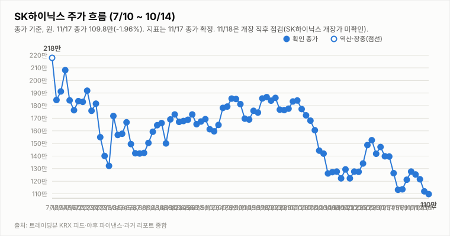
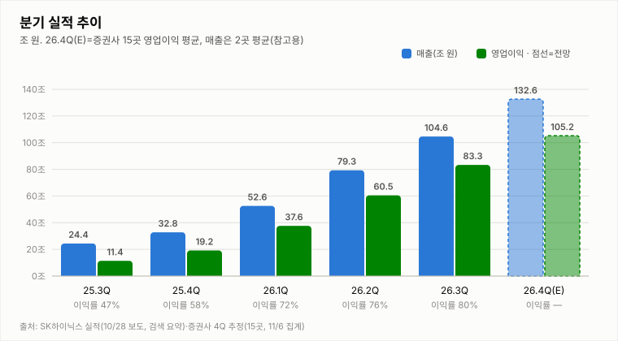
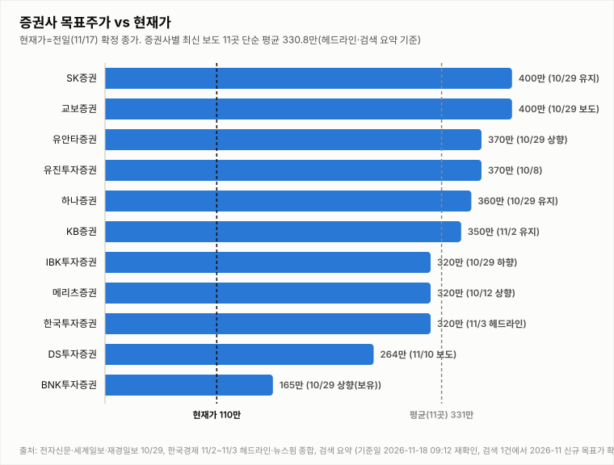
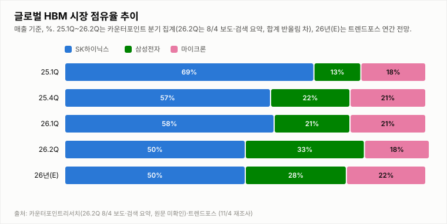

# SK하이닉스 투자 리포트 — 2026-11-18 (수) 장중 업데이트 (13:48, 13:24 지연 시세)

> **작성** 2026-11-18 13:48 KST · **확정 판정: 중립(v2, 11/17 종가 기준) · 장중 잠정: 점수 0·위험 높음·비중 배수 0.51** · 전일 종가 112.0만원(-7.89%)은 `quote.json`(marketTime 11/17 15:30 KST) 확정이며, 오늘 시세는 야후 `quote.json` 13:24 기준 20분 지연 값(확정 아님)입니다. 간밤 지표는 night.yml 11/18 08:03 스냅샷이며 엔비디아 CEO 사임·외국인 수급은 검색 결과·제목 기준으로 원문 미확인, 증권사 수치는 헤드라인·검색 요약 기준입니다. 확정 판정은 종가 기준으로만 변경합니다.

> **종목** SK하이닉스 (KRX 000660 · NASDAQ 상장 7/10)
> 본 자료는 정보 제공 목적이며 투자 권유가 아닙니다.

## 핵심 요약

- **투자의견: 확정 판정 중립(v2) 유지, 장중 잠정 점검** — 확정 판정은 11/17 종가 기준 중립(전략 점수 0·위험 극단·확신도 낮음)입니다. 13:48 데이터(13:24 지연 시세)로 같은 로직을 임시 적용하면 전략 점수 0(중립), 위험 레짐 높음(10일 변동성 5.9%·20일 고점 대비 -24.4%), 비중 배수 0.51입니다(확정 판정과 같은 요인 값입니다.). 낮 반등으로 현재가는 전일 확정 종가 대비 +5.01%입니다. 가격 변화는 방향 점수(F1~F5)를 바꾸지 못해 점수는 확정 판정과 같지만(F3은 낡은 목표가 규칙으로 0 유지), 20일 고점 대비 낙폭이 -24.44%로 극단 기준(-25%) 위로 올라와 위험 레짐은 장중 잠정 ‘높음’(10일 변동성 5.9%, 극단 기준 6%)이 됐습니다. 확정 판정(극단)과 다른 것은 규칙 변경이 아니라 임계값 바로 위·아래를 오가는 경계 효과이며(12:48은 낙폭 -25.95%로 극단), 비중 배수는 0.51로 확정 0.55와 비슷합니다. 엔비디아 실적 호조 보도(제목·검색 요약, 원문 미열람)와 외국인 수급 관련 제목 수준 보도는 F4·F2·F5의 마감 때 재평가 대상이며 장중에는 값을 바꾸지 않습니다. 거래량은 개장 264분 누적이라 비교 의미가 작습니다. 장중 가격 변화는 방향 점수(F4 정책 리스크·F5 외국인 수급)를 바꾸지 못하고 위험 레짐·비중 배수와 F3(목표가 신선도 규칙)만 움직일 수 있으며, 판정은 종가에서만 확정합니다. 매수 전환은 F4·F5가 함께 0 이상, 매도 전환은 F1 또는 F2가 -1일 때입니다.
- **11/17 확정 종가 109.8만(-1.96%)** — 시가 109.8만(11/16 종가 대비 -1.96%)·고가 115.0만(+2.68%)·저가 109.2만(-2.50%), 종가는 시가와 같으며 -2.2만원, 거래량 376.8만주(20일 평균의 0.97배, 야후 quote.json 15:30 확정; 트레이딩뷰 15:52 수집 350.8만주로 소스 간 차이가 있어 거래량은 참고용). 09:24 112.0만(0.0%) → 10:24 111.6만(-0.36%) → 11:24 112.0만(0.0%) → 12:24 114.2만(+1.96%, 장중 고가 115.0만 +2.68%) → 13:24 111.4만(-0.54%) → 14:24 110.7만(-1.16%)(장중 지연 시세)으로 오전 박스(저가 109.6만~고가 113.8만)를 12시대에 위로 벗어났다가 오후 두 시간 연속 내렸고, 종가는 전일 저가(111.3만)와 11/9 저가(111.6만)를 이탈했으나 11/6 저가(108.9만)는 지켰습니다. 코스피 -2.59%·코스닥 -2.34%·삼성전자 -3.30%보다 SK하이닉스 낙폭(-1.96%)이 작았습니다. 원인은 WHY 섹션을 참조하세요.
- **11/18 장중(13:24 지연 시세)** — 시가 115.4만(11/17 종가 대비 +5.10%)·고가 117.3만(+6.83%)·저가 110.8만(+0.91%), 현재 115.3만(**+5.01%**), 거래량 239.4만주(20일 평균의 0.62배, 개장 264분 누적). 직전 확정(11/17 15:30, 109.8만)보다 +5.5만원(+5.0%), 저가 대비 +4.1%·고가 대비 -1.7% 위치입니다. 09:25 117.1만 → 10:24 114.5만 → 11:24 112.1만 → 저가 110.8만 → 12:24 113.0만 → 13:24 115.3만으로 오전 하락을 오후에 되돌렸습니다. 시가(115.4만)와 사실상 같은 수준이고 고가 대비 -1.7%, 저가 대비 +4.1%이며 거래량(개장 264분)은 20일 평균의 0.62배입니다. 11/9 종가(113.6만)를 다시 넘어섰습니다. 원인은 WHY 섹션을 참조하세요.
- **간밤 변수·개장 전 헤드라인**: 11/17(화) 미국장은 반도체가 안정됐습니다(night.yml 11/18 08:03·09:09 스냅샷, 일부 종목은 시간외 값이 섞였을 수 있음). SOX +0.34%(9,642.88)·SK하이닉스 ADR +0.35%(122.61달러)·브로드컴 +2.46%·마이크론 -0.92%(712.42달러)·엔비디아 -0.44%(155.46달러)·AMD -0.17%·퀄컴 -1.10%·EWY -0.90%였고, 나스닥 -0.74%(24,328.38)·S&P500 -1.03%(7,340.53)·VIX 25.46(+11.1%), 원/달러 1,335.25원(+0.06%)입니다. 빅테크는 MS -2.27%·알파벳 -1.24%·메타 -1.20%·애플 -0.25%·아마존 +0.05%·테슬라 +0.10%로 엇갈렸습니다. 엔비디아 3Q 실적은 회사 발표 제목·검색 요약상 11/17 美장 마감 후(한국시간 오전 6시 20분경)였으나 실적 수치·가이던스·시간외 주가 반응은 검색에서 확인하지 못했고, 엔비디아 시세(08:03·09:09 모두 155.46달러, -0.44%)는 변동이 없어 시간외 반응이 반영됐는지 알 수 없습니다. 코스피200 야간선물은 767.95로 주간 종가(767.2) 대비 +0.10%(08:03 수집, 06:00 야간 종가, 야간 세션 값인지 첫 실측 검증 진행 중)이며 실적 발표 전 값입니다. 개장 직후 09:09 트레이딩뷰 기준 코스피 5,130.67(+3.26%)·코스닥 666.10(+2.47%)·코스피200 799.52(+3.73%)·코스피200 주간선물 789.40(+2.89%, 08:48)로 강하게 출발했습니다(20분 지연·잠정). SK하이닉스·삼성전자 개별 개장가는 이 시각 수집값이 전일 종가 그대로라 확인하지 못했습니다.
- **지표(11/18 13:24 지연 시세 포함, 야후 일봉 기준)**: DMI 격차 -14.2(+DI 19.0 < -DI 33.2, 11/17 종가 -16.7), KDJ K 21.4·D 24.8(격차 -3.4, K<D, 11/17 종가 -8.4), MACD 히스토그램 -0.56만(시그널 아래, 0선 아래; 11/17 종가 -0.82만), ATR 10.22만(8.9%). 오늘 거래량은 개장 264분 누적 239.4만주로 20일 평균(388.9만주)의 0.62배이며 장중 잠정입니다.

<!--CAUSE:START-->
## 주간 변동 원인 분석 — 국내·해외·미국 빅테크 (11/2~11/6 주간 + 주말 점검, 기준 2026-11-18(수) 13:48 KST (13:24 지연 시세))

**한 줄 결론** — 11/17(화) SK하이닉스는 -1.96%(종가 109.8만, 저가 109.2만)로 코스피 -2.59%·삼성전자 -3.30%보다 낙폭이 작았고, 원인은 11/16 美 반도체 추가 급락 후속과 엔비디아 실적 앞 경계로 추정합니다(확신도 중간~낮음, 제목 기준). 간밤(11/17) 美장은 반도체가 안정(SOX +0.34%·ADR +0.35%)됐지만 나스닥 -0.74%·S&P500 -1.03%·VIX +11.1%로 지수는 약했고, 엔비디아 실적(한국시간 11/18 오전 6시 20분경) 결과는 확인하지 못했습니다. 개장 후 09:09 코스피가 +3.26%(5,130.67)·코스피200 주간선물이 +2.89%로 강하게 출발해, 06:00 야간선물(+0.10%)보다 크게 올랐으며 엔비디아 실적 호재 또는 저가 매수가 원인일 가능성(추정, 확신도 낮음)이 있습니다. 이번 주(11/9~11/17) 흐름은 11/10~11/11 반등 뒤 11/12~11/17 연속 하락(-1.80%·-3.03%·-7.89%·-1.96%)이며, 1차 배경(미국 중간선거 후 AI 데이터센터 규제·투자 둔화 우려와 11/5 美 AI 반도체 투매, 외국인 대규모 순매도)은 그대로입니다. SK하이닉스 개별 외국인 수급은 확인하지 못했습니다. 11/18(수) 장중(13:24 지연)에는 엔비디아 3분기 호실적(검색 요약 기준)에 갭업(시가 +5.10%)으로 출발해 고가 117.3만(+6.83%)·저가 110.8만(+0.91%)을 오간 뒤 115.3만(+5.01%)으로 시가 수준을 회복했으며 확정 아님, 갭업 원인 확신도 중간·낮 재반등 원인 확신도 낮음. 코스피는 13:41 +1.38%로 상승 전환했습니다.

> 방법: 한국 시장(코스피·외국인 수급·사이드카) + 해외 시장(미국 지수·반도체·빅테크·VIX) + 국내외 뉴스를 교차해 사건을 시간순으로 놓고, 수치가 복수 출처에서 일치하면 ‘높음’, 매체의 해석이면 ‘중간’, 정황 추정이면 ‘낮음’으로 표시합니다. 수치는 트레이딩뷰 실측(night.yml 2026-11-10 08:04 KST 수집)과 검색 요약 보도를 병기했으며, 원인 기사는 요약 기준이라 원문 확인이 필요할 수 있습니다.

**① 시장 현황**

| 종목·지수 | 11/16(월) | 11/17(화) | 주간 | 11/18(수) 장중 |
|---|---|---|---|---|
| **한국 시장 (KRX 정규장, 해당일 15:30 마감)** | | | | |
| 코스피 | -3.59% | -2.59% | -5.31% | +1.38% |
| 코스닥 | -4.86% | -2.34% | -1.76% | +1.31% |
| SK하이닉스 | -7.89% | -1.96% | -9.56% | +5.01% |
| 삼성전자 | -4.47% | -3.30% | -4.56% | +1.58% |
| **미국 지수·변동성 (美 정규장, 11/16·11/17 현지 마감)** | | | | |
| 나스닥 | -2.49% | -0.74% | -2.87% | — |
| S&P500 | -1.92% | -1.03% | -2.30% | — |
| 필라델피아 반도체(SOX) | -5.28% | +0.34% | -2.37% | — |
| VIX (11/17 종가 25.46) | +18.70% | +11.13% | +28.85% | — |
| **미국 AI 반도체·메모리 (공급 측)** | | | | |
| 마이크론(MU) | -7.62% | -0.92% | -0.70% | — |
| 엔비디아(NVDA) | -4.12% | -0.44% | -10.64% | — |
| AMD | -5.58% | -0.17% | +0.12% | — |
| 브로드컴(AVGO) | -3.92% | +2.46% | +7.86% | — |
| 퀄컴(QCOM) | -2.29% | -1.10% | -1.22% | — |
| SK하이닉스 ADR(SKHY) | -7.29% | +0.35% | -6.40% | — |
| 한국 ETF(EWY) | -4.36% | -0.90% | -3.11% | — |
| **미국 빅테크 (수요 측·플랫폼)** | | | | |
| 애플(AAPL) | -0.98% | -0.25% | +0.16% | — |
| 마이크로소프트(MSFT) | -1.12% | -2.27% | -6.77% | — |
| 알파벳(GOOGL) | -4.07% | -1.24% | -3.04% | — |
| 아마존(AMZN) | -3.34% | +0.05% | -3.13% | — |
| 메타(META) | -2.38% | -1.20% | -3.00% | — |
| 테슬라(TSLA) | -2.69% | +0.10% | +2.50% | — |

> 주간=트레이딩뷰 Perf.W(한국은 11/17 종가 기준, 미국은 11/17 현지 종가 기준 1주 변동)이며 보도의 주간 수치와 기준 시점 차이로 다를 수 있습니다. 미국 11/17 열은 night.yml 11/18 08:03·09:09 스냅샷으로 일부 종목은 시간외 값이 섞였을 수 있고 엔비디아 실적 반응은 반영 여부를 확인하지 못했습니다. 한국장은 미국장보다 먼저 열려 11/17 한국장은 11/16 美 급락을, 오늘(11/18) 한국장은 11/17 美장과 엔비디아 실적을 반영합니다.

**② 원인 사슬 (시간순)**

| 시점 | 사건·수치 | 확신·출처 |
|---|---|---|
| 11/3(화) 美 | 미국 중간선거에서 민주당이 상·하원을 장악. | 높음 — 파이낸셜뉴스·SBS Biz·CNBC 일치 |
| 11/4(수) 美 | 선거 직후 지수는 ‘역대급 랠리’였지만 반도체는 약세: SOX -3.13%·마이크론 -7.00%·SK하이닉스 ADR -5.12%(저장소 night.yml 11/5 수집분). 야간선물 -1.66%. | 높음(수치 실측) / 랠리는 CNN·Yahoo 보도 |
| 11/5(목) 韓 | 코스피 -5.28%(5,383.80), 외국인 약 3.39조원 순매도, 코스피200 선물 급락에 매도 사이드카(10:16), 코스닥 -5.1%대. SK하이닉스 -9.46%·삼성전자 -7.57%. ‘美 증시 상승에도 반도체 약세’로 보도. | 높음 — 헤럴드경제·파이낸셜뉴스·마이데일리 일치 |
| 11/5(목) 美 | AI 반도체 투매: 나스닥 -5.52%(24,315, 2025년 4월 이후 최대 낙폭)·S&P500 -4.36%·다우 약 -1,830p. SOX -12.25%(Yahoo: 2020년 3월 이후 최악)·엔비디아 -9.26%·마이크론 -17.46%·퀄컴 -9%대(분기 가이던스 부진)·브로드컴 -10%대·테슬라 -10.8%·메타 -3.9%·MS -3.6%. 나스닥 시총 약 2.5조달러 증발, 나스닥은 10/6 고점 대비 -10% 조정장, VIX 장중 28.09. | 수치 높음 / 원인(규제 우려) 중간 — CNN·CNBC·Fox Business·SBS Biz·파이낸셜뉴스 |
| 11/6(금) 韓 | 코스피 -6.02%(5,059.69, 장중 -8%대 급락 보도·5,000선 사수), 코스닥 -5.03%(644.27), 외국인 약 2.77조원 순매도(이틀 6조원대), 매도 사이드카(코스닥 09:06·코스피 09:34). SK하이닉스 -10.44%(113.2만, 시가=저가 108.9만)·삼성전자 -6.35%. | 높음 — 디지털데일리·아시아투데이·뉴스핌 + 저장소 실측 |
| 11/6(금) 美 | 반등: 나스닥 +1.09%(24,579)·S&P500 +0.31%·다우 -0.46%, SOX +4.21%(9,390.25)·마이크론 +5.12%·AMD +11.04%·엔비디아 +2.78%. 그러나 주간으로는 나스닥 -3.96%·S&P500 -3.33%로 4주 연속 하락. 보도: 강한 경제지표로 추가 긴축(금리 인상) 베팅 부담. | 수치 높음(실측) / 긴축 베팅은 헤드라인 수준 — Yahoo Finance·UPI·TradingKey |
| 11/7(토) 06:00 韓 | 코스피200 야간선물 795.5(+1.60%, 주간 종가 782.95 대비). 야간 세션 종료 시각(06:00) 값으로 보이나 첫 실측 검증 진행 중. | 중간 — night.yml 실측 |
| 11/10(화) 06:00 韓 | 코스피200 야간선물 820.7(주간 종가 775.85 대비 +5.78%, 야간 세션 종료 시각 값으로 보이나 첫 실측 검증 진행 중). 원/달러 1,341.8(+0.13%). | 중간 — night.yml 실측, 야간선물은 야간 세션 값인지 검증 중(11/9 야간선물 +1.60%는 실제 개장 상승폭보다 과대했음) |
| 11/10(화) 장중~마감 韓 | 갭 상승 출발(SK하이닉스 시가 121.4만 +6.87%, 야간선물 +5.78% 신호) 후 고가 124.2만(+9.3%)·저가 119.0만을 거쳐 121.2만(+6.69%)으로 마감했고, 오후에 하락이 확대됐던 전날과 달리 14:24 이후에도 121만대를 지켰습니다. 코스피 5,239.13(+4.39%, 장중 고가 5,300.92)·코스닥 667.61(+4.48%)로 양 시장에 매수 사이드카가 발동됐고, 외국인 약 3,532억원·기관 약 4,980억원 순매수, 개인 약 1조3,396억원 순매도(코스피, 마감 보도)로 외국인의 7거래일 연속 순매도가 끝났습니다. 삼성전자 198,900원(+4.74%), 코스피200 12월물 주간 선물 813.40(+4.84%). | 높음 — 서울신문·필드뉴스·위키트리·Chosunbiz 보도와 트레이딩뷰·야후 수치 일치(수급 금액은 보도 기준) |
| 11/10(화) 밤 美 | 조정: 10월 CPI가 전월 대비 +0.4%(예상 +0.3%)·근원 +0.3%(예상 +0.2%)로 예상을 웃돌아 연준 12월 금리 인상 기대가 커졌고(미 10년물 약 4.99%, 달러지수 +0.6% 보도, 월러 이사 ‘50bp 인상 고려’ 발언 보도), 나스닥 -0.74%(25,066)·S&P500 -0.38%(7,521)·SOX -0.35%(9,998), 엔비디아 -5.47%(젠슨 황 관련 스캔들·대중 수출 규제 우려로 이틀간 약 -9.6% 보도), 마이크론 -1.10%, MSFT -2.20%, 브로드컴 +3.91%·AMD +1.30%. VIX 19.46. | 수치 높음(트레이딩뷰 실측) / CPI·엔비디아 원인은 중간 — 와우TV·이투데이·국제뉴스·블록미디어·헤럴드경제 등 복수 매체 요약 |
| 11/11(수) 06:00 韓 | 코스피200 야간선물 798.0(주간 종가 812.10 대비 -1.74%, 야간 세션 종료 시각 값으로 보이나 첫 실측 검증 진행 중). SK하이닉스 ADR 129.66달러(-3.51%)·EWY -2.05%, 원/달러 1,342.35(+0.01%). | 중간 — night.yml 실측, 야간선물은 야간 세션 값인지 검증 중(11/9 야간선물 +1.60%는 실제 개장 -0.18%, 11/10 +5.78%는 실제 개장 +6.87%로 차이가 컸음) |
| 11/11(수) 장중~마감 韓 | 갭다운 출발(시가 120.6만 -0.50%)→개장 직후 저가 119.3만(11/9 고가)→오전 반등으로 11/10 고가(124.2만) 돌파→낮 시간 128만 안팎→고가 129.0만(+6.43%)→종가 127.7만(+5.36%). 코스피 5,375.36(+2.60%)·코스닥 705.10(+5.62%)·삼성전자 206,000원(+3.57%), 코스피200 주간 선물 +3.04%(트레이딩뷰 15:52 실측). 외국인·기관 순매매 확정 수치는 확인 불가. | 중간 — 가격·지수는 트레이딩뷰·quote.json 실측, 원인은 추정(촉발 재료 확인 불가) |
| 11/11(수) 밤 美 | 급등: SOX +5.66%(10,564)·마이크론 +11.89%(811.30)·AMD +7.32%·브로드컴 +3.99%·엔비디아 +2.87%(173.73)·SK하이닉스 ADR +9.71%(142.25)·EWY +6.19%, 나스닥 +1.60%(25,466)·S&P500 +1.31%(7,619), VIX 17.49(-10.12%). 빅테크는 애플 +2.04%·알파벳 +2.11%·테슬라 +2.91%, MS -2.26%·아마존 -1.74%·메타 -1.97%로 엇갈림. 연합인포맥스 헤드라인(11/11 23:39)은 ‘코어위브 호실적發 AI 훈풍’이라고 전했으나 원문은 확인하지 못했습니다. | 수치 높음(트레이딩뷰 실측) / 원인은 낮음~중간 — 제목 기준 헤드라인 1건, 영문 검색에서 당일 보도 확인 못 함 |
| 11/12(목) 06:00 韓 | 코스피200 야간선물 852.95(주간 종가 836.55 대비 +1.96%, 야간 세션 종료 시각 값으로 보이나 첫 실측 검증 진행 중). SK하이닉스 ADR 142.25달러(+9.71%)·EWY +6.19%, 원/달러 1,336.67(-0.14%). | 중간 — night.yml 실측, 야간선물은 야간 세션 값인지 검증 중(11/11 야간선물 -1.74%는 실제 시가 -0.50% 후 장중 반전해 +5.36% 마감) |
| 11/12(목) 장중~마감 韓 | 보합 출발(시가 128.0만 +0.23%)→10시대 129.4만 고가 후 되밀림→11시대 130.3만(11/4 저가) 돌파→12시대 고가 131.0만(+2.58%)→오후 하락 전환→저가 124.5만→종가 125.4만(-1.80%). 코스피 5,342.73(-0.61%)·코스닥 696.53(-1.22%)·삼성전자 208,000원(+0.97%), 코스피200 주간 선물 -0.62%(트레이딩뷰 15:52 실측). 외국인·기관 순매매 확정 수치는 확인 불가. | 중간 — 가격·지수는 트레이딩뷰·quote.json 실측, 원인은 추정(촉발 재료 확인 불가) |
| 11/12(목) 밤 美 | 약보합: SOX -0.54%(10,507)·마이크론 -1.59%(798.44)·엔비디아 -4.34%(166.19; 시가 151.0달러로 약 -13% 갭다운 후 회복)·SK하이닉스 ADR -3.19%(137.71)·EWY -1.64%, 브로드컴 +5.54%·AMD +5.86%, 나스닥 -0.39%(25,366)·S&P500 -0.35%(7,592), VIX 18.70(+6.92%). 빅테크는 알파벳 +1.79%·테슬라 +1.69%·아마존 +0.48%·MS +0.36%, 애플 -0.21%·메타 -0.82%. 11/12 SEC 8-K로 표기된 문서(검색 결과 요약, 원문 미열람, CNBC·Forbes 제목·요약으로 복수 확인)는 젠슨 황의 CEO·이사 즉시 사임과 콜렛 크레스 임시 CEO 선임을 전했고, 11/12 한국 마감 시황 헤드라인(파이낸스투데이·인포스탁데일리)의 ‘젠슨 황 해임 위기’와 엔비디아 -4.34%와 방향이 일치합니다. | 수치 높음(트레이딩뷰 실측) / 원인은 낮음~중간 — 검색 결과상 SEC 8-K 표기(원문 미열람)+매체 헤드라인 |
| 11/13(금) 06:00 韓 | 코스피200 야간선물 833.95(주간 종가 827.50 대비 +0.78%, 야간 세션 종료 시각 값으로 보이나 첫 실측 검증 진행 중). SK하이닉스 ADR 137.71달러(-3.19%)·EWY -1.64%, 원/달러 1,334.52(-0.03%). | 중간 — night.yml 실측, 야간선물은 야간 세션 값인지 검증 중(11/12 야간선물 +1.96%는 실제 시가 +0.23% 후 오후 하락 전환해 -1.80% 마감) |
| 11/13(금) 장중~마감 韓 | 갭업 출발(시가 129.2만 +3.03%, 글로벌이코노믹 10:02 특징주 헤드라인: 엔비디아 이슈 속 AMD·브로드컴 등 반사수혜 기대로 삼성전자·SK하이닉스 강세, 제목만 확인)→고가 131.7만(+5.02%)→단계적 하락(09:24 130.1만→10:24 129.6만→11:30 126.9만→12:24 124.4만→13:24 121.8만→14:24 120.3만, 지연 시세)→저가 120.1만(-4.23%)→종가 121.6만(-3.03%, 15:30 확정, 거래량 308.8만주). 코스피 -0.98%·코스닥 +0.45%·삼성전자 -0.96%로 SK하이닉스 낙폭이 컸습니다. 추정(확신도 낮음~중간): ① 엔비디아 젠슨 황 CEO 사임 이슈(SEC 8-K 표기와 CNBC·Forbes·Yahoo Finance 제목·요약으로 복수 확인, 원문 미열람)와 엔비디아 -4.34%가 AI 반도체 투자심리를 눌렀고, ② 갭업은 반사수혜 기대·저가 매수가 만든 단기 반등이어서 매수 소진 뒤 매물이 우위로 바뀌었으며, ③ 11/12 외국인의 SK하이닉스 약 8,700억원 순매도·삼성전자 약 9,200억원 순매수(제목 기준)와 같은 종목 간 이동이 이어졌을 가능성이 있습니다. 반증 조건: 마감 후 투자자별 수급에서 외국인이 SK하이닉스 순매수였다면 ③이 약해집니다. 11/13 수급 수치는 확인 불가. | 낮음~중간 — 수치는 quote.json 확정 실측, 반사수혜·외국인 이동은 매체 제목 해석(원문 미확인), 엔비디아 CEO 사임은 검색 결과상 SEC 8-K 표기(원문 미열람) |
| 11/13(금) 밤 美 | 반도체 급락: SOX -3.43%(10,146)·AMD -8.75%·브로드컴 -4.76%·퀄컴 -2.64%·마이크론 -2.52%(778.31)·엔비디아 -2.01%(162.85; 시가 169.9 후 장중 158.4~170.0)·SK하이닉스 ADR -4.30%(131.79)·EWY -1.79%, 나스닥 -0.91%·S&P500 -0.40%, VIX 19.30(+3.21%). 빅테크는 메타 +2.90%·애플 +0.39%·MS +0.17% 대 알파벳 -0.98%·아마존 -0.29%·테슬라 -1.82%로 반도체 낙폭이 두드러졌습니다. 원인은 10:44 검색에서 CNBC(11/12)·Forbes(11/13)·Yahoo Finance 제목·요약이 엔비디아 젠슨 황 CEO 사임 여파와 AI 설비투자 부담·데이터센터 규제 우려를 전한 것을 확인했습니다(원문 미열람). 11/12 AMD·브로드컴 급등의 되돌림도 겹쳤을 가능성은 추정입니다. | 수치 높음(트레이딩뷰 실측) / 원인은 중간 — 복수 매체 제목·검색 요약(반증: 엔비디아·AMD 반등에도 한국 반도체가 약세면 수급 이탈 해석 강화) |
| 11/16(월) 06:00~08:00 韓 | 코스피200 야간선물 823.65(주간 종가 822.35 대비 +0.16%, 20분 지연; 야간 세션 값인지 첫 실측 검증 진행 중, 시각 표기 11-15 08:11로 어긋나 신뢰 낮음)로 美 반도체 급락과 엇갈립니다. SK하이닉스 ADR 131.79달러(-4.30%)·EWY -1.79%, 원/달러 1,335.71원(보합). | 낮음 — night.yml 실측이나 야간선물은 검증 중(11/13에도 야간선물 +0.78%와 반대로 갭업 후 -3.03% 마감) |
| 11/16(월) 장중~마감 韓 | 갭 없이 출발(시가 121.6만 0.00%)→고가 122.2만(+0.49%)→09:27 120.0만(-1.32%)→10:24 115.4만(-5.10%)→11:24 116.8만(-3.95%)→12:24 115.05만(-5.39%)→13:24 114.3만(-6.00%)→14:24 112.4만(-7.57%)(지연 시세)→저가 111.3만(-8.47%)→종가 112.0만(-7.89%, 15:30 확정, 거래량 야후 465만주·트레이딩뷰 403만주). 코스피 -3.59%(5,100.50)·코스닥 -4.86%·삼성전자 -4.47%보다 낙폭이 컸습니다. 원인(확신도 중간~높음): 복수 매체(newspim·뉴스1·서울신문·미디어펜 제목·검색 요약, 원문 미열람)가 엔비디아 젠슨 황 CEO 사임 이후 불확실성·실적 경계감과 외국인 매도를 이유로 전했고, CNBC(11/12)·Forbes(11/13) 제목·요약이 같은 맥락(사임 후 AI 반도체주 약세·설비투자 부담·규제 우려)을 전했습니다. 엔비디아 실적은 회사 보도자료 제목·검색 요약상 11/17 美장 마감 후(한국시간 11/18 아침)입니다. 美 법원의 D램 담합 소송 허용(뉴스핌 11/16 09:42 제목, 교차 확인 못함)도 후보이나 확신도 낮음입니다. 반증 조건: 마감 후 투자자별 수급에서 외국인이 SK하이닉스를 순매수했다면 외국인 매도 해석이 약해지고, 엔비디아 실적 이후 반등하면 이벤트 경계 성격이 강해집니다. | 중간~높음 — 수치는 quote.json 확정 실측, 원인은 복수 매체 제목·검색 요약 일치(원문 미열람), 개별 수급·소송 허용 보도는 미확인 |
| 11/16(월) 밤 美 | 반도체 추가 급락: SOX -5.28%(9,610.65)·마이크론 -7.62%(719.02)·엔비디아 -4.12%(156.14)·AMD -5.58%·브로드컴 -3.92%·퀄컴 -2.29%·SK하이닉스 ADR -7.29%(122.18)·EWY -4.36%, 나스닥 -2.49%·S&P500 -1.92%, VIX 22.91(+18.7%), 빅테크도 알파벳 -4.07%·아마존 -3.34%·테슬라 -2.69%·메타 -2.38%·MS -1.12%·애플 -0.98%(night.yml 11/17 08:03, 일부 종목 시간외 포함 가능). 원인(검색 제목·요약, 원문 미열람): 엔비디아 CEO 사임 이후 불확실성, 美 AI 칩 수출 규제 강화(싱가포르·말레이시아·태국·인도네시아·브라질 라이선스 요건, 중국 우회 차단), 엔비디아 경쟁사(AMD 등)에 걸었던 투자의 실적 전 정리, 엔비디아 실적(11/17 美장 마감 후)과 앤트로픽 상장(목요일) 앞 경계. | 수치 높음(트레이딩뷰 실측) / 원인은 중간~높음 — BNN Bloomberg·Benzinga·Investing.com·FXEmpire 등 복수 매체 제목·요약(원문 미열람) |
| 11/17(화) 06:00 韓 | 코스피200 야간선물 775.45(주간 종가 789.35 대비 -1.76%, 20분 지연·06:00 값; 야간 세션 값인지 첫 실측 검증 진행 중)로 간밤 美 급락과 같은 방향입니다. 다만 11/16에는 야간선물 +0.16%·ADR -4.30%와 달리 갭 없이 개장한 뒤 -7.89%로 마감했습니다. 11/16 마감 후 헤드라인: 美 법원 D램 담합 소송 기각 요청 거부(조선비즈·뉴스핌 제목), 모건스탠리 SK하이닉스 목표주가 38% 하향(조선일보 제목, 투자의견 비중확대 유지·절대값 확인 불가). | 낮음~중간 — night.yml 실측이나 야간선물은 검증 중, 법원·모건스탠리는 제목 기준(원문 미확인) |
| 11/17(화) 장중~마감 韓 | 갭다운(시가 109.8만, -1.96%, 야간선물 -1.76%와 같은 방향)→09:24 112.0만(0.0%)→10:24 111.6만(-0.36%)→11:24 112.0만(0.0%)→12:24 114.2만(+1.96%, 고가 115.0만 +2.68%)→13:24 111.4만(-0.54%)→14:24 110.7만(-1.16%)(지연 시세)→저가 109.2만(-2.50%)→종가 109.8만(-1.96%, 15:30 확정, 시가와 같음, 거래량 야후 377만주·트레이딩뷰 351만주). 코스피 -2.59%(4,968.48)·코스닥 -2.34%·삼성전자 -3.30%보다 낙폭은 작았습니다. 원인(확신도 중간~낮음): 11/16 美 반도체 추가 급락(SOX -5.28%)의 후속 반영과 엔비디아 실적(회사 발표 제목·검색 요약 단일 출처상 11/17 美장 마감 후, 한국시간 11/18 오전 7시경) 앞 경계로 추정하며, 전남일보 11/17 09:38 제목이 삼성전자·SK하이닉스 동반 하락을 전했습니다(제목 기준, 원문 미열람). 12:24 반등은 11/16 급락 뒤 저가 매수, 오후 반납은 실적 앞 포지션 정리로 추정하나 직접 근거는 확인하지 못했습니다(확신도 낮음). 반증 조건: 마감 후 투자자별 수급에서 외국인이 SK하이닉스를 순매수했다면 외국인 매도 해석이 약해지고, 엔비디아 실적 이후 한국 반도체가 반등하면 이번 하락은 이벤트 경계 성격이 강해집니다. | 중간~낮음 — 수치는 quote.json 확정 실측, 원인은 제목 기준 단일 매체와 수치 패턴 추정(원문 미열람), 개별 수급은 미확인 |
| 11/17(화) 밤 美 | 반도체는 안정: SOX +0.34%(9,642.88)·브로드컴 +2.46%·SK하이닉스 ADR +0.35%(122.61)·마이크론 -0.92%·엔비디아 -0.44%(155.46)·AMD -0.17%·퀄컴 -1.10%·EWY -0.90%이나 나스닥 -0.74%·S&P500 -1.03%·VIX 25.46(+11.1%), 빅테크 MS -2.27%·알파벳 -1.24%·메타 -1.20%(night.yml 11/18 08:03·09:09, 일부 종목 시간외 포함 가능). 엔비디아 실적(회사 발표 제목·검색 요약상 11/17 美장 마감 후)의 수치·시간외 반응은 확인하지 못했습니다. | 수치 높음(트레이딩뷰 실측) / 엔비디아 실적 반응은 확인 불가 |
| 11/18(수) 06:00~09:10 韓 | 코스피200 야간선물 767.95(06:00 야간 종가, 주간 종가 767.2 대비 +0.10%, 야간 세션 값인지 검증 중)였으나 개장 후 09:09 코스피 5,130.67(+3.26%)·코스닥 666.10(+2.47%)·코스피200 799.52(+3.73%)·주간선물 789.40(+2.89%)로 강하게 출발했습니다(20분 지연·잠정). 엔비디아 실적(06:20경) 반응 또는 11/16~11/17 낙폭에 대한 저가 매수로 추정하나 직접 근거는 확인하지 못했습니다. SK하이닉스 개장가는 미확인입니다. | 낮음 — 수치는 지연 시세, 원인은 시간 순서에 의한 추정(검색 2건에서 2026-11-18 자료 없음) |
| 11/18(수) 장중 13:24 韓 | 개장 직후 갭업(시가 115.4만, +5.10%)→09:25 117.1만·고가 117.3만(+6.83%)→10:24 114.5만→11:24 112.1만→저가 110.8만(+0.91%)→12:24 113.0만→13:24 115.3만(+5.01%, 20분 지연·개장 264분 누적 거래량 239.4만주=20일 평균의 0.62배). 복수 매체 제목·검색 요약(원문 미열람)이 엔비디아 3분기 호실적(매출 1,158억달러·4분기 가이던스 1,300억달러, 검색 요약 기준)을 갭업 원인으로 전했습니다. 코스피는 트레이딩뷰 11:52 -0.35%에서 13:41 +1.38%(5,036.81)로 상승 전환했고 삼성전자도 +1.58%로 회복했습니다. | 중간 — 갭업 원인은 복수 매체 제목·검색 요약 일치(원문 미열람), 실적 수치는 요약 기준; 오전 반납과 낮 재반등의 원인은 확인 불가(수급·저가 매수 추정, 확신도 낮음) |

**③ 원인 순위**

| 순위 | 원인 | 근거 | 확신 |
|---|---|---|---|
| 1 | (오늘 장중) 엔비디아 호실적 갭업이 오전에 반납(저가 110.8만)됐다가 낮에 재반등해 115.3만(+5.01%) — 코스피도 상승 전환 | 이투데이·투데이신문·디지털타임스·뉴스핌·디지털데일리 등 복수 매체 제목·검색 요약(원문 미열람)이 엔비디아 호실적(매출 1,158억달러·전년 대비 +103%, 4분기 가이던스 1,300억달러, 검색 요약 기준)에 삼전닉스가 프리마켓부터 급등하고 코스피가 5000선을 되찾았다고 전했습니다. 개장 직후에는 외국인이 1,760억원을 순매수해 4거래일 만에 매수 우위였다는 보도(제목·요약, 시장 전체)도 있습니다. 오전에는 갭업을 반납해 코스피가 11:52 -0.35%(4,951.32), SK하이닉스는 저가 110.8만(+0.91%)까지 밀렸으나, 트레이딩뷰 13:41 스냅샷에서 코스피가 +1.38%(5,036.81), 코스닥 +1.31%, 삼성전자 +1.58%로 올라섰고 SK하이닉스는 13:24 115.3만(+5.01%)으로 시가 수준을 되찾았습니다. 핀포인트뉴스 제목(외국인 삼성전자 ‘매도’·SK하이닉스 ‘집중매수’)은 방향이 맞지만 집계 시각·수치는 열람하지 못했습니다. 오전 반납과 낮 재반등을 설명한 기사는 찾지 못해 외국인 수급 복귀·저가 매수로 추정합니다. | 낮음~중간 — 갭업 원인은 중간(복수 매체 제목 일치), 낮 재반등 원인은 낮음(수급·저가 매수 추정; 반증: 마감 후 투자자별 수치가 외국인 순매도이거나 마감 직전 재반납 시 약화) |
| 2 | (11/17 결과) 美 반도체 추가 급락 후속·엔비디아 실적 앞 경계 — -1.96% 마감(오전 반등 반납) | 시가 109.8만(-1.96%)은 야간선물(-1.76%)과 같은 방향으로 간밤 신호가 개장 때 반영됐고, 12:24 고가 115.0만(+2.68%) 뒤 오후에 반납해 시가와 같은 109.8만에 마감했습니다(저가 109.2만). 전남일보 11/17 09:38 제목이 삼성전자·SK하이닉스 동반 하락을 전했고(제목 기준), 11/16 美 SOX -5.28%·마이크론 -7.62%·ADR -7.29%의 후속과 엔비디아 실적(한국시간 11/18 오전 7시경) 앞 경계로 추정합니다. 코스피 -2.59%·삼성전자 -3.30%보다 SK하이닉스 낙폭(-1.96%)이 작았던 것은 11/16에 -7.89% 선반영된 영향일 수 있으며(추정), 외국인 순매매 확정 수치와 개별 수급은 확인하지 못했습니다. | 중간~낮음 — 수치는 확정 실측, 원인은 제목 기준 단일 매체와 수치 패턴 추정(원문 미열람), 개별 수급은 미확인(반증: 마감 후 외국인 SK하이닉스 순매수 확인 또는 엔비디아 실적 후 반등) |
| 3 | (11/16 결과) 엔비디아發 불확실성·실적 경계감과 외국인 매도 — -7.89% 마감 | 시가 121.6만(갭 없음)에서 계속 낙폭이 커져 저가 111.3만(-8.47%)을 거쳐 112.0만(-7.89%)에 마감했습니다. newspim·뉴스1·서울신문·미디어펜(제목·검색 요약)이 엔비디아 CEO 사임 이후 불확실성·실적 경계감과 외국인 매도를 원인으로 전했고 CNBC(11/12)·Forbes(11/13)도 사임 후 AI 반도체주 약세를 전했습니다(원문 미열람). 11/13 美 SOX -3.43%·ADR -4.30%·AMD -8.75%의 후속 반영이며 코스피 -3.59%·삼성전자 -4.47%보다 SK하이닉스 낙폭(-7.89%)이 컸습니다. 美 법원 D램 담합 소송 허용 제목(뉴스핌, 교차 확인 못함)은 보조 후보입니다. 외국인 순매매 확정 수치와 SK하이닉스 개별 수급은 확인하지 못했습니다. | 중간~높음 — 수치는 확정 실측, 원인은 복수 매체 제목·검색 요약 일치(원문 미열람), 개별 수급은 미확인(반증: 마감 후 외국인 SK하이닉스 순매수 확인) |
| 4 | (11/13 결과) 갭업 전부 반납·-3.03% 마감 — 엔비디아 CEO 사임 이슈, 반사수혜 기대 소진, 외국인 종목 간 이동 추정 | 시가 129.2만(+3.03%)·고가 131.7만(+5.02%) 후 저가 120.1만(-4.23%)을 거쳐 121.6만(-3.03%) 마감, 고점 대비 -7.7%입니다. 개장 갭업은 AMD·브로드컴 반사수혜 기대(글로벌이코노믹 특징주, 제목만)였지만 오후로 갈수록 밀렸습니다. 11/12 마감 시황 헤드라인의 ‘젠슨 황 해임 위기’와 SEC 8-K(11/12자, 즉시 사임·크레스 임시 CEO)와 CNBC·Forbes·Yahoo Finance 제목·요약(원문 미열람)가 엔비디아 -4.34%와 방향이 일치합니다. 11/12 외국인은 SK하이닉스 약 8,700억원 순매도·삼성전자 약 9,200억원 순매수(제목 기준)였고 11/13 수치는 확인하지 못했습니다. 코스피 -0.98%·삼성전자 -0.96%에 비해 SK하이닉스 낙폭이 컸습니다. | 낮음~중간 — 수치는 확정 실측, 원인은 매체 제목 해석+정황 추정(반증: 마감 후 외국인 SK하이닉스 순매수 확인) |
| 5 | (11/12 결과) 간밤 美 반도체 급등(마이크론 +11.89%·SOX +5.66%)에도 오후 하락 전환 — 선반영·차익 실현 추정 | SOX +5.66%(10,564)·마이크론 +11.89%·AMD +7.32%·브로드컴 +3.99%·엔비디아 +2.87%·ADR +9.71%·EWY +6.19%, 나스닥 +1.60%·S&P500 +1.31%, VIX 17.49(-10.12%). 연합인포맥스 헤드라인(23:39)은 코어위브 호실적發 AI 훈풍이라고 전했으나 원문은 확인하지 못했고 영문 검색에서도 11/11 당일 보도를 찾지 못했습니다. 반면 MS -2.26%·아마존 -1.74%·메타 -1.97%로 수요 측 일부는 약세여서 ‘AI 투자 둔화’ 우려가 사라졌다고 단정하기 어렵습니다. 실제 한국장은 128.0만 보합 출발 후 131.0만(+2.58%)까지 올랐다가 오후에 125.4만(-1.80%)으로 마감했고, 같은 날 삼성전자는 +0.97%, 코스피는 -0.61%여서 메모리 대표주만 상대적으로 약했습니다. | 낮음~중간 — 美 수치는 실측, 오후 하락의 원인은 확인 불가(가격·상대강도 패턴 추정) |
| 6 | (11/11 결과) 美 10월 CPI 상회·엔비디아 급락 신호는 개장 직후에만 반영, 이후 반전 | 10월 CPI +0.4%(예상 +0.3%)·근원 +0.3%(예상 +0.2%)로 12월 금리 인상 기대가 커지며 11/10 美장이 하락했고(나스닥 -0.74%, S&P500 -0.38%) 엔비디아는 젠슨 황 관련 스캔들·대중 수출 규제 우려로 -5.47%(이틀 약 -9.6%) 급락했습니다. 반면 SOX는 -0.35%로 버텨(브로드컴 +3.91%·AMD +1.30%) 반도체 전체 투매는 아니며, 야간선물 -1.74%·ADR -3.51%·EWY -2.05%가 오늘 한국장 갭다운 신호입니다. 실제로는 갭다운(시가 120.6만 -0.50%)과 저가 119.3만 확인 뒤 낙폭을 되돌려 SK하이닉스 +5.36%·코스피 +2.60%로 마감해, 이 신호는 하루 종일 유지되지 않았습니다. | 중간 — 美 수치는 실측, 11/11 한국장 반전의 원인은 확인 불가(추정) |
| 7 | 미국 AI 반도체 투매의 한국 전이 | SOX 11/4 -3.13% → 11/5 -12.25%, 마이크론 -7.00% → -17.46%, ADR -5.12% → -13.40%가 한국장에 하루 시차로 반영: 11/5 코스피 -5.28%(SK하이닉스 -9.46%), 11/6 코스피 -6.02%(SK하이닉스 -10.44%). 11/9 美장은 SOX +6.85%·마이크론 +6.25%로 반등해 같은 전이 경로가 반대로 작동합니다(오늘 한국장 반영 대상). | 높음 |
| 8 | 외국인 대규모 순매도(프로그램·선물 연쇄 포함) | 11/5 약 3.39조 + 11/6 약 2.77조원 = 이틀 6조원대, 11/2~6 주간 약 10.4~11.1조원(매체별 상이; SK하이닉스 약 5.4~5.8조, 삼성전자 약 2.2~2.6조). 코스피200 선물 급락에 사이드카 3회(11/5 코스피, 11/6 코스닥·코스피). 11/9: 美 반등 속 코스피가 5,170선까지 올랐다가 외국인 순매도(6,284억~6,889억원, 7거래일 연속)에 막혀 -0.81% 마감. 11/10: 외국인 약 3,532억원 순매수로 전환(기관 약 4,980억원 순매수, 개인 약 1조3,396억원 순매도)하며 코스피 +4.39%·SK하이닉스 +6.69%로 마감해 수급 방향이 반등 지속성을 좌우한다는 해석과 일치. 5거래일 누적은 여전히 대규모 순매도이고 선물·프로그램 비중은 미확인. | 높음(수급 수치·방향 복수 출처 일치) / 선물·프로그램 비중은 미확인 |
| 9 | 트리거: 중간선거 후 AI 데이터센터 규제·투자 둔화 우려 | 파이낸셜뉴스·SBS Biz·CNBC(로이터 인용)가 같은 해석: 민주당 의회 장악 → AI 인프라 확장이 늦고 비싸질 것이라는 우려 → 공급 측(엔비디아·마이크론·브로드컴) 급락. 구체 법안·정책 내용은 보도되지 않음. 주말 보강: 민주당 중진의 AI 규제·개발 일시 중단 촉구 보도와 ‘데이터센터 800~1,000곳 지연 가능’ 분석이 있으나, 다수 분석가는 청문·조사 수준으로 입법 가능성에는 회의적이며 금지가 아닌 둔화 우려가 시장 해석의 핵심. | 중간 — 시장의 해석(구체성 일부 보강, 입법 가능성은 회의적) |
| 10 | 메모리·AI 하드웨어 쏠림 해소(고베타) | 주간 마이크론 -21.95%·SK하이닉스 -21.61%는 엔비디아 -10.67%·AMD -11.70%·브로드컴 -11.20%·SOX -13.5%·코스피 -12.2%의 약 2배. 반면 수요 측 빅테크는 MSFT +1.02%·GOOGL +1.30%·AMZN +11.51%로 버팀. | 중간 — 수치 실측, 해석은 추정 |
| 11 | 개별 악재 중첩 | 퀄컴 분기 가이던스 부진(CNBC 제목), 메타 데이터센터 관련 발언 후 -3.9%(발언 내용 미확인), 11/6 글로벌이코노믹 ‘ADR 13% 폭락…수요 절벽 공포’(제목만 확인). | 중간~낮음 |
| 12 | 심리·거시: 조정장 진입과 긴축 베팅 | 나스닥 -10% 조정장, VIX 28.09(주간 +39%), 11/6 강한 경제지표 → 추가 긴축 베팅 보도(지표 수치 미확인), 원/달러 1,363.64(주간 +1.8%). | 낮음 — 정황 |

**④ 분석 판단 (추정 포함)**

- 이번 하락은 ‘이익 전망 하향’보다 ‘멀티플·수급 충격’의 성격이 강하다고 판단합니다(추정). 근거: 같은 기간 4Q26 영업이익 증권사 추정치(15곳 평균 105.2조)와 TrendForce 4Q 계약가 전망은 하향 보도가 확인되지 않았고, 하락률이 업종 베타 순서(메모리 > 파운드리·GPU > 빅테크 플랫폼)와 일치합니다.
- 공급 측(반도체)만 크게 빠지고 수요 측(MSFT·GOOGL·AMZN)은 버틴 구도는 ‘AI 투자 속도 둔화·규제’ 해석과 정합적이지만, 이 구도만으로 AI 투자 계획이 실제로 줄었다고 단정할 수 없습니다(CAPEX 하향 보도 없음).
- 한국장이 美장보다 먼저 열리는 시차 때문에 한국 낙폭에는 美 투매가 하루 늦게 합산됐고(11/5·11/6), 11/6 美 반등은 11/9 한국장에 반영됩니다.
- 11/9 美 반등 신호에도 외국인 순매도에 상승분을 반납했던 SK하이닉스가 11/10에는 외국인 순매수 전환과 함께 +6.69%로 마감해, 가격 신호보다 수급 방향이 반등 지속성을 가른다는 이번 주 해석(추정, 확신도 중간~높음)이 두 거래일 연속 지지됐습니다. 다만 외국인 순매수는 하루뿐이고 5거래일 누적은 대규모 순매도라 추세 전환으로 단정할 수 없으며, 개인이 1조원 넘게 순매도한 점도 반등의 질을 가르는 변수입니다(추정).
- 11/10 美 조정의 중심이 엔비디아 개별 악재와 금리(CPI) 변수여서 SOX 낙폭(-0.35%)은 작았습니다. SK하이닉스 ADR(-3.51%)과 야간선물(-1.74%)이 엔비디아 낙폭보다 작은 점은 한국 메모리 대표주가 엔비디아 개별 이슈에 덜 민감하다는 해석(추정, 확신도 낮음)과 정합적이지만, 금리 인상 우려가 이어지면 고베타 성장주 전반의 멀티플 부담이 커질 수 있어 외국인 수급이 핵심 변수입니다.
- 11/11 한국장은 美 악재 신호(야간선물 -1.74%·ADR -3.51%)와 반대로 갭다운 후 반전해 마감해, 해외 가격 신호보다 국내 저가 매수·수급이 우세했다는 정황입니다(추정, 확신도 낮음~중간). 코스닥 +5.62%·삼성전자 +3.57%가 함께 올라 종목 고유 재료보다 시장 전반의 반등이 중심으로 보이지만, 투자자별 수급 수치를 확인하지 못해 단정할 수 없습니다.
- 11/10 CPI 쇼크로 눌렸던 엔비디아(-5.47%)가 +2.87% 반등하고 마이크론이 +11.89%로 더 크게 오른 점은 메모리 고베타 패턴과 일치합니다(추정, 확신도 낮음). 어제 한국장이 美 약세 신호를 거슬러 올랐다는 점은 국내 수급 우위 가설을 지지하지만, 오늘 갭업은 美 신호와 같은 방향이라 두 해석을 구분해서 봐야 합니다.
- 11/12 한국장은 美 반도체 급등 신호(야간선물 +1.96%·ADR +9.71%)와 같은 방향으로 출발했지만 오전 고가(131.0만) 이후 오후에 하락 전환해, 해외 신호보다 국내 수급·차익 실현이 오후 흐름을 좌우했다는 정황입니다(추정, 확신도 낮음). 어제까지 이틀 +12% 급반등으로 선반영됐고 130만대(11/4 저가 130.3만 부근) 매물에 막혔다는 해석이 가격 패턴과 맞지만, 삼성전자(+0.97%)와의 상대 약세 원인은 확인하지 못했습니다.
- 11/12 한국장은 美 급등 신호와 야간선물(+1.96%)을 거슬러 오후에 하락 전환했고 삼성전자(+0.97%)와의 상대 약세가 뚜렷했습니다. 연합뉴스 헤드라인(제목만 확인)이 외국인의 삼성전자 매수·SK하이닉스 매도를 전해, 간밤 약보합 속에서도 외국인의 종목 간 이동이 오늘 SK하이닉스 상대 약세를 이어갈 가능성이 있습니다(추정, 확신도 낮음). 다만 금액은 확인하지 못했습니다.
- 11/12·11/13 이틀 연속 SK하이닉스는 오전 강세 후 오후에 하락했고, 두 날 모두 외국인의 SK하이닉스 매도·삼성전자 매수 헤드라인이 있었습니다(11/12 약 8,700억원 순매도·약 9,200억원 순매수는 제목 기준, 11/13 수치는 확인 불가). 엔비디아 CEO 사임 이슈(SEC 8-K 표기와 CNBC·Forbes·Yahoo Finance 제목·요약으로 복수 확인, 원문 미열람)가 주말 사이 어떻게 소화되는지가 월요일 갭의 변수입니다(추정, 확신도 낮음).
- 금요일 한국장은 야간선물 +0.78%·美 약세(ADR -3.19%)와 반대로 갭업했다가 -3.03%로 마감했고, 오늘은 美 반도체 급락(SOX -3.43%)과 야간선물 +0.16%가 다시 엇갈립니다. 개장 직후 값의 신뢰가 낮아 갭 방향보다 종가 안착 여부가 중요합니다(추정, 확신도 낮음). 외국인 순매매 확정 수치는 확인하지 못했습니다.
- 11/16은 11/13 美 반도체 급락의 후속 반영과 엔비디아 CEO 사임 이후 불확실성이 겹친 하락입니다. 엔비디아 실적(회사 보도자료 제목·검색 요약상 11/17 美장 마감 후, 한국시간 11/18 아침)이 다음 변수라 11/17 한국장은 실적 앞 경계와 반등 시도가 엇갈릴 가능성이 있습니다(추정, 확신도 낮음). SK하이닉스 낙폭이 코스피·삼성전자보다 컸던 이유는 외국인 개별 수급 확인 전까지 가설입니다.
- 모건스탠리 목표주가 38% 하향(조선일보 제목)은 한국경제 요약상 투자의견 비중확대를 유지하고 2029년 이후 영업이익률 전망을 낮춘 장기 가정 변경이라 4Q26 단기 이익추정(F1)을 직접 낮춘 근거로 보기 어렵습니다(추정, 확신도 낮음, 절대값·보도일 확인 불가, 마감 때 재평가). 美 D램 담합 소송 기각 요청 거부(조선비즈·뉴스핌 제목)는 F4 법적 리스크 후보이나 법원 결정 원문은 확인하지 못했습니다.
- 11/17은 11/16 美 반도체 추가 급락의 후속 반영과 엔비디아 실적 앞 경계가 겹친 약세 마감입니다. 다음 변수는 엔비디아 실적(회사 발표 제목·검색 요약 단일 출처상 11/17 美장 마감 후, 한국시간 11/18 오전 7시경)이라 11/18 한국장은 실적 반응에 따라 갭 방향이 갈릴 가능성이 큽니다(추정, 확신도 낮음). SK하이닉스 낙폭이 코스피·삼성전자보다 작았던 이유는 외국인 개별 수급 확인 전까지 가설입니다.
- 11/18 개장 직후 코스피 강세(+3.26%)는 엔비디아 실적 반응 또는 저가 매수로 추정하지만 실적 결과를 확인하지 못해 가설입니다. TrendForce 4Q26 가격 전망 유지(검색 요약)는 F2 긍정(+1) 유지에 부합하나 마감 때 재평가합니다.

**⑤ 아직 모르는 것과 반증 조건**

- ‘AI 규제’의 실제 입법·행정 조치는 보도되지 않았습니다(발언·청문 가능성 수준) → 의회 일정과 후속 보도가 나오면 3순위 원인의 확신도를 조정합니다.
- 엔비디아 -4.27%의 배경인 젠슨 황 관련 이사회 조사 보도는 검색 요약 기준이며 원문·사실관계는 확인하지 못했습니다. 퀄컴 가이던스 수치, 마이크론 대만 HBM 공장 건설 중단 보도(제목만 확인)의 범위·사유도 확인하지 못했습니다.
- 11/10 외국인·기관·개인 순매매 금액은 마감 보도(코스피 기준 외국인 약 +3,532억·기관 약 +4,980억·개인 약 -1조3,396억원) 기준이며 KRX 확정 집계와 다를 수 있고, 선물·프로그램 매매 비중은 확인하지 못했습니다.
- CPI 수치(+0.4%·근원 +0.3%)와 월러 이사 발언, 미 10년물 4.99%는 복수 매체 요약 기준이며 BLS 원문과 발언 원문은 확인하지 못했습니다. 엔비디아 급락의 원인(젠슨 황 관련 스캔들·대중 수출 규제 우려)도 매체 해석입니다.
- 11/16 외국인·기관·개인 순매매 확정 금액과 SK하이닉스 개별 수급은 확인하지 못했습니다. 모건스탠리 목표주가(절대값·보도일), 美 법원 D램 담합 소송 결정 원문, 美 AI 칩 수출 규제 강화 보도의 원문, 엔비디아 CEO 사임 보도의 원문은 열람하지 못했습니다. 11/16 마감 거래량은 야후 465만주와 트레이딩뷰 403만주(15:54)·415만주(20:08)로 소스 간 차이가 있습니다.
- 11/17 외국인·기관·개인 순매매 확정 금액과 SK하이닉스 개별 수급은 확인하지 못했습니다. 엔비디아 3Q 실적의 수치·가이던스·시간외 반응, 전남일보 11/17 09:38 제목의 본문, 美 D램 담합 소송 결정 원문은 열람하지 못했습니다. 11/18 개장 직후 SK하이닉스 개별 시세는 지연으로 확인하지 못했습니다.
- 반증 조건: 시간외 엔비디아가 하락했거나 개장 후 외국인이 SK하이닉스를 순매도로 돌아서면 반등은 일시적 저가 매수로 해석이 약해지고, 외국인이 순매수하고 엔비디아가 실적 후 상승했다면 이벤트 해소 성격이 강해집니다.
- 11/18 SK하이닉스 개별 외국인·기관 수급은 이번 점검(10:48)에서도 확인하지 못했고(시장 전체 순매수 전환 보도는 제목·요약 기준), 09:25 이후 상승분이 줄어든 원인도 확인하지 못했습니다. 엔비디아 실적 수치는 검색 요약 기준이며 원문은 열람하지 못했습니다.
- 11/18 SK하이닉스 개별 외국인·기관 수급은 이번 점검(10:48)에서도 확인하지 못했고(시장 전체 순매수 전환 보도는 제목·요약 기준), 09:25 이후 상승분이 줄어든 원인도 확인하지 못했습니다. 엔비디아 실적 수치는 검색 요약 기준이며 원문은 열람하지 못했습니다.
- 11/18 SK하이닉스 개별 외국인·기관 수급은 이번 점검(11:48)에서도 수치를 열람하지 못했고(핀포인트뉴스 접속 불가, 제목만 확인), 오전 되밀림의 직접 원인 기사도 찾지 못했습니다. 엔비디아 실적 수치는 검색 요약 기준이며 원문은 열람하지 못했습니다.
- 11/18 SK하이닉스 개별 외국인·기관 수급은 이번 점검(12:48)에서도 수치를 열람하지 못했고(검색은 다른 연도 기사만 반환), 코스피 하락 전환의 직접 원인 기사도 찾지 못했습니다. 엔비디아 실적 수치는 검색 요약 기준이며 원문은 열람하지 못했습니다.
- 11/18 SK하이닉스 개별 외국인·기관 수급은 이번 점검(13:48)에서도 수치를 열람하지 못했고(개장 시점 시장 전체 순매수 보도만 확인), 오전 반납과 낮 재반등의 직접 원인 기사도 찾지 못했습니다. 엔비디아 실적 수치는 검색 요약 기준이며 원문은 열람하지 못했습니다.

**⑥ 다음 거래일 시사점** — 오늘(11/18, 수) 한국장은 엔비디아 호실적(검색 요약 기준)에 갭업(시가 +5.10%)으로 출발해 오전에 저가 110.8만까지 반납했다가 13:24 115.3만(+5.01%)으로 시가 수준을 회복했습니다. 코스피도 하락 전환(11:52 -0.35%)에서 +1.38%(13:41)로 올라섰습니다. 시가·117.3만(오늘 고가) 부근 안착과 113.6만(11/9 종가) 지지 전환이 마감까지 이어지는지가 관건이며(확률 관점, 가격 예측 아님), 11/12·11/17 전례는 오후 반납이었으나 오늘은 오전 반납 후 낮 반등이라 경로가 다릅니다. 확정 판정(v2)은 11/17 종가 기준 중립 유지(위험 극단)이며 다음 확정은 오늘 종가입니다.

출처: [CNN 11/5](https://www.cnn.com/2026/11/05/investing/tech-heavy-nasdaq-plunges) · [CNBC 11/5](https://www.cnbc.com/2026/11/05/qualcomm-earnings-chip-stocks-election.html) · [Fox Business 11/5](https://www.foxbusiness.com/markets/stocks-nov-5-2026) · [Yahoo Finance 11/6 마감](https://finance.yahoo.com/markets/live/stock-market-today-friday-november-6-dow-sp-500-nasdaq-jobs-report-earnings-135953863.html) · [Yahoo 칩 반등](https://finance.yahoo.com/markets/article/nvidia-amd-micron-sandsik-lead-chip-sector-higher-134336542.html) · [UPI 11/6](https://www.upi.com/Top_News/US/2026/11/06/nasdaq-rebounds-tech-stocks/5901794005326/) · [파이낸셜뉴스 11/6](https://www.fnnews.com/news/202611060834515879) · [SBS Biz 11/6](https://biz.sbs.co.kr/article/20000344723) · [헤럴드경제 11/5](https://biz.heraldcorp.com/article/10927440) · [디지털데일리 11/6](https://www.ddaily.co.kr/page/view/2026110615524945049) · [아시아투데이 11/6](https://www.asiatoday.co.kr/kn/view.php?key=20261106010002606) · [StockTwits 마이크론·규제](https://stocktwits.com/news-articles/markets/equity/micron-hits-3-month-low-amid-chip-rout-after-top-democratic-lawmaker-calls-for-ai-regulation-pause-in-development/cNG14kWR9Eh) · [Reuters 인용(Devdiscourse)](https://www.devdiscourse.com/article/international/4001686-us-stocks-wall-street-rallies-after-democrats-win-congress-data-center-stocks-slide) · [글로벌이코노믹 11/9](https://www.g-enews.com/article/Securities/2026/11/202611091102167807923c501012_1) · [MoneyToday EN 11/9](https://www.mt.co.kr/en/stock/2026/11/09/2026110910110484191) · [헤럴드경제 11/9](https://biz.heraldcorp.com/article/10930383) · [이투데이 — 코스피 오후 상승폭 축소·외국인 매도 속 5100선 등락](https://www.etoday.co.kr/news/view/2645772) · [재경일보 — 외국인 10조원 매도에 코스피 5000선 급락·주간 11% 하락](https://news.jkn.co.kr/post/1079576) · [MoneyToday — Retail investors lift Samsung and SK hynix as ETF buying offsets 7-day foreign selling](https://www.mt.co.kr/en/stock/2026/11/09/2026110911301182528) · [Invezz — KOSPI today: Why South Korea's stock market rebounded above 5,100](https://invezz.com/news/2026/11/09/kospi-today-south-korea-stock-market-rebound/) · [Finimize — South Korea's KOSPI bounced back as chip stocks recovered](https://finimize.com/content/south-koreas-kospi-bounced-back-as-chip-stocks-recovered) · [아시아경제 — 힘 잃고 주저앉은 코스피…0.81% 하락한 5018 마감](https://view.asiae.co.kr/article/2026110916013525615) · [Businesskorea — 외국인·개인 ‘팔자’에 코스피 5,018선 턱걸이 마감](https://www.businesskorea.co.kr/news/articleView.html?idxno=280833) · [파이낸스투데이 — 코스피, 외국인 7일 연속 매도에 0.8% 또 하락](https://www.fntoday.co.kr/news/articleView.html?idxno=397349) · [Benzinga — Nasdaq Jumps 3%, Nvidia Lags Most Since DeepSeek](https://www.benzinga.com/markets/equities/26/11/63055270/stock-market-today-nasdaq-100-chip-rebound-nvidia-deepseek) · [TradingKey — Nasdaq extends gains 2.7%, SOX reclaims 10,000, Nvidia falls 4%](https://www.tradingkey.com/analysis/stocks/us-stocks/262297090-us-stock-nasdaq-dow-rise-anthropic-ipo-nvidia-spacex-tesla-tradingkey) · [서울신문 — 삼성전자 5%·SK하이닉스 7% 강세… 코스피 5272선 반등](https://www.seoul.co.kr/news/economy/securities/2026/11/10/20261110500048) · [필드뉴스 — [마감 시황] 코스피, 상승 마감…SK하이닉스·삼성전자 강세](http://www.fieldnews.kr/news/articleView.html?idxno=32980) · [위키트리 — 코스피 5239.13 마감…양 시장 모두 4%대 상승 마감](https://www.wikitree.co.kr/articles/1173455) · [진일보 — 삼성전자 20만원·SK하이닉스 120만원 탈환…반도체주 동반 급등](https://www.jnilbo.com/news/articleView.html?idxno=90000081130) · [와우TV — 美증시, 예상치 웃돈 10월 CPI에 일제히 하락](https://www.wowtv.co.kr/NewsCenter/News/Read?articleId=A202611110010) · [이투데이 — 뉴욕증시, 인플레 불안에 하락…유가 약세](https://www.etoday.co.kr/news/view/2646540) · [국제뉴스 — 젠슨 황 스캔들에 엔비디아 5.5% 급락…CPI 충격에 뉴욕증시 하락](https://www.gukjenews.com/news/articleView.html?idxno=3748330) · [블록미디어 — [뉴욕증시 마감] 예상보다 높은 10월 CPI, 엔비디아 5% 하락](https://www.blockmedia.co.kr/archives/1164156) · [헤럴드경제 — ‘빅스텝 올 수도’ 금리 우려에 뉴욕증시 또 충격](https://biz.heraldcorp.com/article/10932887) · [파이낸스투데이 11/12 '젠슨 황 해임 위기'에 발목 잡힌 코스피…5,342 마감](https://www.fntoday.co.kr/news/articleView.html?idxno=398004) · [인포스탁데일리(Investing.com) [1112마감체크] 젠슨 황 스캔들 여파에 반도체·금융 약세](https://kr.investing.com/news/stock-market-news/article-2172100) · [Businesskorea [마감 시황] 코스피·코스닥 동반 약세 5,340선](https://businesskorea.co.kr/news/articleView.html?idxno=281164) · [SEC EDGAR NVIDIA Form 8-K (검색 결과에 표기된 문서, 원문 미열람) — CEO 전환 공시](https://www.sec.gov/Archives/edgar/data/0001045810/000104581026000082/nvidiaannouncesceotransiti.htm)

<!--CAUSE:END-->

## 시세

**전일 확정 (11/17 화 15:30)**

| 시가 | 고가 | 저가 | 종가 | 등락 | 거래량 |
|---|---|---|---|---|---|
| ₩1,098,000 | ₩1,150,000 | ₩1,092,000 | **₩1,098,000** | **-1.96%** | 3,767,961주 |

출처: 야후 `quote.json`(marketTime 15:30 KST 확정)·트레이딩뷰 KRX 피드 15:52 수집 교차 확인(시가·고가·저가·종가 일치). 거래량은 시점별로 다릅니다(야후 3,767,961주, 트레이딩뷰 15:52 3,508,305주·20:08 3,736,935주).

**오늘 장중 (11/18 수 13:24 지연 시세, 확정 아님)**

| 시가 | 고가 | 저가 | 현재가 | 등락 | 거래량 |
|---|---|---|---|---|---|
| ₩1,154,000 | ₩1,173,000 | ₩1,108,000 | **₩1,153,000** | **+5.01%** | 2,393,896주 |

출처: 야후 파이낸스 `quote.json`(20분 지연, 등락률은 11/17 확정 종가 기준). 거래량은 개장 264분 누적입니다.

## 기술적 지표 (11/18 13:24 지연 시세 포함 야후 일봉 기준, 장중 잠정)

| 지표 | 값 | 해석 |
|---|---|---|
| MACD (12,26,9) | -9.78만 / 시그널 -9.22만 / 히스토그램 **-0.56만** | 하락 모멘텀(MACD가 시그널 아래·0선 아래) |
| ATR (14) | 10.22만 (8.9%) | 변동성 매우 큼 |
| ADX / DMI | ADX 24.2 · +DI 19.0 · -DI 33.2 | 격차 -14.2(-DI 우위, 11/17 종가 -16.7) |
| KDJ (9,3,3) | K 21.4 · D 24.8 · J 14.6 | 과매도 구간, K<D(-3.4, 11/17 종가 -8.4) |
| 거래량 / 20일 이평 | 239.4만 / 388.9만 | 평균의 0.62배(개장 264분 누적, 장중 잠정) |

야후가 10/13 일봉을 정정 반영하면서 어제 리포트의 값(MACD 히스토그램 -3.59만·DMI -26.1)과 달라졌습니다.

종가 기준 격차 흐름: DMI 9/29 +1.6 → 9/30 +4.3 → 10/1 +2.2 → 10/2 +3.9 → 10/6 -0.8 → 10/7 -4.7 → 10/8 -7.9 → 10/12 -13.9(15:14 집계) → 10/13 -26.1(어제 리포트 기준) → 10/14 -25.9(종가 확정) → 10/15 -34.5(종가 확정·정정) → 10/16 -32.5(종가 확정) → 10/19 -33.2(종가 확정), KDJ 9/29 -8.4 → 9/30 -8.9 → 10/1 -5.2 → 10/2 -2.2 → 10/6 -8.2 → 10/7 -14.1 → 10/8 -15.1 → 10/12 -13.3(15:14 집계) → 10/13 -10.9(어제 리포트 기준) → 10/14 -8.4(종가 확정) → 10/15 -6.4(종가 확정·정정) → 10/16 -4.4(종가 확정) → 10/19 -1.8(종가 확정).

## 최신 뉴스 Top 5 (구글 뉴스 헤드라인 기준, 같은 사안은 1건만)

1. 🟢 **삼성·SK하이닉스, 실탄 329조…‘투자·주주환원’ 저울질** (서울경제TV, 11/17 17:42) · 삼성전자·SK하이닉스가 현금성 자산 등 ‘실탄’ 329조원을 두고 투자와 주주환원 사이에서 저울질한다는 서울경제TV 기사(11/17 17:42, 제목 기준, 산출 기준은 확인 불가).
2. 🟢 **SK하이닉스, 美 매출 147조 돌파…엔비디아 매출만 35조** (뉴스핌, 11/17 17:37) · SK하이닉스의 美 매출이 147조원을 넘었고 엔비디아 매출만 35조원이라는 뉴스핌 기사(11/17 17:37, 제목 기준, 기준 기간은 확인 불가).
3. ⚪ **【공시 모니터링】SK하이닉스, 매출 47%증가에도 온실가스 집약도 31% 감소…내부탄소가격 운영여부는 미공개** (임팩트온, 11/17 17:06) · SK하이닉스가 매출 47% 증가에도 온실가스 집약도가 31% 줄었고 내부탄소가격 운영 여부는 공개하지 않았다는 임팩트온 공시 모니터링 기사(제목 기준, 투자 판단과는 무관).
4. ⚪ **반도체 팹의 ’숨은 엔진’…SK하이닉스, IT 조직으로 AX 가속 By FinancialPost** (Investing.com 한국어, 11/17 16:41) · SK하이닉스의 IT 조직이 AX(AI 전환)로 반도체 팹의 ‘숨은 엔진’ 역할을 한다는 FinancialPost 기사를 옮긴 Investing.com 한국어 기사(제목 기준, 투자 판단과는 무관).
5. 🔴 **SK하이닉스 주가 110만원선 붕괴…7개월 만에 최저** (연합뉴스TV, 11/17 15:54) · SK하이닉스 주가가 110만원선이 무너져 7개월 만에 최저라는 연합뉴스TV 기사(11/17 15:54, 제목 기준; 확정 종가 109.8만과 일치, 세부 원인은 확인 불가).

※ 뉴스는 헤드라인 기준이며 본문 수치는 별도 검증하지 않았습니다. 같은 사안을 다룬 기사는 가장 최신 1건만 남겼습니다(예: 홍보성 "초심 조형물" 기사 3건·구직자 관심 기업 순위 기사 제외, [포토] 제외).

## 실적 · 밸류에이션 (기준일 2026-11-13 09:12, 11/16 09:12 재확인: 신규 변경 확인 못함 — 4Q26 증권사 추정치 15곳 집계·목표주가 11곳 반영, 에프앤가이드 4Q26 컨센서스는 확인 불가)

**2Q26 확정 실적: 매출 79.3조·영업이익 60.5조·영업이익률 76%**로 분기 역대 최대였고, 3Q26(10/28 공시)는 **매출 104.62조(첫 100조 돌파)·영업이익 83.33조(영업이익률 약 80%, 79.7%로 쓴 기사도 있음)·순이익 39.78조**입니다. 전분기 대비 매출 +31.9%·영업이익 +37.6%이며, 에프앤가이드 컨센서스(10/18 기준 매출 98.23조·영업이익 76.96조)를 각각 +6.5%·+8.3% 웃돌았습니다. 실적 발표 전 3Q 증권사 추정치 4곳(70.0~80.1조, 평균 76.05조)은 모두 확정치보다 낮았습니다. 순이익은 전분기 대비 약 58% 감소했는데, 검색 요약은 환율 손실과 투자자산 평가손실을 이유로 들었습니다(영업 실적과 별개이며 공시 원문은 확인하지 못함).

**4Q26 영업이익 증권사 추정치 — 11/13 09:12 기준 집계** — 실적 발표(10/28) 이후 증권사들이 4분기 전망을 일제히 올렸습니다. 아래 15곳(보도일 10/29~11/3; 11/13 검색에서 11/5~11/13자 신규 추정치·목표가 기사는 확인하지 못함)은 모두 100조원 이상이며 3Q 확정(83.33조) 대비 +21~42%입니다. 대부분 제목·검색 요약만 확인했고, 에프앤가이드의 4Q26 컨센서스는 실적 발표 후 집계를 확인하지 못했습니다(10/18 기준 3Q 컨센서스만 확인).

| 증권사 | 4Q26 영업이익(조) | 3Q 확정 대비 | 비고 | 출처·확인 수준 |
|---|---|---|---|---|
| SK증권 | 105.0 | +26.0% | 목표가 400만원 유지·메모리 공급 부족·HBM4 기여 근거 | 10/29 보도 묶음, 검색 요약 기준 |
| NH투자증권 | 102.7 | +23.2% | — | 10/29 보도 묶음, 검색 요약 기준 |
| BNK투자증권 | 103.6 | +24.3% | 목표가 148→165만원 상향·투자의견 보유 유지 | 10/29 보도 묶음, 검색 요약 기준 |
| 유안타증권 | 118.2 | +41.8% | 목표가 330→370만원 상향(10/29 보도 묶음) | 10/29 기준 보도 묶음, 검색 요약 기준 |
| 한국투자증권 | 112.1 | +34.5% | 매출 136.3조(전분기 대비 +30%)·목표가 320만원(헤드라인) | 한국경제 11/3 헤드라인·검색 요약, 원문 미확인 |
| IBK투자증권 | 112.0 | +34.4% | 목표가 400→320만원 하향(10/29 보도 묶음, 검색 요약) | 검색 요약 기준(10/29 전후 보도 묶음, 정확한 보도일 확인 불가) |
| 씨티증권 | 107.0 | +28.4% | 기존 89.8조에서 상향 | 10/29 기준 보도 묶음, 검색 요약 기준 |
| KB증권 | 104.0 | +24.8% | 목표가 350만원 유지·“분기 사상 첫 100조 돌파” 전망(10/29 보도 묶음은 목표가 420→350만원 하향·4Q 89조로 제시, 이후 상향) | 한국경제 11/2 헤드라인·검색 요약 기준 |
| 메리츠증권 | 104.0 | +24.8% | 86조대→103조대 상향이라는 요약도 있어 103~104조(출처마다 다름) | 검색 요약 기준, 104조로 계산 |
| 유진투자증권 | 103.5 | +24.2% | 103조라는 요약도 있음 | 검색 요약 기준, 103.5조로 계산 |
| DS투자증권 | 102.1 | +22.5% | — | 10/29 기준 보도 묶음, 검색 요약 기준 |
| 다올투자증권 | 101.0 | +21.2% | 매출 128.8조·올해 282조/내년 466조(연간) | 한국경제 10/29 헤드라인·검색 요약 기준 |
| 대신증권 | 101.0 | +21.2% | — | 검색 요약 기준(보도일 확인 불가) |
| 삼성증권 | 101.0 | +21.2% | — | 검색 요약 기준(보도일 확인 불가) |
| 신한투자증권 | 101.0 | +21.2% | — | 검색 요약 기준(보도일 확인 불가) |
| **15곳 단순 평균** | **105.2** | **+26.3%** | 중앙값 103.5조 · 범위 101.0~118.2조 | 단순 평균(표본 15곳, 참고용) |
| **에프앤가이드 4Q26** | 확인 불가 | — | 이전 검색 요약의 87.27조는 출처·기준일 불명이라 제외 | 신규 집계 확인하지 못함 |

매출 추정치는 한국투자증권 136.3조·다올투자증권 128.8조 두 곳만 확인했습니다(평균 132.6조, 차트의 26.4Q(E) 매출 막대에 사용하며 표본이 매우 작음). KB증권은 4Q 영업이익을 104조원(전년 동기 +441%, 11/2 헤드라인)으로 제시했고 10/29 보도 묶음에는 89조원(목표가 하향)으로 전해져 최근 값을 썼습니다. 하나증권 등 “100조원 이상”만 확인된 증권사는 표본에서 제외했습니다. 영업이익률은 MTN 11/2 헤드라인에 “4분기 영업이익률 83%”가 있으나 어느 기관의 추정인지 확인하지 못했습니다. 일부 증권사는 내년 대규모 설비투자가 수익성을 낮출 수 있다고 지적했습니다(검색 요약 기준). 한국경제·파이낸셜뉴스 원문은 이 환경에서 열리지 않아 수치는 모두 검색 요약 기준이며 증권사 보고서 원문은 확인하지 못했습니다.

**업계 비교** — 삼성전자는 3Q26 매출 195.3조·영업이익 107.4조로 분기 영업이익 100조원을 처음 넘겼다고 밝혔습니다(10/29, 아주경제·삼성뉴스룸 검색 요약). 두 회사 3Q 영업이익을 합치면 약 190.7조로, 주간한국 11/2 헤드라인(“합산 영업익 190兆”)과 같은 규모입니다. SK하이닉스 4Q 추정치 평균(105.2조)은 삼성전자 3Q 실적과 비슷한 수준입니다.

**컨퍼런스콜 정리(SK하이닉스 3Q26, 10/28 발표)** — 실적 컨퍼런스콜(뉴스핌 10/28)에서 김우현 CFO는 주요 고객과 내년 HBM 물량·가격 협의를 마무리했고 HBM과 일반 D램의 수익성 격차가 줄 것으로 본다고 밝혔으며, 4Q에 HBM4가 출하량·매출 비중 모두 HBM3E를 넘을 것으로 내다봤다고 전해졌습니다. 3Q 평균판매가(ASP)는 D램이 전분기 대비 20%대 후반, 낸드가 20%대 중반 올랐고, LTA 고객은 14곳이며 D램·HBM이 2029년까지 사실상 완판이라는 발언이 보도됐습니다(TrendForce 10/28 기사·연합인포맥스 헤드라인, 검색 요약 기준).

> 밸류에이션 기준일 2026-11-13(09:12 집계) — 보도일 기준 최근 1개월(10/14~11/13) 증권사별 최신 목표주가를 집계했습니다. 실적 발표 후 변경은 세계일보·재경일보 10/29 보도(“SK하이닉스 목표주가 165만~400만원…증권사 격차 235만원”, 검색 요약) 등에서 확인했습니다: BNK투자증권 148→165만원 상향(투자의견 보유 유지, 최저), IBK투자증권 400→320만원 하향(업황 우려보다 주가와 목표가 사이 괴리율을 반영했다는 설명), KB증권 420→350만원 하향(매수 유지; 11/2 헤드라인은 350만원 유지), 유안타증권 330→370만원 상향, DS투자증권 264만원(뉴스핌 11/10 14:01 ‘리포트 브리핑’ 헤드라인, 기존 9/29 보도와 같은 값이나 11/10 신규 보도로 기준 창 안에 포함), SK증권·교보증권 400만원(최고), 하나증권 360만원 유지, 유진투자증권 370만원(적극 매수, 10/8 보도), 한국투자증권 320만원(한국경제 11/3 07:47 헤드라인, 기존 7/30 보도 470만원에서의 변경으로 보이나 상·하향 표기 확인 불가)입니다. 평균은 증권사별 최신 보도 목표가 11곳의 단순 평균(330.8만원, 중앙값 335.0만원: SK증권 400·교보 400·유안타 370·유진 370·하나 360·KB 350·IBK 320·메리츠 320·한투 320·DS 264·BNK 165)이며, 최고 400만원과 최저 165만원의 차이는 235만원으로 보도와 일치합니다. 유진 370(10/8)·메리츠 320(10/12)은 실적 발표 후 변경 여부를 확인하지 못해 기존 값을 썼고, 교보증권 400만원은 기존 7/9 보도와 같은 값으로 보이나 10/29 보도 묶음의 날짜를 썼습니다. 제외한 항목: 노무라 470만원(9/4 유지분과 같아 신규 여부 확인 불가), RBC ADR 200달러(달러 목표가), 매일경제 11/2 “목표주가 350만원”(주체 확인 불가, KB증권 350만원과 같은 건일 수 있음). 원문 리포트는 이 환경에서 열리지 않아 모두 헤드라인·검색 요약 기준입니다.

최근 1개월 이내 11곳의 평균 목표주가 **330.8만 원**은 전일(11/17) 확정 종가 109.8만 대비 **+201.3%** 괴리입니다(11/16 확정 종가 112.0만 기준 +195.4%). 표본이 11곳으로 적고 헤드라인·검색 요약 기준이라 평균은 참고용입니다. 11곳 모두 현재가보다 높지만 최저(BNK 165만원, 보유 의견)와 최고(400만원) 사이 폭이 235만원으로 의견이 크게 갈립니다. 11/18 09:12 재확인(검색 1건)에서는 2026-11 신규 목표가 보도가 확인되지 않았고(검색 결과는 5~7월 보고서 위주), 모건스탠리 목표주가 38% 하향(조선일보 11/16 제목, 한국경제 요약상 투자의견 비중확대 유지·2029년 이후 영업이익률 전망 하향)은 목표가 절대값·보도일을 확인하지 못해 11곳 평균에는 반영하지 않았습니다(F1·F3 마감 때 재평가 대상).

## 산업 동향 — HBM·DRAM·NAND (기준일 2026-11-13 09:12, 11/18 09:12 재확인: TrendForce 4Q26 가격 전망 유지(검색 요약), 항목별 기준일 표기)

> 차트의 점유율은 카운터포인트 25.1Q·25.4Q·26.1Q·26.2Q(26.2Q는 8/4 보도·검색 요약)와 트렌드포스 2026년 연간 전망(E)이며 3Q26 확정 점유율은 확인하지 못했습니다. 수치는 대부분 검색 요약·헤드라인 기준입니다.

**주요 확인 내용**

- **카운터포인트 2Q26 점유율(8/4 발표, 검색 요약 기준·원문 미확인)** — D램 전체 매출 점유율은 삼성전자 39%·SK하이닉스 26%(전년 동기 39%)·마이크론 25%로 보도됐고(10/2 보도는 같은 자료로 38%·25%·24%를 전해 수치가 달라 정정 여부 확인 불가), HBM 매출 점유율은 SK하이닉스 50%(전년 동기 64%)·삼성전자 33%·마이크론 18%로 전해졌습니다. SK하이닉스는 2Q 매출이 전년 동기 대비 214% 늘었지만 점유율은 내려갔다는 요약입니다. 두 지표(D램 전체 vs HBM)는 서로 다르며 차트에는 HBM 기준 26.2Q를 반영했습니다. 3Q26 점유율은 확인 불가입니다.
- **삼성전자 3Q26 컨퍼런스콜(10/29, 아주경제·디일렉 컨콜 전문 검색 요약)** — HBM4 매출이 3Q에 전분기 대비 3배 늘었고 전체 HBM 매출에서 HBM4 비중이 60%에 이르렀으며, 올 하반기 목표였던 “HBM 점유율을 D램 점유율 수준으로” 끌어올리는 일을 3Q에 이미 달성한 것으로 보인다고 밝혔습니다. 3Q D램 ASP는 약 +20%, 낸드 ASP는 10% 후반 상승했고, 4Q에도 높은 메모리 가격이 이어지며 비트그로스는 D램 10% 중후반·낸드 10% 중반을 예상했습니다. 서버용 SSD 수요 증가와 내년 HBM 물량 완판 발언도 요약에 있었습니다.
- **SK하이닉스와 삼성전자 3Q 컨콜 비교** — 아래 표는 두 회사가 밝힌 수치를 나란히 둔 것이며, 기준 정의(출하·비트그로스)가 다를 수 있어 단순 비교는 조심해야 합니다.

| 항목 | SK하이닉스(10/28) | 삼성전자(10/29) |
|---|---|---|
| 3Q D램 ASP(전분기 대비) | 20%대 후반 상승 | 약 +20% |
| 3Q 낸드 ASP(전분기 대비) | 20%대 중반 상승 | 10% 후반 상승 |
| 4Q D램 물량 전망 | 출하 20%대 중반 증가(뉴스핌) | 비트그로스 10% 중후반 |
| 4Q 낸드 물량 전망 | 출하 한 자릿수 중반 증가(기준 시점 불명확) | 비트그로스 10% 중반 |
| HBM4 | 3Q 본격 양산·출하, 4Q 출하·매출 비중 HBM3E 상회 | 3Q 매출 3배, HBM 내 비중 60% |

- **HBM 점유율 보도의 엇갈림 정리** — 비즈워치 9/4의 삼성전자 점유율 “33%”는 카운터포인트 2Q26 HBM 값(33%)과 같은 수치로 보이고, 서울경제의 “40% 육박”(날짜 확인 불가)과 UBS의 2027년 비트 기준 삼성 41%·SK하이닉스 39% 전망(발표 시점 확인 불가)은 기관·기준·시점이 달라 차트에 반영하지 않았습니다. 삼성전자의 HBM 점유율 상승은 SK하이닉스 요소 ④ 산업 사이클의 모니터링 항목입니다.
- **중국 CXMT** — 4F² 셀 구조 서버용 D램의 고객 검증용 샘플을 연내 출하하겠다는 계획이 보도됐습니다(글로벌이코노믹 11/3 헤드라인·검색 요약). 마이크론은 이 접근을 “공정이 복잡하고 수율이 낮아 비용이 폭증한다”고 비판했고, 발표 직후 마이크론 주가가 3.8% 내렸다는 보도가 있습니다(재경일보, 날짜 확인 불가). DDR5 현물가는 사상 최고 수준에서 계속 올랐다고 전해졌습니다(MoneyToday 10/15). SK하이닉스는 “기존 6F² 구조를 최대한 활용하고 4F²는 이후 로드맵”이라는 입장입니다(연합인포맥스 10/28 헤드라인). 이 기술은 HBM이 아니라 범용 D램입니다.
- **간밤 시장 지표(night.yml 11/18 08:03·09:09)** — 11/17(화) 미국장은 반도체가 안정됐습니다. SOX +0.34%(9,642.88)·마이크론 -0.92%(712.42달러)·엔비디아 -0.44%(155.46달러)·AMD -0.17%·브로드컴 +2.46%·SK하이닉스 ADR 122.61달러(+0.35%)·EWY -0.90%였고 나스닥 -0.74%(24,328.38)·S&P500 -1.03%(7,340.53)입니다. 주간(트레이딩뷰 Perf.W)으로는 SOX -2.37%·마이크론 -0.70%·AMD +0.12%·엔비디아 -10.64%입니다. 코스피200 야간선물은 767.95(+0.10%, 06:00 야간 종가, 야간 세션 값인지 첫 실측 검증 진행 중)입니다. 업황 지표가 아니라 시장 심리 지표이므로 계약가·점유율 수치와 구분해 봅니다.
- **11/17 장중~마감 후 헤드라인(제목만 확인, 세부 내용 확인 불가)** — 연합뉴스TV(11/17 15:54)는 SK하이닉스 주가가 110만원선이 무너져 7개월 만에 최저라고 전했고, 오피니언뉴스(14:15)는 美 D램 담합 소송이 AI 시대 생산 전략의 심판대에 올랐다고 전했으나 법원 결정 원문은 확인하지 못했습니다. 뉴스핌(17:37)·서울경제TV(17:42)·녹색경제신문(15:49)은 SK하이닉스 美 매출 147조원 돌파(엔비디아만 35조원), 삼성·SK하이닉스 실탄 329조원, 중국 매출 4배 증가를 전했습니다. TrendForce 재확인(09:12, 검색 요약, 원문 미열람): 11/11자로 알려진 4Q26 PC DRAM 계약가 +13~18%(3Q +18~23%), 범용 DRAM +10~15%·NAND +15~20%는 기존 전망 유지이고, 2027년 HBM 계약가 +70~140% 가능·NAND 2027년 수급 균형 전환 전망은 발표일을 확인하지 못했습니다. 업황 수치가 없는 헤드라인은 계약가·점유율과 구분해 봅니다.

**기준 수치 (신규 발표 확인 못 해 유지, 기준일 표기)**

- **4Q26 계약가 전망 (TrendForce 9/30 발표)** — 범용 D램 +10~15%(QoQ, 3Q26 전망 +13~18%보다 둔화), HBM 포함 D램 전체 +15~20%, NAND 전체 +15~20%(3Q26 +18~23%보다 둔화), eSSD가 가장 강합니다. StockHub 10/20 보도의 “D램 약 +20%”는 2차 출처이고 HBM 포함 여부를 확인하지 못해 반영하지 않았습니다. 이후 신규 TrendForce 발표는 확인하지 못했습니다. 11월 신규 TrendForce 발표는 11/13 09:12 검색 기준 확인하지 못했습니다(검색 결과 최신은 9/23 불러틴·9/30 보도와 StockHub 10/20 2차 보도, 10/21 D램 불러틴(4Q 계약가 인상 폭 확대 시도·내년 PC D램 공급 감소·1Q27 PC/서버 D램 +3~8%, 검색 요약 기준)이며, 5/29 보도(2027년 글로벌 메모리 시장 규모 1.28조 달러 이상 상향, itiger 재인용·원문 미확인)와 6/2 “2027년 HBM 계약가 수 배 급등” 헤드라인도 있었습니다).
- **2027년 HBM 가격** — TrendForce가 내년 HBM 평균판매가(blended ASP)를 약 +121%로 전망했다는 보도가 있으나 보도마다 기준이 엇갈려 원문 확인이 필요합니다. 삼성전자의 HBM4 연간 공급가 제시 보도가 있고, SK하이닉스는 주요 고객과 2027년 물량·가격 협의를 마무리했다고 밝혔으나 확정 가격은 확인 불가입니다.
- **수출·기타** — 9월 반도체 수출 603억달러(+262.8%, 산업통상부 10/1). 관세청 10월 1~20일 잠정치(검색 요약)에서 반도체 수출은 10월 기준 역대 최대로 보도됐고 1~10일 잠정치는 전년 대비 +170.9%였으나, 11/1 산업통상부의 10월 월간 확정치와 반도체 금액은 확인하지 못했습니다. 솔리다임 상장 검토 철회(10/23, YTN)로 중복상장 논란은 완화됐고 ADR 괴리율 과제는 남았습니다(헤드라인 기준).

**해석** — 삼성전자도 4Q 높은 메모리 가격과 비트그로스를 전망해 가격 환경은 우호적이고, SK하이닉스 4Q 영업이익 추정치가 100조원을 넘는 등 이익 전망은 계속 올라가고 있어 요소 ④ 산업 사이클은 **긍정 유지**입니다. 다만 삼성전자 HBM4 비중 확대(HBM 매출의 60%)와 카운터포인트 2Q26 HBM 점유율 하락(SK하이닉스 50%·삼성전자 33%, 검색 요약 기준)과 보도 간 점유율 차이, CXMT의 4F² 추격은 SK하이닉스의 HBM 점유율과 고점 논쟁에 영향을 줄 수 있어 카운터포인트 3Q 점유율, 4Q 계약가 실측, HBM4 가격 협상 결과를 계속 점검합니다.

## 투자 판단

**의견: 중립 (v2 확정 11/17 종가 유지, 장중 13:48 잠정: 점수 0·위험 높음·비중 배수 0.51·확신도 낮음) — 확정은 15:30 종가에서만 바꿉니다**

| 요소 | 점수 | 근거 |
|---|---|---|
| ① 이익추정 리비전 | 긍정(+1) | 4Q26 영업이익 증권사 추정치 15곳 평균 105.2조(3Q 확정 83.3조 대비 +26%), 11/5~11/9 신규 하향 보도 없음 |
| ② 업황 가격 전망 | 긍정(+1) | TrendForce 4Q26 범용 D램 +10~15%·HBM 포함 +15~20%·NAND +15~20% 상승 전망(9/30 발표), 이후 하향 발표 없음(11월 신규 발표 확인 불가) |
| ③ 밸류에이션 괴리 | 중립(0) | 목표가 평균 괴리 +201%, 목표가 낡음(보도일 이후 주가 변동 -25.4%, 약 -15% 경계 초과). 최근 1개월 11곳 평균 목표가 330.8만원 대비 11/17 종가 109.8만원의 괴리율은 **+201.3%**(헤드라인·검색 요약 기준, 11/16 종가 112.0만 기준 +195.4%)입니다. 목표가 보도일(10/8~11/11)이 대부분 급락 이전이라 임계값 경계 효과일 가능성이 커 점수 해석에 주의가 필요합니다(규칙은 승인 없이 바꾸지 않고 그대로 적용). 11/17 신규 목표가 보도는 확인하지 못했습니다. |
| ④ 정책·외부 이벤트 리스크 | 부정(-1) | 미국 AI 데이터센터 규제·투자 둔화 우려는 실제 입법·정책 구체화 보도가 없는 채 미해소 상태입니다. 11/10 코스피 급반등(+4.39%, 양 시장 매수 사이드카)이 우려 완화를 시사하지만 반등 원인으로 규제 완화를 확인한 보도는 없어(제목만 확인) 방향 점수는 -1을 유지합니다. |
| ⑤ 수급(외국인 5거래일) | 부정(-1) | 외국인은 11/5 약 3.39조·11/6 약 2.77조·11/9 약 0.63~0.69조원 순매도 뒤 11/10 코스피에서 약 3,532억원, 11/11 약 6,590억원 순매수였습니다(보도). 11/12에는 네이버 프리미엄콘텐츠 제목이 SK하이닉스 약 8,700억원 순매도·삼성전자 약 9,200억원 순매수를 전했고(제목 기준), 11/16 장 초반 외국인의 코스피 순매도는 기사별 1,558억~7,097억원으로 보도됐습니다(집계 시점 상이, 확정 수치 확인 불가). 11/17 외국인 순매매 수치는 마감 점검 검색 3건에서도 확인하지 못했습니다. 이달 외국인 코스피 순매도가 약 10조원(SK하이닉스 약 6.4조원)이라는 검색 요약이 있어 5거래일 누적은 순매도 우세로 보고 -1을 유지합니다. |

**종합(장중 13:48, 잠정): 전략 점수 0(중립), 위험 레짐 높음, 비중 배수 0.51.** 확정 판정(11/17 종가 기준 중립)을 바꾸지 않으며, 장중 가격에서 달라지는 것은 위험 레짐·비중 배수와 F3(목표가 신선도 규칙의 경계 효과)뿐입니다(10일 변동성 5.9%·20일 고점 대비 -24.4% 잠정, 확정 판정과 같은 요인 값입니다.). 방향 점수는 이익 전망(F1 +1)·업황(F2 +1)·밸류에이션(F3 +0), 정책 리스크(F4 -1)·외국인 수급(F5 -1)으로 11/17 종가와 같고, 오늘 장중 외국인 수급은 확인하지 못해 F5를 바꾸지 않았습니다. 최종 판정은 15:30 종가에서 확정합니다.

**위험 레짐 극단** — 10일 실현변동성 5.5%(기준 6% 이상이면 극단)·20일 고점 대비 낙폭 -28.1%(기준 -25% 이하면 극단). 낙폭 기준을 넘어 극단으로 판정됐고 ATR은 9.5%입니다. 위험이 높음·극단이면 매수 판정이 나와도 소규모·분할만 허용하고 확신도는 낮음으로 둡니다. 비중 배수는 0.55입니다.

**전술 플래그** — 10일 이평 이격 -9.3%(z -1.7), 3일 수익률 -12.4%. 플래그: 과매도: 반등·추가하락 우위 없음(훈련 +12.5% / 검증 -4.5%로 부호 불일치) → 방향 판단에 사용하지 않음. 과매도 신호는 방향 우위가 없어 방향 점수에는 반영하지 않고 위험 관리 참고로만 씁니다.

**전환 조건** — 매수(긍정) 전환: F4(규제 구체안 약화·해소 보도)와 F5(외국인 5거래일 누적 순매도 -2조원 미만으로 완화 또는 순매수 전환)가 함께 0 이상이 되어 점수 +2 이상. 매도(부정) 전환: F1(4Q 추정치 하향) 또는 F2(계약가 하향 전망)가 -1로 바뀌고 F4·F5가 -1을 유지해 점수 -2 이하. 라벨 변경은 점수 변화 2 이상이거나 같은 라벨이 종가 2회 연속일 때만 확정합니다. 위험 레짐은 변동성 6% 미만·낙폭 -25% 이내가 되면 극단에서 높음으로 완화됩니다.

**전일 확정(11/17):** 시가 109.8만→고가 115.0만→저가 109.2만→종가 109.8만(-1.96%, quote.json 15:30 확정; 거래량은 야후 377만주·트레이딩뷰 351만주로 소스 간 차이). **오늘(11/18, 13:24 지연):** 시가 115.4만→고가 117.3만→저가 110.8만→현재 115.3만(+5.01%). **전전일 확정(11/16):** 시가 121.6만→고가 122.2만→저가 111.3만→종가 112.0만(-7.89%).

**판정 이력** — v1: 10/28 종가 확정으로 매수 전환, 10/29~11/6 종가 확정으로 매수 유지(마지막 11/6: 긍정 3·부정 1). v2: 11/9 종가 첫 확정 = 중립, 11/10 종가 = 중립 유지(점수 0·위험 극단), 11/11 종가 = 중립 유지(점수 1·위험 높음), 11/12 종가 = 중립 유지(점수 1·위험 높음), 11/13 종가 = 중립 유지(점수 0·위험 높음), 11/16 종가 = 중립 유지(점수 0·위험 극단), 11/17 종가 = 중립 유지(점수 0·위험 극단). 확정 판정은 종가 기준으로만 변경하며 장중·아침 리포트는 직전 확정 판정을 인용합니다.

## 오늘(11/18, 수) 전망 — 오전 반납 후 낮 재반등, 115.3만(+5.01%)으로 시가 수준 회복

| 항목 | 내용 |
|---|---|
| 지지선 | 113.6만(11/9 종가) · 110.8만(오늘 장중 저가) · 109.8만(11/17 종가) · 109.2만(11/17 저가) · 108.9만(11/6 저가) |
| 저항선 | 115.4만(오늘 시가) · 116.8만(11/16 장중 반등 고점) · 117.3만(오늘 장중 고가) · 119.0만(11/10 저가)~119.3만(11/11 저가) · 120.1만(11/13 저가) · 121.6만(11/13 종가·11/16 시가) |
| 예상 등락 레인지(참고용) | 11/17 종가 109.8만 ± ATR 10.22만 = 99.6만 ~ 120.0만(참고용, 잠정 ATR 8.9%; 현재 115.3만과 오늘 저가 110.8만은 범위 안) |
| 예정 이벤트 | 4Q26 실적 발표일은 확인 불가라 D-day 산출 불가(3Q26은 10/28 발표) · 엔비디아 3Q(회계 2027년) 실적: 회사 발표 제목·검색 요약(단일 출처)상 11/17(화) 美장 마감 후(한국시간 11/18(수) 오전 6시 20분경)로 이미 발표됐을 시점이나 수치·가이던스·시간외 반응은 검색에서 확인하지 못함 · 젠슨 황 CEO 사임 후속·후임 구도 · TrendForce 4Q26 가격 전망(11/11자 PC DRAM +13~18%, 범용 DRAM +10~15%·NAND +15~20% 유지, 검색 요약) · 외국인 수급(11/18 09:53 시장 전체 순매수 전환·핀포인트뉴스 ‘외국인 SK하이닉스 집중매수’ 제목 기준, 집계 시각·수치와 11/17 확정 수치 확인 불가; 11/9~11/17 SK하이닉스 누적 순매도 약 1.26조원 보도 요약 기준) · 美 법원의 D램 담합 소송 후속(11/17 오피니언뉴스 제목) · 美 AI 규제·데이터센터 정책 후속 · 증권사 목표가 11곳 평균 330.8만 · 다음 거래일은 목요일 11/19 |
| 관찰 포인트 | 시가(115.4만)·117.3만(오늘 고가) 부근 안착 여부, 113.6만(11/9 종가) 지지 전환 여부, 코스피 상승 전환 속 외국인 수급 방향(마감 후 투자자별 수치 확인), 엔비디아 실적 후 美 선물 반응, 장중 DMI 격차(-14.2)·KDJ(K 21.4<D 24.8, 중립 구간 복귀)·MACD 히스토그램(-0.56만) 변화, AI 규제 후속(F4)·외국인 5거래일 누적 수급(F5) 변화(v2 매수 전환 조건) |
| 상방 시나리오 | 117.3만(오늘 고가)을 넘어 119.0만~119.3만 위로 종가를 확정하면 11/16~11/17 낙폭의 상당 부분이 되돌려집니다. 다만 v2 판정은 가격이 아니라 F4·F5로 움직이므로 반등만으로는 중립이 유지되며, 엔비디아 실적 호조가 F4(정책·규제 리스크) 완화로 확인되고 외국인 5거래일 누적 순매도가 완화돼야 매수 전환 조건에 근접합니다 |
| 하방 시나리오 | 낮 반등이 마감 직전 다시 반납돼 113.6만(11/9 종가) 아래로 되밀리면 오늘 반등은 일시적이었다는 해석이 되고, 110.8만(오늘 저가) 이탈 시 109.8만(11/17 종가)·109.2만 시험이 이어질 수 있습니다. 위험 레짐이 극단 경계(ATR 8.9%)라 하루 ±10%대 움직임도 배제할 수 없습니다. 매도 전환은 가격 하락이 아니라 F1 또는 F2가 -1로 바뀔 때입니다 |
| 야간선물 | 767.95(코스피200 야간선물, 주간 종가 767.2 대비 +0.10%·06:00 야간 종가; 야간 세션 값인지 첫 실측 검증 진행 중, 엔비디아 실적 발표 전 값) — 실제 개장은 시가 115.4만(+5.10%)으로 13:24 지연 시세는 +5.01%이며 코스피는 09:09 +3.26%로 출발했습니다 |

간밤(11/17) 미국장은 반도체가 안정됐지만 지수는 약세였습니다(SOX +0.34%·브로드컴 +2.46%·ADR +0.35%·마이크론 -0.92%·엔비디아 -0.44%·AMD -0.17%, 나스닥 -0.74%·S&P500 -1.03%, VIX +11.1%; 빅테크는 MS -2.27%·알파벳 -1.24%·메타 -1.20%로 약세). 엔비디아 3Q 실적(11/17 美장 마감 후, 한국시간 오전 6시 20분경)의 수치·가이던스·시간외 반응은 검색에서 확인하지 못했습니다. 야간선물(06:00 종가 767.95, +0.10%)은 실적 발표 전 값이었는데 개장 후 09:09 코스피 +3.26%·코스피200 +3.73%·주간선물 789.40(+2.89%)로 크게 올라 출발해, 06:20경 발표된 엔비디아 실적이 시장에 호재로 받아들여졌거나 11/16~11/17 낙폭에 대한 저가 매수가 들어왔을 가능성이 있습니다(추정, 확신도 낮음, 반증: 시간외 엔비디아가 하락했거나 외국인이 순매도로 돌아서면 약화). 11/17에는 SK하이닉스가 -1.96%로 코스피(-2.59%)·삼성전자(-3.30%)보다 덜 내려 오늘 반등 폭이 상대적으로 작을 수도 있습니다(추정). SK하이닉스 개별 개장가와 외국인 수급은 확인하지 못했습니다. 확정 판정은 v2 중립(점수 0·위험 극단·비중 배수 0.55)이고 다음 확정은 오늘 종가입니다(방향성 참고일 뿐 가격 예측이 아닙니다). [11/18 13:48 장중] 13:24 지연 시세 115.3만(+5.01%)으로 12:24의 113.0만(+2.91%)에서 2.3만원 반등해 시가(115.4만)와 거의 같은 수준을 되찾았습니다(고가 117.3만 +6.83%·저가 110.8만 +0.91%, 개장 264분 누적 거래량 239.4만주=20일 평균의 0.62배). 저가 대비 +4.1%, 고가 대비 -1.7% 위치입니다. 시장도 같이 돌아섰습니다(트레이딩뷰 13:41 스냅샷: 코스피 5,036.81 +1.38%로 11:52의 -0.35%에서 상승 전환, 코스닥 +1.31%, 코스피200 +1.55%, 삼성전자 193,300원 +1.58%, 주간선물 +2.22%[네이버 13:21]). 오전에 갭업을 반납하다 낮에 반등한 직접 원인 기사는 찾지 못했습니다(이번 검색은 개장 시점 기사 위주). 개장 직후 외국인이 1,760억원 순매수로 4거래일 만에 매수 우위였다는 보도(제목·요약 기준, 시장 전체·오전 시점)와 핀포인트뉴스 ‘외국인 SK하이닉스 집중매수’ 제목이 있어 외국인 매수가 낮에 다시 붙었을 가능성이 있지만 장중 수치는 열람하지 못했습니다(추정, 확신도 낮음; 반증: 마감 후 투자자별 수치에서 외국인 순매도로 확인되면 약화). 11/12·11/17에는 오전 반등을 오후에 반납했지만 이번에는 오전에 반납한 뒤 낮에 재반등해 전례와 다른 경로입니다(마감까지 유지되는지는 미확인).

---

*본 자료는 공개 보도·자료를 종합해 작성한 정보 제공 목적의 리포트이며 투자 판단과 책임은 투자자 본인에게 있습니다.*
