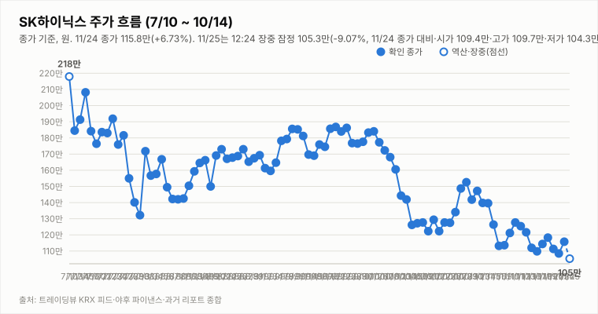
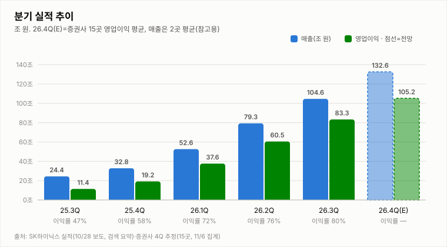
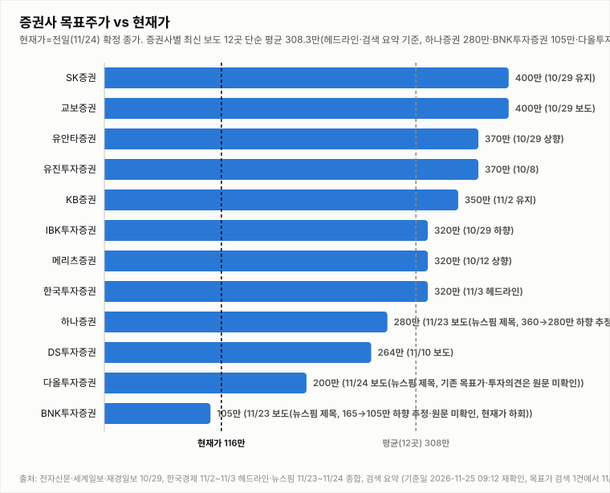
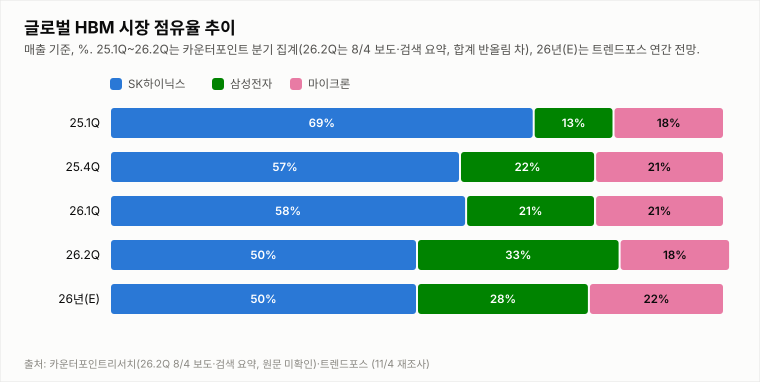

# SK하이닉스 투자 리포트 — 2026-11-25 (수) 장중 업데이트 (10:44, 10:24 지연 시세)

> **작성** 2026-11-25 10:44 KST · **확정 판정: 중립(v2, 11/24 종가 기준) · 장중 잠정: 점수 0·위험 극단·비중 배수 0.63** · 전일 종가 115.8만원(+6.73%)은 `quote.json`(marketTime 11/24 15:30 KST) 확정이며, 오늘 시세는 야후 `quote.json` 10:24 기준 20분 지연 값(확정 아님)입니다. 간밤 지표는 night.yml 11/25 08:04 스냅샷이며 외국인·기관 수급과 美 반도체 하락 원인 보도는 검색 결과·제목 기준으로 원문 미확인, 증권사 수치는 헤드라인·검색 요약 기준입니다. 확정 판정은 종가 기준으로만 변경합니다.

> **종목** SK하이닉스 (KRX 000660 · NASDAQ 상장 7/10)
> 본 자료는 정보 제공 목적이며 투자 권유가 아닙니다.

## 핵심 요약

- **투자의견: 확정 판정 중립(v2) 유지, 장중 잠정 점검** — 확정 판정은 11/24 종가 기준 중립(전략 점수 0·위험 높음·확신도 낮음)입니다. 10:44 데이터(10:24 지연 시세)로 같은 로직을 임시 적용하면 전략 점수 0(중립), 위험 레짐 극단(10일 변동성 4.8%·20일 고점 대비 -29.9%), 비중 배수 0.63입니다(확정 판정과 같은 요인 값입니다.) 위험 레짐은 확정(높음)과 달리 극단로 잠정 계산되었으나 이는 장중 가격과 10:24 일봉이 반영된 임시 값이며 종가에서 다시 판정합니다. 현재가는 전일 확정 종가 대비 -7.69%이고 방향 점수(F1~F5)는 바뀌지 않아 점수는 확정 판정과 같습니다. 20일 창에는 오늘까지 10/29 고점(152.6만)이 남아 있어(11/26에 빠짐, 아침 리포트의 ‘오늘 롤오프’ 표기는 하루 빨랐던 오류로 정정) 현재가 106.9만은 고점 대비 약 -29.9%로 극단 기준(-25%)을 넘어섭니다(가격 하락 효과; 147.2만 기준으로도 -27.4%). F3는 중앙 보도일 기준가(147.2만) 대비 -27.4%라 낡음 처리(0)가 유지됩니다. 외국인 순매도(09:22 기준 코스피 4,206억원, 매체 집계)는 F5 마감 재평가 근거로 기록하고, 엔비디아 조사 보도(F4)·DRAM 상승폭 둔화(F2)와 함께 장중 값을 바꾸지 않습니다. 장중 가격 변화는 방향 점수(F4 정책 리스크·F5 외국인 수급)를 바꾸지 못하고 위험 레짐·비중 배수와 F3(목표가 신선도 규칙)만 움직일 수 있으며, 판정은 종가에서만 확정합니다. 매수 전환은 F4·F5가 함께 0 이상, 매도 전환은 F1 또는 F2가 -1일 때입니다.
- **11/25 장중(10:24 지연 시세)** — 시가 109.4만(11/24 종가 대비 -5.53%)·고가 109.7만(-5.27%)·저가 105.9만(-8.55%), 현재 106.9만(**-7.69%**), 거래량 92.3만주(개장 84분 누적이라 20일 평균 대비 비교 의미 작음). 직전 확정(11/24 15:30, 115.8만)보다 -8.9만원(-7.7%), 저가 대비 +0.9%·고가 대비 -2.6% 위치입니다. 시가 109.4만(-5.53%)은 야간선물(-4.56%)보다 큰 갭다운이었고 이후 저가 105.9만(-8.55%)까지 밀려 고가 대비 -2.6%, 저가 대비 +0.9% 위치입니다. 같은 시각(10:44 수집) 코스피 4,780.51(-4.50%, 저가 4,740.70)·코스닥 655.20(-1.60%)·삼성전자 174,500(-7.87%)이고 주간 12월물 734.40(-5.62%, 10:23)입니다. 코스피는 09:08께 5% 넘게 빠지며 매도 사이드카가 발동됐고 09:22 기준 외국인 4,206억원·기관 554억원 순매도였습니다(복수 매체 보도). 원인은 WHY 섹션을 참조하세요.
- **11/24 확정 종가 115.8만(+6.73%)** — 시가 121.2만(11/23 종가 대비 +11.71%)·고가 121.2만(+11.71%)·저가 115.8만(+6.73%), 종가는 시가보다 -5.4만원(-4.5%) 낮고 일봉 저가와 같으며 전일 대비 +7.3만원·고가 대비 -4.5% 위치입니다(시가가 곧 고가, 종가가 곧 저가인 하락 장대음봉 형태). 거래량 329.2만주(20일 평균의 0.85배, 야후 quote.json 15:30 확정이며 트레이딩뷰 15:53 수집값과 일치)로 11/23(0.99배)보다 소폭 줄었습니다. 09:24 118.0만(+8.76%) → 10:24 120.0만(+10.60%) → 11:24 117.6만(+8.39%) → 12:24 117.0만(+7.83%) → 13:24 118.3만(+9.03%) → 14:24 117.3만(+8.11%) → 종가 115.8만(+6.73%)(14:24까지는 20분 지연 시세)로 오전에 갭업 폭 +11.71%에서 시작해 장중 저가 116.1만(+7.01%)과 10:24 120.0만을 오간 뒤 점심 이후 117만대 횡보, 마감 동시호가에서 14:24 시점(+8.11%)보다 -1.3% 더 내려 일봉 저가를 새로 썼습니다. 야간선물(+7.06%) 갭보다 시가 갭(+11.71%)이 컸지만 종가 등락률(+6.73%)은 야간선물 수준에 가까워졌고, 코스피 +6.32%(5,006.03, 14:44 5,055.23에서 마감 동시호가 하락)·코스닥 +4.79%·삼성전자 +6.70%와 비슷한 폭입니다. 수급: 오늘 외국인·기관 확정 금액은 확인하지 못했습니다. 원인은 WHY 섹션을 참조하세요.
- **간밤 변수·개장 전 헤드라인**: 11/24(화) 미국장에서 반도체가 전일 폭등분을 되돌렸습니다(night.yml 11/25 08:04 스냅샷, 일부 종목은 시간외 값이 섞였을 수 있음). SOX -7.88%(8,832.50, 장중 8,658~9,198)·나스닥 -1.48%(23,733.54)·S&P500 -0.50%(7,201.09)·VIX 26.36(-0.98%)였고, 마이크론 -11.01%(629.79달러)·AMD -8.86%·엔비디아 -5.86%(155.38달러)·브로드컴 -3.98%·퀄컴 -0.25%·SK하이닉스 ADR -9.90%(111.98달러)·EWY -3.70%(130.70달러), 원/달러 1,340.4원(보합)입니다. 빅테크는 애플 +1.43%·MS +0.74%가 오르고 알파벳 -1.08%·아마존 -1.21%·메타 -1.30%·테슬라 -0.20%로 혼조여서 반도체 업종에 집중된 하락이었습니다. 코스피200 야간선물은 742.60으로 주간 종가(네이버 15:35 778.10) 대비 -4.56%(06:00 야간 종가, 야간 장중 731.35~769.95, 08:04 수집·night_futures_valid true, 야간 세션 값인지 첫 실측 검증 진행 중)입니다. 11/23에는 야간선물보다 실제 갭이 작았고(-7.01% 신호 대비 -3.05%) 11/24에는 더 컸어(+7.06% 대비 +11.71%) 신호 대비 갭 폭은 일정하지 않습니다. 헤드라인(제목·검색 요약만 확인, 원문 미열람): Yahoo Finance·Benzinga·Bloomingbit·CNBC 제목은 11/24 반도체 하락을 전일 젠슨 황 복귀 랠리의 되돌림·차익 실현으로 전했고, Benzinga 제목은 ‘엔비디아 조사(scrutiny)가 칩메이커를 강타’, CNBC 제목은 앤트로픽 주가가 공모가를 밑돌았다고 전했습니다. 한국경제(11/25 07:45)는 한화투자증권이 SK하이닉스 Y1 발주 시작으로 소부장 새 성장 사이클을 전망했다고, 더트래커(07:03)는 삼성전자·SK하이닉스의 美 광 인터커넥트 기업 아비세나 투자를 전했습니다.
- **지표(11/25 10:24 지연 시세 포함, 야후 일봉 기준)**: DMI 격차 -13.3(+DI 21.8 < -DI 35.1, 11/24 종가 -6.6), KDJ K 20.8·D 22.7(격차 -1.9, 중립 구간, K<D, 11/24 종가 +2.9), MACD 히스토그램 +0.02만(시그널 위, 0선 아래; 11/24 종가 +0.21만), ATR 9.90만(9.3%). 오늘 거래량은 개장 84분 누적 92.3만주로 장중 잠정이며 20일 평균(390.5만주) 대비 비교는 의미가 작습니다.

<!--CAUSE:START-->
## 주간 변동 원인 분석 — 국내·해외·미국 빅테크 (11/2~11/6 주간 + 주말 점검, 기준 2026-11-25(수) 10:44 KST (10:24 지연 시세))

**한 줄 결론** — 11/24(화) SK하이닉스는 11/23 밤 美 폭등(젠슨 황 복귀)을 하루 늦게 반영해 +11.71% 갭업했다가 마감 동시호가에서 저가 마감해 +6.73%(115.8만)로 갭 폭의 약 43%를 반납했고(반납 원인은 차익 실현 추정, 확신도 낮음), 11/24 밤 美장에서는 반도체가 전일 폭등분을 되돌려 SOX -7.88%·마이크론 -11.0%·엔비디아 -5.9%·ADR -9.9%로 내렸습니다. 나스닥 -1.48%·S&P500 -0.50%에 그치고 애플·MS가 올라 반도체에 집중된 하락이며, 복수 매체 제목은 젠슨 황 복귀 랠리 후 차익 실현을 공통 원인으로 들었습니다(확신도 중간; 엔비디아 조사·관세 보도는 단일 출처라 낮음). 야간선물 -4.56%로 오늘 한국장은 갭다운 신호이나 11/24 마감 동시호가에서 이미 일부 선반영됐을 가능성도 있습니다(추정, 확신도 낮음). 개장 후 SK하이닉스 시세는 확인하지 못했습니다. 11/25(수) 장중 시가 109.4만(-5.53%) 갭다운 후 10:24 106.9만(-7.69%)이며 코스피 매도 사이드카(09:08)·외국인 순매도 속에 코스피 -4.50%·삼성전자 -7.87%입니다(확정 아님).

> 방법: 한국 시장(코스피·외국인 수급·사이드카) + 해외 시장(미국 지수·반도체·빅테크·VIX) + 국내외 뉴스를 교차해 사건을 시간순으로 놓고, 수치가 복수 출처에서 일치하면 ‘높음’, 매체의 해석이면 ‘중간’, 정황 추정이면 ‘낮음’으로 표시합니다. 수치는 트레이딩뷰 실측(night.yml 2026-11-10 08:04 KST 수집)과 검색 요약 보도를 병기했으며, 원인 기사는 요약 기준이라 원문 확인이 필요할 수 있습니다.

**① 시장 현황**

| 종목·지수 | 11/23(월) | 11/24(화) | 주간 | 11/25(수) 장중 |
|---|---|---|---|---|
| **한국 시장 (KRX 정규장, 해당일 15:30 마감)** | | | | |
| 코스피 | -3.31% | +6.32% | -0.04% | -4.50% |
| 코스닥 | -1.58% | +4.79% | +1.38% | -1.60% |
| SK하이닉스 | -2.52% | +6.73% | +5.46% | -7.69% |
| 삼성전자 | -3.06% | +6.70% | -1.04% | -7.87% |
| **미국 지수·변동성 (美 정규장, 11/23·11/24 현지 마감)** | | | | |
| 나스닥 | +6.51% | -1.48% | -3.24% | — |
| S&P500 | +4.73% | -0.50% | -2.83% | — |
| 필라델피아 반도체(SOX) | +14.03% | -7.88% | -8.93% | — |
| VIX (11/24 종가 26.36) | -25.83% | -0.98% | +14.06% | — |
| **미국 AI 반도체·메모리 (공급 측)** | | | | |
| 마이크론(MU) | +19.04% | -11.01% | -13.28% | — |
| 엔비디아(NVDA) | +31.48% | -5.86% | -0.97% | — |
| AMD | +6.85% | -8.86% | -19.30% | — |
| 브로드컴(AVGO) | +3.00% | -3.98% | -10.28% | — |
| 퀄컴(QCOM) | +10.30% | -0.25% | -2.45% | — |
| SK하이닉스 ADR(SKHY) | +20.00% | -9.90% | -9.32% | — |
| 한국 ETF(EWY) | +10.11% | -3.70% | -4.00% | — |
| **미국 빅테크 (수요 측·플랫폼)** | | | | |
| 애플(AAPL) | +1.90% | +1.43% | +0.35% | — |
| 마이크로소프트(MSFT) | +1.65% | +0.74% | -3.58% | — |
| 알파벳(GOOGL) | +6.34% | -1.08% | -1.53% | — |
| 아마존(AMZN) | +3.47% | -1.21% | -2.04% | — |
| 메타(META) | +6.55% | -1.30% | -5.51% | — |
| 테슬라(TSLA) | +11.46% | -0.20% | +0.65% | — |

> 주간=트레이딩뷰 Perf.W(한국은 11/24 종가 기준 1주 변동, 미국은 11/24 현지 종가 기준 1주 변동)이며 보도의 주간 수치와 기준 시점 차이로 다를 수 있습니다. 한국 11/24 열은 15:30 확정 마감입니다. 미국 11/24 열은 night.yml 11/25 08:04 수집으로 SOX·나스닥은 네이버 종가와 일치하지만 일부 종목은 시간외 값이 섞였을 수 있습니다. 한국장은 미국장보다 먼저 열려 11/24 한국장은 11/23 밤 美 폭등을, 오늘(11/25) 한국장은 11/24 밤 美 반도체 되돌림을 반영합니다.

**② 원인 사슬 — 최근 5건 요약**

| 시점 | 핵심 | 확신 |
|---|---|---|
| 11/24(화) 06:00~09:10 韓 | 야간선물 +7.06%(777.95) 갭업 신호, 프리마켓 SK하이닉스 +12%·코스피 +3.64% 개장(제목) | 수치 높음 · 보도 중간 |
| 11/24(화) 장중~마감 韓 | 시가 121.2만(+11.71%)=고가 → 10:24 120.0만 → 117만대 횡보 → 종가=저가 115.8만(+6.73%). 코스피 +6.32%, 수급 미확인 | 수치 높음 · 반납 원인 낮음 |
| 11/24(화) 밤 美 | SOX -7.88%·마이크론 -11.0%·엔비디아 -5.9%·ADR -9.9%, 나스닥 -1.48%·애플·MS 상승 — 젠슨 황 랠리 후 반도체 차익 실현(제목 공통) | 수치 높음 · 원인 중간 |
| 11/25(수) 06:00~09:10 韓 | 야간선물 -4.56%(742.60) 갭다운 신호, 한화 ‘Y1 발주·소부장 사이클’(제목), 개장 시세 미확인 | 수치 높음 · 개장 반응 미확인 |
| 11/25(수) 장중 10:24 韓 | 09:08 코스피 매도 사이드카·외국인 4,206억 순매도(09:22) → 10:24 106.9만(-7.69%), 저가 105.9만 | 수치 높음 · 원인 중간(美 반도체 되돌림+외국인 매도) |

_이전 사슬 37건과 항목별 상세 근거는 웹페이지의 펼치기 또는 docs/cause_analysis.json 참조._

**③ 원인 순위 — 최근 일별 원인과 주간 구조 원인**

| 구분 | 원인 | 확신 |
|---|---|---|
| 오늘 | 美 반도체 되돌림+외국인 4,206억 순매도(09:22)·코스피 사이드카 → 106.9만(-7.69%) | 중간 · 수급 수치는 매체 집계 |
| 11/24 | 美 반도체 폭등(젠슨 황 복귀) 하루 늦은 반영으로 +11.71% 갭업 → 차익 실현·마감 매도 추정으로 +6.73% 마감 | 갭업 높음~중간 · 반납 낮음 |
| 구조 1 | 미국 AI 반도체 투매의 한국 전이 | 높음 |
| 구조 2 | 외국인 대규모 순매도(프로그램·선물 연쇄 포함) | 높음 |
| 구조 3 | 트리거: 중간선거 후 AI 데이터센터 규제·투자 둔화 우려 | 중간 |
| 구조 4 | 메모리·AI 하드웨어 쏠림 해소(고베타) | 중간 |
| 구조 5 | 개별 악재 중첩 | 중간~낮음 |
| 구조 6 | 심리·거시: 조정장 진입과 긴축 베팅 | 낮음 |

**④ 분석 판단 (추정 포함)**

- 이번 하락은 ‘이익 전망 하향’보다 ‘멀티플·수급 충격’의 성격이 강하다고 판단합니다(추정). 근거: 같은 기간 4Q26 영업이익 증권사 추정치(15곳 평균 105.2조)와 TrendForce 4Q 계약가 전망은 하향 보도가 확인되지 않았고, 하락률이 업종 베타 순서(메모리 > 파운드리·GPU > 빅테크 플랫폼)와 일치합니다.
- 공급 측(반도체)만 크게 빠지고 수요 측(MSFT·GOOGL·AMZN)은 버틴 구도는 ‘AI 투자 속도 둔화·규제’ 해석과 정합적이지만, 이 구도만으로 AI 투자 계획이 실제로 줄었다고 단정할 수 없습니다(CAPEX 하향 보도 없음).
- 한국장이 美장보다 먼저 열리는 시차 때문에 한국 낙폭에는 美 투매가 하루 늦게 합산됐고(11/5·11/6), 11/6 美 반등은 11/9 한국장에 반영됩니다.
- 11/9 美 반등 신호에도 외국인 순매도에 상승분을 반납했던 SK하이닉스가 11/10에는 외국인 순매수 전환과 함께 +6.69%로 마감해, 가격 신호보다 수급 방향이 반등 지속성을 가른다는 이번 주 해석(추정, 확신도 중간~높음)이 두 거래일 연속 지지됐습니다. 다만 외국인 순매수는 하루뿐이고 5거래일 누적은 대규모 순매도라 추세 전환으로 단정할 수 없으며, 개인이 1조원 넘게 순매도한 점도 반등의 질을 가르는 변수입니다(추정).
- 11/10 美 조정의 중심이 엔비디아 개별 악재와 금리(CPI) 변수여서 SOX 낙폭(-0.35%)은 작았습니다. SK하이닉스 ADR(-3.51%)과 야간선물(-1.74%)이 엔비디아 낙폭보다 작은 점은 한국 메모리 대표주가 엔비디아 개별 이슈에 덜 민감하다는 해석(추정, 확신도 낮음)과 정합적이지만, 금리 인상 우려가 이어지면 고베타 성장주 전반의 멀티플 부담이 커질 수 있어 외국인 수급이 핵심 변수입니다.
- 11/11 한국장은 美 악재 신호(야간선물 -1.74%·ADR -3.51%)와 반대로 갭다운 후 반전해 마감해, 해외 가격 신호보다 국내 저가 매수·수급이 우세했다는 정황입니다(추정, 확신도 낮음~중간). 코스닥 +5.62%·삼성전자 +3.57%가 함께 올라 종목 고유 재료보다 시장 전반의 반등이 중심으로 보이지만, 투자자별 수급 수치를 확인하지 못해 단정할 수 없습니다.
- 11/10 CPI 쇼크로 눌렸던 엔비디아(-5.47%)가 +2.87% 반등하고 마이크론이 +11.89%로 더 크게 오른 점은 메모리 고베타 패턴과 일치합니다(추정, 확신도 낮음). 어제 한국장이 美 약세 신호를 거슬러 올랐다는 점은 국내 수급 우위 가설을 지지하지만, 오늘 갭업은 美 신호와 같은 방향이라 두 해석을 구분해서 봐야 합니다.
- 11/12 한국장은 美 반도체 급등 신호(야간선물 +1.96%·ADR +9.71%)와 같은 방향으로 출발했지만 오전 고가(131.0만) 이후 오후에 하락 전환해, 해외 신호보다 국내 수급·차익 실현이 오후 흐름을 좌우했다는 정황입니다(추정, 확신도 낮음). 어제까지 이틀 +12% 급반등으로 선반영됐고 130만대(11/4 저가 130.3만 부근) 매물에 막혔다는 해석이 가격 패턴과 맞지만, 삼성전자(+0.97%)와의 상대 약세 원인은 확인하지 못했습니다.
- 11/12 한국장은 美 급등 신호와 야간선물(+1.96%)을 거슬러 오후에 하락 전환했고 삼성전자(+0.97%)와의 상대 약세가 뚜렷했습니다. 연합뉴스 헤드라인(제목만 확인)이 외국인의 삼성전자 매수·SK하이닉스 매도를 전해, 간밤 약보합 속에서도 외국인의 종목 간 이동이 오늘 SK하이닉스 상대 약세를 이어갈 가능성이 있습니다(추정, 확신도 낮음). 다만 금액은 확인하지 못했습니다.
- 11/12·11/13 이틀 연속 SK하이닉스는 오전 강세 후 오후에 하락했고, 두 날 모두 외국인의 SK하이닉스 매도·삼성전자 매수 헤드라인이 있었습니다(11/12 약 8,700억원 순매도·약 9,200억원 순매수는 제목 기준, 11/13 수치는 확인 불가). 엔비디아 CEO 사임 이슈(SEC 8-K 표기와 CNBC·Forbes·Yahoo Finance 제목·요약으로 복수 확인, 원문 미열람)가 주말 사이 어떻게 소화되는지가 월요일 갭의 변수입니다(추정, 확신도 낮음).
- 금요일 한국장은 야간선물 +0.78%·美 약세(ADR -3.19%)와 반대로 갭업했다가 -3.03%로 마감했고, 오늘은 美 반도체 급락(SOX -3.43%)과 야간선물 +0.16%가 다시 엇갈립니다. 개장 직후 값의 신뢰가 낮아 갭 방향보다 종가 안착 여부가 중요합니다(추정, 확신도 낮음). 외국인 순매매 확정 수치는 확인하지 못했습니다.
- 11/16은 11/13 美 반도체 급락의 후속 반영과 엔비디아 CEO 사임 이후 불확실성이 겹친 하락입니다. 엔비디아 실적(회사 보도자료 제목·검색 요약상 11/17 美장 마감 후, 한국시간 11/18 아침)이 다음 변수라 11/17 한국장은 실적 앞 경계와 반등 시도가 엇갈릴 가능성이 있습니다(추정, 확신도 낮음). SK하이닉스 낙폭이 코스피·삼성전자보다 컸던 이유는 외국인 개별 수급 확인 전까지 가설입니다.
- 모건스탠리 목표주가 38% 하향(조선일보 제목)은 한국경제 요약상 투자의견 비중확대를 유지하고 2029년 이후 영업이익률 전망을 낮춘 장기 가정 변경이라 4Q26 단기 이익추정(F1)을 직접 낮춘 근거로 보기 어렵습니다(추정, 확신도 낮음, 절대값·보도일 확인 불가, 마감 때 재평가). 美 D램 담합 소송 기각 요청 거부(조선비즈·뉴스핌 제목)는 F4 법적 리스크 후보이나 법원 결정 원문은 확인하지 못했습니다.
- 11/17은 11/16 美 반도체 추가 급락의 후속 반영과 엔비디아 실적 앞 경계가 겹친 약세 마감입니다. 다음 변수는 엔비디아 실적(회사 발표 제목·검색 요약 단일 출처상 11/17 美장 마감 후, 한국시간 11/18 오전 7시경)이라 11/18 한국장은 실적 반응에 따라 갭 방향이 갈릴 가능성이 큽니다(추정, 확신도 낮음). SK하이닉스 낙폭이 코스피·삼성전자보다 작았던 이유는 외국인 개별 수급 확인 전까지 가설입니다.
- 11/18은 엔비디아 실적 호조라는 이벤트 호재가 오전에 외국인 매수 축소·연기금 매도로 반납됐다가 오후 기관 매수로 되돌려진 날입니다. 11/12·11/17의 ‘오전 반등 후 오후 반납’과 경로는 달랐지만 반등을 이끈 주체가 외국인이 아니라 기관이었다는 점은 지속성에 불확실성을 남깁니다(추정, 확신도 중간). 다음 변수는 11/18 밤 美장의 엔비디아 실적 후 반응과 외국인 순매도 지속 여부입니다. 낸드 현물가 20% 하락(글로벌이코노믹 11/18 14:15)·AI칩 지출 전망 40% 하향(11/18 03:35) 제목은 원문 확인 전까지 가설입니다.
- 11/18 마감 수급(외국인 약 -3,300억원·기관 약 +5,100억원)이 복수 매체 제목·검색 요약으로 확인돼 13:48의 ‘외국인 수급 복귀’ 추정이 틀렸음을 확정했고, 반등 주체가 기관이라 지속성은 외국인 순매도 지속 여부에 좌우될 가능성이 큽니다(추정, 확신도 중간). 엔비디아가 호실적에도 하락한 것은 호재 소멸 성격이라 11/19 한국 반도체는 야간선물 신호대로 약세 출발할 수 있으나 ADR 보합이 일부 상쇄합니다(추정, 확신도 중간~낮음).
- 11/19는 간밤 약세 신호(엔비디아 -2.89%·야간선물 -1.41%)가 오전에는 맞았지만(저가 -2.53%) 오후 이후 시장 전체의 마감 직전 반전(코스닥 +3.32%·코스피 종가=고가)이 SK하이닉스를 +3.41%로 끌어올린 날입니다. 11/12·11/17의 ‘오전 반등 후 오후 반납’, 11/18의 ‘오전 반납 후 오후 반등’에 이어 장중 방향이 다시 뒤집혔고, 거래량이 20일 평균의 0.66배에 그쳐 상승의 지속성에는 불확실성이 남습니다(추정, 확신도 낮음). 다음 변수는 11/19 밤 美장 반응과 외국인 순매도 지속 여부입니다.
- 11/19는 간밤 약세 신호(엔비디아 -2.89%·야간선물 -1.41%)에도 시가가 +0.87%였고 오전에는 신호대로 -2.53%까지 밀렸다가 마감 직전 시장 전체 반전으로 +3.41% 마감했습니다. 외국인 매도 속의 거래량 없는 반등(20일 평균의 0.66배)이라 지속성이 약하다고 보며(추정, 확신도 중간~낮음), 간밤 美장이 장 초반 상승을 모두 반납하고 급락해 오늘 한국장은 11/19 막판 상승분의 상당 부분을 되돌릴 가능성이 있습니다(확률 관점, 가격 예측 아님).
- 11/20은 간밤 美 급락과 야간선물 -3.66% 신호가 한국장에 그대로 반영된 날입니다. 앤트로픽 상장 이후 AI 트레이드 매도가 아시아 전체로 번져 코스피가 -5.21%로 11/5~11/6 이후 가장 큰 낙폭 수준을 기록했고(제목·검색 요약 기준 해석, 확신도 중간), SK하이닉스는 거래량이 늘며(20일 평균의 0.80배) 저가 대비 1.5% 만회했지만 11/19 막판 상승분은 대부분 반납했습니다. 이번 주(11/16~11/20) SK하이닉스는 11/17 종가(109.8만) 부근을 두 번째로 시험했고, 종가 위에서 마감했으나 저가가 일시 이탈한 점은 지지 약화의 단서입니다(추정, 확신도 낮음~중간). 다음 변수는 11/20 밤 美장과 외국인 순매도 지속 여부이며, 위험 레짐이 극단이라 월요일 변동성에 유의해야 합니다.
- 11/20 한국장은 간밤 약세·야간선물 신호대로 갭다운 후 저가 대비 1.6% 만회하며 마감했으나 11/20 밤 美장은 SOX -10.73%로 더 크게 급락해, 11/20의 선반영 -5.92%만으로는 부족할 가능성이 있다고 봅니다(추정, 확신도 중간; 반증: 외국인 순매수 전환·美 선물 반등). 위험 레짐이 극단이라 변동성은 매우 크며, 확정 판정(v2 중립)은 오늘 종가에서만 바뀝니다(확률 관점, 가격 예측 아님).
- 11/24는 11/23 밤 美 반도체 폭등(SOX +14.03%·엔비디아 +31.48%, 젠슨 황 복귀)을 하루 늦게 반영해 시가 +11.71% 갭업했으나 시가가 곧 고가였고 종가는 저가와 같은 115.8만(+6.73%)으로 갭 폭의 약 43%를 반납했습니다(수치). 반납의 원인은 수급 미확인이라 차익 실현·마감 매도 추정(확신도 낮음)이며, 위험 레짐은 높음으로 낙폭 기준(-25%)과 여유 0.9%p에 불과해 변동성에 유의해야 합니다. 11/25은 11/24 밤 美장·외국인 수급·10/29 고점 롤오프(11/26)가 변수이며 반등의 지속성은 확인되지 않았습니다(확률 관점, 가격 예측 아님).
- 11/24 밤 美 반도체는 젠슨 황 복귀 랠리의 상당 부분을 되돌렸고(SOX +14.03%→-7.88%) 반도체에 집중된 하락이라 AI 반도체 쏠림 해소·차익 실현 국면이 이어지는 것으로 보입니다(추정, 확신도 중간). 오늘 한국장은 갭다운 신호지만 11/24 마감 동시호가 약세로 일부 선반영됐을 수 있고, 위험 레짐은 오늘까지 10/29 고점(152.6만) 기준이라 종가 약 114.5만 아래면 극단으로 돌아가고 10/29 고점은 11/26에 창에서 빠집니다(아침의 ‘오늘 롤오프’ 표기 정정)(확률 관점, 가격 예측 아님; 11/25 종가 확정에서 F2·F4·F5 재평가).

**⑤ 아직 모르는 것과 반증 조건**

- ‘AI 규제’의 실제 입법·행정 조치는 보도되지 않았습니다(발언·청문 가능성 수준) → 의회 일정과 후속 보도가 나오면 3순위 원인의 확신도를 조정합니다.
- 엔비디아 -4.27%의 배경인 젠슨 황 관련 이사회 조사 보도는 검색 요약 기준이며 원문·사실관계는 확인하지 못했습니다. 퀄컴 가이던스 수치, 마이크론 대만 HBM 공장 건설 중단 보도(제목만 확인)의 범위·사유도 확인하지 못했습니다.
- 11/10 외국인·기관·개인 순매매 금액은 마감 보도(코스피 기준 외국인 약 +3,532억·기관 약 +4,980억·개인 약 -1조3,396억원) 기준이며 KRX 확정 집계와 다를 수 있고, 선물·프로그램 매매 비중은 확인하지 못했습니다.
- CPI 수치(+0.4%·근원 +0.3%)와 월러 이사 발언, 미 10년물 4.99%는 복수 매체 요약 기준이며 BLS 원문과 발언 원문은 확인하지 못했습니다. 엔비디아 급락의 원인(젠슨 황 관련 스캔들·대중 수출 규제 우려)도 매체 해석입니다.
- 11/16 외국인·기관·개인 순매매 확정 금액과 SK하이닉스 개별 수급은 확인하지 못했습니다. 모건스탠리 목표주가(절대값·보도일), 美 법원 D램 담합 소송 결정 원문, 美 AI 칩 수출 규제 강화 보도의 원문, 엔비디아 CEO 사임 보도의 원문은 열람하지 못했습니다. 11/16 마감 거래량은 야후 465만주와 트레이딩뷰 403만주(15:54)·415만주(20:08)로 소스 간 차이가 있습니다.
- 11/17 외국인·기관·개인 순매매 확정 금액과 SK하이닉스 개별 수급은 확인하지 못했습니다. 엔비디아 3Q 실적의 수치·가이던스·시간외 반응, 전남일보 11/17 09:38 제목의 본문, 美 D램 담합 소송 결정 원문은 열람하지 못했습니다. 11/18 개장 직후 SK하이닉스 개별 시세는 지연으로 확인하지 못했습니다.
- 11/18 SK하이닉스 외국인 -346억원은 단일 검색 요약이며 기관·개인의 SK하이닉스 개별 수급과 마감 확정 투자자별 표는 열람하지 못했습니다. 엔비디아 실적 원문(매출 1,158억 4,000만달러·시장 예상 1,091억달러)·CNBC/서울경제 하락 원인 기사 본문·글로벌이코노믹 낸드 현물가·세미애널리시스 제목의 본문, 11/19 개장 후 SK하이닉스 시세는 확인하지 못했습니다.
- 11/20 외국인·기관·개인 순매매 마감 확정 금액과 SK하이닉스 개별 수급은 11/23 점검 검색에서도 확인하지 못했고, 한국경제 11/20 17:52 제목(개인 1.5조원 매수)·이투데이 주간수급 검색 요약(외국인 주간 약 4.5조원 순매도)만 확인했습니다(원문 미열람). SEC 엔비디아 조사·대중국 AI 칩 수출통제 강화·F4 긴급 회의·하나증권 280만원의 원문과 사실관계, 11/20 밤 美장 지수 마감 수치 외 원인은 검증하지 못했습니다.
- 11/25 SK하이닉스 개장 시세와 외국인·기관·개인 수급, 11/24 확정 수급은 확인하지 못했습니다. 11/24 美 반도체 하락의 엔비디아 조사·SEC 조사·관세 보도는 단일 출처·원문 미열람이며, TrendForce DRAM 1Q27 수치와 10월 말 DRAM 보고의 정확한 발표일, 하나증권·BNK투자증권·다올투자증권 목표가 원문은 열람하지 못했습니다.
- 반증 조건: 개장 갭이 야간선물(-4.56%)보다 훨씬 작고 외국인이 순매수면 ‘11/24 마감 선반영’ 해석이 강해지고, 엔비디아 조사 등 구체적 악재가 확인되거나 외국인 순매도가 커지면 위험회피 재개 해석이 강해집니다.
- 11/25 장중 외국인 순매도는 09:22 기준(4,206억원, 매체)만 확인했고 이후 누적 규모와 SK하이닉스 종목별 수급은 확인하지 못했습니다.

**⑥ 다음 거래일 시사점** — 오늘(11/25, 수) 한국장은 11/24 밤 美 반도체 되돌림을 반영해 시가 109.4만(-5.53%)으로 갭다운했고 코스피 매도 사이드카(09:08)·외국인 순매도 속에 10:24 현재 106.9만(-7.69%)입니다. 104.4만(11/23 저가) 지지와 외국인 수급이 핵심이며 확률 관점으로만 봅니다(가격 예측 아님). 확정 판정(v2)은 11/24 종가 기준 중립 유지이며 다음 확정은 오늘 종가입니다.

출처: [CNN 11/5](https://www.cnn.com/2026/11/05/investing/tech-heavy-nasdaq-plunges) · [CNBC 11/5](https://www.cnbc.com/2026/11/05/qualcomm-earnings-chip-stocks-election.html) · [Fox Business 11/5](https://www.foxbusiness.com/markets/stocks-nov-5-2026) · [Yahoo Finance 11/6 마감](https://finance.yahoo.com/markets/live/stock-market-today-friday-november-6-dow-sp-500-nasdaq-jobs-report-earnings-135953863.html) · [Yahoo 칩 반등](https://finance.yahoo.com/markets/article/nvidia-amd-micron-sandsik-lead-chip-sector-higher-134336542.html) · [UPI 11/6](https://www.upi.com/Top_News/US/2026/11/06/nasdaq-rebounds-tech-stocks/5901794005326/) · [파이낸셜뉴스 11/6](https://www.fnnews.com/news/202611060834515879) · [SBS Biz 11/6](https://biz.sbs.co.kr/article/20000344723) · [헤럴드경제 11/5](https://biz.heraldcorp.com/article/10927440) · [디지털데일리 11/6](https://www.ddaily.co.kr/page/view/2026110615524945049) · [아시아투데이 11/6](https://www.asiatoday.co.kr/kn/view.php?key=20261106010002606) · [StockTwits 마이크론·규제](https://stocktwits.com/news-articles/markets/equity/micron-hits-3-month-low-amid-chip-rout-after-top-democratic-lawmaker-calls-for-ai-regulation-pause-in-development/cNG14kWR9Eh) · [Reuters 인용(Devdiscourse)](https://www.devdiscourse.com/article/international/4001686-us-stocks-wall-street-rallies-after-democrats-win-congress-data-center-stocks-slide) · [글로벌이코노믹 11/9](https://www.g-enews.com/article/Securities/2026/11/202611091102167807923c501012_1) · [MoneyToday EN 11/9](https://www.mt.co.kr/en/stock/2026/11/09/2026110910110484191) · [헤럴드경제 11/9](https://biz.heraldcorp.com/article/10930383) · [이투데이 — 코스피 오후 상승폭 축소·외국인 매도 속 5100선 등락](https://www.etoday.co.kr/news/view/2645772) · [재경일보 — 외국인 10조원 매도에 코스피 5000선 급락·주간 11% 하락](https://news.jkn.co.kr/post/1079576) · [MoneyToday — Retail investors lift Samsung and SK hynix as ETF buying offsets 7-day foreign selling](https://www.mt.co.kr/en/stock/2026/11/09/2026110911301182528) · [Invezz — KOSPI today: Why South Korea's stock market rebounded above 5,100](https://invezz.com/news/2026/11/09/kospi-today-south-korea-stock-market-rebound/) · [Finimize — South Korea's KOSPI bounced back as chip stocks recovered](https://finimize.com/content/south-koreas-kospi-bounced-back-as-chip-stocks-recovered) · [아시아경제 — 힘 잃고 주저앉은 코스피…0.81% 하락한 5018 마감](https://view.asiae.co.kr/article/2026110916013525615) · [Businesskorea — 외국인·개인 ‘팔자’에 코스피 5,018선 턱걸이 마감](https://www.businesskorea.co.kr/news/articleView.html?idxno=280833) · [파이낸스투데이 — 코스피, 외국인 7일 연속 매도에 0.8% 또 하락](https://www.fntoday.co.kr/news/articleView.html?idxno=397349) · [Benzinga — Nasdaq Jumps 3%, Nvidia Lags Most Since DeepSeek](https://www.benzinga.com/markets/equities/26/11/63055270/stock-market-today-nasdaq-100-chip-rebound-nvidia-deepseek) · [TradingKey — Nasdaq extends gains 2.7%, SOX reclaims 10,000, Nvidia falls 4%](https://www.tradingkey.com/analysis/stocks/us-stocks/262297090-us-stock-nasdaq-dow-rise-anthropic-ipo-nvidia-spacex-tesla-tradingkey) · [서울신문 — 삼성전자 5%·SK하이닉스 7% 강세… 코스피 5272선 반등](https://www.seoul.co.kr/news/economy/securities/2026/11/10/20261110500048) · [필드뉴스 — [마감 시황] 코스피, 상승 마감…SK하이닉스·삼성전자 강세](http://www.fieldnews.kr/news/articleView.html?idxno=32980) · [위키트리 — 코스피 5239.13 마감…양 시장 모두 4%대 상승 마감](https://www.wikitree.co.kr/articles/1173455) · [진일보 — 삼성전자 20만원·SK하이닉스 120만원 탈환…반도체주 동반 급등](https://www.jnilbo.com/news/articleView.html?idxno=90000081130) · [와우TV — 美증시, 예상치 웃돈 10월 CPI에 일제히 하락](https://www.wowtv.co.kr/NewsCenter/News/Read?articleId=A202611110010) · [이투데이 — 뉴욕증시, 인플레 불안에 하락…유가 약세](https://www.etoday.co.kr/news/view/2646540) · [국제뉴스 — 젠슨 황 스캔들에 엔비디아 5.5% 급락…CPI 충격에 뉴욕증시 하락](https://www.gukjenews.com/news/articleView.html?idxno=3748330) · [블록미디어 — [뉴욕증시 마감] 예상보다 높은 10월 CPI, 엔비디아 5% 하락](https://www.blockmedia.co.kr/archives/1164156) · [헤럴드경제 — ‘빅스텝 올 수도’ 금리 우려에 뉴욕증시 또 충격](https://biz.heraldcorp.com/article/10932887) · [파이낸스투데이 11/12 '젠슨 황 해임 위기'에 발목 잡힌 코스피…5,342 마감](https://www.fntoday.co.kr/news/articleView.html?idxno=398004) · [인포스탁데일리(Investing.com) [1112마감체크] 젠슨 황 스캔들 여파에 반도체·금융 약세](https://kr.investing.com/news/stock-market-news/article-2172100) · [Businesskorea [마감 시황] 코스피·코스닥 동반 약세 5,340선](https://businesskorea.co.kr/news/articleView.html?idxno=281164) · [SEC EDGAR NVIDIA Form 8-K (검색 결과에 표기된 문서, 원문 미열람) — CEO 전환 공시](https://www.sec.gov/Archives/edgar/data/0001045810/000104581026000082/nvidiaannouncesceotransiti.htm) · [EBN 11/21(美 증시 급락, 검색 요약)](https://www.ebn.co.kr/news/articleView.html?idxno=1732544) · [뉴데일리 11/21(반도체지수 10% 폭락, 검색 요약)](https://www.newdaily.co.kr/site/data/html/2026/11/21/2026112150002.html) · [MTN 11/22(긴급 F4 소집, 제목)](https://news.mtn.co.kr/article/2026112215282149020) · [Motley Fool 11/20 midday(검색 요약)](https://www.fool.com/coverage/stock-market-today/2026/11/20/stock-market-midday-nov-20-nasdaq-plunges-nearly-3-as-amd-and-micron-lead-a-brutal-semiconductor-sell-off/) · [이투데이 주간수급리포트(검색 요약)](https://etoday.co.kr/news/view/2651100) · [EBN 11/23 마감(코스피 3.31% 급락 4708선, 검색 요약)](https://www.ebn.co.kr/news/articleView.html?idxno=1732707) · [뉴스핌 11/23(코스피 5%대 급락·매도 사이드카)](https://www.newspim.com/news/view/20261123000607) · [이투데이 11/23(매도 사이드카·오후 낙폭 축소·외인 팔자 전환)](https://www.etoday.co.kr/news/view/2651689) · [한국경제 11/20(코스피 4869 마감·외국인 1조2682억 순매도)](https://www.hankyung.com/article/202611200429i) · [SBS 11/24(젠슨 황 복귀 엔비디아 폭등, 검색 요약)](https://news.sbs.co.kr/news/endPage.do?news_id=N1008859898) · [헤럴드경제 11/24(나스닥 6.5% 급등)](https://biz.heraldcorp.com/article/10946814) · [CNBC 11/23(Tech stocks monster rally after Jensen Huang returns)](https://www.cnbc.com/2026/11/23/anthropic-nvidia-shares.html) · [서울파이낸스 11/24(코스피 개장 +3.64%, 제목)](https://www.seoulfn.com/news/articleView.html?idxno=643706) · [TrendForce 11/19(NAND 가격 전망 하향, 검색 요약)](https://www.trendforce.com/presscenter/news/20261119-13314.html) · [Yahoo Finance 11/24(Stock market today: chip sector tumbles, Nvidia falls 6%)](https://finance.yahoo.com/markets/live/stock-market-today-tuesday-november-24-dow-sp-500-nasdaq-chip-stocks-nvidia-140629923.html) · [Benzinga 11/24(Micron drops after Monday surge as Nvidia scrutiny hits chipmakers)](https://www.benzinga.com/markets/tech/26/11/63575386/micron-stock-drops-after-mondays-surge-as-nvidia-scrutiny-hits-chipmakers) · [Bloomingbit 11/24(Nvidia -5.9%, Micron -11% a day after Huang return rally)](https://en.bloomingbit.io/feed/news/125159)

<!--CAUSE:END-->

## 시세

**전일 확정 (11/24 화 15:30)**

| 시가 | 고가 | 저가 | 종가 | 등락 | 거래량 |
|---|---|---|---|---|---|
| ₩1,212,000 | ₩1,212,000 | ₩1,158,000 | **₩1,158,000** | **+6.73%** | 3,291,712주 |

출처: 야후 `quote.json`(marketTime 15:30 KST 확정)·트레이딩뷰 KRX 피드 15:53 수집 교차 확인(시가·고가·저가·종가·거래량 일치, 거래량은 확정 기록).

**오늘 장중 (11/25 수 10:24 지연 시세, 확정 아님)**

| 시가 | 고가 | 저가 | 현재가 | 등락 | 거래량 |
|---|---|---|---|---|---|
| ₩1,094,000 | ₩1,097,000 | ₩1,059,000 | **₩1,069,000** | **-7.69%** | 922,730주 |

출처: 야후 파이낸스 `quote.json`(20분 지연, 등락률은 11/24 확정 종가 기준). 거래량은 개장 84분 누적입니다.

## 기술적 지표 (11/25 10:24 지연 시세 포함 야후 일봉 기준, 장중 잠정)

| 지표 | 값 | 해석 |
|---|---|---|
| MACD (12,26,9) | -9.31만 / 시그널 -9.33만 / 히스토그램 **+0.02만** | 상승 모멘텀(MACD가 시그널 위·0선 아래) |
| ATR (14) | 9.90만 (9.3%) | 변동성 매우 큼 |
| ADX / DMI | ADX 24.1 · +DI 21.8 · -DI 35.1 | 격차 -13.3(-DI 우위, 11/24 종가 -6.6) |
| KDJ (9,3,3) | K 20.8 · D 22.7 · J 16.9 | 중립 구간, K<D(-1.9, 11/24 종가 +2.9) |
| 거래량 / 20일 이평 | 92.3만 / 390.5만 | 개장 84분 누적(장중 잠정, 비교 의미 작음) |

야후가 10/13 일봉을 정정 반영하면서 어제 리포트의 값(MACD 히스토그램 -3.59만·DMI -26.1)과 달라졌습니다.

종가 기준 격차 흐름: DMI 9/29 +1.6 → 9/30 +4.3 → 10/1 +2.2 → 10/2 +3.9 → 10/6 -0.8 → 10/7 -4.7 → 10/8 -7.9 → 10/12 -13.9(15:14 집계) → 10/13 -26.1(어제 리포트 기준) → 10/14 -25.9(종가 확정) → 10/15 -34.5(종가 확정·정정) → 10/16 -32.5(종가 확정) → 10/19 -33.2(종가 확정), KDJ 9/29 -8.4 → 9/30 -8.9 → 10/1 -5.2 → 10/2 -2.2 → 10/6 -8.2 → 10/7 -14.1 → 10/8 -15.1 → 10/12 -13.3(15:14 집계) → 10/13 -10.9(어제 리포트 기준) → 10/14 -8.4(종가 확정) → 10/15 -6.4(종가 확정·정정) → 10/16 -4.4(종가 확정) → 10/19 -1.8(종가 확정).

## 최신 뉴스 Top 5 (구글 뉴스 헤드라인 기준, 같은 사안은 1건만)

1. 🟢 **"SK하이닉스 Y1 발주 시작…반도체 소부장 '새 성장 사이클'"-한화** (한국경제, 11/25 07:45) · 한화투자증권이 SK하이닉스의 Y1 발주가 시작돼 반도체 소부장 업종에 ‘새 성장 사이클’이 온다고 본 한국경제 기사(11/25 07:45, 제목 기준, Y1이 가리키는 팹과 발주 규모는 확인 불가이며 🟢는 제목 키워드 기준 분류).
2. ⚪ **삼성전자·SK하이닉스. 美 광 인터커넥트 기업 '아비세나' 투자** (더트래커, 11/25 07:03) · 삼성전자와 SK하이닉스가 미국 광 인터커넥트 기업 아비세나에 투자했다는 더트래커 기사(11/25 07:03, 제목 기준, 투자 규모·지분은 확인 불가).
3. ⚪ **윤풍영 SK하이닉스 사장 자사주 1500주 매입…16억 규모 - 머니투데이** (머니투데이, 11/24 21:34) · 윤풍영 SK하이닉스 사장이 16억원 규모 자사주 1,500주를 매입했다는 머니투데이 기사(11/24 21:34, 제목 기준, 공시 원문은 확인 불가이며 경영진 소규모 매입으로 방향 판단 근거는 아님).
4. ⚪ **SK하이닉스, 협력사 R&D에 1000억원 지원…실패해도 보상** (아이뉴스24, 11/24 18:26) · SK하이닉스가 협력사 R&D에 1,000억원을 지원하고 실패해도 보상하는 제도를 운영한다는 아이뉴스24 기사(11/24 18:26, 제목 기준, 투자 판단과는 무관).
5. ⚪ **젠슨 황 돌아오자 삼성전자·SK하이닉스 시총 123조원 껑충** (아이뉴스24, 11/24 18:26) · 젠슨 황 복귀 후 삼성전자·SK하이닉스 시가총액이 합쳐 123조원 늘었다는 아이뉴스24 기사(11/24 18:26, 제목 기준, 11/24 확정 종가 기준 계산인지는 확인 불가).

※ 뉴스는 헤드라인 기준이며 본문 수치는 별도 검증하지 않았습니다. 같은 사안을 다룬 기사는 가장 최신 1건만 남겼습니다(예: 홍보성 "초심 조형물" 기사 3건·구직자 관심 기업 순위 기사 제외, [포토] 제외).

## 실적 · 밸류에이션 (기준일 2026-11-13 09:12, 11/16 09:12 재확인: 신규 변경 확인 못함, 11/20 15:43 재확인(검색 1건): 에프앤가이드 4Q 컨센서스는 87.27조(10월 중순 기사, 실적 발표 10/28 이전 집계)가 최신으로 확인되고 11월 신규 집계·신규 증권사 추정치는 확인 못함, 11/24 15:59 재확인(검색 1건): 4Q 컨센서스는 87.27조(머니투데이 10/19 기사, 에프앤가이드 집계)가 최신으로 확인되고 11월 신규 집계는 확인 못함(증권사별 4Q 영업이익 추정 SK증권 105조·BNK 103.6조·NH 102.7조·다올 101조·KB증권 89조는 2026년 10월 말 기사 요약으로 원문 미열람·집계 기준 상충해 표본에서 제외, 검색 요약) — 4Q26 증권사 추정치 15곳 집계·목표주가 11곳 반영, 에프앤가이드 4Q26 컨센서스는 확인 불가)

**2Q26 확정 실적: 매출 79.3조·영업이익 60.5조·영업이익률 76%**로 분기 역대 최대였고, 3Q26(10/28 공시)는 **매출 104.62조(첫 100조 돌파)·영업이익 83.33조(영업이익률 약 80%, 79.7%로 쓴 기사도 있음)·순이익 39.78조**입니다. 전분기 대비 매출 +31.9%·영업이익 +37.6%이며, 에프앤가이드 컨센서스(10/18 기준 매출 98.23조·영업이익 76.96조)를 각각 +6.5%·+8.3% 웃돌았습니다. 실적 발표 전 3Q 증권사 추정치 4곳(70.0~80.1조, 평균 76.05조)은 모두 확정치보다 낮았습니다. 순이익은 전분기 대비 약 58% 감소했는데, 검색 요약은 환율 손실과 투자자산 평가손실을 이유로 들었습니다(영업 실적과 별개이며 공시 원문은 확인하지 못함).

**4Q26 영업이익 증권사 추정치 — 11/13 09:12 기준 집계** — 실적 발표(10/28) 이후 증권사들이 4분기 전망을 일제히 올렸습니다. 아래 15곳(보도일 10/29~11/3; 11/13 검색에서 11/5~11/13자 신규 추정치·목표가 기사는 확인하지 못함)은 모두 100조원 이상이며 3Q 확정(83.33조) 대비 +21~42%입니다. 대부분 제목·검색 요약만 확인했고, 에프앤가이드의 4Q26 컨센서스는 실적 발표 후 집계를 확인하지 못했습니다(10/18 기준 3Q 컨센서스만 확인).

| 증권사 | 4Q26 영업이익(조) | 3Q 확정 대비 | 비고 | 출처·확인 수준 |
|---|---|---|---|---|
| SK증권 | 105.0 | +26.0% | 목표가 400만원 유지·메모리 공급 부족·HBM4 기여 근거 | 10/29 보도 묶음, 검색 요약 기준 |
| NH투자증권 | 102.7 | +23.2% | — | 10/29 보도 묶음, 검색 요약 기준 |
| BNK투자증권 | 103.6 | +24.3% | 목표가 148→165만원 상향·투자의견 보유 유지 | 10/29 보도 묶음, 검색 요약 기준 |
| 유안타증권 | 118.2 | +41.8% | 목표가 330→370만원 상향(10/29 보도 묶음) | 10/29 기준 보도 묶음, 검색 요약 기준 |
| 한국투자증권 | 112.1 | +34.5% | 매출 136.3조(전분기 대비 +30%)·목표가 320만원(헤드라인) | 한국경제 11/3 헤드라인·검색 요약, 원문 미확인 |
| IBK투자증권 | 112.0 | +34.4% | 목표가 400→320만원 하향(10/29 보도 묶음, 검색 요약) | 검색 요약 기준(10/29 전후 보도 묶음, 정확한 보도일 확인 불가) |
| 씨티증권 | 107.0 | +28.4% | 기존 89.8조에서 상향 | 10/29 기준 보도 묶음, 검색 요약 기준 |
| KB증권 | 104.0 | +24.8% | 목표가 350만원 유지·“분기 사상 첫 100조 돌파” 전망(10/29 보도 묶음은 목표가 420→350만원 하향·4Q 89조로 제시, 이후 상향) | 한국경제 11/2 헤드라인·검색 요약 기준 |
| 메리츠증권 | 104.0 | +24.8% | 86조대→103조대 상향이라는 요약도 있어 103~104조(출처마다 다름) | 검색 요약 기준, 104조로 계산 |
| 유진투자증권 | 103.5 | +24.2% | 103조라는 요약도 있음 | 검색 요약 기준, 103.5조로 계산 |
| DS투자증권 | 102.1 | +22.5% | — | 10/29 기준 보도 묶음, 검색 요약 기준 |
| 다올투자증권 | 101.0 | +21.2% | 매출 128.8조·올해 282조/내년 466조(연간) | 한국경제 10/29 헤드라인·검색 요약 기준 |
| 대신증권 | 101.0 | +21.2% | — | 검색 요약 기준(보도일 확인 불가) |
| 삼성증권 | 101.0 | +21.2% | — | 검색 요약 기준(보도일 확인 불가) |
| 신한투자증권 | 101.0 | +21.2% | — | 검색 요약 기준(보도일 확인 불가) |
| **15곳 단순 평균** | **105.2** | **+26.3%** | 중앙값 103.5조 · 범위 101.0~118.2조 | 단순 평균(표본 15곳, 참고용) |
| **에프앤가이드 4Q26** | 확인 불가 | — | 이전 검색 요약의 87.27조는 출처·기준일 불명이라 제외 | 신규 집계 확인하지 못함 |

매출 추정치는 한국투자증권 136.3조·다올투자증권 128.8조 두 곳만 확인했습니다(평균 132.6조, 차트의 26.4Q(E) 매출 막대에 사용하며 표본이 매우 작음). KB증권은 4Q 영업이익을 104조원(전년 동기 +441%, 11/2 헤드라인)으로 제시했고 10/29 보도 묶음에는 89조원(목표가 하향)으로 전해져 최근 값을 썼습니다. 하나증권 등 “100조원 이상”만 확인된 증권사는 표본에서 제외했습니다. 영업이익률은 MTN 11/2 헤드라인에 “4분기 영업이익률 83%”가 있으나 어느 기관의 추정인지 확인하지 못했습니다. 일부 증권사는 내년 대규모 설비투자가 수익성을 낮출 수 있다고 지적했습니다(검색 요약 기준). 한국경제·파이낸셜뉴스 원문은 이 환경에서 열리지 않아 수치는 모두 검색 요약 기준이며 증권사 보고서 원문은 확인하지 못했습니다.

**업계 비교** — 삼성전자는 3Q26 매출 195.3조·영업이익 107.4조로 분기 영업이익 100조원을 처음 넘겼다고 밝혔습니다(10/29, 아주경제·삼성뉴스룸 검색 요약). 두 회사 3Q 영업이익을 합치면 약 190.7조로, 주간한국 11/2 헤드라인(“합산 영업익 190兆”)과 같은 규모입니다. SK하이닉스 4Q 추정치 평균(105.2조)은 삼성전자 3Q 실적과 비슷한 수준입니다.

**컨퍼런스콜 정리(SK하이닉스 3Q26, 10/28 발표)** — 실적 컨퍼런스콜(뉴스핌 10/28)에서 김우현 CFO는 주요 고객과 내년 HBM 물량·가격 협의를 마무리했고 HBM과 일반 D램의 수익성 격차가 줄 것으로 본다고 밝혔으며, 4Q에 HBM4가 출하량·매출 비중 모두 HBM3E를 넘을 것으로 내다봤다고 전해졌습니다. 3Q 평균판매가(ASP)는 D램이 전분기 대비 20%대 후반, 낸드가 20%대 중반 올랐고, LTA 고객은 14곳이며 D램·HBM이 2029년까지 사실상 완판이라는 발언이 보도됐습니다(TrendForce 10/28 기사·연합인포맥스 헤드라인, 검색 요약 기준).

> 밸류에이션 기준일 2026-11-13(09:12 집계) — 보도일 기준 최근 1개월(10/14~11/13) 증권사별 최신 목표주가를 집계했습니다. 실적 발표 후 변경은 세계일보·재경일보 10/29 보도(“SK하이닉스 목표주가 165만~400만원…증권사 격차 235만원”, 검색 요약) 등에서 확인했습니다: BNK투자증권 148→165만원 상향(투자의견 보유 유지, 최저), IBK투자증권 400→320만원 하향(업황 우려보다 주가와 목표가 사이 괴리율을 반영했다는 설명), KB증권 420→350만원 하향(매수 유지; 11/2 헤드라인은 350만원 유지), 유안타증권 330→370만원 상향, DS투자증권 264만원(뉴스핌 11/10 14:01 ‘리포트 브리핑’ 헤드라인, 기존 9/29 보도와 같은 값이나 11/10 신규 보도로 기준 창 안에 포함), SK증권·교보증권 400만원(최고), 하나증권 360만원(10/29 유지)→11/23 280만원(뉴스핌 11/23 제목, 하향 여부·근거 원문 미확인), 유진투자증권 370만원(적극 매수, 10/8 보도), 한국투자증권 320만원(한국경제 11/3 07:47 헤드라인, 기존 7/30 보도 470만원에서의 변경으로 보이나 상·하향 표기 확인 불가)입니다. 평균은 증권사별 최신 보도 목표가 11곳의 단순 평균(318.1만원, 중앙값 320.0만원: SK증권 400·교보 400·유안타 370·유진 370·KB 350·IBK 320·메리츠 320·한투 320·하나 280·DS 264·BNK 105; 11/23 하나 360→280·BNK 165→105(뉴스핌 11/23 제목, 원문 미확인) 반영, 직전 표기 중앙값 335.0만원은 오기로 정정 — 직전 값 기준 정확한 중앙값은 350.0만원)이며, 최고 400만원과 최저 105만원(BNK, 현재가 하회)의 차이는 295만원이며 10/29 보도의 235만원 격차는 BNK 변경 전 값이었습니다. 보도와 일치합니다. 유진 370(10/8)·메리츠 320(10/12)은 실적 발표 후 변경 여부를 확인하지 못해 기존 값을 썼고, 교보증권 400만원은 기존 7/9 보도와 같은 값으로 보이나 10/29 보도 묶음의 날짜를 썼습니다. 제외한 항목: 노무라 470만원(9/4 유지분과 같아 신규 여부 확인 불가), RBC ADR 200달러(달러 목표가), 매일경제 11/2 “목표주가 350만원”(주체 확인 불가, KB증권 350만원과 같은 건일 수 있음). 원문 리포트는 이 환경에서 열리지 않아 모두 헤드라인·검색 요약 기준입니다.

최근 1개월 이내 12곳의 평균 목표주가 **308.3만 원**은 전일(11/24) 확정 종가 115.8만 대비 **+166.2%** 괴리입니다(11/24 마감 점검과 같은 평균). 표본이 12곳으로 적고 헤드라인·검색 요약 기준이라 평균은 참고용입니다. 11/25 09:12 재확인(검색 1건)에서는 11/24 뉴스핌 제목 기준 다올투자증권 200만 이후 2026-11 신규·변경 목표가 보도를 확인하지 못했습니다(검색 결과는 2025년·2026년 상반기 기사와 11/10 분석 기준 개인 분석 사이트 위주라 반영하지 않음). 12곳 중 최저는 BNK 105만원(현재가 115.8만 하회), 최고는 400만원(SK증권·교보증권)으로 폭 295만원입니다. 모건스탠리 160만(11/10 보도, 원문 미확인)은 평균에 반영하지 않았고 반영하면 13곳 평균은 약 296.8만원입니다(참고 계산, F1·F3 마감 후 재평가 대상).

## 산업 동향 — HBM·DRAM·NAND (기준일 2026-11-13 09:12, 11/25 09:12 재확인: TrendForce 10월 말 DRAM 보고(2027 계약 물량 부족 지속·분기별 점진 상승, 4Q26 PC DRAM 상승폭 축소, 정확한 발표일 확인 불가)·10/22 eMMC/UFS 1Q27 보합(검색 1건 요약, 원문 미열람), DRAM 1Q27 수치 확인 못함·11/19 NAND 하향·9/29~9/30 HBM 전망 유지, 항목별 기준일 표기)

> 차트의 점유율은 카운터포인트 25.1Q·25.4Q·26.1Q·26.2Q(26.2Q는 8/4 보도·검색 요약)와 트렌드포스 2026년 연간 전망(E)이며 3Q26 확정 점유율은 확인하지 못했습니다. 수치는 대부분 검색 요약·헤드라인 기준입니다.

**주요 확인 내용**

- **카운터포인트 2Q26 점유율(8/4 발표, 검색 요약 기준·원문 미확인)** — D램 전체 매출 점유율은 삼성전자 39%·SK하이닉스 26%(전년 동기 39%)·마이크론 25%로 보도됐고(10/2 보도는 같은 자료로 38%·25%·24%를 전해 수치가 달라 정정 여부 확인 불가), HBM 매출 점유율은 SK하이닉스 50%(전년 동기 64%)·삼성전자 33%·마이크론 18%로 전해졌습니다. SK하이닉스는 2Q 매출이 전년 동기 대비 214% 늘었지만 점유율은 내려갔다는 요약입니다. 두 지표(D램 전체 vs HBM)는 서로 다르며 차트에는 HBM 기준 26.2Q를 반영했습니다. 3Q26 점유율은 확인 불가입니다.
- **삼성전자 3Q26 컨퍼런스콜(10/29, 아주경제·디일렉 컨콜 전문 검색 요약)** — HBM4 매출이 3Q에 전분기 대비 3배 늘었고 전체 HBM 매출에서 HBM4 비중이 60%에 이르렀으며, 올 하반기 목표였던 “HBM 점유율을 D램 점유율 수준으로” 끌어올리는 일을 3Q에 이미 달성한 것으로 보인다고 밝혔습니다. 3Q D램 ASP는 약 +20%, 낸드 ASP는 10% 후반 상승했고, 4Q에도 높은 메모리 가격이 이어지며 비트그로스는 D램 10% 중후반·낸드 10% 중반을 예상했습니다. 서버용 SSD 수요 증가와 내년 HBM 물량 완판 발언도 요약에 있었습니다.
- **SK하이닉스와 삼성전자 3Q 컨콜 비교** — 아래 표는 두 회사가 밝힌 수치를 나란히 둔 것이며, 기준 정의(출하·비트그로스)가 다를 수 있어 단순 비교는 조심해야 합니다.

| 항목 | SK하이닉스(10/28) | 삼성전자(10/29) |
|---|---|---|
| 3Q D램 ASP(전분기 대비) | 20%대 후반 상승 | 약 +20% |
| 3Q 낸드 ASP(전분기 대비) | 20%대 중반 상승 | 10% 후반 상승 |
| 4Q D램 물량 전망 | 출하 20%대 중반 증가(뉴스핌) | 비트그로스 10% 중후반 |
| 4Q 낸드 물량 전망 | 출하 한 자릿수 중반 증가(기준 시점 불명확) | 비트그로스 10% 중반 |
| HBM4 | 3Q 본격 양산·출하, 4Q 출하·매출 비중 HBM3E 상회 | 3Q 매출 3배, HBM 내 비중 60% |

- **HBM 점유율 보도의 엇갈림 정리** — 비즈워치 9/4의 삼성전자 점유율 “33%”는 카운터포인트 2Q26 HBM 값(33%)과 같은 수치로 보이고, 서울경제의 “40% 육박”(날짜 확인 불가)과 UBS의 2027년 비트 기준 삼성 41%·SK하이닉스 39% 전망(발표 시점 확인 불가)은 기관·기준·시점이 달라 차트에 반영하지 않았습니다. 삼성전자의 HBM 점유율 상승은 SK하이닉스 요소 ④ 산업 사이클의 모니터링 항목입니다.
- **중국 CXMT** — 4F² 셀 구조 서버용 D램의 고객 검증용 샘플을 연내 출하하겠다는 계획이 보도됐습니다(글로벌이코노믹 11/3 헤드라인·검색 요약). 마이크론은 이 접근을 “공정이 복잡하고 수율이 낮아 비용이 폭증한다”고 비판했고, 발표 직후 마이크론 주가가 3.8% 내렸다는 보도가 있습니다(재경일보, 날짜 확인 불가). DDR5 현물가는 사상 최고 수준에서 계속 올랐다고 전해졌습니다(MoneyToday 10/15). SK하이닉스는 “기존 6F² 구조를 최대한 활용하고 4F²는 이후 로드맵”이라는 입장입니다(연합인포맥스 10/28 헤드라인). 이 기술은 HBM이 아니라 범용 D램입니다.
- **간밤 시장 지표(night.yml 11/25 08:04)** — 11/24(화) 미국장에서 반도체가 되밀렸습니다. SOX -7.88%(8,832.50)·마이크론 -11.01%(629.79달러)·엔비디아 -5.86%(155.38달러)·AMD -8.86%·브로드컴 -3.98%·퀄컴 -0.25%·SK하이닉스 ADR 111.98달러(-9.90%)·EWY -3.70%였고 나스닥 -1.48%·S&P500 -0.50%·VIX 26.36(-0.98%)입니다. 주간(트레이딩뷰 Perf.W)으로는 SOX -8.93%·마이크론 -13.28%·AMD -19.30%·엔비디아 -0.97%·ADR -9.32%입니다. 코스피200 야간선물은 742.60(-4.56%, 06:00 야간 종가, 야간 세션 값인지 첫 실측 검증 진행 중)입니다. 업황 지표가 아니라 시장 심리 지표이므로 계약가·점유율 수치와 구분해 봅니다.
- **11/24~11/25 헤드라인(제목만 확인, 세부 내용 확인 불가)** — 한국경제(11/25 07:45)는 한화투자증권이 SK하이닉스 Y1 발주 시작으로 반도체 소부장에 새 성장 사이클을 전망했다고, 더트래커(07:03)는 삼성전자·SK하이닉스의 美 광 인터커넥트 기업 아비세나 투자를, 아이뉴스24(11/24 17:40)는 HBM·HBF 경력 채용을 전했습니다. 시사저널e(11/24 10:10)는 중국발 낸드 공급과잉 경고 속 신규 증설이 신중하다고 전했습니다(NAND 쪽 부정 신호, 수치 미확인). TrendForce 재확인(09:12, 검색 1건 요약, 원문 미열람): 10월 말 DRAM 시장 보고(정확한 발표일 확인 불가)는 2027년에도 계약 물량 부족이 이어져 분기별 점진적 가격 상승을 예상하면서도 4Q26 PC DRAM 계약가 상승폭이 협상 난항 속에 좁아지고 모바일 DRAM은 보합~소폭 상승이라고 전했고, 10/22 발표는 eMMC/UFS의 1Q27 비수기 가격 보합을 전망했습니다. DRAM 1Q27 분기 수치는 여전히 확인되지 않았고, 11/19 발표의 NAND 4Q26 +8~13%(기존 +15~20% 하향)·1Q27 -0~5%와 9/29~9/30 발표의 2027 HBM 블렌디드 ASP +121%가 날짜가 확인되는 최신 수치입니다. 업황 수치가 없는 헤드라인은 계약가·점유율과 구분해 봅니다.

**기준 수치 (신규 발표 확인 못 해 유지, 기준일 표기)**

- **4Q26 계약가 전망 (TrendForce 9/30 발표)** — 범용 D램 +10~15%(QoQ, 3Q26 전망 +13~18%보다 둔화), HBM 포함 D램 전체 +15~20%, NAND 전체 +15~20%(3Q26 +18~23%보다 둔화), eSSD가 가장 강합니다. StockHub 10/20 보도의 “D램 약 +20%”는 2차 출처이고 HBM 포함 여부를 확인하지 못해 반영하지 않았습니다. 이후 신규 TrendForce 발표는 확인하지 못했습니다. 11월 신규 TrendForce 발표는 11/13 09:12 검색 기준 확인하지 못했습니다(검색 결과 최신은 9/23 불러틴·9/30 보도와 StockHub 10/20 2차 보도, 10/21 D램 불러틴(4Q 계약가 인상 폭 확대 시도·내년 PC D램 공급 감소·1Q27 PC/서버 D램 +3~8%, 검색 요약 기준)이며, 5/29 보도(2027년 글로벌 메모리 시장 규모 1.28조 달러 이상 상향, itiger 재인용·원문 미확인)와 6/2 “2027년 HBM 계약가 수 배 급등” 헤드라인도 있었습니다).
- **NAND 계약가 전망 하향 (TrendForce 11/19 발표, 검색 요약)** — 4Q26 NAND 계약가 인상률을 +8~13%(기존 +15~20%)로 낮추고 1Q27은 -0~5% 하락, 2Q27부터 전 제품군이 하락 국면에 들어간다고 전망했습니다(소비자 전자제품 출하 전망 하향·중국 CSP 기업용 SSD 주문 감소, 2027 NAND 비트 공급 +25~30%가 수요 증가를 웃돈다는 설명, 스팟 가격 20% 이상 조정). DRAM 1Q27 분기 수치는 이번 검색에서 확인하지 못했고 9/30 발표의 DRAM 공급 타이트(2027)·HBM 계약가 +70~140% 전망은 그대로입니다. 원문 미열람이며 발표일(11/19)은 TrendForce 보도자료 URL 날짜 기준입니다.
- **2027년 HBM 가격** — TrendForce가 내년 HBM 평균판매가(blended ASP)를 약 +121%로 전망했다는 보도가 있으나 보도마다 기준이 엇갈려 원문 확인이 필요합니다. 삼성전자의 HBM4 연간 공급가 제시 보도가 있고, SK하이닉스는 주요 고객과 2027년 물량·가격 협의를 마무리했다고 밝혔으나 확정 가격은 확인 불가입니다.
- **수출·기타** — 9월 반도체 수출 603억달러(+262.8%, 산업통상부 10/1). 관세청 10월 1~20일 잠정치(검색 요약)에서 반도체 수출은 10월 기준 역대 최대로 보도됐고 1~10일 잠정치는 전년 대비 +170.9%였으나, 11/1 산업통상부의 10월 월간 확정치와 반도체 금액은 확인하지 못했습니다. 솔리다임 상장 검토 철회(10/23, YTN)로 중복상장 논란은 완화됐고 ADR 괴리율 과제는 남았습니다(헤드라인 기준).

**해석** — 삼성전자도 4Q 높은 메모리 가격과 비트그로스를 전망해 가격 환경은 우호적이고, SK하이닉스 4Q 영업이익 추정치가 100조원을 넘는 등 이익 전망은 계속 올라가고 있어 요소 ④ 산업 사이클은 **긍정 유지**입니다. 다만 삼성전자 HBM4 비중 확대(HBM 매출의 60%)와 카운터포인트 2Q26 HBM 점유율 하락(SK하이닉스 50%·삼성전자 33%, 검색 요약 기준)과 보도 간 점유율 차이, CXMT의 4F² 추격은 SK하이닉스의 HBM 점유율과 고점 논쟁에 영향을 줄 수 있어 카운터포인트 3Q 점유율, 4Q 계약가 실측, HBM4 가격 협상 결과를 계속 점검합니다.

## 투자 판단

**의견: 중립 (v2 확정 11/24 종가 유지, 장중 10:44 잠정: 점수 0·위험 극단·비중 배수 0.63·확신도 낮음) — 확정은 15:30 종가에서만 바꿉니다**

| 요소 | 점수 | 근거 |
|---|---|---|
| ① 이익추정 리비전 | 긍정(+1) | 4Q26 영업이익 증권사 추정치 15곳 평균 105.2조(3Q 확정 83.3조 대비 +26%), 11/5~11/9 신규 하향 보도 없음 11/24 마감 점검: 다올투자증권 목표가 200만(뉴스핌 11/24 제목)은 목표가이며 4Q 추정 변경 근거가 아니라 값을 유지합니다. |
| ② 업황 가격 전망 | 긍정(+1) | TrendForce 4Q26 범용 D램 +10~15%·HBM 포함 +15~20%·NAND +15~20% 상승 전망(9/30 발표), 이후 하향 발표 없음(11월 신규 발표 확인 불가) 11/24 마감 점검: TrendForce 11/19 발표(검색 요약, 원문 미열람)의 NAND 4Q26 계약가 +8~13%(기존 +15~20% 하향)·1Q27 -0~5%·2Q27부터 전 제품군 하락 전망과 시사저널e 11/24 제목 ‘중국發 낸드 공급과잉 경고’는 NAND 쪽 하향·혼재 신호이나, DRAM·HBM은 9/29~9/30 발표(2027 HBM 블렌디드 ASP +121%·4Q26 범용 DRAM +10~15%) 상승 전망이 유지되고 DRAM 1Q27 분기 수치는 확인되지 않아 +1을 유지합니다(DRAM 1Q27 수치 확인 또는 NAND 하락 구체화 시 혼재 0 재평가 후보). |
| ③ 밸류에이션 괴리 | 중립(0) | 목표가 평균 괴리 +166%, 목표가 낡음(보도일 이후 주가 변동 -21.3%, 약 -15% 경계 초과). 최근 1개월 12곳 평균 목표가 308.3만원 대비 11/24 종가 115.8만원의 괴리율은 **+166.2%**(헤드라인·검색 요약 기준, 11/23 종가 108.5만·11곳 평균 318.1만 기준 +193.2%)입니다. 목표가 보도일(10/8~11/10)이 대부분 급락 이전이고 11/23 하나증권(360→280만)·BNK투자증권(105만, 현재가 하회)에 이어 11/24 다올투자증권 200만(뉴스핌 제목)이 나왔으나(원문 미확인) 신선도 경계 효과로 점수는 0을 유지했습니다(규칙은 승인 없이 바꾸지 않고 그대로 적용). 모건스탠리 160만(11/10 보도, 알파스퀘어 집계 검색 요약·원문 미확인)은 평균에 반영하지 않았고 반영하면 13곳 평균 296.8만원입니다. |
| ④ 정책·외부 이벤트 리스크 | 부정(-1) | 미국 AI 데이터센터 규제·투자 둔화 우려는 실제 입법·정책 구체화 보도가 없는 채 미해소 상태입니다. 11/10 코스피 급반등(+4.39%, 양 시장 매수 사이드카)이 우려 완화를 시사하지만 반등 원인으로 규제 완화를 확인한 보도는 없어(제목만 확인) 방향 점수는 -1을 유지합니다. 11/24 마감 점검: 엔비디아 이사회의 젠슨 황 CEO 즉시 복귀 결정(복수 매체 제목·검색 요약, 독립조사는 계속)으로 11/23 밤 美 반도체가 폭등했으나 이는 엔비디아 지배구조 이슈이며 SEC 조사·대중국 수출통제·AI 데이터센터 규제 우려가 해소됐다는 확인이 아니어서 -1을 유지합니다(제목·검색 요약 기준, 원문 미확인). |
| ⑤ 수급(외국인 5거래일) | 부정(-1) | 외국인은 11/5 약 3.39조·11/6 약 2.77조·11/9 약 0.63~0.69조원 순매도 뒤 11/10 코스피에서 약 3,532억원, 11/11 약 6,590억원 순매수였습니다(보도). 11/12에는 SK하이닉스 약 8,700억원 순매도·삼성전자 약 9,200억원 순매수 제목(네이버 프리미엄콘텐츠, 제목 기준), 11/17 코스피 약 1.44조원 순매도(SK하이닉스 약 4,600억원·삼성전자 약 4,800억원, 보도 검색 요약 기준), 11/18은 외국인 약 3,300억원 순매도·기관 약 5,100억원 순매수, 11/19는 시사프리즘 제목이 반등에도 외국인은 매도했다고 전했습니다(금액·원문 미확인). 11/20은 한국경제 제목 기준 외국인 약 1.27조원 순매도·양 시장 매도 사이드카였고, 11/23은 유가증권시장 개인 -3,954억·외국인 -2,636억·기관 +2,322억원(EBN 검색 요약)으로 외국인이 장 초반 순매수에서 순매도로 돌아서 7거래일째 순매도입니다. 11/17~11/23 5거래일 합계는 -3조원대로 추정되어 -2조원 기준을 하회하므로 -1을 유지합니다(SK하이닉스 개별 수급은 확인 불가). 11/24 마감 점검: 오늘 외국인·기관 확정 수급은 확인하지 못했습니다. 11/18~11/24 5거래일 중 확인된 금액은 11/18 -3,300억·11/20 약 -1.27조·11/23 -2,636억원(합 약 -1.9조원)이며 11/19(매도, 금액 미확인)와 11/24(미확인)가 빠져 -2조원 기준 경계 근처라 근거가 약하나 새 순매수 근거가 없어 -1을 유지합니다(마감 후 수급 확정 확인 필요, SK하이닉스 개별 수급 확인 불가). |

**종합(장중 10:44, 잠정): 전략 점수 0(중립), 위험 레짐 극단, 비중 배수 0.63.** 확정 판정(11/24 종가 기준 중립)을 바꾸지 않으며, 장중 가격에서 달라지는 것은 위험 레짐·비중 배수와 F3(목표가 신선도 규칙의 경계 효과)뿐입니다(10일 변동성 4.8%·20일 고점 대비 -29.9% 잠정, 확정 판정과 같은 요인 값입니다.). 방향 점수는 이익 전망(F1 +1)·업황(F2 +1)·밸류에이션(F3 +0), 정책 리스크(F4 -1)·외국인 수급(F5 -1)으로 11/24 종가와 같고, 오늘 장중 외국인 수급은 확인하지 못해 F5를 바꾸지 않았습니다. 최종 판정은 15:30 종가에서 확정합니다.

**위험 레짐 높음** — 10일 실현변동성 4.7%(기준 4% 이상이면 높음·6% 이상이면 극단)·20일 고점 대비 낙폭 -24.12%(기준 -15% 이하면 높음·-25% 이하면 극단). 낙폭이 극단 기준(-25%)보다 0.9%p 안쪽이라 전일 극단에서 완화됐으며 이는 종가가 +6.73% 회복한 결과이고 규칙 변경이 아닙니다(경계 근처라 하루 -1%대 하락에도 극단으로 되돌아갈 수 있음). 20일 고점은 10/29 종가(152.6만)이며 이 날은 11/26에 20일 창에서 빠집니다(11/25 종가까지는 창 안에 남음)(그 뒤 20일 고점은 147.2만이라 종가 115.8만 기준 낙폭이 -21.3%로 기계적으로 더 줄어드는 규칙 효과이며 가격 회복이 아님). 위험이 높음·극단이면 매수 판정이 나와도 소규모·분할만 허용하고 확신도는 낮음으로 둡니다. 비중 배수는 0.64입니다.

**전술 플래그** — 10일 이평 이격 -0.6%(z -0.1), 3일 수익률 -2.1%. 플래그: 해당 없음. 과매도·과매수 신호는 방향 우위가 없어 방향 점수에는 반영하지 않고 위험 관리 참고로만 씁니다.

**전환 조건** — 매수(긍정) 전환: F4(규제 구체안 약화·해소 보도)와 F5(외국인 5거래일 누적 순매도 -2조원 미만으로 완화 또는 순매수 전환)가 함께 0 이상이 되어 점수 +2 이상. 매도(부정) 전환: F1(4Q 추정치 하향) 또는 F2(계약가 하향 전망)가 -1로 바뀌고 F4·F5가 -1을 유지해 점수 -2 이하. 라벨 변경은 점수 변화 2 이상이거나 같은 라벨이 종가 2회 연속일 때만 확정합니다. 위험 레짐은 현재 높음이며 10일 변동성 6% 이상이거나 20일 낙폭이 -25% 이하로 되돌아가면 극단으로, 변동성 4% 미만·낙폭 -15% 이내가 되면 보통으로 바뀝니다(10/29 고점이 11/25에 창에서 빠지면 낙폭이 기계적으로 줄어드는 규칙 효과가 있음).

**전일 확정(11/24):** 시가 121.2만→고가 121.2만→저가 115.8만→종가 115.8만(+6.73%, quote.json 15:30 확정; 거래량 329.2만주). **오늘(11/25, 10:24 지연):** 시가 109.4만→고가 109.7만→저가 105.9만→현재 106.9만(-7.69%). **전전일 확정(11/23):** 시가 107.9만→고가 109.9만→저가 104.4만→종가 108.5만(-2.52%).

**판정 이력** — v1: 10/28 종가 확정으로 매수 전환, 10/29~11/6 종가 확정으로 매수 유지(마지막 11/6: 긍정 3·부정 1). v2: 11/9 종가 첫 확정 = 중립, 11/10 종가 = 중립 유지(점수 0·위험 극단), 11/11 종가 = 중립 유지(점수 1·위험 높음), 11/12 종가 = 중립 유지(점수 1·위험 높음), 11/13 종가 = 중립 유지(점수 0·위험 높음), 11/16 종가 = 중립 유지(점수 0·위험 극단), 11/17 종가 = 중립 유지(점수 0·위험 극단), 11/18 종가 = 중립 유지(점수 0·위험 극단), 11/19 종가 = 중립 유지(점수 0·위험 높음), 11/20 종가 = 중립 유지(점수 0·위험 극단), 11/23 종가 = 중립 유지(점수 0·위험 극단), 11/24 종가 = 중립 유지(점수 0·위험 높음). 확정 판정은 종가 기준으로만 변경하며 장중·아침 리포트는 직전 확정 판정을 인용합니다.

## 오늘(11/25, 수) 전망 — 갭다운 -5.53% 후 106.9만(-7.69%) — 사이드카·외국인 매도 속 11/24 갭업분 전부 반납, 104.4만(11/23 저가) 지지가 관건

| 항목 | 내용 |
|---|---|
| 지지선 | 105.9만(오늘 저가) · 104.4만(11/23 저가) — 11/2 이후 일봉에서 11/23 저가 아래 확인된 지지 레벨은 없습니다 |
| 저항선 | 108.5만(11/23 종가)~109.7만(오늘 고가) · 111.3만(11/20 종가) · 113.6만(11/9 종가) · 115.8만(11/24 종가=저가) |
| 예상 등락 레인지(참고용) | 11/24 종가 115.8만 ± ATR 9.90만 = 105.9만 ~ 125.7만(참고용, 잠정 ATR 9.3%; 현재 106.9만과 오늘 시가·고가 109.4만은 이 레인지 위쪽을 이미 벗어난 상태) |
| 예정 이벤트 | 4Q26 실적 발표일은 확인 불가라 D-day 산출 불가(3Q26은 10/28 발표) · 11/24 밤 美 반도체 되돌림(SOX -7.88%)의 韓장 첫 반영(오늘 수요일) · 美 PCE 물가지수(11/25 발표 예정, 검색 요약)·美 추수감사절(11/26 목, 달력 기준) 연휴 전 포지션 정리 · 엔비디아 관련 조사 보도 후속(Benzinga 제목, 단일 출처·원문 미열람)·독립조사 진행 · 10/29 고점(152.6만)이 11/26에 20일 창에서 빠지는 규칙 효과(11/25까지는 152.6만 기준, 11/26부터 147.2만; 아침 리포트의 ‘오늘’ 표기는 하루 빨랐던 오류로 정정) · 외국인 순매도 반전 여부(11/23까지 7거래일째, 11/24 미확인) · 자사주 한도 완화 시행(11/24~)·증안펀드 집행(미정) · TrendForce NAND 하향(11/19)·DRAM 4Q26 상승폭 둔화(10월 말, 검색 요약) — F2 재평가 후보 · 한화투자증권 Y1 발주·소부장 사이클(한국경제 11/25 제목) · 다올투자증권 200만(뉴스핌 11/24 제목) |
| 관찰 포인트 | 105.9만~104.4만 지지 여부, 외국인 순매도 확대 여부(09:22 4,206억원)와 사이드카 이후 프로그램 매도(코스피 -4.50%), 위험 레짐 극단(오늘은 10/29 고점 152.6만 기준이라 종가 약 114.5만 아래면 극단, 10/29 고점은 11/26에 창에서 빠짐), 美 PCE(11/25)·추수감사절 전 차익 실현, 엔비디아 조사 후속(F4)·외국인 5거래일 누적 수급(F5) |
| 상방 시나리오 | 저가 매수가 들어와 108.5만(11/23 종가)~111.3만(11/20 종가)을 회복하면 낙폭이 줄 수 있으나, 위험 레짐이 극단권이고 v2 판정은 F4·F5로 움직이므로 반등만으로는 중립이 유지됩니다 |
| 하방 시나리오 | 외국인 순매도가 이어지면 104.4만(11/23 저가) 시험, 이탈 시 확인된 지지 레벨이 없습니다(확률 중간). 매도 전환은 가격 하락이 아니라 F1 또는 F2가 -1로 바뀔 때입니다 |
| 야간선물 | 야간선물 742.60(-4.56%, 08:04 수집·valid true)은 아침 리포트 값입니다. 10:44 수집은 주간 시간대라 valid false이고 주간 12월물은 734.40(-5.62%, 10:23)입니다. 오늘 SK하이닉스 시가 갭(-5.53%)은 야간선물 갭보다 컸습니다(11/23 과대·11/24 과소·11/25 과소 신호로 일관성 낮음) |

간밤(11/24) 미국장은 반도체가 전일 폭등분을 되돌려 SOX -7.88%·마이크론 -11.01%·AMD -8.86%·엔비디아 -5.86%·브로드컴 -3.98%·ADR -9.90%로 크게 내렸으나 나스닥 -1.48%·S&P500 -0.50%에 그치고 애플 +1.43%·MS +0.74%가 올라 수요 측 빅테크보다 공급 측 반도체에 집중된 하락이었습니다(수치 패턴 기반, 확신도 높음). 원인: Yahoo Finance·Benzinga·Bloomingbit·CNBC 제목·검색 요약(원문 미열람)이 공통적으로 11/23 젠슨 황 복귀 랠리 후 차익 실현을 들었고, Benzinga 제목은 엔비디아 관련 조사(scrutiny)를, 일부 요약은 SEC 조사 보도(단일 출처)·관세 우려·금리 인상 기대를, CNBC는 앤트로픽의 공모가 하회를 거론했습니다(차익 실현 확신도 중간, 조사·관세 요인은 낮음; 반증: 개장 전 엔비디아 조사 결과 등 구체적 악재가 확인되면 일시적 되돌림이 아니라 위험회피 재개로 해석). 11/24 한국장은 美 폭등을 하루 늦게 반영해 +11.71%로 갭업했다가 마감 동시호가에서 저가 마감(+6.73%)해 갭 폭의 약 43%를 반납했으므로, 오늘 갭다운 폭이 야간선물(-4.56%)보다 작을 가능성도 있습니다(추정, 확신도 낮음). 개장 후 SK하이닉스 시세와 외국인 수급은 확인하지 못했습니다. 확정 판정은 v2 중립(점수 0·위험 높음·비중 배수 0.64)이고 다음 확정은 오늘 종가입니다(방향성 참고일 뿐 가격 예측이 아닙니다). [11/25 10:24 지연 시세 갱신] 시가 109.4만(-5.53%)으로 야간선물(-4.56%)보다 크게 갭다운한 뒤 저가 105.9만까지 밀려 106.9만(-7.69%)이며, 코스피는 09:08 매도 사이드카 발동 후 -4.50%·삼성전자 -7.87%입니다(수치). 11/24 밤 美 반도체 되돌림(SOX -7.88%, 젠슨 황 랠리 후 차익 실현 — 복수 매체 제목, 확신도 중간)의 하루 늦은 반영에 외국인 순매도(09:22 4,206억원, 복수 매체)가 겹친 것으로, 갭이 신호보다 컸던 이유는 외국인 매도·사이드카로 일부 설명됩니다(확신도 중간으로 상향). 원/달러 1,344.78(+0.33%).

---

*본 자료는 공개 보도·자료를 종합해 작성한 정보 제공 목적의 리포트이며 투자 판단과 책임은 투자자 본인에게 있습니다.*
