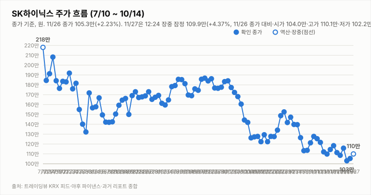
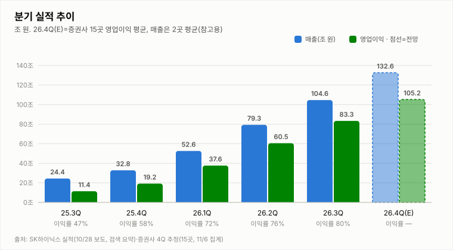
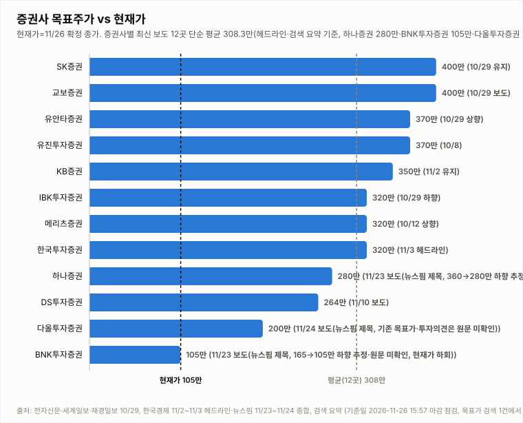
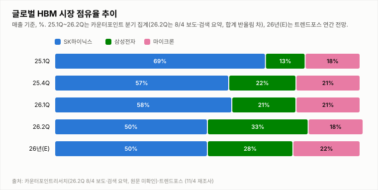

# SK하이닉스 투자 리포트 — 2026-11-27 (금) 마감 리포트 (15:57, 종가 확정)

> **작성** 2026-11-27 15:57 KST · **확정 판정: 중립(v2, 11/27 종가 기준 · 위험 높음 · 확신도 낮음)** · 확정 종가 111.0만원(+5.41%)은 `quote.json`(marketTime 11/27 15:30 KST)으로 확정이며 트레이딩뷰 15:51 수집값과 시가·고가·저가·종가·거래량이 일치합니다. 외국인·기관 수급과 사이드카·목표가·헤드라인은 검색 결과·제목 기준으로 원문 미확인, 증권사 수치는 헤드라인·검색 요약 기준입니다. 확정 판정은 종가 기준으로만 변경합니다.

> **종목** SK하이닉스 (KRX 000660 · NASDAQ 상장 7/10)
> 본 자료는 정보 제공 목적이며 투자 권유가 아닙니다.

## 핵심 요약

- **투자의견: 확정 판정 중립 유지 (v2, 11/9~11/27에 이어 15회 연속, 확신도 낮음)** — 11/27 종가 111.0만 기준 전략 점수 1(F1 이익추정 +1·F2 업황 가격 전망 +1·F3 밸류에이션 +0[목표가 신선도 규칙, 중앙 보도일 이후 주가 변동 -24.6%로 낡음 처리 유지]·F4 정책 리스크 -1·F5 외국인 수급 +0), 위험 레짐 높음(10일 변동성 5.8%·20일 고점 대비 -24.6%), 비중 배수 0.52입니다. 점수는 전일 0에서 1로 올랐고 원인은 방향 요인 F5 변화입니다: 11/20(약 -1.27조원)이 5거래일 창에서 빠지고 오늘 유가증권시장 외국인이 약 1조1,256억원 순매수해 5거래일 확인 합이 약 -0.51조원(11/25를 뉴스핌 기준으로 보면 약 -0.93조원)으로 -2조원 기준을 벗어나 -1→0이 됐습니다(순매수가 이어진 것은 아니어서 +1은 아님). F4는 미국 통상 압박·AI 수익성 의구심 해소 확인이 없어 -1, F2는 TrendForce 신규 발표가 없어 +1을 유지했습니다. 점수 +1은 매수 전환 기준(+2)에 못 미쳐 라벨은 중립입니다. 위험 레짐은 전일 극단에서 높음으로 한 단계 내려갔습니다(10일 변동성 5.8%·20일 고점(147.2만) 대비 낙폭 -24.59%). 오늘 종가 111.0만이 극단 탈출선(약 110.4만)을 0.5% 웃돌아 낙폭이 -25%보다 얕아진 가격 효과이며 규칙 변경은 아닙니다(다음 거래일에는 20일 창에서 고점이 빠져 기준 고점이 139.8만으로 낮아지므로 극단 재진입선은 종가 약 104.8만, 오늘 종가 대비 -5.5%입니다)(비중 배수는 전일 0.55에서 0.52). 매수 전환은 F4가 0 이상으로 개선되거나 F5가 순매수 지속(+1)으로 바뀌어 점수 +2 이상이 될 때, 매도 전환은 F1 또는 F2가 -1로 바뀌고 F4·F5가 함께 나빠질 때이며 다음 확정은 다음 거래일(월요일 11/30) 종가입니다.
- **11/27 확정 종가 111.0만(+5.41%)** — 시가 104.0만(11/26 종가 대비 -1.23%)·고가 111.0만(+5.41%)·저가 102.2만(-2.94%), 종가가 고가와 같고 저가 대비 +8.6% 위치입니다(갭다운 후 장대양봉, 고가 마감). 거래량 287.2만주(20일 평균의 0.75배, 야후 quote.json 15:30 확정이며 트레이딩뷰 15:44 수집값과 일치)로 11/26보다 줄었습니다. 09:10 104.1만(-1.14%) → 09:24 103.2만(-1.99%, 저가 102.2만) → 10:24 106.6만(+1.23%) → 11:24 107.5만(+2.09%) → 12:24 109.9만(+4.37%) → 13:24 109.9만(고가 110.8만) → 14:24 110.0만(+4.46%) → 종가 111.0만(+5.41%, 고가 마감)(09:24~14:24는 20분 지연 시세)로 장 초반 11/25 저가(102.7만)를 밑돌았다가 오전 내내 반등해 11/25·11/26 고가(109.7만~109.8만)와 극단 탈출선(약 110.4만)을 넘어 고가에서 마감했습니다. 코스피 +4.34%(4,915.68, 고가 4,922.94)·코스닥 +8.13%(708.99, 매수 사이드카)·삼성전자 +4.55%로 시장 전반이 급등했습니다. 수급: 유가증권시장 외국인 약 1조1,256억원 순매수·기관 약 2,388억원 순매수·개인 순매도(블록미디어, 매일일보는 외국인 1조1,298억원). 원인은 WHY 섹션을 참조하세요.
- **마감 후 데이터**: 마감 직후(15:30~15:53 수집) 트레이딩뷰 기준 코스피 4,915.68(+4.34%, 시가 4,728.80·고가 4,922.94·저가 4,682.43), 코스닥 708.99(+8.13%), 삼성전자 179,100원(+4.55%, 고가 179,900원), SK하이닉스 1,110,000원(+5.41%), 원/달러 1,337.35원(-0.42%)입니다. 코스피200 주간선물 757.40(+4.22%, 15:32)은 주간 정규장 값이라 야간선물이 아닙니다(night_futures_valid false). 11/27 밤 美장은 추수감사절 다음 날 단축 거래로 알려져 있고(거래소 공지 미확인) 결과는 한국시간 11/28 새벽에 나와 월요일 11/30 한국장에 반영됩니다. 주간(트레이딩뷰 Perf.W)은 코스피 -0.26%·코스닥 +7.26%·삼성전자 -4.78%·SK하이닉스 -0.63%로 주 초반 급락분을 대부분 되돌렸습니다. 마감 시황 제목(검색 요약): 블록미디어 ‘외인 1조원 순매수에 4%대 급등…코스닥도 700선 회복’, 매일일보 ‘외국인 매수에 코스피 4900선 회복…코스닥도 8% 급등’(원문 미열람).
- **지표(11/27 종가 확정, 야후 일봉 기준)**: DMI 격차 -14.9(+DI 19.0 < -DI 33.9, 11/26 종가 -14.5), KDJ K 26.4·D 22.2(격차 +4.2, 중립 구간, K>D, 11/26 종가 -3.5), MACD 히스토그램 +0.19만(시그널 위, 0선 아래; 11/26 종가 -0.25만), ATR 9.81만(8.8%). 오늘 거래량은 287.2만주로 20일 평균(383.5만주)의 0.75배입니다(트레이딩뷰 15:44 287.2만주로 동일). MACD 히스토그램이 종가 기준으로 양수로 돌아섰고(11/24 이후 처음) KDJ는 과매도를 벗어나 K>D로 바뀌었지만, DMI는 여전히 -DI 우위라 하락 추세 신호는 남아 있습니다.

<!--CAUSE:START-->
## 주간 변동 원인 분석 — 국내·해외·미국 빅테크 (11/2~11/6 주간 + 주말 점검, 기준 2026-11-27(금) 15:57 KST (마감 확정))

**한 줄 결론** — 11/27(금) SK하이닉스는 美 추수감사절 휴장으로 외부 신호가 없던 가운데 시가 104.0만(-1.23%)으로 갭다운해 저가 102.2만(-2.94%)까지 밀렸다가, 유가증권시장 외국인 약 1조1,256억원 순매수(기관 약 2,388억원)와 코스닥 +8.13% 급등(매수 사이드카)의 위험선호 회복 속에 장 내내 올라 고가와 같은 111.0만(+5.41%)에 마감했습니다(코스피 +4.34%·삼성전자 +4.55%). 주간으로는 -0.63%로 주 초반 급락분을 대부분 되돌렸습니다. 원인은 외국인 순매수 전환과 급락 후 저가 매수(확신도 중간), 증안펀드 확대 기대(확신도 낮음)로 판단합니다.

> 방법: 한국 시장(코스피·외국인 수급·사이드카) + 해외 시장(미국 지수·반도체·빅테크·VIX) + 국내외 뉴스를 교차해 사건을 시간순으로 놓고, 수치가 복수 출처에서 일치하면 ‘높음’, 매체의 해석이면 ‘중간’, 정황 추정이면 ‘낮음’으로 표시합니다. 수치는 트레이딩뷰 실측(night.yml 2026-11-10 08:04 KST 수집)과 검색 요약 보도를 병기했으며, 원인 기사는 요약 기준이라 원문 확인이 필요할 수 있습니다.

**① 시장 현황**

| 종목·지수 | 11/25(수) | 11/26(목) | 주간 | 11/27(금) 마감 |
|---|---|---|---|---|
| **한국 시장 (KRX 정규장, 해당일 15:30 마감)** | | | | |
| 코스피 | -6.16% | +0.29% | -0.26% | +4.34% |
| 코스닥 | -2.29% | +0.78% | +7.26% | +8.13% |
| SK하이닉스 | -11.05% | +2.23% | -0.63% | +5.41% |
| 삼성전자 | -9.87% | +0.35% | -4.78% | +4.55% |
| **미국 지수·변동성 (美 정규장, 11/25 현지 마감 · 11/26 추수감사절 휴장)** | | | | |
| 나스닥 | -0.62% | — | -3.68% | — |
| S&P500 | -0.25% | — | -2.35% | — |
| 필라델피아 반도체(SOX) | -0.65% | — | -10.36% | — |
| VIX (11/25 종가 28.29) | +7.32% | — | +16.80% | — |
| **미국 AI 반도체·메모리 (공급 측)** | | | | |
| 마이크론(MU) | -4.53% | — | -16.32% | — |
| 엔비디아(NVDA) | -3.91% | — | -6.21% | — |
| AMD | -1.75% | — | -20.37% | — |
| 브로드컴(AVGO) | -0.07% | — | -13.72% | — |
| 퀄컴(QCOM) | +2.24% | — | +0.99% | — |
| SK하이닉스 ADR(SKHY) | -0.75% | — | -11.30% | — |
| 한국 ETF(EWY) | -1.16% | — | -6.20% | — |
| **미국 빅테크 (수요 측·플랫폼)** | | | | |
| 애플(AAPL) | +0.43% | — | +1.03% | — |
| 마이크로소프트(MSFT) | -1.25% | — | -3.08% | — |
| 알파벳(GOOGL) | -2.13% | — | -3.41% | — |
| 아마존(AMZN) | -3.12% | — | -5.92% | — |
| 메타(META) | +3.40% | — | -1.65% | — |
| 테슬라(TSLA) | -1.18% | — | -1.32% | — |

> 주간=트레이딩뷰 Perf.W(한국은 11/27 종가 기준 1주 변동, 미국은 11/25 현지 종가 기준 1주 변동)이며 보도의 주간 수치와 기준 시점 차이로 다를 수 있습니다. 한국 11/27 열은 15:30 확정 마감(트레이딩뷰 15:30~15:53 수집)입니다. 미국 11/26 열은 추수감사절 휴장이라 비어 있고(—), 11/27 美 단축장 결과는 한국시간 11/28 새벽에 나와 월요일 11/30 한국장에 반영됩니다.

**② 원인 사슬 — 최근 5건 요약**

| 시점 | 핵심 | 확신 |
|---|---|---|
| 11/26(목) 06:00~09:10 韓 | 야간선물 +0.35% 보합~소폭 갭업 신호, ‘2028년 이익 급감’ 예측·YMTC 기술 도입(제목), 개장 시세 미확인 | 수치 높음 · 개장 반응 미확인 |
| 11/26(목) 장중~마감 韓 | 고가 109.8만(+6.60%) 후 외국인 매도 전환 → 시가와 같은 105.3만(+2.23%) 마감; 코스피 +0.29% | 수치 높음 · 수급 중간 |
| 11/26(목) 밤 美 | 美 추수감사절 휴장 — 새 신호 없음(수집값 11/25 종가와 동일) | 높음 |
| 11/27(금) 06:00~09:10 韓 | 美 휴장·야간선물 +0.17% 보합 신호, 외국인 수급이 변수, 개장 시세 미확인 | 수치 높음 · 개장 반응 미확인 |
| 11/27(금) 장중~마감 韓 | 외국인 1.13조 순매수·코스닥 +8.13% → 저가 102.2만에서 111.0만(+5.41%) 고가 마감 | 수치 높음 · 수급 중간 |

_이전 사슬 43건과 항목별 상세 근거는 웹페이지의 펼치기 또는 docs/cause_analysis.json 참조._

**③ 원인 순위 — 최근 일별 원인과 주간 구조 원인**

| 구분 | 원인 | 확신 |
|---|---|---|
| 11/27 | 외국인 1.13조 순매수·저가 매수 → 111.0만(+5.41%) 고가 마감, 극단 탈출 | 중간 |
| 11/26 | 美 반도체 회복+저가 매수 → 고가 109.8만 후 외국인 매도 전환, 105.3만(+2.23%) | 중간 |
| 구조 1 | 미국 AI 반도체 투매의 한국 전이 | 높음 |
| 구조 2 | 외국인 대규모 순매도(프로그램·선물 연쇄 포함) | 높음 |
| 구조 3 | 트리거: 중간선거 후 AI 데이터센터 규제·투자 둔화 우려 | 중간 |
| 구조 4 | 메모리·AI 하드웨어 쏠림 해소(고베타) | 중간 |
| 구조 5 | 개별 악재 중첩 | 중간~낮음 |
| 구조 6 | 심리·거시: 조정장 진입과 긴축 베팅 | 낮음 |

**④ 분석 판단 (추정 포함) — 최근 3건**

- 11/27은 외부 신호가 없는 날 외국인 1조원대 순매수와 코스닥 급등이 겹쳐 SK하이닉스가 저가 102.2만에서 111.0만(+5.41%)까지 올라 고가에 마감했습니다(수치). 이번 주(11/23~11/27)는 -11.05% 급락(11/25)과 +6.73%·+5.41% 반등이 오가며 주간 -0.63%로 끝났고, 외국인 5거래일 합이 약 -0.5조원으로 줄어 F5가 -1→0, 종가가 극단 탈출선을 넘어 위험 레짐이 극단→높음으로 완화됐습니다. 다음 거래일에는 20일 고점이 139.8만으로 낮아져 극단 재진입선이 약 104.8만이며 월요일 외국인 수급과 11/27 美 단축장 반응이 관건입니다(확률 관점, 가격 예측 아님).
- 11/26 밤 美장 휴장으로 오늘 한국장은 외부 신호 없이 열리며, 야간선물 +0.17%의 보합 신호 속에 외국인 수급이 방향을 정할 가능성이 큽니다(추정). 전일 장중 반등분을 반납한 흐름이 이어지면 104.1만(전일 저가) 시험, 외국인 순매수 전환 시 108.5만 재시도가 관전 포인트이며, 위험 레짐 극단 탈출선은 종가 약 110.4만입니다(확률 관점, 가격 예측 아님; 11/27 종가 확정에서 F4·F5 재평가, F5는 11/20 롤오프 효과).
- 11/26은 11/25 밤 美 반도체 회복을 반영해 +2.23% 갭업하고 저가 매수로 장중 +6.60%까지 올랐지만 오후 외국인 매도 전환에 상승분을 반납해 시가와 같은 +2.23%로 마감했습니다(수치). 장중 반등을 지키지 못한 것은 전일 급락 후 저가 매수 수요는 있으나 외국인이 아직 매수로 돌아서지 않았다는 뜻으로 해석합니다(확신도 중간). 10/29 고점 롤오프로 기준 고점이 147.2만으로 낮아졌지만 낙폭 -28.5%로 위험 레짐은 극단이며, 11/27은 美 휴장으로 새 신호가 없어 국내 수급이 변수입니다(확률 관점, 가격 예측 아님).

_이전 분석 판단 24건은 웹페이지의 펼치기 또는 docs/cause_analysis.json 참조._

**⑤ 아직 모르는 것과 반증 조건**

- ‘AI 규제’의 실제 입법·행정 조치는 보도되지 않았습니다(발언·청문 가능성 수준) → 의회 일정과 후속 보도가 나오면 3순위 원인의 확신도를 조정합니다.
- 엔비디아 -4.27%의 배경인 젠슨 황 관련 이사회 조사 보도는 검색 요약 기준이며 원문·사실관계는 확인하지 못했습니다. 퀄컴 가이던스 수치, 마이크론 대만 HBM 공장 건설 중단 보도(제목만 확인)의 범위·사유도 확인하지 못했습니다.
- 11/10 외국인·기관·개인 순매매 금액은 마감 보도(코스피 기준 외국인 약 +3,532억·기관 약 +4,980억·개인 약 -1조3,396억원) 기준이며 KRX 확정 집계와 다를 수 있고, 선물·프로그램 매매 비중은 확인하지 못했습니다.
- CPI 수치(+0.4%·근원 +0.3%)와 월러 이사 발언, 미 10년물 4.99%는 복수 매체 요약 기준이며 BLS 원문과 발언 원문은 확인하지 못했습니다. 엔비디아 급락의 원인(젠슨 황 관련 스캔들·대중 수출 규제 우려)도 매체 해석입니다.
- 11/16 외국인·기관·개인 순매매 확정 금액과 SK하이닉스 개별 수급은 확인하지 못했습니다. 모건스탠리 목표주가(절대값·보도일), 美 법원 D램 담합 소송 결정 원문, 美 AI 칩 수출 규제 강화 보도의 원문, 엔비디아 CEO 사임 보도의 원문은 열람하지 못했습니다. 11/16 마감 거래량은 야후 465만주와 트레이딩뷰 403만주(15:54)·415만주(20:08)로 소스 간 차이가 있습니다.
- 11/17 외국인·기관·개인 순매매 확정 금액과 SK하이닉스 개별 수급은 확인하지 못했습니다. 엔비디아 3Q 실적의 수치·가이던스·시간외 반응, 전남일보 11/17 09:38 제목의 본문, 美 D램 담합 소송 결정 원문은 열람하지 못했습니다. 11/18 개장 직후 SK하이닉스 개별 시세는 지연으로 확인하지 못했습니다.
- 11/18 SK하이닉스 외국인 -346억원은 단일 검색 요약이며 기관·개인의 SK하이닉스 개별 수급과 마감 확정 투자자별 표는 열람하지 못했습니다. 엔비디아 실적 원문(매출 1,158억 4,000만달러·시장 예상 1,091억달러)·CNBC/서울경제 하락 원인 기사 본문·글로벌이코노믹 낸드 현물가·세미애널리시스 제목의 본문, 11/19 개장 후 SK하이닉스 시세는 확인하지 못했습니다.
- 11/20 외국인·기관·개인 순매매 마감 확정 금액과 SK하이닉스 개별 수급은 11/23 점검 검색에서도 확인하지 못했고, 한국경제 11/20 17:52 제목(개인 1.5조원 매수)·이투데이 주간수급 검색 요약(외국인 주간 약 4.5조원 순매도)만 확인했습니다(원문 미열람). SEC 엔비디아 조사·대중국 AI 칩 수출통제 강화·F4 긴급 회의·하나증권 280만원의 원문과 사실관계, 11/20 밤 美장 지수 마감 수치 외 원인은 검증하지 못했습니다.
- 11/25 SK하이닉스 개별 외국인·기관 순매매 금액은 확인하지 못했고(유가증권시장 합계만 매체별 1조8,993억~1조9,618억원), BNP파리바의 마이크론 하향 언급은 2026년 원문·날짜를 확인하지 못했습니다. 11/26 美 추수감사절 휴장 여부는 거래소 공지로 확인하지 않았습니다.
- 11/26 SK하이닉스 개별 외국인·기관 순매매 금액은 마감 기준으로 확인하지 못했고(장중 10:25 외국인·기관 동시 순매수 제목만 확인), 유가증권시장 외국인 합계는 매체별 1,096억~1,137억원 순매도입니다. 11/25 외국인 순매도는 위키트리 1조8,993억원·뉴스핌 2조3,203억원으로 집계가 다릅니다. 미국의 ‘D램 지배력=정부 지원 결과’ 지적의 발언 주체와 통상 조치 여부, 美 추수감사절 휴장은 거래소 공지로 확인하지 않았습니다.
- 11/27 SK하이닉스 개별 외국인·기관 순매매 금액은 확인하지 못했고(유가증권시장 합계만 매체별 1조1,256억~1조1,298억원), 증안펀드 확대 기대의 구체 내용과 11/27 美 단축장 결과는 확인하지 못했습니다.
- 반증 조건: 월요일 11/30 외국인이 다시 대량 순매도로 돌아서 종가가 약 104.8만 아래로 내려가면 11/27 급등은 휴장기 수급 공백 속 일회성 반등이며 위험 레짐도 극단으로 돌아갑니다. 반대로 외국인 순매수가 이어지면 F5가 +1로 올라 점수 +2(매수 전환 기준)에 닿습니다.

**⑥ 다음 거래일 시사점** — 다음 거래일(월요일 11/30) 한국장은 11/27 美 단축장(추수감사절 다음 날) 결과와 외국인 순매수 지속 여부가 핵심입니다. 종가 111.0만(고가 마감)에서 104.8만(극단 재진입선) 위 유지와 111.3만(11/20 종가)·115.8만(11/24 종가) 시험이 관전 포인트이며(확률 관점, 가격 예측 아님), 외국인 순매수가 이어지면 F5가 +1로 올라 점수 +2(매수 전환 기준)에 닿을 수 있습니다. 확정 판정(v2)은 11/27 종가 기준 중립(점수 1·위험 높음)이며 다음 확정은 월요일 종가입니다.

출처: [CNN 11/5](https://www.cnn.com/2026/11/05/investing/tech-heavy-nasdaq-plunges) · [CNBC 11/5](https://www.cnbc.com/2026/11/05/qualcomm-earnings-chip-stocks-election.html) · [Fox Business 11/5](https://www.foxbusiness.com/markets/stocks-nov-5-2026) · [Yahoo Finance 11/6 마감](https://finance.yahoo.com/markets/live/stock-market-today-friday-november-6-dow-sp-500-nasdaq-jobs-report-earnings-135953863.html) · [Yahoo 칩 반등](https://finance.yahoo.com/markets/article/nvidia-amd-micron-sandsik-lead-chip-sector-higher-134336542.html) · [UPI 11/6](https://www.upi.com/Top_News/US/2026/11/06/nasdaq-rebounds-tech-stocks/5901794005326/) · [파이낸셜뉴스 11/6](https://www.fnnews.com/news/202611060834515879) · [SBS Biz 11/6](https://biz.sbs.co.kr/article/20000344723) · [헤럴드경제 11/5](https://biz.heraldcorp.com/article/10927440) · [디지털데일리 11/6](https://www.ddaily.co.kr/page/view/2026110615524945049) · [아시아투데이 11/6](https://www.asiatoday.co.kr/kn/view.php?key=20261106010002606) · [StockTwits 마이크론·규제](https://stocktwits.com/news-articles/markets/equity/micron-hits-3-month-low-amid-chip-rout-after-top-democratic-lawmaker-calls-for-ai-regulation-pause-in-development/cNG14kWR9Eh) · [Reuters 인용(Devdiscourse)](https://www.devdiscourse.com/article/international/4001686-us-stocks-wall-street-rallies-after-democrats-win-congress-data-center-stocks-slide) · [글로벌이코노믹 11/9](https://www.g-enews.com/article/Securities/2026/11/202611091102167807923c501012_1) · [MoneyToday EN 11/9](https://www.mt.co.kr/en/stock/2026/11/09/2026110910110484191) · [헤럴드경제 11/9](https://biz.heraldcorp.com/article/10930383) · [이투데이 — 코스피 오후 상승폭 축소·외국인 매도 속 5100선 등락](https://www.etoday.co.kr/news/view/2645772) · [재경일보 — 외국인 10조원 매도에 코스피 5000선 급락·주간 11% 하락](https://news.jkn.co.kr/post/1079576) · [MoneyToday — Retail investors lift Samsung and SK hynix as ETF buying offsets 7-day foreign selling](https://www.mt.co.kr/en/stock/2026/11/09/2026110911301182528) · [Invezz — KOSPI today: Why South Korea's stock market rebounded above 5,100](https://invezz.com/news/2026/11/09/kospi-today-south-korea-stock-market-rebound/) · [Finimize — South Korea's KOSPI bounced back as chip stocks recovered](https://finimize.com/content/south-koreas-kospi-bounced-back-as-chip-stocks-recovered) · [아시아경제 — 힘 잃고 주저앉은 코스피…0.81% 하락한 5018 마감](https://view.asiae.co.kr/article/2026110916013525615) · [Businesskorea — 외국인·개인 ‘팔자’에 코스피 5,018선 턱걸이 마감](https://www.businesskorea.co.kr/news/articleView.html?idxno=280833) · [파이낸스투데이 — 코스피, 외국인 7일 연속 매도에 0.8% 또 하락](https://www.fntoday.co.kr/news/articleView.html?idxno=397349) · [Benzinga — Nasdaq Jumps 3%, Nvidia Lags Most Since DeepSeek](https://www.benzinga.com/markets/equities/26/11/63055270/stock-market-today-nasdaq-100-chip-rebound-nvidia-deepseek) · [TradingKey — Nasdaq extends gains 2.7%, SOX reclaims 10,000, Nvidia falls 4%](https://www.tradingkey.com/analysis/stocks/us-stocks/262297090-us-stock-nasdaq-dow-rise-anthropic-ipo-nvidia-spacex-tesla-tradingkey) · [서울신문 — 삼성전자 5%·SK하이닉스 7% 강세… 코스피 5272선 반등](https://www.seoul.co.kr/news/economy/securities/2026/11/10/20261110500048) · [필드뉴스 — [마감 시황] 코스피, 상승 마감…SK하이닉스·삼성전자 강세](http://www.fieldnews.kr/news/articleView.html?idxno=32980) · [위키트리 — 코스피 5239.13 마감…양 시장 모두 4%대 상승 마감](https://www.wikitree.co.kr/articles/1173455) · [진일보 — 삼성전자 20만원·SK하이닉스 120만원 탈환…반도체주 동반 급등](https://www.jnilbo.com/news/articleView.html?idxno=90000081130) · [와우TV — 美증시, 예상치 웃돈 10월 CPI에 일제히 하락](https://www.wowtv.co.kr/NewsCenter/News/Read?articleId=A202611110010) · [이투데이 — 뉴욕증시, 인플레 불안에 하락…유가 약세](https://www.etoday.co.kr/news/view/2646540) · [국제뉴스 — 젠슨 황 스캔들에 엔비디아 5.5% 급락…CPI 충격에 뉴욕증시 하락](https://www.gukjenews.com/news/articleView.html?idxno=3748330) · [블록미디어 — [뉴욕증시 마감] 예상보다 높은 10월 CPI, 엔비디아 5% 하락](https://www.blockmedia.co.kr/archives/1164156) · [헤럴드경제 — ‘빅스텝 올 수도’ 금리 우려에 뉴욕증시 또 충격](https://biz.heraldcorp.com/article/10932887) · [파이낸스투데이 11/12 '젠슨 황 해임 위기'에 발목 잡힌 코스피…5,342 마감](https://www.fntoday.co.kr/news/articleView.html?idxno=398004) · [인포스탁데일리(Investing.com) [1112마감체크] 젠슨 황 스캔들 여파에 반도체·금융 약세](https://kr.investing.com/news/stock-market-news/article-2172100) · [Businesskorea [마감 시황] 코스피·코스닥 동반 약세 5,340선](https://businesskorea.co.kr/news/articleView.html?idxno=281164) · [SEC EDGAR NVIDIA Form 8-K (검색 결과에 표기된 문서, 원문 미열람) — CEO 전환 공시](https://www.sec.gov/Archives/edgar/data/0001045810/000104581026000082/nvidiaannouncesceotransiti.htm) · [EBN 11/21(美 증시 급락, 검색 요약)](https://www.ebn.co.kr/news/articleView.html?idxno=1732544) · [뉴데일리 11/21(반도체지수 10% 폭락, 검색 요약)](https://www.newdaily.co.kr/site/data/html/2026/11/21/2026112150002.html) · [MTN 11/22(긴급 F4 소집, 제목)](https://news.mtn.co.kr/article/2026112215282149020) · [Motley Fool 11/20 midday(검색 요약)](https://www.fool.com/coverage/stock-market-today/2026/11/20/stock-market-midday-nov-20-nasdaq-plunges-nearly-3-as-amd-and-micron-lead-a-brutal-semiconductor-sell-off/) · [이투데이 주간수급리포트(검색 요약)](https://etoday.co.kr/news/view/2651100) · [EBN 11/23 마감(코스피 3.31% 급락 4708선, 검색 요약)](https://www.ebn.co.kr/news/articleView.html?idxno=1732707) · [뉴스핌 11/23(코스피 5%대 급락·매도 사이드카)](https://www.newspim.com/news/view/20261123000607) · [이투데이 11/23(매도 사이드카·오후 낙폭 축소·외인 팔자 전환)](https://www.etoday.co.kr/news/view/2651689) · [한국경제 11/20(코스피 4869 마감·외국인 1조2682억 순매도)](https://www.hankyung.com/article/202611200429i) · [SBS 11/24(젠슨 황 복귀 엔비디아 폭등, 검색 요약)](https://news.sbs.co.kr/news/endPage.do?news_id=N1008859898) · [헤럴드경제 11/24(나스닥 6.5% 급등)](https://biz.heraldcorp.com/article/10946814) · [CNBC 11/23(Tech stocks monster rally after Jensen Huang returns)](https://www.cnbc.com/2026/11/23/anthropic-nvidia-shares.html) · [서울파이낸스 11/24(코스피 개장 +3.64%, 제목)](https://www.seoulfn.com/news/articleView.html?idxno=643706) · [TrendForce 11/19(NAND 가격 전망 하향, 검색 요약)](https://www.trendforce.com/presscenter/news/20261119-13314.html) · [Yahoo Finance 11/24(Stock market today: chip sector tumbles, Nvidia falls 6%)](https://finance.yahoo.com/markets/live/stock-market-today-tuesday-november-24-dow-sp-500-nasdaq-chip-stocks-nvidia-140629923.html) · [Benzinga 11/24(Micron drops after Monday surge as Nvidia scrutiny hits chipmakers)](https://www.benzinga.com/markets/tech/26/11/63575386/micron-stock-drops-after-mondays-surge-as-nvidia-scrutiny-hits-chipmakers) · [Bloomingbit 11/24(Nvidia -5.9%, Micron -11% a day after Huang return rally)](https://en.bloomingbit.io/feed/news/125159) · [StockTitan 11/25(Stocks win back most of morning losses after a chip sell-off)](https://www.stocktitan.net/articles/stock-market-today-live-november-25-2026) · [TECHi 11/25(Chip stocks recover most of a 8.0% early slide; Nasdaq ends down 0.6%)](https://www.techi.com/chip-stocks-recover-early-slide-nasdaq-close-november-25/) · [위키트리 11/25(코스피 4697.51 마감…외국인 1조 8993억 원 순매도)](https://www.wikitree.co.kr/articles/1177728) · [아주경제 11/26(코스피, 기관 7500억 사자에 4710선 회복…상승폭은 축소)](https://www.ajunews.com/view/20261126153559839) · [매일일보 11/26(코스피, 외국인 순매도 전환에 0.29% 상승 그쳐)](https://www.m-i.kr/news/articleView.html?idxno=2023951) · [블록미디어 11/27([마감시황] 코스피, 외인 1조원 순매수에 4%대 급등…코스닥도 700선 회복)](https://www.blockmedia.co.kr/archives/1171445) · [매일일보 11/27(외국인 매수에 코스피 4900선 회복... 코스닥도 8% 급등)](https://www.m-i.kr/news/articleView.html?idxno=2024424) · [디지털타임스(11.3조 던진 外人, SK하이닉스만 ‘유턴’)](https://www.dt.co.kr/article/12097566)

<!--CAUSE:END-->

## 시세

**전일 확정 (11/26 목 15:30)**

| 시가 | 고가 | 저가 | 종가 | 등락 | 거래량 |
|---|---|---|---|---|---|
| ₩1,053,000 | ₩1,098,000 | ₩1,041,000 | **₩1,053,000** | **+2.23%** | 3,290,328주 |

출처: 야후 `quote.json`(marketTime 15:30 KST 확정)·트레이딩뷰 KRX 피드 15:51 수집 교차 확인(시가·고가·저가·종가·거래량 일치, 거래량은 확정 기록).

**오늘 확정 (11/27 금 15:30)**

| 시가 | 고가 | 저가 | 종가 | 등락 | 거래량 |
|---|---|---|---|---|---|
| ₩1,040,000 | ₩1,110,000 | ₩1,022,000 | **₩1,110,000** | **+5.41%** | 2,872,424주 |

출처: 야후 `quote.json`(marketTime 15:30 KST 확정)·트레이딩뷰 KRX 피드 15:51 수집 교차 확인(시가·고가·저가·종가·거래량 일치). 등락률은 11/26 확정 종가 기준입니다.

## 기술적 지표 (11/27 종가 확정 야후 일봉 기준)

| 지표 | 값 | 해석 |
|---|---|---|
| MACD (12,26,9) | -9.21만 / 시그널 -9.41만 / 히스토그램 **+0.19만** | 상승 모멘텀(MACD가 시그널 위·0선 아래) |
| ATR (14) | 9.81만 (8.8%) | 변동성 매우 큼 |
| ADX / DMI | ADX 24.7 · +DI 19.0 · -DI 33.9 | 격차 -14.9(-DI 우위, 11/26 종가 -14.5) |
| KDJ (9,3,3) | K 26.4 · D 22.2 · J 35.0 | 중립 구간, K>D(+4.2, 11/26 종가 -3.5) |
| 거래량 / 20일 이평 | 287.2만 / 383.5만 | 평균의 0.75배(마감 확정) |

야후가 10/13 일봉을 정정 반영하면서 어제 리포트의 값(MACD 히스토그램 -3.59만·DMI -26.1)과 달라졌습니다.

종가 기준 격차 흐름: DMI 9/29 +1.6 → 9/30 +4.3 → 10/1 +2.2 → 10/2 +3.9 → 10/6 -0.8 → 10/7 -4.7 → 10/8 -7.9 → 10/12 -13.9(15:14 집계) → 10/13 -26.1(어제 리포트 기준) → 10/14 -25.9(종가 확정) → 10/15 -34.5(종가 확정·정정) → 10/16 -32.5(종가 확정) → 10/19 -33.2(종가 확정), KDJ 9/29 -8.4 → 9/30 -8.9 → 10/1 -5.2 → 10/2 -2.2 → 10/6 -8.2 → 10/7 -14.1 → 10/8 -15.1 → 10/12 -13.3(15:14 집계) → 10/13 -10.9(어제 리포트 기준) → 10/14 -8.4(종가 확정) → 10/15 -6.4(종가 확정·정정) → 10/16 -4.4(종가 확정) → 10/19 -1.8(종가 확정).

## 최신 뉴스 Top 5 (구글 뉴스 헤드라인 기준, 같은 사안은 1건만)

1. 🟢 **삼성전자, 역대 최대 30조원 배당…SK하이닉스도 14조원 지급 예고** (ESG경제, 11/27 14:51) · 삼성전자가 역대 최대 30조원 배당을, SK하이닉스도 14조원 지급을 예고했다는 ESG경제 기사(11/27 14:51, 제목 기준, SK하이닉스 배당 기준일·주당 금액은 원문 미확인이며 10/28 발표 주주환원 계획의 일부로 보임).
2. ⚪ **[분석] SK하이닉스 해외 보증 95%가 ’인디애나’…북미 패키징 거점 힘 싣는다 By FinancialPost** (Investing.com 한국어, 11/27 14:37) · SK하이닉스 해외 보증의 95%가 미국 인디애나에 집중돼 북미 패키징 거점에 힘을 싣고 있다는 FinancialPost 분석(Investing.com 한국어, 11/27 14:37, 제목 기준, 보증 금액은 원문 미확인).
3. ⚪ **삼성전자 DS, 기술 개발 체계 간소화···SK하이닉스는 글로벌 조직 손 볼까?** (서울파이낸스, 11/27 14:30) · 삼성전자 DS부문이 기술 개발 체계를 간소화한 가운데 SK하이닉스도 글로벌 조직을 손볼지 주목된다는 서울파이낸스 기사(11/27 14:30, 제목 기준, SK하이닉스 조직 개편은 확정 보도 아님).
4. ⚪ **[데스크칼럼] 삼성전자와 SK하이닉스의 주주라면 By FinancialPost** (Investing.com 한국어, 11/27 12:03) · Investing.com 한국어에 실린 FinancialPost 데스크칼럼으로 삼성전자·SK하이닉스 주주가 지금 따져볼 점을 다룬 글(11/26 14:38, 제목 기준, 칼럼 논지는 원문 미확인).
5. ⚪ **SK하이닉스 하루 만에 매수 1위로 돌렸다…초고수, 삼성전자은 매도[주식 초고수는 지금]** (매일경제, 11/27 11:12) · 주식 초고수들이 SK하이닉스를 하루 만에 순매수 1위로 돌려 담고 삼성전자는 매도했다는 매일경제 기사(11/27 11:12, 특정 증권사 고객 집계로 시장 전체 수급과 다름).

※ 뉴스는 헤드라인 기준이며 본문 수치는 별도 검증하지 않았습니다. 같은 사안을 다룬 기사는 가장 최신 1건만 남겼습니다(예: 홍보성 "초심 조형물" 기사 3건·구직자 관심 기업 순위 기사 제외, [포토] 제외).

## 실적 · 밸류에이션 (기준일 2026-11-13 09:12, 11/16 09:12 재확인: 신규 변경 확인 못함, 11/20 15:43 재확인(검색 1건): 에프앤가이드 4Q 컨센서스는 87.27조(10월 중순 기사, 실적 발표 10/28 이전 집계)가 최신으로 확인되고 11월 신규 집계·신규 증권사 추정치는 확인 못함, 11/24 15:59 재확인(검색 1건): 4Q 컨센서스는 87.27조(머니투데이 10/19 기사, 에프앤가이드 집계)가 최신으로 확인되고 11월 신규 집계는 확인 못함(증권사별 4Q 영업이익 추정 SK증권 105조·BNK 103.6조·NH 102.7조·다올 101조·KB증권 89조는 2026년 10월 말 기사 요약으로 원문 미열람·집계 기준 상충해 표본에서 제외, 검색 요약) — 4Q26 증권사 추정치 15곳 집계·목표주가 11곳 반영, 에프앤가이드 4Q26 컨센서스는 확인 불가)

**2Q26 확정 실적: 매출 79.3조·영업이익 60.5조·영업이익률 76%**로 분기 역대 최대였고, 3Q26(10/28 공시)는 **매출 104.62조(첫 100조 돌파)·영업이익 83.33조(영업이익률 약 80%, 79.7%로 쓴 기사도 있음)·순이익 39.78조**입니다. 전분기 대비 매출 +31.9%·영업이익 +37.6%이며, 에프앤가이드 컨센서스(10/18 기준 매출 98.23조·영업이익 76.96조)를 각각 +6.5%·+8.3% 웃돌았습니다. 실적 발표 전 3Q 증권사 추정치 4곳(70.0~80.1조, 평균 76.05조)은 모두 확정치보다 낮았습니다. 순이익은 전분기 대비 약 58% 감소했는데, 검색 요약은 환율 손실과 투자자산 평가손실을 이유로 들었습니다(영업 실적과 별개이며 공시 원문은 확인하지 못함).

**4Q26 영업이익 증권사 추정치 — 11/13 09:12 기준 집계** — 실적 발표(10/28) 이후 증권사들이 4분기 전망을 일제히 올렸습니다. 아래 15곳(보도일 10/29~11/3; 11/13 검색에서 11/5~11/13자 신규 추정치·목표가 기사는 확인하지 못함)은 모두 100조원 이상이며 3Q 확정(83.33조) 대비 +21~42%입니다. 대부분 제목·검색 요약만 확인했고, 에프앤가이드의 4Q26 컨센서스는 실적 발표 후 집계를 확인하지 못했습니다(10/18 기준 3Q 컨센서스만 확인).

| 증권사 | 4Q26 영업이익(조) | 3Q 확정 대비 | 비고 | 출처·확인 수준 |
|---|---|---|---|---|
| SK증권 | 105.0 | +26.0% | 목표가 400만원 유지·메모리 공급 부족·HBM4 기여 근거 | 10/29 보도 묶음, 검색 요약 기준 |
| NH투자증권 | 102.7 | +23.2% | — | 10/29 보도 묶음, 검색 요약 기준 |
| BNK투자증권 | 103.6 | +24.3% | 목표가 148→165만원 상향·투자의견 보유 유지 | 10/29 보도 묶음, 검색 요약 기준 |
| 유안타증권 | 118.2 | +41.8% | 목표가 330→370만원 상향(10/29 보도 묶음) | 10/29 기준 보도 묶음, 검색 요약 기준 |
| 한국투자증권 | 112.1 | +34.5% | 매출 136.3조(전분기 대비 +30%)·목표가 320만원(헤드라인) | 한국경제 11/3 헤드라인·검색 요약, 원문 미확인 |
| IBK투자증권 | 112.0 | +34.4% | 목표가 400→320만원 하향(10/29 보도 묶음, 검색 요약) | 검색 요약 기준(10/29 전후 보도 묶음, 정확한 보도일 확인 불가) |
| 씨티증권 | 107.0 | +28.4% | 기존 89.8조에서 상향 | 10/29 기준 보도 묶음, 검색 요약 기준 |
| KB증권 | 104.0 | +24.8% | 목표가 350만원 유지·“분기 사상 첫 100조 돌파” 전망(10/29 보도 묶음은 목표가 420→350만원 하향·4Q 89조로 제시, 이후 상향) | 한국경제 11/2 헤드라인·검색 요약 기준 |
| 메리츠증권 | 104.0 | +24.8% | 86조대→103조대 상향이라는 요약도 있어 103~104조(출처마다 다름) | 검색 요약 기준, 104조로 계산 |
| 유진투자증권 | 103.5 | +24.2% | 103조라는 요약도 있음 | 검색 요약 기준, 103.5조로 계산 |
| DS투자증권 | 102.1 | +22.5% | — | 10/29 기준 보도 묶음, 검색 요약 기준 |
| 다올투자증권 | 101.0 | +21.2% | 매출 128.8조·올해 282조/내년 466조(연간) | 한국경제 10/29 헤드라인·검색 요약 기준 |
| 대신증권 | 101.0 | +21.2% | — | 검색 요약 기준(보도일 확인 불가) |
| 삼성증권 | 101.0 | +21.2% | — | 검색 요약 기준(보도일 확인 불가) |
| 신한투자증권 | 101.0 | +21.2% | — | 검색 요약 기준(보도일 확인 불가) |
| **15곳 단순 평균** | **105.2** | **+26.3%** | 중앙값 103.5조 · 범위 101.0~118.2조 | 단순 평균(표본 15곳, 참고용) |
| **에프앤가이드 4Q26** | 확인 불가 | — | 이전 검색 요약의 87.27조는 출처·기준일 불명이라 제외 | 신규 집계 확인하지 못함 |

매출 추정치는 한국투자증권 136.3조·다올투자증권 128.8조 두 곳만 확인했습니다(평균 132.6조, 차트의 26.4Q(E) 매출 막대에 사용하며 표본이 매우 작음). KB증권은 4Q 영업이익을 104조원(전년 동기 +441%, 11/2 헤드라인)으로 제시했고 10/29 보도 묶음에는 89조원(목표가 하향)으로 전해져 최근 값을 썼습니다. 하나증권 등 “100조원 이상”만 확인된 증권사는 표본에서 제외했습니다. 영업이익률은 MTN 11/2 헤드라인에 “4분기 영업이익률 83%”가 있으나 어느 기관의 추정인지 확인하지 못했습니다. 일부 증권사는 내년 대규모 설비투자가 수익성을 낮출 수 있다고 지적했습니다(검색 요약 기준). 한국경제·파이낸셜뉴스 원문은 이 환경에서 열리지 않아 수치는 모두 검색 요약 기준이며 증권사 보고서 원문은 확인하지 못했습니다.

**업계 비교** — 삼성전자는 3Q26 매출 195.3조·영업이익 107.4조로 분기 영업이익 100조원을 처음 넘겼다고 밝혔습니다(10/29, 아주경제·삼성뉴스룸 검색 요약). 두 회사 3Q 영업이익을 합치면 약 190.7조로, 주간한국 11/2 헤드라인(“합산 영업익 190兆”)과 같은 규모입니다. SK하이닉스 4Q 추정치 평균(105.2조)은 삼성전자 3Q 실적과 비슷한 수준입니다.

**컨퍼런스콜 정리(SK하이닉스 3Q26, 10/28 발표)** — 실적 컨퍼런스콜(뉴스핌 10/28)에서 김우현 CFO는 주요 고객과 내년 HBM 물량·가격 협의를 마무리했고 HBM과 일반 D램의 수익성 격차가 줄 것으로 본다고 밝혔으며, 4Q에 HBM4가 출하량·매출 비중 모두 HBM3E를 넘을 것으로 내다봤다고 전해졌습니다. 3Q 평균판매가(ASP)는 D램이 전분기 대비 20%대 후반, 낸드가 20%대 중반 올랐고, LTA 고객은 14곳이며 D램·HBM이 2029년까지 사실상 완판이라는 발언이 보도됐습니다(TrendForce 10/28 기사·연합인포맥스 헤드라인, 검색 요약 기준).

> 밸류에이션 기준일 2026-11-13(09:12 집계) — 보도일 기준 최근 1개월(10/14~11/13) 증권사별 최신 목표주가를 집계했습니다. 실적 발표 후 변경은 세계일보·재경일보 10/29 보도(“SK하이닉스 목표주가 165만~400만원…증권사 격차 235만원”, 검색 요약) 등에서 확인했습니다: BNK투자증권 148→165만원 상향(투자의견 보유 유지, 최저), IBK투자증권 400→320만원 하향(업황 우려보다 주가와 목표가 사이 괴리율을 반영했다는 설명), KB증권 420→350만원 하향(매수 유지; 11/2 헤드라인은 350만원 유지), 유안타증권 330→370만원 상향, DS투자증권 264만원(뉴스핌 11/10 14:01 ‘리포트 브리핑’ 헤드라인, 기존 9/29 보도와 같은 값이나 11/10 신규 보도로 기준 창 안에 포함), SK증권·교보증권 400만원(최고), 하나증권 360만원(10/29 유지)→11/23 280만원(뉴스핌 11/23 제목, 하향 여부·근거 원문 미확인), 유진투자증권 370만원(적극 매수, 10/8 보도), 한국투자증권 320만원(한국경제 11/3 07:47 헤드라인, 기존 7/30 보도 470만원에서의 변경으로 보이나 상·하향 표기 확인 불가)입니다. 평균은 증권사별 최신 보도 목표가 11곳의 단순 평균(318.1만원, 중앙값 320.0만원: SK증권 400·교보 400·유안타 370·유진 370·KB 350·IBK 320·메리츠 320·한투 320·하나 280·DS 264·BNK 105; 11/23 하나 360→280·BNK 165→105(뉴스핌 11/23 제목, 원문 미확인) 반영, 직전 표기 중앙값 335.0만원은 오기로 정정 — 직전 값 기준 정확한 중앙값은 350.0만원)이며, 최고 400만원과 최저 105만원(BNK, 현재가 하회)의 차이는 295만원이며 10/29 보도의 235만원 격차는 BNK 변경 전 값이었습니다. 보도와 일치합니다. 유진 370(10/8)·메리츠 320(10/12)은 실적 발표 후 변경 여부를 확인하지 못해 기존 값을 썼고, 교보증권 400만원은 기존 7/9 보도와 같은 값으로 보이나 10/29 보도 묶음의 날짜를 썼습니다. 제외한 항목: 노무라 470만원(9/4 유지분과 같아 신규 여부 확인 불가), RBC ADR 200달러(달러 목표가), 매일경제 11/2 “목표주가 350만원”(주체 확인 불가, KB증권 350만원과 같은 건일 수 있음). 원문 리포트는 이 환경에서 열리지 않아 모두 헤드라인·검색 요약 기준입니다.

최근 1개월 이내 12곳의 평균 목표주가 **308.3만 원**은 11/27 확정 종가 111.0만 대비 **+177.7%** 괴리입니다(11/26 확정 종가 105.3만 기준 +192.7%). 표본이 12곳으로 적고 헤드라인·검색 요약 기준이라 평균은 참고용입니다. 11/27 마감 점검에서 신규 목표가 변경은 확인되지 않았습니다(오늘 저장소 뉴스 Top 10에도 목표가 기사 없음). 하나증권 280만·BNK투자증권 105만은 11/23, 다올투자증권 200만은 11/24 뉴스핌 제목 기준입니다. 12곳 중 최저는 BNK 105만원(현재가 111.0만 대비 -5.4%), 최고는 400만원(SK증권·교보증권)입니다. 모건스탠리 160만(11/10 보도, 원문 미확인)은 평균에 반영하지 않았으며 반영하면 13곳 평균은 약 296.8만원입니다(참고 계산).

## 산업 동향 — HBM·DRAM·NAND (기준일 2026-11-13 09:12, 11/27 09:11 재확인: TrendForce 11월 신규 발표 확인 못함(검색 1건 요약, 원문 미열람) — 10월 DRAM 보고·10/22 eMMC/UFS 1Q27 보합·11/19 NAND 하향·9/29~9/30 HBM 전망 유지, DRAM 1Q27 수치 확인 못함, 항목별 기준일 표기)

> 차트의 점유율은 카운터포인트 25.1Q·25.4Q·26.1Q·26.2Q(26.2Q는 8/4 보도·검색 요약)와 트렌드포스 2026년 연간 전망(E)이며 3Q26 확정 점유율은 확인하지 못했습니다. 수치는 대부분 검색 요약·헤드라인 기준입니다.

**주요 확인 내용**

- **카운터포인트 2Q26 점유율(8/4 발표, 검색 요약 기준·원문 미확인)** — D램 전체 매출 점유율은 삼성전자 39%·SK하이닉스 26%(전년 동기 39%)·마이크론 25%로 보도됐고(10/2 보도는 같은 자료로 38%·25%·24%를 전해 수치가 달라 정정 여부 확인 불가), HBM 매출 점유율은 SK하이닉스 50%(전년 동기 64%)·삼성전자 33%·마이크론 18%로 전해졌습니다. SK하이닉스는 2Q 매출이 전년 동기 대비 214% 늘었지만 점유율은 내려갔다는 요약입니다. 두 지표(D램 전체 vs HBM)는 서로 다르며 차트에는 HBM 기준 26.2Q를 반영했습니다. 3Q26 점유율은 확인 불가입니다.
- **삼성전자 3Q26 컨퍼런스콜(10/29, 아주경제·디일렉 컨콜 전문 검색 요약)** — HBM4 매출이 3Q에 전분기 대비 3배 늘었고 전체 HBM 매출에서 HBM4 비중이 60%에 이르렀으며, 올 하반기 목표였던 “HBM 점유율을 D램 점유율 수준으로” 끌어올리는 일을 3Q에 이미 달성한 것으로 보인다고 밝혔습니다. 3Q D램 ASP는 약 +20%, 낸드 ASP는 10% 후반 상승했고, 4Q에도 높은 메모리 가격이 이어지며 비트그로스는 D램 10% 중후반·낸드 10% 중반을 예상했습니다. 서버용 SSD 수요 증가와 내년 HBM 물량 완판 발언도 요약에 있었습니다.
- **SK하이닉스와 삼성전자 3Q 컨콜 비교** — 아래 표는 두 회사가 밝힌 수치를 나란히 둔 것이며, 기준 정의(출하·비트그로스)가 다를 수 있어 단순 비교는 조심해야 합니다.

| 항목 | SK하이닉스(10/28) | 삼성전자(10/29) |
|---|---|---|
| 3Q D램 ASP(전분기 대비) | 20%대 후반 상승 | 약 +20% |
| 3Q 낸드 ASP(전분기 대비) | 20%대 중반 상승 | 10% 후반 상승 |
| 4Q D램 물량 전망 | 출하 20%대 중반 증가(뉴스핌) | 비트그로스 10% 중후반 |
| 4Q 낸드 물량 전망 | 출하 한 자릿수 중반 증가(기준 시점 불명확) | 비트그로스 10% 중반 |
| HBM4 | 3Q 본격 양산·출하, 4Q 출하·매출 비중 HBM3E 상회 | 3Q 매출 3배, HBM 내 비중 60% |

- **HBM 점유율 보도의 엇갈림 정리** — 비즈워치 9/4의 삼성전자 점유율 “33%”는 카운터포인트 2Q26 HBM 값(33%)과 같은 수치로 보이고, 서울경제의 “40% 육박”(날짜 확인 불가)과 UBS의 2027년 비트 기준 삼성 41%·SK하이닉스 39% 전망(발표 시점 확인 불가)은 기관·기준·시점이 달라 차트에 반영하지 않았습니다. 삼성전자의 HBM 점유율 상승은 SK하이닉스 요소 ④ 산업 사이클의 모니터링 항목입니다.
- **중국 CXMT** — 4F² 셀 구조 서버용 D램의 고객 검증용 샘플을 연내 출하하겠다는 계획이 보도됐습니다(글로벌이코노믹 11/3 헤드라인·검색 요약). 마이크론은 이 접근을 “공정이 복잡하고 수율이 낮아 비용이 폭증한다”고 비판했고, 발표 직후 마이크론 주가가 3.8% 내렸다는 보도가 있습니다(재경일보, 날짜 확인 불가). DDR5 현물가는 사상 최고 수준에서 계속 올랐다고 전해졌습니다(MoneyToday 10/15). SK하이닉스는 “기존 6F² 구조를 최대한 활용하고 4F²는 이후 로드맵”이라는 입장입니다(연합인포맥스 10/28 헤드라인). 이 기술은 HBM이 아니라 범용 D램입니다.
- **간밤 시장 지표(night.yml 11/27 08:03)** — 11/26(목) 미국장은 추수감사절 휴장이라 수집값이 11/25 종가와 같습니다. 직전 美장(11/25) SOX -0.65%(8,774.86)·마이크론 -4.53%(601.25달러)·엔비디아 -3.91%(149.30달러)·AMD -1.75%·브로드컴 -0.07%·퀄컴 +2.24%·SK하이닉스 ADR 111.14달러(-0.75%)·EWY -1.16%, 나스닥 -0.62%·S&P500 -0.25%·VIX 28.29입니다. 주간(트레이딩뷰 Perf.W)으로는 SOX -10.36%·마이크론 -16.32%·AMD -20.37%·엔비디아 -6.21%·ADR -11.30%입니다. 코스피200 야간선물은 주간 종가 대비 +0.17%(06:00 야간 종가, 야간 세션 값인지 첫 실측 검증 진행 중)입니다. 업황 지표가 아니라 시장 심리 지표이므로 계약가·점유율 수치와 구분해 봅니다.
- **11/26~11/27 헤드라인(제목만 확인, 세부 내용 확인 불가)** — 뉴스핌(11/26 15:29)은 中 화웨이·창신(CXMT)의 첨단 메모리 개발 가속을, 서울이코노미뉴스(11:48)는 삼성·SK하이닉스의 D램 셀 구조 혁신 경쟁을, 녹색경제신문(16:20)은 SK하이닉스 차세대 본더 공급망의 베시(BESI) 비중 확대를, 연합인포맥스(14:09)는 장기공급계약의 선수금 부재(실효성 의문)를 전했습니다. TrendForce 재확인(09:11, 검색 1건 요약, 원문 미열람): 11월 신규 발표는 검색되지 않았고, 10월 DRAM 보고(2027 계약 물량 부족 지속·분기별 점진 상승, 4Q26 PC DRAM 상승폭 축소·모바일 보합~소폭 상승)와 10/22 eMMC/UFS 1Q27 보합, 11/19 NAND 4Q26 +8~13%·1Q27 -0~5%, 9/29~9/30 2027 HBM 블렌디드 ASP +121%가 최신 수치입니다(DRAM 1Q27 분기 수치는 여전히 확인되지 않음). 업황 수치가 없는 헤드라인은 계약가·점유율과 구분해 봅니다.

**기준 수치 (신규 발표 확인 못 해 유지, 기준일 표기)**

- **4Q26 계약가 전망 (TrendForce 9/30 발표)** — 범용 D램 +10~15%(QoQ, 3Q26 전망 +13~18%보다 둔화), HBM 포함 D램 전체 +15~20%, NAND 전체 +15~20%(3Q26 +18~23%보다 둔화), eSSD가 가장 강합니다. StockHub 10/20 보도의 “D램 약 +20%”는 2차 출처이고 HBM 포함 여부를 확인하지 못해 반영하지 않았습니다. 이후 신규 TrendForce 발표는 확인하지 못했습니다. 11월 신규 TrendForce 발표는 11/13 09:12 검색 기준 확인하지 못했습니다(검색 결과 최신은 9/23 불러틴·9/30 보도와 StockHub 10/20 2차 보도, 10/21 D램 불러틴(4Q 계약가 인상 폭 확대 시도·내년 PC D램 공급 감소·1Q27 PC/서버 D램 +3~8%, 검색 요약 기준)이며, 5/29 보도(2027년 글로벌 메모리 시장 규모 1.28조 달러 이상 상향, itiger 재인용·원문 미확인)와 6/2 “2027년 HBM 계약가 수 배 급등” 헤드라인도 있었습니다).
- **NAND 계약가 전망 하향 (TrendForce 11/19 발표, 검색 요약)** — 4Q26 NAND 계약가 인상률을 +8~13%(기존 +15~20%)로 낮추고 1Q27은 -0~5% 하락, 2Q27부터 전 제품군이 하락 국면에 들어간다고 전망했습니다(소비자 전자제품 출하 전망 하향·중국 CSP 기업용 SSD 주문 감소, 2027 NAND 비트 공급 +25~30%가 수요 증가를 웃돈다는 설명, 스팟 가격 20% 이상 조정). DRAM 1Q27 분기 수치는 이번 검색에서 확인하지 못했고 9/30 발표의 DRAM 공급 타이트(2027)·HBM 계약가 +70~140% 전망은 그대로입니다. 원문 미열람이며 발표일(11/19)은 TrendForce 보도자료 URL 날짜 기준입니다.
- **2027년 HBM 가격** — TrendForce가 내년 HBM 평균판매가(blended ASP)를 약 +121%로 전망했다는 보도가 있으나 보도마다 기준이 엇갈려 원문 확인이 필요합니다. 삼성전자의 HBM4 연간 공급가 제시 보도가 있고, SK하이닉스는 주요 고객과 2027년 물량·가격 협의를 마무리했다고 밝혔으나 확정 가격은 확인 불가입니다.
- **수출·기타** — 9월 반도체 수출 603억달러(+262.8%, 산업통상부 10/1). 관세청 10월 1~20일 잠정치(검색 요약)에서 반도체 수출은 10월 기준 역대 최대로 보도됐고 1~10일 잠정치는 전년 대비 +170.9%였으나, 11/1 산업통상부의 10월 월간 확정치와 반도체 금액은 확인하지 못했습니다. 솔리다임 상장 검토 철회(10/23, YTN)로 중복상장 논란은 완화됐고 ADR 괴리율 과제는 남았습니다(헤드라인 기준).

**해석** — 삼성전자도 4Q 높은 메모리 가격과 비트그로스를 전망해 가격 환경은 우호적이고, SK하이닉스 4Q 영업이익 추정치가 100조원을 넘는 등 이익 전망은 계속 올라가고 있어 요소 ④ 산업 사이클은 **긍정 유지**입니다. 다만 삼성전자 HBM4 비중 확대(HBM 매출의 60%)와 카운터포인트 2Q26 HBM 점유율 하락(SK하이닉스 50%·삼성전자 33%, 검색 요약 기준)과 보도 간 점유율 차이, CXMT의 4F² 추격은 SK하이닉스의 HBM 점유율과 고점 논쟁에 영향을 줄 수 있어 카운터포인트 3Q 점유율, 4Q 계약가 실측, HBM4 가격 협상 결과를 계속 점검합니다.

## 투자 판단

**의견: 중립 (v2 확정, 11/27 종가 기준) — 전략 점수 1·위험 높음·비중 배수 0.52·확신도 낮음 · 다음 확정은 11/30(월) 종가**

| 요소 | 점수 | 근거 |
|---|---|---|
| ① 이익추정 리비전 | 긍정(+1) | 4Q26 영업이익 증권사 추정치 15곳 평균 105.2조(3Q 확정 83.3조 대비 +26%), 11/5~11/9 신규 하향 보도 없음 11/24 마감 점검: 다올투자증권 목표가 200만(뉴스핌 11/24 제목)은 목표가이며 4Q 추정 변경 근거가 아니라 값을 유지합니다. 11/25 마감 점검: 4Q 추정치·목표가 신규 변경은 검색 1건에서 확인하지 못해 값을 유지합니다(신규 근거 없음). 11/26 마감 점검: 4Q 추정치·목표가 신규 변경은 검색 1건에서 확인하지 못해 값을 유지합니다(신규 근거 없음; ‘2028년 이익 급감’ 예측 헤드라인은 주체·근거 미확인). 11/27 마감 점검: 4Q 추정치·목표가 신규 변경 확인 못함(신규 근거 없음; SK하이닉스 14조원 배당 예고 보도는 주주환원 정보). |
| ② 업황 가격 전망 | 긍정(+1) | TrendForce 4Q26 범용 D램 +10~15%·HBM 포함 +15~20%·NAND +15~20% 상승 전망(9/30 발표), 이후 하향 발표 없음(11월 신규 발표 확인 불가) 11/24 마감 점검: TrendForce 11/19 발표(검색 요약, 원문 미열람)의 NAND 4Q26 계약가 +8~13%(기존 +15~20% 하향)·1Q27 -0~5%·2Q27부터 전 제품군 하락 전망과 시사저널e 11/24 제목 ‘중국發 낸드 공급과잉 경고’는 NAND 쪽 하향·혼재 신호이나, DRAM·HBM은 9/29~9/30 발표(2027 HBM 블렌디드 ASP +121%·4Q26 범용 DRAM +10~15%) 상승 전망이 유지되고 DRAM 1Q27 분기 수치는 확인되지 않아 +1을 유지합니다(DRAM 1Q27 수치 확인 또는 NAND 하락 구체화 시 혼재 0 재평가 후보). 11/25 마감 점검: 장중 기사 1건이 BNP파리바의 메모리 과잉 전망에 따른 마이크론 하향을 하락 배경으로 언급했으나 2026년 원문·날짜를 확인하지 못해(검색 결과는 2024년 9월 하향 건) 근거로 쓰지 않았고 TrendForce 신규 발표도 없어 +1을 유지합니다(NAND 하향으로 혼재 0 재평가 후보 유지). 11/26 마감 점검: TrendForce 신규 발표는 없었고 中 화웨이·창신 첨단 메모리 개발(뉴스핌)·장기공급계약 실효성 의문(연합인포맥스)은 경쟁·계약 이슈로 계약가 하향 전망이 아니어서 +1을 유지합니다(제목 기준, NAND 하향으로 혼재 0 재평가 후보 유지). 11/27 마감 점검: TrendForce 신규 발표는 없었고 中 HBM·낸드 추격 가속(서울경제TV)·YMTC 기술 도입(Nikkei Asia 인용)은 경쟁·공급망 정보로 계약가 하향 전망이 아니어서 +1을 유지합니다(제목 기준, NAND 하향으로 혼재 0 재평가 후보 유지). |
| ③ 밸류에이션 괴리 | 중립(0) | 목표가 평균 괴리 +178%, 목표가 낡음(보도일 이후 주가 변동 -24.6%, -15% 경계 초과). 최근 1개월 12곳 평균 목표가 308.3만원 대비 11/27 종가 111.0만원의 괴리율은 **+177.7%**(헤드라인·검색 요약 기준, 11/26 종가 105.3만 기준 +192.7%)입니다. 목표가 보도일(10/8~11/24)이 대부분 급락 이전이라 신선도 경계 효과로 점수는 0을 유지했습니다(규칙은 승인 없이 바꾸지 않고 그대로 적용). 11/27 신규 목표가 변경은 확인되지 않았고, 모건스탠리 160만(11/10 보도, 원문 미확인)을 반영하면 13곳 평균 296.8만원입니다. |
| ④ 정책·외부 이벤트 리스크 | 부정(-1) | 미국 AI 데이터센터 규제·투자 둔화 우려는 실제 입법·정책 구체화 보도가 없는 채 미해소 상태입니다. 11/10 코스피 급반등(+4.39%, 양 시장 매수 사이드카)이 우려 완화를 시사하지만 반등 원인으로 규제 완화를 확인한 보도는 없어(제목만 확인) 방향 점수는 -1을 유지합니다. 11/24 마감 점검: 엔비디아 이사회의 젠슨 황 CEO 즉시 복귀 결정(복수 매체 제목·검색 요약, 독립조사는 계속)으로 11/23 밤 美 반도체가 폭등했으나 이는 엔비디아 지배구조 이슈이며 SEC 조사·대중국 수출통제·AI 데이터센터 규제 우려가 해소됐다는 확인이 아니어서 -1을 유지합니다(제목·검색 요약 기준, 원문 미확인). 11/25 마감 점검: 마감 시황 다수가 젠슨 황 복귀 후에도 해소되지 않은 AI 수익성 의구심을 반도체 급락 배경으로 들었고(제목·요약 기준, 원문 미확인) 규제·조사 해소 확인은 없어 -1을 유지합니다. 11/26 마감 점검: 미국 측의 ‘삼성·SK하이닉스 D램 지배력은 정부 지원 결과’ 지적(뉴스핌 10:37 제목)·‘관세까지 덮친다’(서울신문 제목)로 통상 압박 신호가 더해졌고 규제·조사 해소 확인은 없어 -1을 유지합니다(제목 기준, 원문 미확인). 11/27 마감 점검: 미국 통상 압박·AI 수익성 의구심 해소 확인이 없고, 증안펀드 확대 기대(매일일보 제목)는 국내 수급 지원책으로 외부 리스크 해소가 아니어서 -1을 유지합니다. |
| ⑤ 수급(외국인 5거래일) | 부정(-1) | 외국인은 11/5 약 3.39조·11/6 약 2.77조·11/9 약 0.63~0.69조원 순매도 뒤 11/10 코스피에서 약 3,532억원, 11/11 약 6,590억원 순매수였습니다(보도). 11/12에는 SK하이닉스 약 8,700억원 순매도·삼성전자 약 9,200억원 순매수 제목(네이버 프리미엄콘텐츠, 제목 기준), 11/17 코스피 약 1.44조원 순매도(SK하이닉스 약 4,600억원·삼성전자 약 4,800억원, 보도 검색 요약 기준), 11/18은 외국인 약 3,300억원 순매도·기관 약 5,100억원 순매수, 11/19는 시사프리즘 제목이 반등에도 외국인은 매도했다고 전했습니다(금액·원문 미확인). 11/20은 한국경제 제목 기준 외국인 약 1.27조원 순매도·양 시장 매도 사이드카였고, 11/23은 유가증권시장 개인 -3,954억·외국인 -2,636억·기관 +2,322억원(EBN 검색 요약)으로 외국인이 장 초반 순매수에서 순매도로 돌아서 7거래일째 순매도입니다. 11/17~11/23 5거래일 합계는 -3조원대로 추정되어 -2조원 기준을 하회하므로 -1을 유지합니다(SK하이닉스 개별 수급은 확인 불가). 11/24 마감 점검: 오늘 외국인·기관 확정 수급은 확인하지 못했습니다. 11/18~11/24 5거래일 중 확인된 금액은 11/18 -3,300억·11/20 약 -1.27조·11/23 -2,636억원(합 약 -1.9조원)이며 11/19(매도, 금액 미확인)와 11/24(미확인)가 빠져 -2조원 기준 경계 근처라 근거가 약하나 새 순매수 근거가 없어 -1을 유지합니다(마감 후 수급 확정 확인 필요, SK하이닉스 개별 수급 확인 불가). 11/25 마감 점검: 유가증권시장 외국인은 11/24 6,381억원 순매수(8거래일 만에 매수 전환) 후 11/25 약 1조8,993억원 순매도(위키트리; 중앙이코노미뉴스 1조9,618억원, 개인 1조4,224억원 순매수)로 돌아서 5거래일 확인 합이 약 -2.8조원(11/19 금액 미확인)이 되어 -2조원 기준을 넘었습니다. -1 근거가 강화됐습니다(검색 요약 기준, 원문 미확인). 11/26 마감 점검: 유가증권시장 외국인은 오전 순매수에서 오후 순매도로 돌아서 마감 약 1,137억원 순매도(기관 약 7,500억원 순매수·개인 약 1조438억원 순매도)였고, 11/25는 뉴스핌 기준 2조3,203억원 순매도였습니다. 11/20~11/26 5거래일 확인 합 약 -2.9조원(뉴스핌 기준 약 -3.3조원)으로 -2조원 기준을 넘어 -1을 유지합니다(검색 요약 기준, 원문 미확인). 11/27 마감 재평가(-1→0): 유가증권시장 외국인 5거래일(11/23~11/27) 확인 합이 약 -0.51조원(11/23 -2,636억·11/24 +6,381억·11/25 -1조8,993억·11/26 -1,137억·11/27 +1조1,256억; 11/25를 뉴스핌 -2조3,203억으로 보면 약 -0.93조원)으로 -2조원 기준을 벗어났습니다. 11/20(약 -1.27조원) 롤오프와 오늘 1조원대 순매수가 원인이며, 순매수가 이어진 것은 아니어서 +1은 아닙니다(검색 요약 기준, 원문 미확인). |

**종합(확정, 11/27 종가): 전략 점수 1 → 중립(11/9~11/27에 이어 15회 연속), 위험 레짐 높음, 비중 배수 0.52, 확신도 낮음.** 이익 전망(F1 +1)·업황 가격 전망(F2 +1)은 긍정, 정책 리스크(F4 -1)는 부정, 외국인 수급(F5 +0)은 중립, 밸류에이션(F3 +0)은 목표가 신선도 규칙(중앙 보도일 이후 주가 변동 -24.6%, -15% 경계 초과)으로 0을 유지했습니다. 점수는 전일 0에서 1로 1 올랐고, 이는 F3 경계 효과가 아니라 방향 요인 F5의 재평가(5거래일 외국인 합 약 -2.9조원 → 약 -0.5조원, 11/20 롤오프와 11/27 순매수)입니다. 위험 레짐은 전일 극단에서 높음으로 한 단계 내려갔습니다(10일 변동성 5.8%·20일 고점(147.2만) 대비 낙폭 -24.59%). 오늘 종가 111.0만이 극단 탈출선(약 110.4만)을 0.5% 웃돌아 낙폭이 -25%보다 얕아진 가격 효과이며 규칙 변경은 아닙니다(다음 거래일에는 20일 창에서 고점이 빠져 기준 고점이 139.8만으로 낮아지므로 극단 재진입선은 종가 약 104.8만, 오늘 종가 대비 -5.5%입니다). 규칙은 승인 없이 바꾸지 않고 그대로 적용했습니다. 순점수 1는 매수 전환 기준(+2)에 1 모자라 중립입니다.

**위험 레짐 높음** — 10일 실현변동성 5.8%(기준 4% 이상이면 높음·6% 이상이면 극단)·20일 고점 대비 낙폭 -24.59%(기준 -15% 이하면 높음·-25% 이하면 극단). 오늘 종가 111.0만이 20일 고점 147.2만의 75%(약 110.4만)를 넘어 극단에서 높음으로 내려갔습니다(가격 효과, 규칙 변경 아님). 다음 거래일 20일 고점은 139.8만이라 극단 재진입선은 종가 약 104.8만, 보통 전환은 변동성 4% 미만과 종가 약 118.8만(낙폭 -15%) 위가 함께 필요합니다. 위험이 높음·극단이면 매수 판정이 나와도 소규모·분할만 허용하고 확신도는 낮음으로 둡니다. 비중 배수는 0.52입니다.

**전술 플래그** — 10일 이평 이격 +0.1%(z +0.0), 3일 수익률 -4.2%. 플래그: 해당 없음. 과매도·과매수 신호는 방향 우위가 없어 방향 점수에는 반영하지 않고 위험 관리 참고로만 씁니다.

**전환 조건** — 매수(긍정) 전환: 현재 점수 1에서 1만 더 오르면 됩니다. F5가 순매수 지속(+1)으로 바뀌거나 F4(통상·규제 우려 약화·해소 보도)가 0이 되면 점수 +2 이상. 매도(부정) 전환: F1(4Q 추정치 하향) 또는 F2(계약가 하향 전망)가 -1로 바뀌고 F5도 다시 -1이 되어 점수 -2 이하. 라벨 변경은 점수 변화 2 이상이거나 같은 라벨이 종가 2회 연속일 때만 확정합니다(히스테리시스). 위험 레짐은 현재 높음이며 종가가 약 104.8만 아래면 다시 극단, 변동성 4% 미만·낙폭 -15% 이내(종가 약 118.8만 위)가 되면 보통으로 바뀝니다. F5는 다음 거래일 11/23(-2,636억)이 창에서 빠집니다.

**전일 확정(11/26):** 시가 105.3만→고가 109.8만→저가 104.1만→종가 105.3만(+2.23%, quote.json 15:30 확정; 거래량 329.0만주, 야후·트레이딩뷰 일치). **오늘 확정(11/27):** 시가 104.0만→고가 111.0만→저가 102.2만→종가 111.0만(+5.41%, quote.json 15:30 확정; 거래량 287.2만주, 야후·트레이딩뷰 일치).

**판정 이력** — v1: 10/28 종가 확정으로 매수 전환, 10/29~11/6 종가 확정으로 매수 유지(마지막 11/6: 긍정 3·부정 1). v2: 11/9 종가 첫 확정 = 중립, 11/10 종가 = 중립 유지(점수 0·위험 극단), 11/11 종가 = 중립 유지(점수 1·위험 높음), 11/12 종가 = 중립 유지(점수 1·위험 높음), 11/13 종가 = 중립 유지(점수 0·위험 높음), 11/16 종가 = 중립 유지(점수 0·위험 극단), 11/17 종가 = 중립 유지(점수 0·위험 극단), 11/18 종가 = 중립 유지(점수 0·위험 극단), 11/19 종가 = 중립 유지(점수 0·위험 높음), 11/20 종가 = 중립 유지(점수 0·위험 극단), 11/23 종가 = 중립 유지(점수 0·위험 극단), 11/24 종가 = 중립 유지(점수 0·위험 높음), 11/25 종가 = 중립 유지(점수 0·위험 극단), 11/26 종가 = 중립 유지(점수 0·위험 극단), 11/27 종가 = 중립 유지(점수 0→1, F5 -1→0·위험 극단→높음). 확정 판정은 종가 기준으로만 변경하며 장중·아침 리포트는 직전 확정 판정을 인용합니다.

## 다음 거래일(월요일 11/30) 전망 — 종가 111.0만(고가 마감)·극단 재진입선 약 104.8만 방어, 11/27 美 단축장·외국인 순매수 지속 여부

| 항목 | 내용 |
|---|---|
| 지지선 | 109.7만~109.8만(11/25·11/26 고가) · 107.5만(11/27 11:24 부근) · 105.3만(11/26 종가) · 104.8만(다음 거래일 위험 레짐 극단 재진입선, 20일 고점 139.8만×0.75) · 102.2만(11/27 저가) |
| 저항선 | 111.0만(11/27 고가·종가) · 111.3만(11/20 종가) · 115.8만(11/24 종가) · 121.2만(11/24 시가·고가) · 118.8만(위험 레짐 보통 전환에 필요한 낙폭 -15% 선, 139.8만×0.85) |
| 예상 등락 레인지(참고용) | 11/27 종가 111.0만 ± ATR 9.81만 = 101.2만 ~ 120.8만(참고용, ATR 8.8%) |
| 예정 이벤트 | 4Q26 실적 발표일은 확인 불가라 D-day 산출 불가(3Q26은 10/28 발표) · 11/27(금) 美 단축 거래 결과(한국시간 11/28 새벽)가 월요일 11/30 한국장에 반영 · 외국인 순매수 지속 여부(11/27 약 1.13조원; F5 5거래일 합 약 -0.5조원, 순매수가 이어지면 +1 후보) · 11/23(-2,636억)이 다음 거래일 F5 창에서 빠지는 규칙 효과 · 미국의 ‘D램 지배력=정부 지원 결과’ 지적·관세 후속(F4) · 증안펀드 확대 기대(매일일보 제목) · 中 HBM·낸드 추격·YMTC 기술 도입(F2 재평가 후보) · 삼성전자·SK하이닉스 배당 일정(ESG경제·코리아리포트 제목) · 12월 초 월초 수급(일정 미확인) |
| 관찰 포인트 | 월요일 개장 방향(11/27 美 단축장·야간선물 반영), 104.8만(극단 재진입선) 위 유지 여부 — 종가가 약 104.8만 아래면 위험 레짐이 다시 극단으로, 위면 높음 유지, 111.0만(고가 마감) 돌파와 111.3만(11/20 종가)·115.8만(11/24 종가) 시험, 외국인 순매수 지속 여부(F5 +1 후보), MACD 히스토그램 양수 유지(+0.19만)와 DMI 격차(-14.9) 축소, 통상 압박·AI 수익성 의구심(F4)·NAND 하락 구체화(F2) 변화(v2 매수·매도 전환 조건) |
| 상방 시나리오 | 외국인 순매수가 이어지고 11/27 美 단축장이 무난하면 고가 마감의 연장선에서 111.3만(11/20 종가)~115.8만(11/24 종가)을 시험할 수 있고, 외국인 순매수 지속이 확인되면 F5가 +1로 올라 점수 +2(매수 전환 기준)에 닿을 수 있습니다. 다만 위험 레짐 높음에서는 매수 판정이 나와도 소규모·분할만 허용합니다 |
| 하방 시나리오 | 美 단축장이 약하거나 외국인이 다시 매도로 돌아서면 고가 마감 다음 날 차익 실현으로 109.7만~105.3만을 시험할 수 있고(확률 중간), 종가가 약 104.8만 아래면 위험 레짐이 다시 극단으로 돌아갑니다. 매도 전환은 가격 하락이 아니라 F1 또는 F2가 -1로 바뀔 때입니다 |
| 야간선물 | 11/27 15:30~15:53 수집값은 주간 장 시간대라 야간선물 값이 아님(night_futures_valid false). 코스피200 주간선물 757.40(+4.22%, 15:32)이며 11/27 밤 야간선물과 美 단축장 결과는 월요일 08:00 프리마켓에서 확인합니다. 참고로 11/26 밤 야간선물(+0.17%) 대비 오늘 SK하이닉스 시가 갭(-1.23%)은 반대 방향이었고 종가는 +5.41%로 신호와 크게 달랐습니다(11/23 과대·11/24~11/26 과소·11/27 반대로 일관성 낮음) |

간밤(11/26) 미국장은 추수감사절로 휴장해 새 미국 지표가 없었습니다(직전 美장 11/25 SOX -0.65%·ADR -0.75%). 11/27 한국장은 외부 신호 없이 시가 104.0만(-1.23%)으로 갭다운해 저가 102.2만(-2.94%)까지 밀렸다가, 유가증권시장 외국인이 장 초반부터 순매수해 마감 약 1조1,256억원(기관 약 2,388억원 순매수)에 이르고 코스닥이 매수 사이드카와 함께 +8.13% 급등하는 위험선호 회복 속에 장 내내 올라 고가와 같은 111.0만(+5.41%)에 마감했습니다(코스피 +4.34%·삼성전자 +4.55%). 매체들은 美 휴장 속 최근 급락에 따른 저가 매수(블록미디어)와 증안펀드 확대 기대(매일일보)를 배경으로 들었고, SK하이닉스는 11/26 외국인 3,141억원 순매수로 11거래일 만에 매수 전환한 데 이어 오늘 시장 전체 외국인 순매수 속에 고가 마감했습니다(확신도 중간, 제목·요약 기준). 확정 판정은 v2 중립(점수 1·위험 높음·비중 배수 0.52)이고 다음 확정은 월요일 11/30 종가입니다(방향성 참고일 뿐 가격 예측이 아닙니다).

---

*본 자료는 공개 보도·자료를 종합해 작성한 정보 제공 목적의 리포트이며 투자 판단과 책임은 투자자 본인에게 있습니다.*
